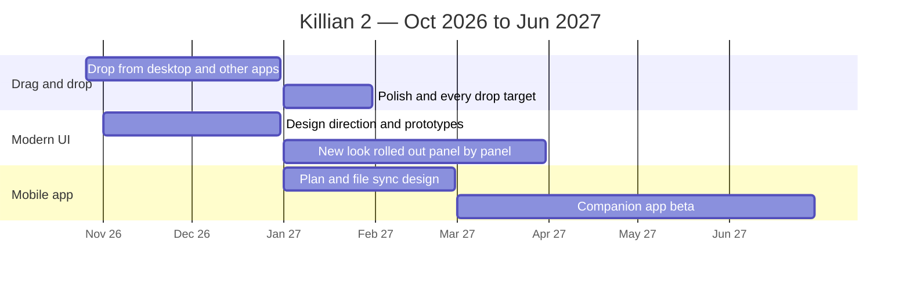

# Killian 2 Roadmap

*Q4 2026 – Q2 2027 · [ภาษาไทย](ROADMAP.th.md)*

Killian 2 is already usable day to day. This roadmap shows where we are heading, not a promise of dates.
Tell us what matters to you through **Help → Report a bug / Request a feature** inside the app.

## 1. Drag and drop from outside the app — Oct 2026 → Jan 2027

Drag files straight into Killian from the desktop, a file manager or another program.
Folders, images and chapter files already work; we will extend this to more file types and to every place that can sensibly accept a drop (Explorer, editor, panels), with clear feedback for what each drop will do.

## 2. A more modern UI — Nov 2026 → Mar 2027

A fresher, more modern look: refreshed layout, spacing, icons and themes, rolled out panel by panel so your layout and habits keep working.

## 3. Mobile app — Jan 2027 → Jun 2027

A companion app for reading, quick edits and notes on the go, built as a separate app that works with the same Markdown + JSON project files.

## Later (no date yet)

- **Signed installers** for Windows and macOS — planned for after the items above.

---
*Last updated: 2026-10-25. Shipped changes are listed in [CHANGELOG.md](CHANGELOG.md).*
