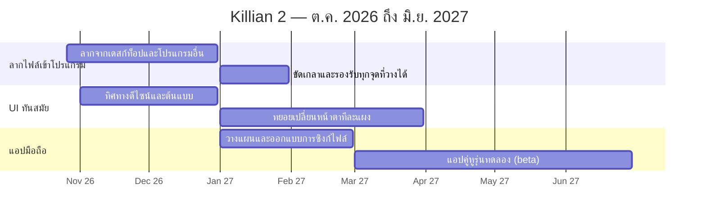

# แผนพัฒนา Killian 2

*ต.ค. 2569 – มิ.ย. 2570 (ต.ค. 2026 – มิ.ย. 2027) · [English](ROADMAP.md)*

ตอนนี้ Killian 2 ใช้งานได้จริงในชีวิตประจำวันแล้ว เอกสารนี้บอกทิศทาง ไม่ใช่คำสัญญาเรื่องวันที่
บอกเราว่าอะไรสำคัญสำหรับคุณผ่าน **ช่วยเหลือ → รายงานบั๊ก / ขอฟีเจอร์** ในโปรแกรม

## 1. ลากไฟล์เข้าโปรแกรมจากภายนอก — ต.ค. 2026 → ม.ค. 2027

ลากไฟล์จากเดสก์ท็อป ตัวจัดการไฟล์ หรือโปรแกรมอื่นเข้า Killian ได้ตรง ๆ
ตอนนี้โฟลเดอร์ รูป และไฟล์บทลากเข้าได้แล้ว จะขยายให้รองรับไฟล์ชนิดอื่นและทุกจุดที่ควรวางได้ (Explorer ตัวแก้ไข แผงต่าง ๆ) พร้อมบอกชัดว่าวางแล้วจะเกิดอะไร

## 2. UI ที่ทันสมัยขึ้น — พ.ย. 2026 → มี.ค. 2027

หน้าตาที่สดและทันสมัยขึ้น: ปรับเลย์เอาต์ ระยะห่าง ไอคอน และธีม ทยอยเปลี่ยนทีละแผง เพื่อให้เลย์เอาต์และความเคยชินของคุณยังใช้ได้

## 3. แอปมือถือ — ม.ค. 2027 → มิ.ย. 2027

แอปคู่หูสำหรับอ่าน แก้ไขเร็ว ๆ และจดโน้ตระหว่างเดินทาง เป็นแอปแยกที่ใช้ไฟล์โปรเจกต์ Markdown + JSON ชุดเดียวกัน

## ทำทีหลัง (ยังไม่กำหนดวัน)

- **ลงนามตัวติดตั้ง** บน Windows และ macOS — วางไว้หลังจบงานข้างบน

---
*อัปเดตล่าสุด: 25 ต.ค. 2569 · สิ่งที่ปล่อยแล้วดูได้ใน [CHANGELOG.md](CHANGELOG.md)*
