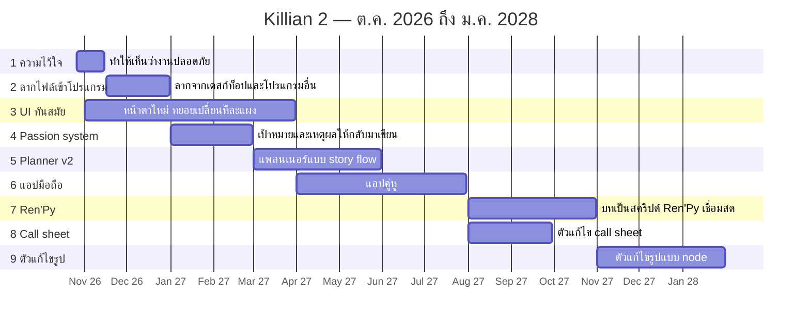

# แผนพัฒนา Killian 2

*ต.ค. 2026 – ม.ค. 2028 · [English](ROADMAP.md)*

Killian 2 อยู่ในช่วง **ทดสอบสาธารณะ (public test)** ใช้งานจริงได้แล้ว และไฟล์ของคุณเป็น Markdown + JSON ธรรมดาที่เปิดได้เสมอแม้ไม่มีโปรแกรม
ทุกอย่างด้านล่างเป็น **แผน ยังไม่ได้ทำ** เรียงตามความสำคัญ ทำพร้อมกันไม่เกินสองอย่าง และวันที่ขยับได้
บอกเราว่าอะไรสำคัญสำหรับคุณผ่าน **ช่วยเหลือ → รายงานบั๊ก / ขอฟีเจอร์** ในโปรแกรม

## ตอนนี้อยู่ตรงไหน

**ทดสอบสาธารณะ → Beta → Stable** ตอนนี้เราอยู่ช่วงทดสอบสาธารณะ จะเรียกว่า Beta เมื่อพื้นฐานไว้ใจได้สำหรับทุกคน (เช่น ตัวติดตั้งไม่ขึ้นคำเตือน และไม่มีบั๊กที่ทำให้งานหายค้างอยู่) ยังไม่มีกำหนดวัน

## แผน เรียงตามความสำคัญ

1. **ความไว้ใจ** — ต.ค. → กลาง พ.ย. 2026 ทำให้เห็นชัดว่างานปลอดภัย: สำรองอัตโนมัติ ประวัติเวอร์ชัน และถังขยะอยู่หน้าแรก ข้อความว่าไฟล์ยังเป็น Markdown ธรรมดา และอธิบายคำเตือนของตัวติดตั้งให้ชัด
2. **ลากไฟล์เข้าโปรแกรมจากภายนอก** — กลาง พ.ย. → ธ.ค. 2026 ลากไฟล์จากเดสก์ท็อป ตัวจัดการไฟล์ หรือโปรแกรมอื่นเข้า Killian ตรง ๆ ตอนนี้โฟลเดอร์ รูป และไฟล์บทลากเข้าได้แล้ว จะขยายให้รองรับไฟล์ชนิดอื่นและทุกจุดที่ควรวางได้
3. **UI ที่ทันสมัยขึ้น** — พ.ย. 2026 → มี.ค. 2027 ปรับเลย์เอาต์ ระยะห่าง ไอคอน และธีม ทยอยเปลี่ยนทีละแผง เพื่อให้เลย์เอาต์และความเคยชินของคุณยังใช้ได้
4. **Passion system** — ม.ค. → ก.พ. 2027 ช่วยให้คุณกลับมาเขียนต่อเนื่อง การเขียนวันละ 10 นาทีอย่างสม่ำเสมอ ดีกว่าเขียนหักโหมวันละ 5–10 ชั่วโมงเป็นครั้งคราว Killian จะช่วยสร้างนิสัยนี้: ตั้งเป้าหมายและบอกว่าเพื่ออะไร ดูความคืบหน้า และมีเหตุผลเบา ๆ ให้กลับมาเขียนพรุ่งนี้
5. **Planner v2** — มี.ค. → พ.ค. 2027 แพลนเนอร์ที่เน้น **story flow** ไม่ใช่กระดานอิสระแบบไวต์บอร์ด: ดูว่าฉากและเส้นเรื่องส่งต่อกันอย่างไร
6. **แอปมือถือ** — เม.ย. → ก.ค. 2027 แอปคู่หูสำหรับอ่าน แก้เร็ว ๆ และจดโน้ตระหว่างเดินทาง ใช้ไฟล์โปรเจกต์ชุดเดียวกัน (ทำงานกับโฟลเดอร์บน Drive, iCloud, Dropbox หรือ OneDrive ดูบท *ใช้หลายเครื่อง* ในคู่มือ) ระหว่างนี้แก้โฟลเดอร์เดียวกันบนมือถือด้วยแอป Markdown ใดก็ได้อยู่แล้ว
7. **เชื่อมต่อ Ren'Py** — ส.ค. → ต.ค. 2027 แปลงบทเป็น **สคริปต์ Ren'Py** แล้วเชื่อมต่อเพื่อเล่นได้ โดยสิ่งที่แก้ใน Killian จะไปปรากฏในเกมที่กำลังรันแบบ **สด**
8. **ตัวแก้ไข Call sheet** — ส.ค. → ก.ย. 2027 call sheet ที่ระบุว่า **แต่ละฉากต้องเรียกใครบ้าง** สร้างจากบทของคุณ รายชื่อนักแสดงจึงตรงกับสิ่งที่เขียนอยู่เสมอ
9. **ตัวแก้ไขรูปแบบ node** — พ.ย. 2027 → ม.ค. 2028 แก้ไขรูปด้วยกราฟ node ในโปรแกรม กราฟบันทึกเป็นไฟล์ **XML** รูปต้นฉบับจึงไม่ถูกแตะ และส่งออกเป็นรูปใหม่ได้เมื่อต้องการ

## ทำทีหลัง (ยังไม่กำหนดวัน)

- **ลงนามตัวติดตั้ง** บน Windows และ macOS
- **Beta** เมื่อพื้นฐานข้างบนไว้ใจได้

---
*อัปเดตล่าสุด: 25 ต.ค. 2569 · สิ่งที่ปล่อยแล้วดูได้ใน [CHANGELOG.md](CHANGELOG.md)*
