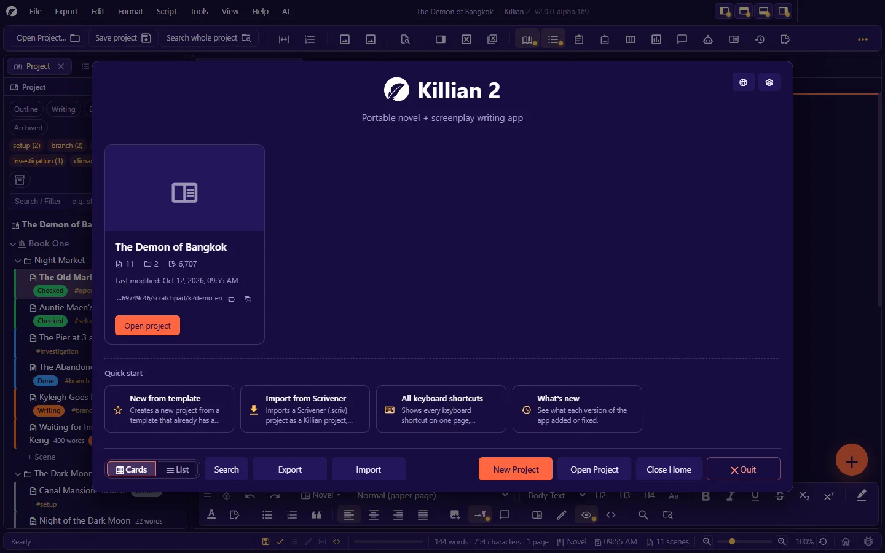
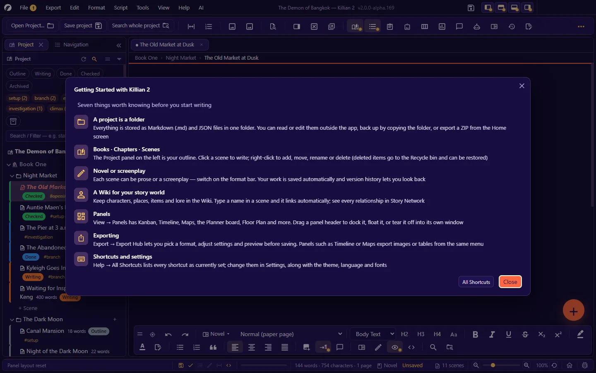

# 1. Getting started

**Language:** English · [ภาษาไทย](../th/01-getting-started.md)

[← Contents](README.md) · Next: [2. The interface →](02-interface.md)

---

## 1.1 System requirements

| | Minimum | Recommended |
|---|---|---|
| Operating system | Windows 10 64-bit · macOS (Intel x64, or Apple Silicon through Rosetta) · Linux x64 | Windows 10/11 64-bit · a current macOS/Linux |
| CPU | 2 cores, ~2 GHz | 4 cores or more |
| RAM | 4 GB | 8 GB (large projects · many panels open at once) |
| Disk space | ~500 MB free, plus room for your work | SSD · 2 GB free or more |
| Display | 1366 × 768 | 1920 × 1080 or larger |
| Graphics | Not required | WebGL support (used by Story Network's 3D mode and 3D models) |

- Windows 7 / 8 / 8.1 and 32-bit machines are **not supported**.
- The numbers above are **estimates** measured on a small project (about 460 MB of memory in use). The app has not been tested on low-end machines or on very large projects.
- The **internet** is used for only four things: calling an AI (if you set one up) · checking for and downloading updates · sending a bug report · viewing bug status. All writing works offline.

## 1.2 Download and launch

Download from the project's Releases page: <https://github.com/Nbcybg/Killian-Editor-V2/releases>

### Windows — portable `.exe`

1. Download the `.exe` (about 92 MB) and put it anywhere, e.g. `D:\Apps\Killian2\` or a USB stick.
2. Double-click it. **No installation and no administrator rights are needed.**
3. The first time, Windows SmartScreen may warn that the publisher is unknown. Choose **More info → Run anyway** (provided you downloaded it from the official Releases page).

Things to know about the portable build:

- Each time it starts, the app unpacks itself into a temporary folder (about 380 MB in `%TEMP%`). Leave room on your system drive; the first launch after a reboot is a little slower than usual.
- **Your user settings are not kept next to the `.exe`.** They live in `%APPDATA%\Killian 2\` (see [1.7](#17-where-the-app-keeps-its-data)). Moving the `.exe` to another machine therefore gives you a clean app — while **your writing lives in the project folder**, which you can move anywhere.
- To uninstall, delete the `.exe` (and delete `%APPDATA%\Killian 2\` if you also want to clear your settings).

### macOS — `.dmg` (Intel x64)

1. Open the `.dmg` and drag the app icon into Applications.
2. The app is **not code-signed yet**. The first time, right-click the icon → **Open** → **Open** again.
3. Apple Silicon machines (M1 and later) run it through Rosetta — there is no ARM build yet.

> On macOS the app's menus are in the system menu bar and shortcuts use `⌘` instead of `Ctrl`. The macOS build has been tested less than the Windows build.

### Linux

There is no packaged build yet — run it from source:

```bash
git clone https://github.com/Nbcybg/Killian-Editor-V2.git
cd Killian-Editor-V2
npm install
npm run build
npm start
```

## 1.3 First launch: the Home screen

When there is no recent project, the app always opens on **Home**.



| Part | What it does |
|---|---|
| Project cards | Projects you have opened before, with the number of scenes, chapters and words, the last-modified time and the folder path. The small buttons next to the path open the folder in your file manager / copy the path. A project whose folder can no longer be found shows **Cannot open**, with a **Remove from list** button. |
| **Quick start** | New from template · Import from Scrivener · All keyboard shortcuts · What's new |
| **Cards / List** | Switch how the project list is shown |
| **Search** | Find a project by title / author / file path |
| **Export / Import** | Export the open project as a `.zip` / import a project from a `.zip` |
| **New Project · Open Project · Close Home · Quit** | As named |
| Top-right buttons | **Language** (globe) and **Settings** (gear) — change the language, theme or shortcuts before you have even opened a project |

You can return to Home at any time: **View → Home**, or the house button at the end of the status bar.

**Choose what you see when the app starts**: **Settings → General → When the app starts** — Show Home (the default) · Open the last project right away · Open the last project, with Home on top.

**Change the app's language**: the globe button on Home, or **Settings → Language**. Seven languages are built in (ไทย · English · Deutsch · Français · 日本語 · Português · 简体中文). Details are in [chapter 13](13-language-themes-a11y.md).

## 1.4 Create a new project

**File → New project…** (`Ctrl+N`), or the **New Project** button on Home.

1. Pick the **kind of project** — the first choice is **Blank project**; the rest are templates (see the table below).
2. Pick the **parent folder** the project will be created inside, e.g. `D:\Writing\`.
3. Enter a **Project name**. The app creates a folder with that name inside the parent folder, along with a `project.khn.json` file. (You can change the title later in **Settings → Project info**.)
4. The app opens the project with a first book (named `Book 1`), a first chapter and a first scene. Rename them with right-click → **Rename**, or `F2`.

If that folder already contains a project with the same name, the app **opens the existing one** rather than overwriting it.

> **Choose the location with care.** A project is an ordinary folder, so it can live in a cloud-synced folder (OneDrive · Dropbox · iCloud) — but **never open the same project on two machines at once**, and let syncing finish before you open it on the other machine. A half-synced file may be unreadable. (The app keeps a copy of any file it cannot read and does not overwrite it — see [chapter 10](10-history-backup.md).)

### Create from a template

**File → New project from template…** (`Ctrl+Shift+N`) gives you a starting structure and starting Wiki categories:

| Template | What you get |
|---|---|
| **Blank project** | One book, one chapter, no starting Wiki categories — you build everything yourself |
| **Novel** | General novel structure — chapters + scenes + characters + locations |
| **Fantasy** | Fantasy novel — worldbuilding · races · magic |
| **Mystery/detective** | Mystery novel — suspects · clues · timeline |
| **Screenplay** | Three-act screenplay structure; scenes are written as screenplay |

A template is only a starting point — everything can be edited, added to or deleted afterwards.

## 1.5 Open an existing project

There are several ways; they all do the same thing:

- **File → Open project…** (`Ctrl+O`), then choose the folder that contains `project.khn.json`
- **File → Recent projects**, or a card on Home
- **Drag the project folder** from your file manager onto the app window
- From the command line: pass the project folder path as an argument, e.g. `"Killian 2.exe" "D:\Writing\My Novel"` (an already-running app takes over and opens it; no second window appears)

**Projects from Killian v1** (the older Python/Tkinter app) open immediately with no conversion, and files saved by Killian 2 still open in v1. For the small differences in file names, see [chapter 3](03-project-structure.md#38-names-on-disk-and-renaming-outside-the-app).

**If a project cannot be opened**, the app leaves the reason on the status bar and does not close the project you already had open. Common causes: the folder has no `project.khn.json` · that file is damaged (see [chapter 16](16-troubleshooting.md)).

## 1.6 Your first ten minutes

You can open **Help → Getting Started** in the app at any time — it sums up the same seven things as below.



1. **Look at the Project panel on the left.** It is the outline of your story: book → chapter → scene. Click a scene to write in it; right-click to add, move, rename or delete.
2. **Type in the writing area in the middle.** Save with `Ctrl+S` (the app also saves automatically, every 5 minutes by default).
3. **Choose the kind of scene.** Each scene is either a *novel* scene or a *screenplay* scene. Switch with the mode button on the format bar at the bottom, or `Ctrl+Shift+M`.
4. **Create your first character.** Press `Ctrl+Alt+3` and type a name. From then on, whenever you type that name in a scene, the app highlights it and links it to its Wiki page.
5. **Add scenes and chapters.** Use the floating **+** button at the bottom right, or `Ctrl+Alt+2` (scene) · `Ctrl+Alt+1` (chapter).
6. **Try opening a tool panel.** **View → Panels** — for example Kanban (`Ctrl+K`) or the Dashboard (`Ctrl+Alt+D`). Drag a panel's header to dock it at a side, float it, or combine it into tabs.
7. **Export.** **Export → Export Hub…** (`Ctrl+Shift+E`): pick a format, check the preview, save the file.

Lost? Hover over any button to read what it does, or open **Help → All Shortcuts…** (`Ctrl+Alt+/`).

## 1.7 Where the app keeps its data

There are two piles, kept strictly apart.

### (a) The project folder — your work

Everything that belongs to the story: scenes · Wiki · images · boards · history · trash · backups · the project's own settings. Move, copy or zip the whole folder and you have all of your work. (The full layout is in [Appendix D](D-file-formats.md).)

### (b) The user-data folder — this machine's

| System | Location |
|---|---|
| Windows | `%APPDATA%\Killian 2\` (you can type this straight into File Explorer's address bar) |
| macOS | `~/Library/Application Support/Killian 2/` |
| Linux | `~/.config/Killian 2/` |

Inside:

| File / folder | What it holds |
|---|---|
| `settings.json` | User-level settings (theme · language · editor font · shortcuts · accessibility, etc.) |
| `recent.json` | The recent-projects list |
| `sessions/` | Session state (open tabs · panel layout) and the permissions you gave to project plugins |
| `Plugins/` | Your user plugins (available in every project) |
| `languages/` | Language files you added yourself (if any) |
| `dictionaries/` | Downloaded spell-check dictionaries (if any) |
| `logs/` | The app's daily activity logs |

Nothing in this pile **travels with a project** — send a project to someone else and they do not get your theme, your shortcuts or your AI key.

> **AI provider keys** are stored in `ai-key.json` at the root of the project folder (separate from `project.khn.json`). The app's automatic backups and **Export → Whole project as ZIP…** **leave this file out**. But if you copy or zip the whole folder by hand, the file goes with it — delete it before you send the folder to anyone.

## 1.8 Quitting

**File → Quit**, or close the window. If anything is unsaved, the app shows **a list of everything pending** (document tabs · planning board · branching chart · floor plan, and so on) so you can choose what to save before closing. Nothing disappears silently.

The next time you start it, the app restores your open tabs and your panel layout.

---

Next: [2. The interface →](02-interface.md)
