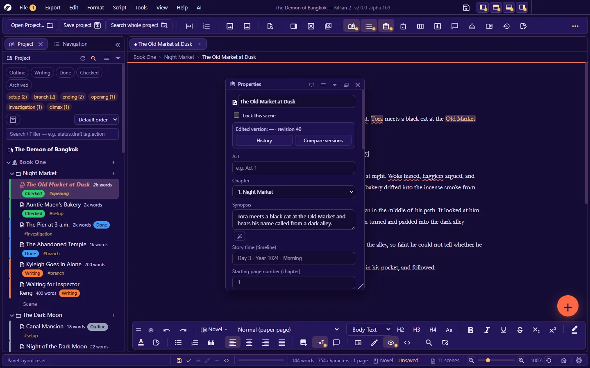
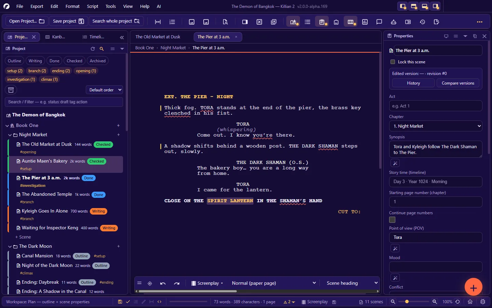
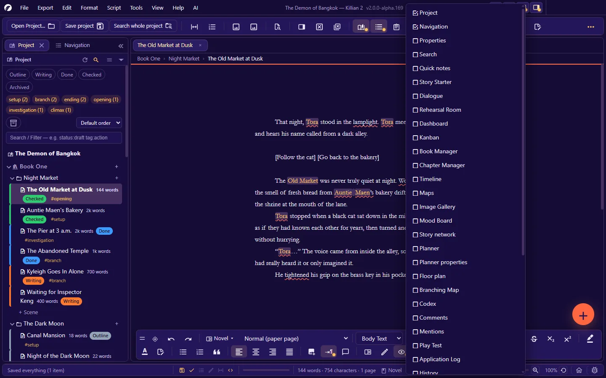
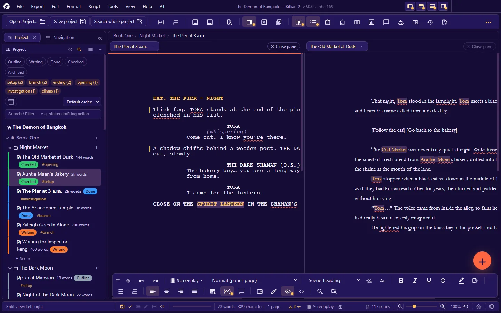

# 2. The interface

**Language:** English · [ภาษาไทย](../th/02-interface.md)

[← 1. Getting started](01-getting-started.md) · [Contents](README.md) · Next: [3. Projects, books, chapters, scenes →](03-project-structure.md)

---

The Killian 2 window is made of four horizontal bars and, between them, a central area that is a **panel system** you can arrange however you like.

| From top to bottom | What it is |
|---|---|
| **Title bar + menu bar** | Logo · the File/Edit/Format/Script/Export/Tools/View/AI/Help menus · the project title and version number · buttons that hide the panels on one side · the system's window buttons |
| **Toolbar** | The project buttons (open · save all · search the whole project) and buttons that show/hide panels and modes |
| **Panel area** | The Project panel · the writing area (document tabs) · any other panels you open — docked, floating, tabbed together, or torn off into their own windows |
| **Status bar** | The latest message · quick switches · today's goal · word/page counts · zoom · Home · Report a bug |

Two things also float over the writing area: the **format bar** (formatting buttons) and the **floating + button** (create something new).

## 2.1 Title bar and menu bar

- **Menus** — the full map is in [Appendix A](A-menus.md). From the keyboard: tap `Alt` (or `F10`), then `←` `→` to move, `Enter`/`↓` to open, `Esc` to leave.
- **Project title — Killian 2 vX.Y.Z** in the middle of the bar. The app's version number is always here (quote it when you report a bug).
- **Four buttons at the top right** — hide/show the panels docked on the **left · top · bottom · right**, one side at a time (press again to bring them back).
- **Minimise/maximise/close** are the real operating-system buttons. On Windows 11 you can hover the maximise button to use Snap Layouts.
- Drag an empty part of the title bar to move the window; double-click it to maximise/restore.

> On macOS the menus are in the system menu bar and the window buttons are the traffic lights at the top left.

## 2.2 Toolbar

At the far left are the **three project buttons, which cannot be hidden**: **Open Project…** · **Save project** (save all) · **Search whole project**.
After them come icon buttons arranged in groups, with a divider between groups:

| Group | Buttons |
|---|---|
| View and modes | Focus mode · Show line numbers |
| Insert | Image library · Visual telling (a storyboard for this scene) |
| Search | Quick open file |
| Tabs and screen | Split View · Close tab · Close all tabs |
| Panels | Project · Outline (Navigation) · Properties · Search · Manage panels · Kanban · Dashboard · All dialogue · Rehearsal Room · Encyclopedia · Activity history · Journal · Quick notes · Log |
| AI | AI tools (a combined menu) · AI Hub · AI tools · AI writing assistant · AI analysis · Story Starter |
| Story tools | Timeline · Map · Manage books · Chapter Manager · Relationship map · Planning board · Branching chart · Floor plan · Play-test · Mood board · Mentions |
| Add-ons | Plugins · Settings · Plugin Commands (appears once a plugin has registered a command) |
| Hide/show panels by side | Left · top · bottom · right |

- A **lit button** (with a coloured dot) means that panel or mode is on. Press it again to turn it off.
- A **dimmed button that cannot be pressed** is not available in the current context (for example, no document is open).
- When the **window is too narrow for all the buttons**, the ones that do not fit are collected under the **»** (three dots) button at the end of the bar.
- **Choose which buttons appear**: **Settings → Toolbar**, or **View → Panels → Customize toolbar…**, or right-click the bar. Tick a box and it takes effect at once. (By default 40 of the 46 buttons are on; the separate AI buttons are off, and you reach them through the **AI tools (menu)** button instead.)
- Hover over any button for a tooltip with its name, a description, and its shortcut as currently bound.

## 2.3 Document tabs and the breadcrumb

The writing area has a tab bar at the top — one tab per open file (scene · Wiki page · memo, and so on).

| To… | Do this |
|---|---|
| Switch tabs | Click · `Ctrl+Tab` / `Ctrl+Shift+Tab` (or `Ctrl+PageDown` / `Ctrl+PageUp` — use these inside a screenplay, where `Ctrl+Tab` cycles the element type instead) |
| Close a tab | The × on the tab · `Ctrl+W` · close all tabs with `Ctrl+Shift+W` |
| Reopen the tab you just closed | `Ctrl+Alt+Shift+Z` (steps back one tab at a time, in the order you closed them) |
| Reorder | Drag the tab |
| Find the tab's file in the tree | **View → Reveal Open File in Explorer** (`Ctrl+Shift+1`) |

- A tab with **unsaved** changes carries a mark, and that file's row in the Explorer changes colour.
- Closing a tab with unsaved changes **always asks first**.
- Too many tabs to fit: tab titles shrink to … (the active tab shrinks last).
- Under the tab bar is the **breadcrumb** `book › chapter › scene` of the open document.
- **No document open**: the writing area shows a hint and an **Open Dashboard** button.

## 2.4 The format bar

A bar of formatting buttons that floats at the bottom of the writing area (by default: against the bottom edge, centred).

**Buttons on the bar** (novel mode): grip · bring the bar to the mouse · undo/redo · **switch novel/script mode** · **page view** · block type (body text/heading/block quote) · H2 H3 H4 · cycle letter case · bold/italic/underline/strikethrough/subscript/superscript · highlight colour · text colour · quick note · bulleted/numbered list · block quote · four alignments · insert image · auto first-line indent · comment · reading mode · typewriter mode · hide line-prefix codes · view raw Markdown · find in document · search the whole project.

In screenplay mode the bar switches to the screenplay set (the element-type selector · character-name extensions · the CONTINUED switches, and so on).

| To… | Do this |
|---|---|
| Move the bar | Drag the **grip** at its far left |
| Snap it to the top/bottom edge | `Ctrl+Shift+;` |
| Bring it to the mouse position | `Ctrl+Shift+/`, or the target button on the bar |
| Lock/unlock it (so you cannot drag it by accident) | `Ctrl+Shift+=` |
| Cycle its opacity 100% → 50% → 5% | `Ctrl+Shift+'` (a faded bar becomes solid again when you hover over it) |
| All options + reset (position · opacity · lock) | **Right-click the grip** |
| Choose which buttons are shown | **Settings → Format bar** — set separately for 4 contexts: novel · screenplay · everywhere (Wiki/dashboard) · planning board |

The bar folds itself into a single row when space is tight, and never runs off the screen.

## 2.5 The floating + button (FAB)

A round button at the bottom right. Press it and it fans out "create" commands (by default: New scene · New chapter · New character · New location).

- **Assign up to 4 commands of your own** in **Settings → Floating button (FAB)** — pick from the groups Create / While writing / View-panels / File, and show them as an icon, icon + text, or text.
- **Move the button**: hold the right mouse button on it and drag.
- **Hide the button entirely**: **View → Floating button, bottom right (FAB)**.
- If the button's default position would cover the format bar, it moves up out of the way by itself (unless you have placed it yourself).

## 2.6 Status bar

The bar at the very bottom has fixed slots, each with a tooltip:

| Slot | Shows | Click to |
|---|---|---|
| **Message** (far left) | The result of what you just did. Ordinary messages fade after a few seconds; **error messages stay** until a new message arrives; some messages carry a link to a follow-up action. | — |
| **Quick switches** | Autosave · spell check · line numbers · typewriter mode · auto-fit page width · show Markdown codes | Turn it on/off (a switch that needs detailed options takes you to the right Settings page) |
| **Progress** | The bar for today's writing goal | — |
| **Document status** | `words · characters · pages` · the page the cursor is on · document type (Novel/Screenplay) · the last-saved time or "Unsaved" · in a screenplay, the format-check badge | The check badge opens the checker's menu (including the switch for the error markers) |
| **Scene count** | Scenes in the whole project | — |
| **Zoom** | − slider + · percentage · reset | Zoom the page |
| **Home** | A house | Open Home |
| **Report a bug** | A bug | Open the bug-report dialog |

When a project has a problem with its file registries (a missing file · a duplicated row, and so on), a warning badge appears on the status bar. Click it to open **Project health check**.

**Toasts** in the corner of the screen are used for things the app does on its own in the background (for example an automatic backup). Some have an **Undo** button.

## 2.7 The panel system

Every part of the window is a "panel", and you arrange panels the way you would in an image editor: **dock** one to an edge · **float** it over the writing area · **combine** several into a tab group · **collapse** it · **tear it off into a separate window** for another monitor.

### Opening and closing panels

- **View → Panels** — the full list, in 4 groups: Writing · Planning · Review · AI
- The panel's button on the toolbar, or the panel's shortcut (the `Ctrl+Alt+…` family — see [Appendix B](B-shortcuts.md#panels))
- **View → Panels → Manage panels (show/hide)…** — one dialog with every panel and a description of what each is for

A panel opened for the first time **docks** beside the writing area (narrow panels such as Properties on the right, wide ones such as the boards on the left), and joins an existing group of the same kind as a tab if there is one — it floats only when the window is too narrow to make room. You can always drag it out to float. The app remembers each panel's size and position (separately for when it floats and when it is docked), and a panel you left floating comes back floating in the same place.

### Buttons on a panel header

| Button | What it does |
|---|---|
| Move to a separate window | Tears the panel off into a system window you can drag to another screen. **Close that window** to bring the panel back. |
| ☰ Panel menu | Every command for this panel: float · tear off · close · arrange · "What is this" |
| ▾ Collapse | Collapses the panel to just its header; press again to expand |
| Float/dock | Lifts the panel out to float, or docks a floating panel back into the window (to its most recent position) |
| × Close | Closes the panel. Reopen it from the toolbar button or from View → Panels. |

Every button works from the keyboard (`Tab` to the button, then `Enter`/`Space`).

### Drag to arrange

- **Drag a panel header** to an edge of the workspace or of another panel → coloured zones show where it will be **inserted**; release to dock.
- **Drop it on another panel's header or tab bar** → the panels become a **tab group** (several panels stacked, switched by tabs).
- **Drag a tab out of the group** → it becomes a single panel again.
- **Hold `Ctrl` while dragging a floating panel** = move only, never dock.
- **Press `Esc` during a drag** = cancel; everything goes back where it was.
- **Drag the divider between panels** = change the proportions · double-click the divider = 50%.
- **Drag the bottom-right corner of a floating panel** = resize.

In a tab group: the × on a tab closes only that panel · the whole group can be collapsed to a narrow **icon bar** · a floating group has buttons to close or dock the whole group.

### Hiding panels temporarily (for a full-width writing area)

| To… | Shortcut |
|---|---|
| Hide/show all panels, leaving only the writing area | `Ctrl+\` |
| Hide the left-side panels | `Ctrl+Shift+[` |
| Hide the right-side panels | `Ctrl+Shift+]` |
| Hide one side at a time (left/top/bottom/right) | The four buttons at the top right of the window |

Press again to put the panels back where they were.

### Workspaces — saved panel layouts

**View → Arrange workspace → Workspaces…** (`Ctrl+Shift+Y`) switches the whole layout in one click.

| Built-in | Layout |
|---|---|
| **Essentials (default)** | The app's starting layout |
| **Write — clear screen with only the outline** | A narrow Project panel + a wide writing area |
| **Plan — outline + scene properties** | A Project/Kanban/Timeline tab group on the left · the writing area · Properties on the right |
| **Review — comments + notes** | Project/Navigation on the left · the writing area · Comments/Quick notes on the right |

Once you have arranged the panels the way you like, you can **save the layout as your own workspace** from the same menu. (Reusing a name overwrites your own workspace; the built-in ones cannot be edited or deleted.)

### The layout is broken, or a panel has gone missing

**View → Panels → Reset the whole panel layout** puts everything back to the defaults. Your writing is not affected.
To attach your layout to a problem report: **Export → Export panel layout (JSON)…**

## 2.8 Split View

Open two documents side by side, or the same scene at two different places.

- **View → Split View → Split left-right / Split top-bottom**, or `Ctrl+Shift+\`
- The new pane starts empty — **drag a tab into the pane**, or click the pane and then click a tab at the top.
- Drag the divider to change the proportions (double-click = 50%).
- You can split again, horizontally or vertically.
- **Remove from this pane** = the pane becomes empty, but the tab stays open · **Unsplit screen** = merge back into a single pane.
- From the Explorer: right-click a scene → **Open in split view**.

## 2.9 Dialogs, menus and tooltips

- **Dialogs**: `Enter` = the primary button (always the rightmost) · `Esc` = cancel/close · `Tab` cycles inside the dialog · drag the title to move it · double-click the title = back to the centre · a × at the top right.
- **Context menus** are almost everywhere — in a document (cut/copy/paste · formatting · spelling suggestions · synonyms · Rewrite this) · rows in the Explorer · panel headers · the toolbar · the format bar's grip · images · cards on the various boards. Move through a menu with `↑` `↓` `Enter` `Esc`.
- **Tooltips**: hover for a moment — you get the name, a description, and the current shortcut.
- **Long-running jobs** (building the search index · exporting a big file · reading the whole project) show a progress box with a **Cancel** button. The app's taskbar icon shows the progress, and flashes when the job finishes while you are in another window.

## 2.10 Dragging things in, and between panels

**From outside the app (your file manager):**

| Drop this | What happens |
|---|---|
| A project folder | That project opens |
| An image file | It is inserted into the document where you drop it, or added to the image library (if dropped on the library or a board) |
| A screenplay file (Fountain · FDX · Celtx · Adobe Story · Fade In) | The screenplay importer opens |
| Any other file | The app tells you which kinds of file it accepts |

**Inside the app ("pick up and drop"):** drag a scene · a Wiki page · an image from the Explorer or the image library onto another panel. For example: drop a scene on the timeline = create/reference an event · on the branching chart = place a scene card · on a map = mark where the scene happens · drop a character on a map/floor plan = add a pin/place the character · drop an entity's name on a document = insert the name. While you drag, a label beside the cursor says what you will get if you release there.

## 2.11 UI size versus page zoom (two separate things)

| | What it changes | How |
|---|---|---|
| **Page zoom** | The size of the document on screen (it does not change the real font size in the file) | `Ctrl+=` / `Ctrl+-` / `Ctrl+Shift+0` · `Ctrl+mouse wheel` · the slider on the status bar · **View → Zoom → Fit to page width** |
| **UI size** | Toolbars, panels, tabs, dialogs (75–200%) — documents are not touched | **View → UI size**, or **Settings → General → App shell size** |

**Auto-fit page width** (off by default): when the document pane is narrower than the page, the app shrinks the page to fit, and enlarges it again when the pane widens — never beyond the zoom you set yourself.

## 2.12 Simple mode

**View → Simple Mode** keeps only what you need to write: the Project panel (Explorer), the document, and the basic writing buttons (undo/redo, headings, bold/italic/underline, lists, find). Every other feature is still in the menus, and the **»** menu at the end of the toolbar lists the hidden buttons.

- Leave it with the **All tools** button on the toolbar, or the same menu item. Your toolbar, format bar and panel layout come back exactly as they were — simple mode never changes your own settings.
- On a brand-new installation the app starts in simple mode. Existing users keep their screen as it was after updating.

---

Next: [3. Projects, books, chapters, scenes →](03-project-structure.md)
