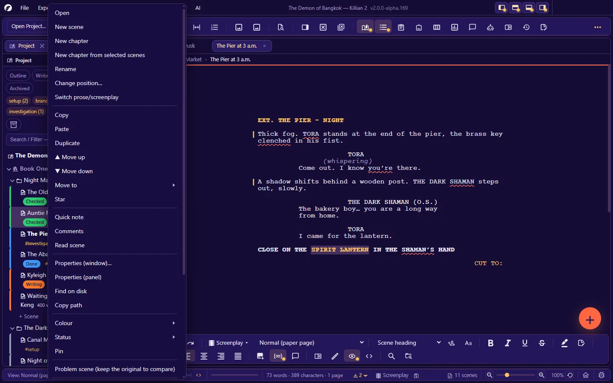
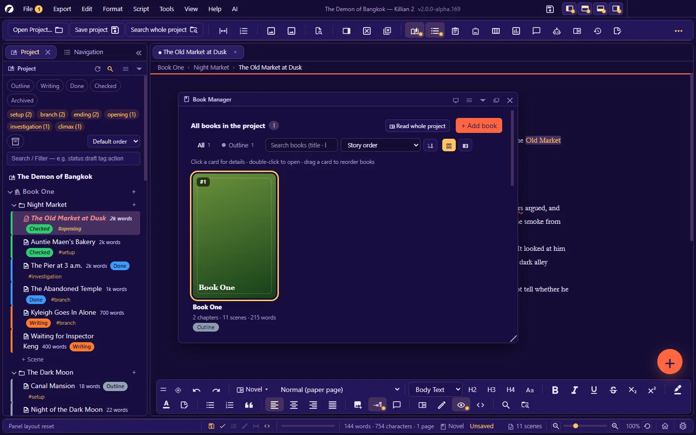
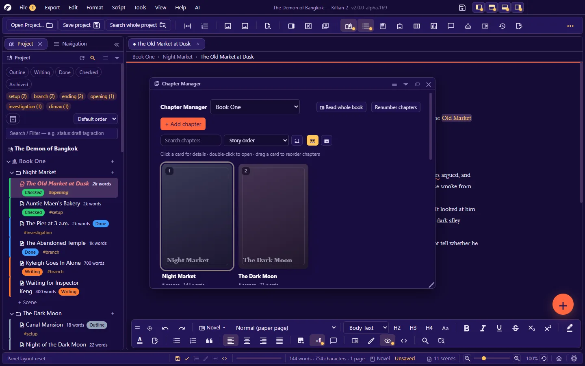
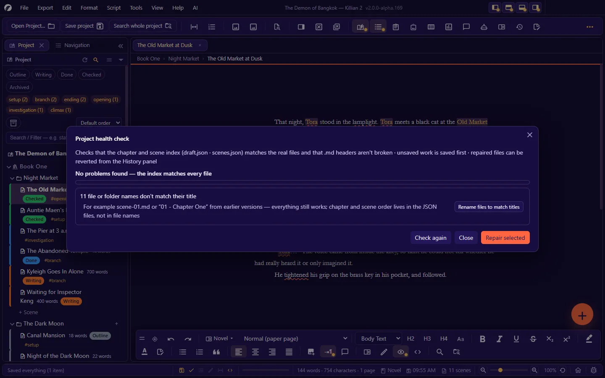

# 3. Projects, books, chapters, scenes

**Language:** English · [ภาษาไทย](../th/03-project-structure.md)

[← 2. The interface](02-interface.md) · [Contents](README.md) · Next: [4. Writing a novel →](04-writing-novel.md)

---

## 3.1 How a project is structured

```
Project (one folder)
├─ Book                       ← one work can have several books
│   └─ Draft                  ← a book can have several drafts, one of them the "main" draft
│       └─ Chapter
│           └─ Scene          ← the smallest unit = one .md file
├─ Memos                      ← notes and research, kept out of the manuscript
├─ Wiki                       ← characters, locations, items, lore, and categories you define
├─ Image library · planning boards · branch maps · floor plans · maps · timeline
└─ Trash · history · backups
```

| Term | Meaning |
|---|---|
| **Scene** | One `.md` file. Each scene is either a **novel** scene or a **screenplay** scene and has its own properties (status · synopsis · point of view · tags …). |
| **Chapter** | A container for scenes. It has a position, an act, a status, and optionally a chapter cover. |
| **Book** | A container for chapters = a top-level folder in the project. It has a cover, a blurb and a cast-of-characters page. |
| **Draft** | A copy of a whole book's structure, for trying out big changes without touching the original. |
| **Memo** | A free-standing note in the project. A memo can be turned into a scene, and a scene into a memo. |

The order of books/chapters/scenes is stored in registry files (JSON), **not in the file names** — you can drag things into a new order without any file being renamed.

## 3.2 The Project panel (Explorer)

The leftmost panel (`Ctrl+Alt+6`) is the table of contents for the whole work.



### Its parts, top to bottom

| Part | What it does |
|---|---|
| Panel header | **Refresh** (re-reads the project folder — use it after changing files outside the app) · **Search** (shows/hides the name search box) |
| Status chips | `Outline` `Writing` `Done` `Checked` `Archived`, plus any statuses you added. Click to show only scenes with that status (select several chips = any of them). |
| Tag chips | The tags used in the project with the number of scenes. Click to filter. |
| Archive button | Shows/hides scenes whose status is **Archived** (hidden by default — the scenes are all still there, just out of the way) |
| Sort box | The default order (story order) or another order |
| **Search / Filter** box | Type a word, or a field query such as `tag:action pov:Tora` — the full syntax is in [chapter 11](11-search-navigate.md#114-filters-in-the-project-panel) |
| Tree | Project title → book → (draft) → chapter → scene · a **+ Scene** row at the end of each chapter · a **+** button at the end of each book/chapter row |
| Other sections | Memos · Wiki (by category) · image library · planning boards · branch maps · the Pinned list · Trash |

### Reading a scene row

`icon  scene title  word count  [status badge]  #tags`, plus:

- **The coloured stripe at the left of the row** = the colour assigned to the scene (or its status colour)
- **Extra icons**: starred · pinned · locked · has comments · "problem scene" · the number of saved versions
- **A row in a different colour** = that scene's tab has unsaved changes
- Hover = a summary card (file name · status · tags · point of view · word count · synopsis)

### With the mouse

| To… | Do this |
|---|---|
| Open a scene | Click the row |
| Collapse/expand a book or chapter | Click the arrow in front of the row |
| Open the row's command menu | Right-click |
| Select several items | `Ctrl`+click or `Shift`+click — then copy/cut/duplicate/delete/move them all together |
| Reorder / move to another chapter | Drag the row |
| Use it in another panel | Drag a scene/Wiki page/image onto the timeline, branching chart, map, a board, and so on |

### With the keyboard

Click once in the tree (or `Tab` into it), then:

| Key | What it does |
|---|---|
| `↑` `↓` | Previous/next row |
| `Home` `End` | First/last row |
| `Enter` | Open the selected row |
| `F2` | Rename in place (scenes only — for other kinds of row use right-click → Rename) |
| `Shift+F10` | Open the row's context menu |

## 3.3 Context menus — for every kind of row

Items are listed in the order they actually appear. Items that do not apply in the context are not shown. **Find on disk** and **Copy path** are in every menu.

### The project-title row

| Group | Items |
|---|---|
| Structure | Add book · Rename |
| Go to | Quick open a file · Search the whole project · Dashboard · Kanban · Journal |
| Branching story | Play · Decision history · Branch map |
| Settings/files | Project settings · AI settings · Find on disk · Copy path |
| Tree | Expand all · Collapse all · Refresh |

### Book

| Group | Items |
|---|---|
| Structure | Add book · Rename · Change position… |
| Inside | New chapter · Duplicate · Star |
| Manage/read | Manage books · Manage chapters · Search in here · Read whole book |
| Special pages | Cast of Characters · Title Page… |
| Notes | Quick note · View quick notes |
| Properties/files | Properties (window)… · Properties (panel) · Find on disk · Copy path |
| Labels | Colour · Status · Pin |
| Protection | Lock · Back up · Restore from backup… |
| | **Delete (move to the trash)** |

### Chapter

| Group | Items |
|---|---|
| Structure | New chapter · New book from this chapter · Visual telling · Rename · Change position… |
| Inside | New scene · Copy · Paste · Duplicate · Move to (another book) · Star |
| Manage/read | Manage chapters · Manage scenes · Search in here · Read whole chapter · Read whole book |
| Properties/files | Properties (window)… · Properties (panel) · Find on disk · Copy path |
| Labels | Colour · Status · Pin |
| Protection | Lock · Back up · Restore from backup… |
| | **Delete (move to the trash)** — every scene in the chapter goes to the trash too |

### Scene

| Group | Items |
|---|---|
| Structure | Open · New scene · New chapter · New chapter from selected scenes · Rename · Change position… · Switch prose/screenplay |
| Move/copy | Copy · Paste · Duplicate · ▲ Move up · ▼ Move down · Move to (another chapter) · Star |
| Notes/read | Quick note · Comments · Read scene |
| Properties/files | Properties (window)… · Properties (panel) · Find on disk · Copy path |
| Labels | Colour · Status · Pin |
| Problem scene | Problem scene (keep the original to compare) · Switch original / revised · the Problem scene menu — see [chapter 5](05-writing-screenplay.md#510-problem-scenes--comparing-against-the-on-set-version) |
| Versions | Save this version · Version history… · Compare versions… |
| Other | Open in split view · Turn into memo |
| Protection | Lock · Back up · Restore from backup… |
| | **Delete (move to the trash)** |

### Memos · images · boards · branch maps

| Row | Items |
|---|---|
| The **Memos** section header | Open · New memo · Find on disk |
| A **memo** | Open · New memo · **New scene from this memo…** · Rename · Copy/Paste/Duplicate · Move up/down · Move to · Star · Quick note · Comments · Properties · Colour/Status/Pin · versions (save/history/compare) · Open in split view · Lock/Back up/Restore · Delete |
| The **image library** section header | Open image library · New album · Import image… · Mood board · Find on disk |
| An **image** | View · Insert into open scene · Rename (the app fixes the links in files that use this image) · Copy/Paste/Duplicate · Properties · Find on disk · Delete |
| The **planning boards** section header | New board · Open planner panel · Find on disk |
| A **board** | Open · New board · Rename · Copy/Paste/Duplicate · Star · Properties · Colour/Status/Pin · Lock · Delete |
| The **branch maps** section header | Open branch map panel · New plan · Find on disk |
| A **plan** | Open · New plan · Rename · Copy/Paste/Duplicate · Star · Properties · Colour/Status/Pin · Compare with another plan… · Lock · Delete |

## 3.4 Create, move, duplicate, delete

### Create

| Create a… | Fastest way |
|---|---|
| Scene | `Ctrl+Alt+2` · the **+ Scene** row at the end of a chapter · the floating + button |
| Chapter | `Ctrl+Alt+1` · the **+** button at the end of a book row |
| Book | Right-click the project title → **Add book** · or from the Manage books panel |
| Memo | `Ctrl+Alt+5` |
| Character / location | `Ctrl+Alt+3` / `Ctrl+Alt+4` |

A new book you did not name yourself is called `Book N` (always in English, because it is a folder name). You can rename it straight away.

### Move and reorder

- **Drag a row** to a new position (within the same chapter or into another one).
- Right-click → **▲ Move up / ▼ Move down** · **Change position…** (type the position you want) · **Move to** (choose the destination chapter/book).
- **New chapter from selected scenes** — select several scenes and gather them into a new chapter · **New book from this chapter** — lift a chapter out into a new book.
- Scenes cannot be moved between **drafts** (items that would cross drafts are skipped, and you are told).

### Copy, paste, duplicate

- **Copy → Paste** works for scenes, chapters, memos, images, boards and plans. **Duplicate** = a new item named with `(copy)` at the end, next to the original.
- If the original has unsaved changes, the app **saves it before copying** so the copy gets the latest text. If that save fails, the item is skipped and you are told.
- A copy of a scene takes its comments with it. A copy of a book/draft gets a fresh set of internal ids, so nothing clashes with the original.

### Delete

**Deleting always means moving to the project's trash** (the `Recycle/` folder). Restore from the **Trash** section at the bottom of the tree. See [chapter 10](10-history-backup.md#105-the-trash).

- If the file being deleted is open in a tab with unsaved work, the app saves it first. If the save fails, **the delete is cancelled**.
- Anything that is **locked** cannot be deleted until you unlock it.

## 3.5 Scene properties

There are two ways in: the **Properties panel** (`Ctrl+Alt+I` — it follows whichever tab is active), or right-click → **Properties (window)…**

| Field | What it is for |
|---|---|
| **Scene title** | Edit and press `Enter` — the file name on disk follows |
| **Lock this scene** | Once locked, the text cannot be edited and the scene cannot be moved or deleted until you unlock it |
| **Version** | The **History** and **Compare versions** buttons |
| **Act** | Belongs to the chapter — every scene in the same chapter shares the act |
| **Chapter** | Choosing another chapter moves this scene to the end of that chapter |
| **Synopsis** | A short summary of the scene. Used in Kanban · on various cards · when exporting "synopsis instead of text" |
| **Story time** | For example `Day 3 · Year 1024 · Monday morning`. Scenes that have this set appear on the **Timeline** automatically |
| **Starting page number** / **Continue page numbers** | The page number this scene starts at, or continue from the previous scene/chapter in the same book |
| **Point of view (POV)** | Who is telling it |
| **Mood** · **Conflict** | Plot notes; used by analysis and by filters |
| **Status** | See [3.6](#36-scene-statuses) |
| **Colour** · **Tags** | Labels for grouping and filtering |
| **Note** · **Future Note** | Notes to yourself — not part of the story, never exported |
| **Flashback / Flashforward** | Flags for a scene told out of time order |
| **Mentioned in this scene** | Wiki names found in the scene's text (click to open the Wiki page) |
| **Show on map** / **Plans for this scene** | Shortcuts to the scene's pin on a map, and to the floor plans attached to the scene |

- The **✨ button beside a field** (synopsis · point of view · mood · conflict) asks the AI to read the scene and fill in that field. (You must set up AI first.)
- Every value is **saved automatically as you type**, and is stored in the **frontmatter of the scene's own `.md` file**. You can edit it in another program too, and then use **Tools → Sync scene properties from the .md file** to make the app read it back.

**Chapter properties**: title · act · status · date/deadline · Key chapter (Favorite) · chapter note · chapter cover
**Book properties**: title · blurb · cover · status · colour · tags · note

## 3.6 Scene statuses

The starting statuses are **Outline · Writing · Done · Checked · Archived**.

- Change a status: right-click → **Status** · the Properties panel · or **drag the card to another column in Kanban**.
- **Add/delete/recolour/reorder/hide statuses**: **File → Settings → Manage scene statuses…**, or from the header of the Kanban board (adding a column = adding a status to the whole project).
- **Export/import a status set** as a `.json` file to use in another project (importing merges with what you have; nothing is deleted).
- Deleting a status that scenes still use: those scenes **keep their value** until you change it yourself (in the selector it shows as "… (removed from the list)").
- **Archived** scenes are hidden from the tree by default — press the archive button in the Explorer to show them.

## 3.7 Star, pin, lock, colour — how they differ

| Label | Meaning | Effect |
|---|---|---|
| **Star** | Important / a favourite | A star icon · filterable (`flag:1`) · counted on the dashboard |
| **Pin** | Something you want quick access to | Appears in the Explorer's **Pinned** list — **the real row does not move** (scene order is the story) |
| **Lock** | Must not be changed | The text cannot be edited; no rename, move or delete · locking a book/chapter locks every scene inside · **Find and replace in project** skips locked scenes |
| **Colour** | Grouping by eye | A coloured stripe on the row · on the Kanban card · filterable by colour code (`color:#6fae6f`) |

Manage the set of colour tags: **File → Settings → Manage colour tags (Visual Tags)…**

## 3.8 Names on disk, and renaming outside the app

- **Names on disk follow titles.** Rename a book/chapter/scene in the app → the folder/file is renamed to match. (Characters a file system will not accept, such as `: ? /`, are dropped from the file name, but the title keeps them. If two names collide, a number is added: ` 2`.)
- **A book's title must match its folder name**, and must not be the same as one of the app's own folders (for example `Wiki`, `Images`, `Planners`, `Recycle`). If you type a clashing name, the app asks you to choose another.
- **You can rename things in your system's file manager.** When you return to the app window (or press Refresh in the Explorer), the app pairs "what went missing" with "what newly appeared", then updates the titles and registries to match. Open tabs and unsaved work follow along. In an ambiguous case (two things missing and two new ones, with no evidence which is which) the app **does not guess** — it reports it in Project health check instead.
- **Older projects** whose files are named `scene-01.md`, or whose folders are named like `01 - Chapter One`, work normally and are not treated as a problem. They get title-based names when you rename or move them, or when you press **Rename files to match titles** in the health-check dialog.

> A `.md` file you drop into a chapter folder from outside the app is **not registered automatically yet**. Project health check reports it as "a file no scene refers to" and offers **Attach it as a scene in this chapter**.

## 3.9 Drafts

A book can have several drafts — use them to tear the structure apart while the original stays intact.

- Manage them in the **Manage books** panel (`Ctrl+Alt+K`): **+ new draft** (copy the structure from the selected draft, or start empty) · **Set as main** · rename a draft · delete a draft (the main draft cannot be deleted).
- The **Draft** row in the Explorer chooses which draft the tree shows. Kanban has its own draft selector.
- The **main draft** is the one used for exporting · statistics · Read whole book.

## 3.10 Manage books and Chapter Manager

"Library"-style panels for working on the whole set.



**Manage books** (`Ctrl+Alt+K`) — a cover card for every book: click = details · double-click = open the book · drag = reorder.
Edit the title · blurb · cover (choose an image/remove the cover) · status · drafts · see statistics (chapters · scenes · words) · export · search · sort by story order/title/status/last edited/word count · switch between cover and list view.



**Chapter Manager** (`Ctrl+Alt+Shift+K`) — choose a book and see all its chapters: drag to reorder · edit titles · change status · **Renumber chapters** (names the chapters by number, in order, across the whole book) · statistics (scenes · words) · and the **chapter cover**:

- Tick **Use chapter cover** → the cover counts as a real page, both in Read whole book and when page numbers run on.
- Add a cover image and/or text on the cover · **Use full-page image** = the image fills the whole sheet with no chapter title over it.
- The app tells you the recommended image size for the paper size you chose.

> You can only drag to reorder while sorted by **story order** and with no filter or search active (the order you see in any other sort is not the real order).

## 3.11 Memos

A memo is a `.md` file in the project's `Memos/` folder. Use memos for ideas, research, or anything you do not yet know where to put.

- Create one: `Ctrl+Alt+5`. You write in it just like a scene (it has version history, comments and locking).
- **New scene from this memo…** — choose the destination chapter · **Turn into memo** (from a scene) — takes the scene out of the manuscript and keeps it as a note.
- Memos are **not counted** when the app decides whether a document is a novel or a screenplay, and can be dropped from an export with the "Remove notes (memos)" step.

## 3.12 Project health check

**Tools → Project health check** (`Ctrl+Alt+Shift+D`) checks that the chapter/scene registries match the real files, and that file headers are not broken.



| Problem checked | Repair offered |
|---|---|
| A scene points to a file that does not exist | Create an empty file |
| A `.md` file that no scene refers to | Attach it as a scene in this chapter |
| Two scenes use the same file | Give it its own copy of the file |
| A chapter has no folder | Create a new folder |
| A folder that is not in the chapter list | Add it back as a chapter, with the scenes inside |
| A broken file header (frontmatter) | Repair the header (it tells you which values it recovered) |
| A damaged JSON registry · a scene with no chapter | Reported — you have to fix it yourself |
| File/folder names that do not match titles yet | (Not a problem) a button to rename the whole set to match |

Tick the items you want, then press **Repair selected** · **Check again** to confirm.
When a project has a problem, a warning badge on the status bar brings you here.

---

Next: [4. Writing a novel →](04-writing-novel.md)
