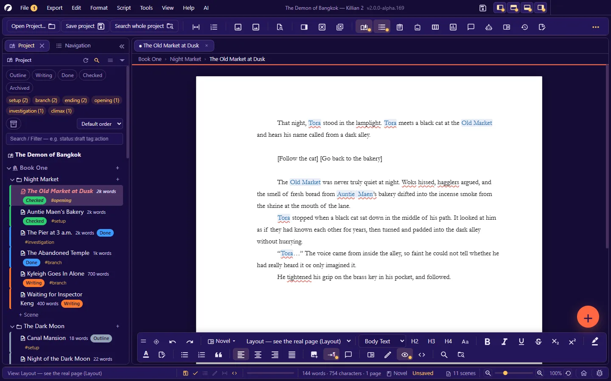
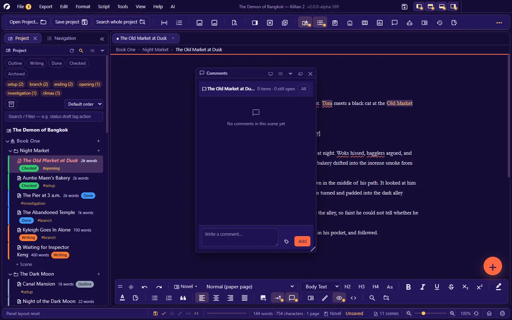

# 4. Writing a novel

**Language:** English · [ภาษาไทย](../th/04-writing-novel.md)

[← 3. Projects, books, chapters, scenes](03-project-structure.md) · [Contents](README.md) · Next: [5. Writing a screenplay →](05-writing-screenplay.md)

---


Every scene has its own mode: **Novel** (prose — this chapter) or **Script** (screenplay — [chapter 5](05-writing-screenplay.md)). Switch with the mode button on the format bar · **Format → Document mode** · or `Ctrl+Shift+M` (the existing text is converted to the other mode's syntax).

The editor is WYSIWYG — what you see is what you get when you export — but the file that is saved is **plain Markdown** that any other program can open.

## 4.1 Typing basics

| To… | Do this |
|---|---|
| Start a new paragraph | `Enter` |
| Start a new line in the same paragraph | `Shift+Enter` |
| **Force a new page** | `Ctrl+Enter` (inserts a "Page break" block) |
| Undo / redo | `Ctrl+Z` / `Ctrl+Shift+Z` or `Ctrl+Y` — steps back through everything, formatting included, to when you opened the scene |
| Cut / copy / paste | `Ctrl+X` / `Ctrl+C` / `Ctrl+V` |
| Paste as plain text (no formatting) | `Ctrl+Shift+V` (**Edit → Paste as plain text**) |
| Select all | `Ctrl+A` |
| Delete the whole line the cursor is on | `Ctrl+Shift+Delete` |
| Non-breaking space (keeps words together, e.g. a number and its unit) | `Ctrl+Shift+Space` |
| Save | `Ctrl+S` (this scene) · `Ctrl+Alt+S` (everything pending) |

Right-clicking in a document gives a single menu with everything: cut/copy/paste · formatting · suggestions for a misspelled word · synonyms · Rewrite this (AI), and more.

## 4.2 Character formatting

| Format | Shortcut | Stored in the file as |
|---|---|---|
| **Bold** | `Ctrl+B` | `**text**` |
| *Italic* | `Ctrl+I` | `*text*` |
| Underline | `Ctrl+U` | `_text_` |
| ~~Strikethrough~~ | `Ctrl+Shift+X` | `~~text~~` |
| Superscript | `Ctrl+Alt+=` | `^text^` |
| Subscript | `Ctrl+Alt+-` | `~text~` |
| Text colour | The **A** button on the format bar | `<span style="color:#rrggbb">…</span>` |
| Highlight colour | The highlighter button | A background-colour span — saved in the file too |
| Clear formatting | `Ctrl+Space` or `Ctrl+Alt+Space` | — |

**Text colour** opens a colour picker: preset swatches · a colour wheel · recently used colours · your saved set (add/remove). It is available in novel mode only, and the colour travels with the exported file (you can choose to export in black and white).

**Change Case**, for Latin letters: **Format → Change Case** has 7 styles — Sentence case · lower case · UPPER CASE · Capitalize Case · aLtErNaTe cAsE · Title Case · iNVERSE cASE — or press `Ctrl+Alt+U` to cycle through them.

**Special characters**: **Format → Special character map…** inserts symbols that are not on your keyboard.

## 4.3 Paragraphs, headings, lists

| Format | Shortcut | Stored in the file as |
|---|---|---|
| Heading 1 / 2 / 3 | `Ctrl+1` / `Ctrl+2` / `Ctrl+3` | `# ` / `## ` / `### ` |
| Heading 4 | The H4 button on the bar | `#### ` |
| Body text (removes a heading/block quote) | `Ctrl+0` | — |
| Block quote | The quote button on the bar | `> ` |
| Bulleted list | `Ctrl+Shift+8` | `- ` |
| Numbered list | `Ctrl+Shift+7` | `1. ` |
| Code block | **Format → Code block** | ` ``` ` |
| Divider | **Format → Insert divider (---)** | `---` |
| Align left / centre / right / justify | `Ctrl+Shift+L` / `K` / `R` / `J` | A formatting comment, `<!--align:…-->` |

- **Headings** are what the Navigation panel and an exported file's table of contents use. Set how they look (size/bold/italic/spacing/alignment/automatic chapter numbers) in **Settings → Novel format**.
- **The list buttons are toggles**: if the whole selection is already that kind of list, the button removes it; otherwise it turns the selection into that kind. Pressing `Enter` on an empty item leaves the list.
- **Alignment travels with the exported file** (including list items and paragraphs inside a block quote).
- **Auto first-line indent** (the first line of each paragraph is indented, as in a printed book): a button on the format bar. Set the distance in **Settings → Novel format → First-line indent** (0.5 in by default; the first paragraph after a heading is not indented, following the usual convention — you can change that).
- **Tab width** can be set as a number of spaces, in inches or in cm. It applies both on screen and in exported files.

## 4.4 Images in a document

**Insert an image**: `Ctrl+Shift+I` · the insert-image button on the bar · drag an image file in from your computer · drag from the Image library panel.
The image is **copied into the project's `Images/` folder** for you. Every format Chromium can display is supported: PNG · JPG · GIF · WebP · SVG · AVIF · BMP · ICO.

**A whole-line image** (an illustration) — right-click the image:

| Option | Effect |
|---|---|
| **Full page** | The image fills the whole page, edge to edge — right for the full-page illustrations of a light novel (that page prints no page number) |
| **Width %** | 1–100% of the width of the print area |
| **Corners** | The corner radius in pixels (0 = square) |
| Caption / alt text | Editable from the same menu |

These options are stored in standard Markdown's "title" slot: ``. The file therefore still opens in other programs, and the image looks the same on screen, in layout view, in the export preview and in the real file.

**An image inside a paragraph** (on the same line as text): write `text  text`. The height is in **lines** (`h=2` = two lines tall).

An image taller than one page is limited to fit the print area. Manage all the project's images in the [image library](06-wiki-world.md#67-the-image-library).

## 4.5 The page, and how you view it

### Six page views

Choose with the view selector on the format bar, or **View → Page view**. The view belongs to the open scene — each tab remembers its own.

| View | What you see | Use it when |
|---|---|---|
| **Normal (paper page)** | Continuous writing at the width of the page, with no page breaks | Everyday writing |
| **Layout — see the real page** | Real sheets of paper, one after another, broken exactly as the exported file will be, with page numbers | Checking page breaks · placing images |
| **Draft — plain text** | No paper, just the text | Writing fast on a small screen |
| **Side-by-side pages** | Left and right pages, like an open book | Seeing it as a book |
| **Overview 4px/character** | Shrunk until you see the shape of several pages | Judging rhythm/density |
| **Overview 1px/character** | Shrunk as far as it goes; the shape of the whole piece | The big picture |



- **Page margin guides**: **View → Page view → Page margin guides** — a dashed line around all four sides of the print area.
- **Paper colour on screen**: **Settings → Editor → Paper colour** — White · Cream · Sepia · Light grey · Mint · Dark · or your own choice. (Printing and PDF export are always on white.)
- **The app theme never changes the paper colour.** A theme only styles the shell (bars, panels, dialogs).

### Paper size and margins

**Format → Paper · margins…** (or **Settings → Paper**) — shared by novel and screenplay modes, and stored per project.

- **Paper size**: Letter · A4 · Legal · Digest · US Trade · Compact/Novella · Mass Market · Bunkobon/A6 · Tankōbon · Pocket Book · A5 · Custom
- **Margins**: presets (Normal — 1 in · Narrow · Moderate · Wide · Screenplay · Novel (manuscript submission) · A4 narrow · A4 normal), or type all four sides yourself
- The dialog shows the **print area** and the number of lines per page straight away.

### How the body text is formatted

**Format → Novel format…** (or **Settings → Novel format**): font size (pt) · line spacing · space between paragraphs · first-line indent · Tab width · default alignment · font/colour/size of headings h1–h6 · automatic chapter numbers · how block quotes look. There are two preset buttons, **Set to standard novel style** and **Manuscript for publishers (double-spaced)**. Every field is described in [chapter 12](12-settings.md#novel-format-project).

These settings apply **both on screen and when exporting**.

### Page numbers

- On/off: **Settings → Scene & page numbers (script) → Show page numbers** (one switch for both novels and screenplays).
- Each scene's **Starting page number** and **Continue page numbers** (carry on from the previous scene/chapter in the book) are set in the scene's properties.
- A book cover is not numbered · a chapter cover is · a full-page image page prints no number.

### Line numbers

`Ctrl+Alt+R` — shows line numbers in the left rail of the writing area (counted per paragraph/block). Handy for pointing at a place when discussing the text. They are on screen only and never printed.

## 4.6 Zoom and writing modes

| Mode | Shortcut | What it does |
|---|---|---|
| Zoom in / out / reset | `Ctrl+=` / `Ctrl+-` / `Ctrl+Shift+0` | Zoom the page (or `Ctrl+mouse wheel`) |
| Fit to page width | **View → Zoom** | Sets the zoom so the page exactly fits the writing area |
| **Focus mode** | `Ctrl+Shift+D` | Hides everything around the writing area, leaving only the page, and dims the other lines so the one you are writing stands out (set how dim in Settings → Editor) |
| **Reading mode (full screen)** | `Ctrl+Shift+H` | Hides the toolbar and all panels, leaving only the page · `Esc` to leave |
| **Typewriter mode** | `Ctrl+Shift+T` | Keeps the line you are typing in the middle of the screen; the page scrolls to you |
| **Typewriter sound** | **Tools → Accessibility** | Key clicks · space · backspace · a bell at the end of the line |
| **Read whole book** | `Ctrl+Alt+Shift+R` | Joins every scene of the book into one read-only document, shown page by page |
| Full screen | **View → Full screen** | The window fills the screen |

**Read whole book**: choose a book (or the whole project) · `←` `→` / `PageUp` `PageDown` / `Space` turn pages · `Home` `End` · type a page number and press `Enter` to jump · switch single/double page · `Ctrl+wheel` zooms · `Esc` leaves. The page numbers you see are the same set as the editor's running page numbers.

## 4.7 Spell check

On by default (**Settings → Editor → Spell check**). It underlines words that look misspelled, **in both Thai and English, offline**, using the app's own dictionary.

Right-click an underlined word:

- **Suggestions** — choose one and it replaces the word immediately
- **Ignore "word" once** — stops underlining this word for this session (it is not remembered)
- **Add "word" to the dictionary** — remembered permanently in this project (the `dictionary.json` file)

Worth knowing:

- Words of 2 characters or fewer, and words longer than 65 characters (links · codes), are not checked.
- You can add whole word lists: put `.txt` files (one word per line; lines starting with `#` are comments) in `<project>/Plugins/dictionaries/`.
- The built-in English word list is not exhaustive, so less common English words may be underlined — add them to the dictionary, or drop in a larger word list as described above.
- Turning off **Use the app's dictionary** leaves only Chromium's checker, which is English-only and must first download its dictionary from the internet. In general, **leave it on**.
- The underlines are on screen only; they never appear in print or in exported files.

## 4.8 SmartType — completing names from the Wiki

Type the first 2 or more letters of a name in the Wiki → a list of names pops up.

| Key | What it does |
|---|---|
| `↑` `↓` | Choose a name |
| `Tab` | Accept the chosen name |
| `Esc` | Close the list |
| `Enter` | A normal new line (does not accept the name) |

In a screenplay, SmartType also remembers character names you type repeatedly. If it remembers something wrong, remove it in **Script → Manage SmartType (remove wrongly remembered words)…**

## 4.9 Wiki names in the text

With **Auto-detect Wiki names** on (the default), the names and aliases of Wiki entities that appear in a scene are highlighted.

- **`Ctrl`+click** a name = open that Wiki page
- For an explicit link, type `[[Name]]` or `[[Name|text to show]]`
- The highlight is on screen only and is not exported. The names found in a scene are listed in the Properties panel ("Mentioned in this scene") and in the **Mentions** panel (`Ctrl+Alt+Shift+B`).

## 4.10 Thesaurus

**Tools → Thesaurus…** (`Ctrl+Alt+Shift+T`), or right-click a word — finds synonyms and antonyms of the selected word and lets you replace it on the spot.

- By default it uses the **built-in Thai thesaurus** (offline).
- Turning on **Settings → Automation → Thesaurus (synonyms/antonyms)** also sends the selected word out to look up synonyms on the internet (off by default) — this is what provides results for English words.

**Repeated words and word-use statistics**: **Tools → Find repeated words · word usage statistics (Word History)…** — catches verbal tics and words you use too often.

## 4.11 Three kinds of notes (kept out of the manuscript)

| Kind | Open with | What it is |
|---|---|---|
| **Quick note** | `Ctrl+Shift+Q` | Jot down a thought without leaving the scene. The note is attached to the scene that was open when you wrote it. You can tick **To do later**. |
| **Quick notes** (panel) | `Ctrl+Alt+8` | All quick notes together, plus free-standing ones · a note can be moved into a memo · see them all: **Edit → View all notes…** |
| **Memo** | `Ctrl+Alt+5` | A full note file in the project ([chapter 3](03-project-structure.md#311-memos)) |

In addition, scene properties have a **Note** and a **Future Note** field for each scene.

## 4.12 Comments

Leave remarks attached to a piece of text — for an editor, a beta reader, or a reminder to yourself.



1. Select some text in the scene.
2. Press the comment button on the format bar (or open the panel with `Ctrl+Alt+O` · **Edit → Comments in this scene (panel)**).
3. Type and send — the comment is anchored to the selected text.

- **Reply** as a thread · **Resolve this thread** · **Reopen this thread** · edit/delete
- Hover over a comment = the text is highlighted in the scene · click = scroll to it
- Filter: **All / Open only**
- If the anchored text is edited or deleted, the comment stays but says the anchored text could not be found.
- Comments are stored **in the scene's own `.md` file** (a block at the end of the file), so they always travel with the file. They are not exported with the manuscript.

## 4.13 Shortcodes and Wiki variables

A **shortcode** is text in square brackets that is replaced by a real value **at export time** (when the workflow has the "Expand shortcodes" step turned on). Insert one from **Format → Insert shortcode…**

| Group | Codes |
|---|---|
| About the work | `[title]` `[author]` `[project]` `[book]` `[language]` `[appversion]` |
| Where this code sits | `[chapter]` `[chapterno]` `[scene]` `[sceneno]` `[status]` `[pov]` `[synopsis]` `[tags]` `[emotion]` `[conflict]` `[note]` `[futurenote]` `[storydate]` `[color]` `[flag]` `[locked]` `[chapterstatus]` `[chapteract]` `[chapterdate]` `[chapterflag]` |
| Numbers | `[words]` `[chars]` `[pages]` `[totalwords]` `[totalscenes]` `[totalchapters]` `[totalbooks]` `[totalcharacters]` `[totallocations]` `[dailygoal]` `[projectgoal]` `[progress]` `[commentcount]` |
| Date and time | `[date]` (accepts a format, e.g. `[date:iso]` · `year` · `time`) `[time]` `[year]` `[weekday]` |
| Data from the Wiki | `[wiki:Tora.age]` `[var:age]` `[field:age]` `[entity]` `[entitycat]` `[entitysummary]` `[entitytags]` `[relation:father]` |

Rules:

- A code the app **does not recognise is left as it is** (a typo shows up in the file; it does not vanish silently).
- To print `[title]` literally, write `[[title]]`.
- `[tags sep=", "]` — some codes take options in the form `key=value`.
- Square brackets containing text that is not a shortcode name, e.g. `[Go to the market]`, are not shortcodes. That form is used for the **choices of a branching story** ([chapter 7](07-planning.md#75-branching-chart-and-play-test)).

**Wiki variables** `{{Name}}` / `{{Name.field}}` — for example `{{Tora.age}}` is replaced by that entity's field value when the workflow has the "Expand {{name}} variables from the Wiki" step turned on.

Shortcodes also work in Wiki page fields · AI chat · comments and in **export file names**.

## 4.14 Seeing what is really written to the file

- **View the raw Markdown of this scene** (the `<>` button on the format bar) — shows the text exactly as saved in the file.
- **Hide/show line-prefix codes** (**View → Hide line-prefix codes**) — hide them for easy reading, or show them to see the real structure. The file is not changed either way.
- The full file syntax: [Appendix D](D-file-formats.md#syntax-of-a-scene-file-md)

## 4.15 Word counts and goals

- The status bar shows `words · characters · pages` for the open document. (Thai words are counted with a word segmenter, not by spaces.)
- **Daily / whole-project word goals**: **Settings → Project info → Word count goals**. The progress bar on the status bar and the dashboard read from these.
- **Writing sprint** (`Ctrl+Alt+Shift+S`) — timed writing rounds ([chapter 7](07-planning.md#79-writing-sprints)).

---

Next: [5. Writing a screenplay →](05-writing-screenplay.md)
