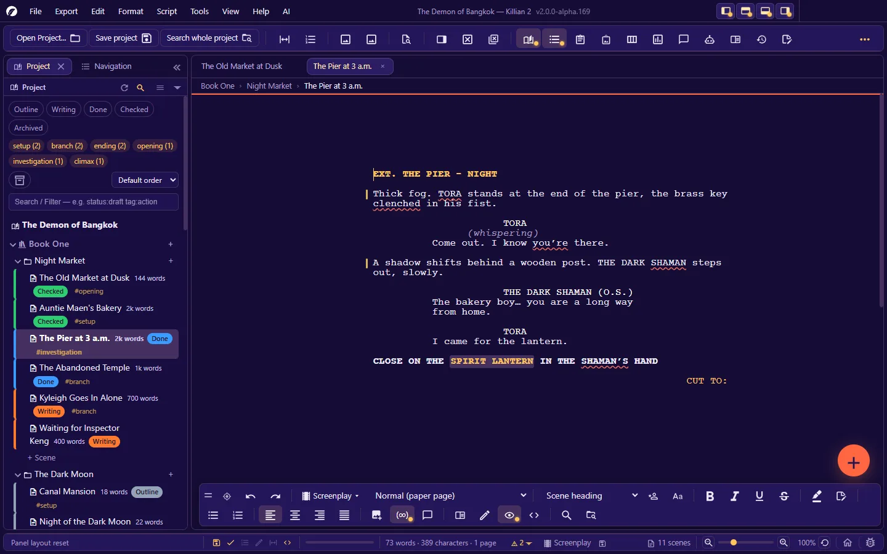
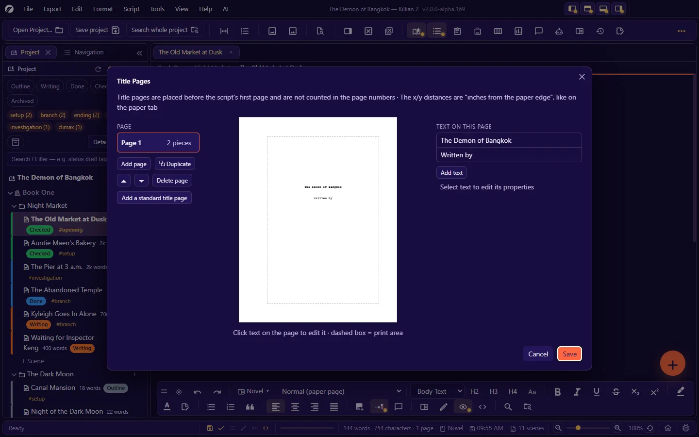
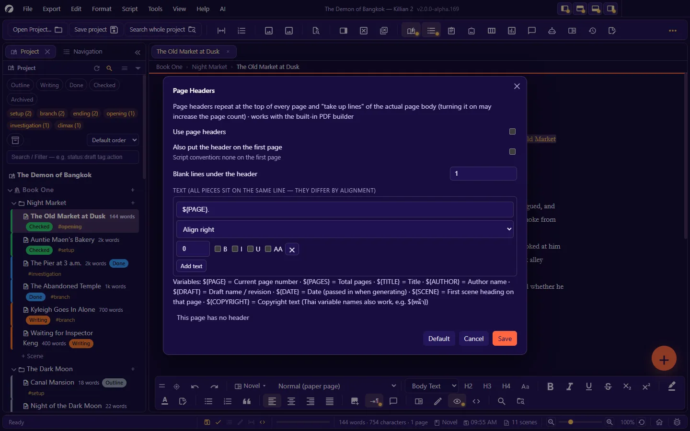

# 5. Writing a screenplay

**Language:** English · [ภาษาไทย](../th/05-writing-screenplay.md)

[← 4. Writing a novel](04-writing-novel.md) · [Contents](README.md) · Next: [6. Wiki, your story world, and the image library →](06-wiki-world.md)

---

Screenplay mode formats your text to the screenplay standard (Final Draft style). Every line is an **element** of some type, and the app takes care of the indent, the width and the capitals.

**Turn a scene into a screenplay**: the mode button on the format bar · **Format → Document mode → Script** · `Ctrl+Shift+M` · or right-click the scene in the Explorer → **Switch prose/screenplay**. The existing text is converted (a novel's Heading 3 ↔ a screenplay's scene heading, and so on).
Or start the whole project from the **Screenplay** template (3 acts).

## 5.1 Screenplay elements

| Element | What it is for | Shortcut | Code in the `.md` file |
|---|---|---|---|
| **Scene heading** | `INT. KITCHEN - DAY` | `Ctrl+1` | `### ` |
| **Action** | What we see and hear | `Ctrl+2` | (plain text) |
| **Character** | The speaker's name | `Ctrl+3` | `@NAME` |
| **Parenthetical** | A direction for the line, e.g. (whispering) — only directly under a character name | `Ctrl+4` | `((whispering))` |
| **Dialogue** | What the character says | `Ctrl+5` | (the line under a character) |
| **Transition out (right)** | `CUT TO:`, right-aligned | `Ctrl+6` | `>> ` |
| **Transition in (left)** | `FADE IN:`, left-aligned | element selector | `<< ` |
| **Shot** | `CLOSE ON …` | `Ctrl+7` | `! ` |
| **Act break** | Divides the big sections of the story | `Ctrl+8` | `$act ` |
| **Note** | A note to yourself, not part of the script | `Ctrl+9` | `/// ` |
| **Sub-header** | A mini-slug; it gets no scene number | element selector | `#### ` |
| **Intercut** | `INTERCUT WITH:` | element selector | `$intercut ` |
| **Page break** | Forces a new page | element selector | `---` |
| **Continued (left/right)** | CONTINUED text you type yourself | element selector | `$contl ` / `$contr ` |
| **Summary · Outline 1–3** | Outlining lines | element selector | `= ` · `# ` · `## ` · `##### ` |
| **Image** | An image in the script | insert image | `` |

The **element selector** on the format bar shows the type of the line the cursor is on, and lets you change it.

> The codes in the file are Markdown wherever possible — switch a scene to novel mode and a scene heading becomes Heading 3, readable either way. Files from Killian v1 (codes `.HEADING`, `>TRANSITION`, `$shot`) still open, and are saved with the new codes.
> You can hide the line-prefix codes on screen with **View → Hide line-prefix codes** (the file is not changed).

## 5.2 Typing in flow: Enter and the element keys

| Key | What it does |
|---|---|
| `Enter` | Starts a new line of the **next element type from the table**. Defaults: Scene heading → Action · Action → Scene heading · Character → Dialogue · Parenthetical → Dialogue · Dialogue → Character · Transition → Scene heading. Splitting a line that has text on both sides of the cursor keeps the same type for the second half. |
| `Ctrl+Tab` | Cycles this line's element type forward |
| `Ctrl+Shift+Tab` | Cycles backward |
| `Ctrl+↑` / `Ctrl+↓` | Switches the element type |
| `Ctrl+1` … `Ctrl+9` | Changes this line to that type at once (see the table above) |

> While the cursor is in a screenplay, `Ctrl+Tab` cycles the element — to switch tabs use `Ctrl+PageDown` / `Ctrl+PageUp`.

**All of it is configurable** in **Settings → Screenplay keys** (stored per project):

- Turn the element-switching keys on/off (off = `Enter` starts a new line of the same type)
- Change the keys for "Go to the next element" and "Cycle element type"
- **The element table**: for each type, which type you get from `Enter` / `Ctrl+Tab` / `Ctrl+Shift+Tab`
- **Line after dialogue = more dialogue**
  - Off (the default · Final Draft style): the line after dialogue is **Action**, written plainly with no prefix code
  - On: for when you regularly write long dialogue over several lines in a row — action must then start with `!`

### Typing helpers

- **SmartType** suggests words to suit the line type: scene-heading prefixes (`INT.` `EXT.` `INT./EXT.` …) · times of day (`DAY` `NIGHT` …) · transitions (`CUT TO:` `DISSOLVE TO:` …) · common parentheticals · character names from the Wiki and names you have already typed in this script. `↑` `↓` to choose · `Tab` to accept.
- **Character name extensions**: **Script → Character name extension (V.O. · O.S. · cont'd)…**, or the button on the bar — adds `(V.O.)` `(O.S.)` `(O.C.)` `(CONT'D)` and others after the name, always with exactly one space.
- **Select Scene**: `Ctrl+Shift+A` — selects from a scene heading to just before the next one (for copying/moving a scene within a file).
- **Delete elements by type**: **Script → Delete elements by type…** — for example, delete every note before sending the script out (it can be undone).

## 5.3 Upper and lower case

The **Script → Upper/lower case (free)** menu:

| Switch | Effect |
|---|---|
| Force upper case per the standard script format | Scene headings · character names · transitions become upper case automatically |
| Automatically capitalise the first letter of a sentence | As you type |
| Automatically change a lone i to I | For English scripts |
| Force upper case for specific types | Tick per type: Scene heading · Character · Transition in/out · Sub-header · Intercut · Shot · Act break |

(These affect Latin letters; scripts such as Thai have no capitals.)

## 5.4 Page breaks · CONTINUED · MORE

A screenplay is paginated on the real paper size (by default Letter · screenplay margins · 54 lines per page). See the result in **Layout** view.

**Automatic continuation text** — **Script → Continuation text (CONTINUED · MORE · cont'd)**:

| When | The app adds |
|---|---|
| A scene runs over a page | `(CONTINUED)` at the bottom of the page and `CONTINUED:` at the top of the next |
| Dialogue is split across pages | `(MORE)` at the bottom of the page, and the character name + `(cont'd)` repeated at the top of the next |

- These texts belong to the page layout; they are not in the file. Change the wording in **Settings → Scene & page numbers (script) → Standard wording**.
- **Add them even when the page has no scene heading**: when off, `(CONTINUED)` is only added on pages that have a scene heading before them (the shooting-script convention).
- Prefer to control it yourself? Turn the automatic text off and type your own with the **Continued (left/right)** elements.

**Page-break rules (widows/orphans)** are on the same page: the minimum number of action/dialogue lines that must stay at the bottom of a page and carry over to the next · how many lines must follow a scene heading at the bottom of a page · the maximum number of consecutive hyphenated line endings.

**Repaginate screenplays automatically** (Settings → Script format): when on, the app recalculates the page count a set time after you stop typing (1–60 seconds).

## 5.5 Scene numbers and page numbers

| | On/off | Details |
|---|---|---|
| **Scene numbers** (beside the scene heading, both sides) | **Script → Scene numbers** | Settings → Scene & page numbers (script): suffix · distance from the left/right edge |
| **Page numbers** (top right of the page) | **Script → Page numbers** | Whether the first page is numbered · distance from the right/top edge · suffix (default `.`) |

- Scene and page numbers show both on screen and in exported files.
- The **starting page number** of each scene file is set in the scene's properties. Title pages and the cast page are not numbered.
- Go to a page/scene: `Ctrl+G` (combined dialog) · `Ctrl+Shift+.` (page) · `Ctrl+Shift+,` (scene) · **Script → Go to the first page**

## 5.6 Screenplay format (every element is adjustable)

**Settings → Script format** — a table with one row per element:

- **Indent** and **width** (inches, measured from the edge of the paper) · **space before** · **line spacing** (10 = 1 line)
- Upper case / bold / italic / underline — set separately for **on screen** and **when printing**
- The script font size (standard 12 pt) · line spacing (standard 1 = 6 lines per inch — changing it changes the number of lines per page)
- A **Restore defaults** button

The defaults follow the standard, e.g. scene heading indent 1.5" width 6" · character indent 3.7" · dialogue indent 2.5" width 3.5" · parenthetical indent 3.1" · transition out indent 6".

**Font**: the default is **Courier Prime** (the screenplay standard). Text in other scripts uses the font paired with it in the **Settings → Fonts by language** table (Thai is scaled to 85% to fit the script's line height). Change the script font in **Settings → Editor → Screenplay Font**.

**Show formatting**: **Script → Show formatting** — outlines each element and marks line ends, so you can see which line is which type.

## 5.7 Title pages · page headers · cast page

### Title Pages

**Script → Title Pages…**

- There can be several: **Add page · Duplicate this page · Delete page**
- **Add text**, then click the text on the sheet to edit it · set its x/y position in **inches from the edge of the paper** · bold/italic/underline/upper case · align left/centre/right
- **Build from project info** fills in the title/author/contact/copyright from **Settings → Project info**
- Title pages are placed before the first page of the script on export, and are **not numbered**

(The title page of a *book*, for novels: right-click the book → **Title Page…**)

### Page Headers

**Script → Page Headers…**

- Several pieces of text on the same line, differing in alignment (left/centre/right) and offset
- You can use **variables**:

  | Variable | Meaning |
  |---|---|
  | `${PAGE}` | The current page number |
  | `${PAGES}` | The total number of pages |
  | `${TITLE}` | The title |
  | `${AUTHOR}` | The author's name |
  | `${DRAFT}` | The draft / revision name |
  | `${DATE}` | The date the file was generated |
  | `${SCENE}` | The first scene heading on that page |
  | `${COPYRIGHT}` | The copyright line |

  (Each variable also has a Thai name, e.g. `${หน้า}` for `${PAGE}`; both spellings work in every interface language.)

- A header **uses real lines of the page** (the dialog tells you how many lines per page) — turning it on may increase the page count.
- By convention the first page has no header (you can change that).
- Off by default (a standard script already has its page number at the top right).

### Cast of Characters page

**Script → Cast of Characters page…** — it belongs to each book.

- **+ Add character** or **↓ Pull from the Wiki** · remove names you do not want
- Choose whether to show the **Scene** and **Time** headings
- The **Include when printing/exporting** switch (off = skip this page)

## 5.8 The script format checker

The app checks the screenplay format continuously and puts a wavy underline under lines that look wrong. The summary is on a badge on the status bar (for example "Script format OK").

| Command | Where |
|---|---|
| Go to the next problem | `Ctrl+Shift+U` · **Script → Find the next error** |
| List every problem in the script (click to go to that line) | **Script → Check the whole script (error list)…** |
| Check every time before printing/exporting (if problems are found you are asked before continuing) | **Script → Check before printing/exporting** |
| Turn the on-screen error markers on/off | The badge on the status bar · Settings → Scene & page numbers (script) → On-screen checking |

It checks, among other things: script text before the first scene heading · two scene headings in a row (a scene with no content) · an element that is an empty line · a line longer than the limit for its element · unbalanced parentheses. The checker only **points things out**; it never changes the file, and its markers are never exported.

## 5.9 Script reports, and comparing scripts

In the **Script** menu (enabled when the open tab is a screenplay):

| Report | What it tells you |
|---|---|
| **Location Report** | Which scenes each location is used in, and for how many pages — helps plan the shoot |
| **Character Report** | Which scenes each character appears in and how many lines they speak |
| **Dialogue per page chart (Dialogue Chart)** | The dialogue/action balance on each page, and who has how much |

**Compare scripts**: **Tools → Compare scripts…** — choose two document tabs and see the differences line by line, colour-coded (added · deleted · changed).

## 5.10 Problem scenes — comparing against the on-set version

Use this when a scene has to be fixed on the day, and you want to keep seeing **what changed from the original**.

1. Right-click the scene in the Explorer → **Problem scene (keep the original to compare)**. The app keeps a copy of the original (in the `OnSet/` folder).
2. Edit the scene as usual. Changed lines get **a coloured bar + a ! mark** in front of them (hover to see whether the line was added/changed/deleted).
3. **Switch between original ⇄ revised**: `Ctrl+Alt+Shift+O` · the button on the "Problem scene" chip · **Tools → Problem scene: switch original / revised**
4. When you are finished: the Problem scene menu → **Stop treating as a problem scene…**

- The original is **read-only** — this is a system for *comparing*, not for restoring.
- **Printing · exporting · saving always use the revised version**, even while you are looking at the original.
- You can change the bar colour (blue · green · purple · red · orange · yellow). The chip shows the number of changes.
- It works for both novel and screenplay scenes.

## 5.11 Views, printing and exporting

- The six page views work as in novel mode ([4.5](04-writing-novel.md#45-the-page-and-how-you-view-it)).
- Export a screenplay as **PDF** (title pages · headers · scene/page numbers · bookmarks · watermark) · **FDX** (Final Draft) · **RTF** · **HTML** · **a watermarked PDF per recipient** — see [chapter 9](09-export-import-print.md).
- Import a screenplay from Fountain · FDX · Celtx · Fade In · Adobe Story — see [chapter 9](09-export-import-print.md#import).
- Production tools that build on the script: [Floor plan](07-planning.md#77-floor-plan) (camera/lighting/blocking plans) · [Visual telling](07-planning.md#78-visual-telling) (storyboards) · [Rehearsal Room](08-ai.md#89-rehearsal-room).

---

Next: [6. Wiki, your story world, and the image library →](06-wiki-world.md)
