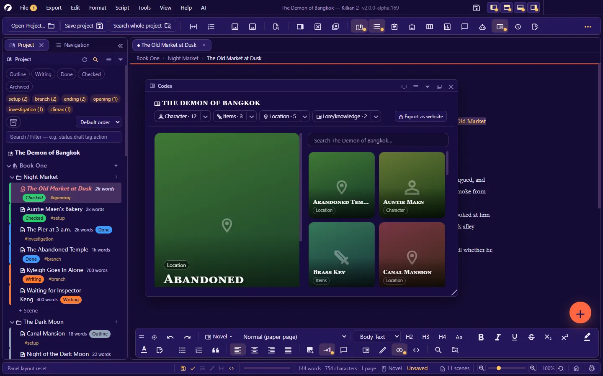
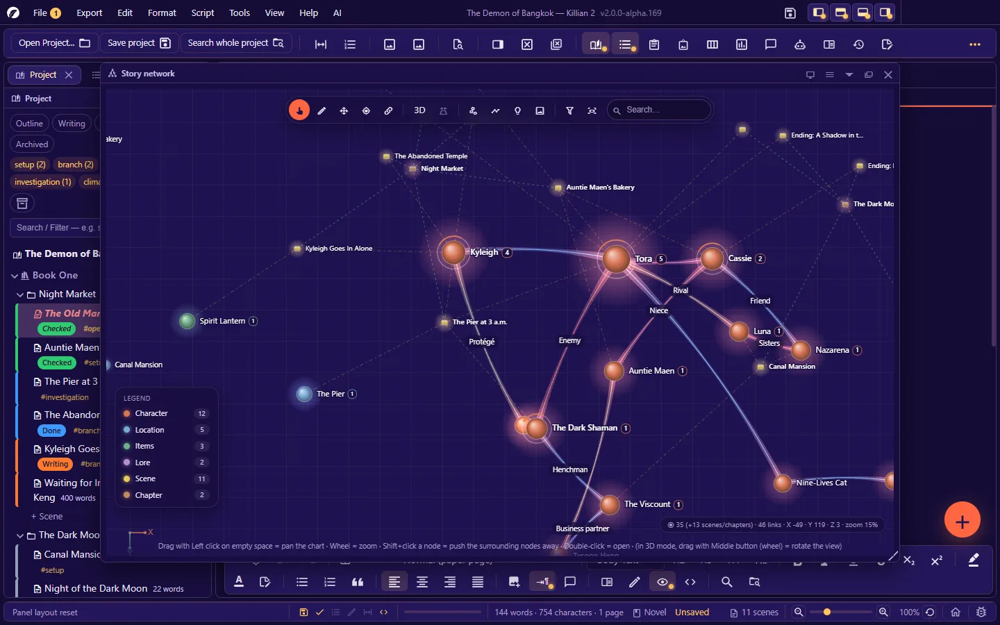
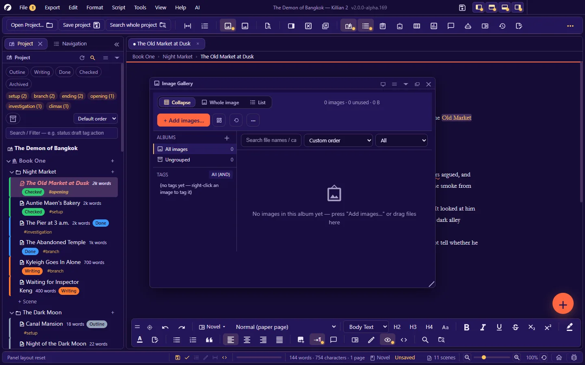

# 6. Wiki, your story world, and the image library

**Language:** English · [ภาษาไทย](../th/06-wiki-world.md)

[← 5. Writing a screenplay](05-writing-screenplay.md) · [Contents](README.md) · Next: [7. Planning tools →](07-planning.md)

---

The Wiki is your "story bible" — characters, locations, items, lore, and anything else you need to refer to while you write. Every page is one `.json` file in the project's `Wiki/<category>/` folder.

## 6.1 Categories and entities

An **entity** = one Wiki page (one character · one location …), filed under a **category**.

| Starting category | Create with |
|---|---|
| Characters | `Ctrl+Alt+3` |
| Locations | `Ctrl+Alt+4` |
| Items | The floating + button / right-click the category in the Explorer |
| Lore/knowledge | The floating + button / right-click the category in the Explorer |

- **Create your own categories** (for example races · organisations · magic): right-click the **Wiki** heading in the Explorer → **Create a new category**. Categories can be edited/deleted (the core categories cannot be deleted; nor can a category that still has entries).
- Open a Wiki page: click its name in the Explorer · `Ctrl`+click the name in the text · double-click the node in Story Network · from the Encyclopedia.
- Deleting an entity moves it to the trash; it can be restored.

## 6.2 The entity page

A Wiki page opens as a tab, like a scene. Save with `Ctrl+S`.

| Part | What it does |
|---|---|
| **Name** | Can be changed. If automatic entity-name syncing is on (Settings → Automation), the app updates the name in every file for you. |
| **Aliases** | Nicknames/epithets, separated by commas — used to detect the name in the text and in search |
| **Portrait** | Click the circle at the top to set an image (right-click = remove it). It appears wherever the entity does (charts · cards · the Encyclopedia). |
| **Other images** | Add images from files (they are copied into the project's image library) or pick from the library · edit the caption/alt text · make any image the portrait · library images tagged `@Name` appear here too |
| **Data (from the template)** | The fields defined by the category's template, e.g. age · occupation · personality |
| **Your own data** | **Add your own data field** — name the field anything you like |
| **Headings** | **Add heading** for long text such as history · habits · inner conflict |
| **Tags** | Separated by commas |
| **Relationships** | **Add relationship** — choose who it is with · the role (e.g. brother / friend / enemy) · the type |
| **AI prompts** | Rules you want the AI to follow every time it writes about this entity, as "topic — what to do/avoid" pairs, e.g. voice — short, clipped sentences |
| **Shortcode** | A short name for referring to this entity (blank = the entity's name). The page tells you the form to type. |
| **Scenes mentioning this** | Every scene that mentions this entity, with a count. Click to open the scene. |

- The **✨** button beside a field asks the AI to fill in that field from the context of the story (if the field already has text, it asks before replacing it).
- The **shortcode** button on the page inserts a shortcode (the entity's own field values · relationships · data from other Wiki pages · project statistics) into the focused field.
- **Save version** (you can name it) and **version history** — view/restore older versions of this page.

### Relationship types

Family · Romantic · Ally · Rival · Enemy · Mentor · Acquaintance · Neutral · Other
The type sets the **colour of the line** in Story Network. The role (free text) is the label on the line.

### Category templates

The fields of each category come from the **`templates.json`** file at the root of the project. It can be edited in any plain-text editor: add/remove/change fields, headings and properties anywhere.

- Field types available: `String` · `Text` · `Int` · `Bool` · `Date` · `Enum` · `EntityRef` (a reference to another entity)
- A category can have several templates. On an entity page, **Change template** keeps the existing data and adds only the fields that are missing.
- A template's `profile` block defines the header of the profile card (subtitle · status · badges).

The full file format: [Appendix D](D-file-formats.md#wiki-and-templatesjson)

## 6.3 Automatic links and "mentions"

- Type an entity's name (or an alias) in a scene → it is highlighted as a link. `Ctrl`+click opens the Wiki page.
- The app keeps a **link index** of which entity is mentioned in which scene. You see it in 3 places:
  - at the bottom of the entity page (**Scenes mentioning this**)
  - in a scene's Properties panel (**Mentioned in this scene**)
  - in the **Mentions** panel (`Ctrl+Alt+Shift+B`) — every entity together, with a **Rebuild the link index for the whole project** button for after you have changed files outside the app
- Turn the highlighting off: **Settings → Editor → Auto-detect Wiki names**

## 6.4 The Encyclopedia (Codex)

`Ctrl+Alt+C` — an encyclopedia-style view of the whole Wiki.

- Browse by category · search by name/alias
- Click a card = see it large · double-click = open the Wiki page
- **Export as website** — builds a Fandom/Wikia-style encyclopedia site that works offline, with no internet connection needed (you can hand it to your team or to readers)

## 6.5 Story Network — the relationship map

`Ctrl+Alt+N` — an interactive graph of characters, locations, items, lore, scenes, chapters and books.

### Reading the graph

- A **node** = an entity/scene/chapter/book — coloured by category · sized by importance · the number beside the name = the number of relationships
- A **line** = a relationship you defined (coloured by type, labelled with the role) · a dashed line = appearing together in a scene / entity ↔ scene
- The **legend card** at the bottom left: the count for each category — click to hide/show that category

### Mouse and keys (defaults)

| To… | Do this |
|---|---|
| Pan the graph | Drag empty space (left button) |
| Zoom | Mouse wheel |
| Move a node | Drag the node |
| See a node's details without opening the page | Click the node (the info panel: relationships · scenes it appears in) |
| Open the Wiki page/scene | Double-click |
| Push the surrounding nodes away | `Shift`+click a node |
| The node/graph menu | Right-click |
| Rotate the 3D view | Drag with the middle button (wheel) |

Change which mouse button rotates/pans: **Settings → Story Network → Mouse controls**

### Tools on the graph's toolbar

- **Select/move** · **Link a relationship** (drag from one node onto another — it is written into the Wiki page for you) · **Search** for a node
- **3D** — switch between the 2D ↔ 3D views · **Perspective** (far things look smaller)
- **Auto layout** (force-directed) · unpin every node and lay the graph out again
- **Find path** — click the starting node, choose "find a path to…", then click the destination node: the graph highlights the shortest path (if there is no direct relationship, it tells you the path goes through scenes they share)
- **Story insights** — for example pairs that "meet often but have no relationship defined yet"
- **Story timeline** — in story order; watch the graph grow scene by scene
- **Filters/display** — which categories are shown · line types · names under the nodes
- **Background** — a colour · an image (fixed to the graph or to the screen) · in 3D mode: a 2:1 panorama or a `.hdr` file = a surrounding sky that turns with the camera
- **3D models** — assign a model to a category or a node (`.glb` `.gltf` `.obj` `.stl` — the file is copied into the `Models/` folder)

The graph remembers where you put each node. The **colours** of nodes/lines/background and the colour presets (Cable · Flowers · X-Rite · Rainbow) are set in **Settings → Story Network**.
Export: **Export → Relationship map → PNG image**

> 3D mode and models need a graphics card with WebGL support.

## 6.6 A book's cast-of-characters page

Right-click a book → **Cast of Characters** — a cast page for that book, which can pull names from the Wiki and is placed near the front of the exported file. See [5.7](05-writing-screenplay.md#cast-of-characters-page).

## 6.7 The image library

`Ctrl+Shift+G` — every image in the project's `Images/` folder.

| To… | Do this |
|---|---|
| Add images | The add-images button, or drag files in from your computer |
| Organise albums | **View → Image library (Gallery) → New album…** · move images between albums (the app updates the links in files that use them) |
| Views | Equal-size thumbnails (cropped) · whole images at their real proportions · one image per row (name, caption, tags, size, usage) |
| Tag | Right-click an image — tags separated by spaces · `@Name` = linked to a Wiki entity · `~Name` = linked to a scene |
| Use an image | Drag it into a document to insert it · choose it as a cover/portrait in the Wiki · drag it onto the mood board |
| See where an image is used | The row view, or filter by actual use in the manuscript |
| **Unused images** | **View → Image library (Gallery) → Unused images** |
| **Find duplicates** | **View → Image library (Gallery) → Find duplicate images in the library** |
| **Export only images in use** | **Export → Image library → ZIP (images in use)** |
| Rename an image file | Right-click the image in the Explorer → Rename — the links in every file are updated |
| AI captions | Select images → the AI caption command (needs a model that can read images) |

Deleting an image/album moves it to the trash.

## 6.8 The mood board

`Ctrl+Alt+G` — a canvas of reference material for each album.

Open it alongside the Image library panel, then just **drag in images, scenes or characters**.

| To… | Do this |
|---|---|
| Add things | Double-click empty space = a note · right-click empty space = note / colour palette / group frame / reference card / image |
| Reference cards | A web link or some text — you can drag a link in from your browser |
| Arrange | Drag = move · bottom-right corner = resize · double-click = open |
| Board background | Colour · image · blur · dim |
| Delete the selection | `Delete` (the toast has an undo button) · `Ctrl+Z` undoes on the board |
| Export | A PNG image or an HTML page (images embedded in the file, links clickable) |

**Clear the board** does not delete image files — it only takes the cards off the canvas.

---

Next: [7. Planning tools →](07-planning.md)
