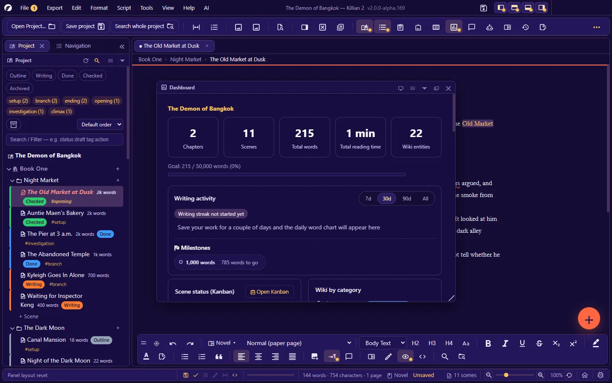
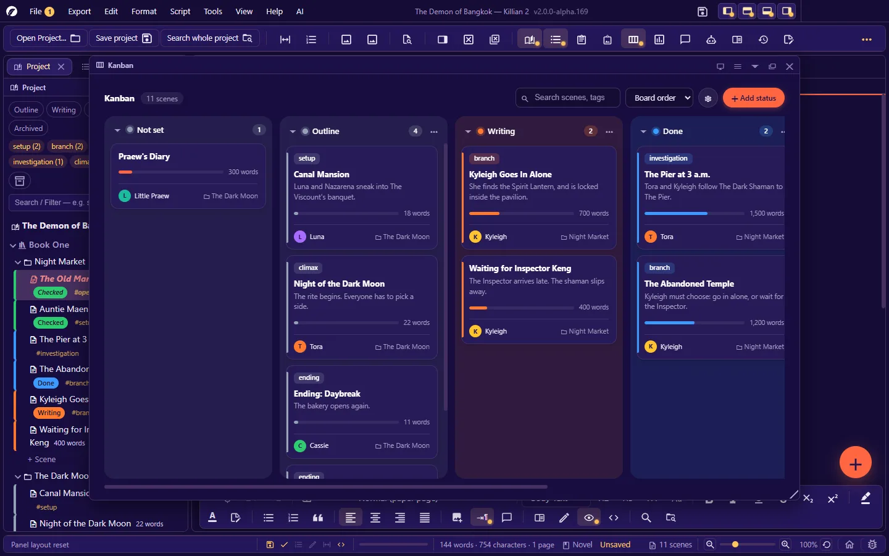
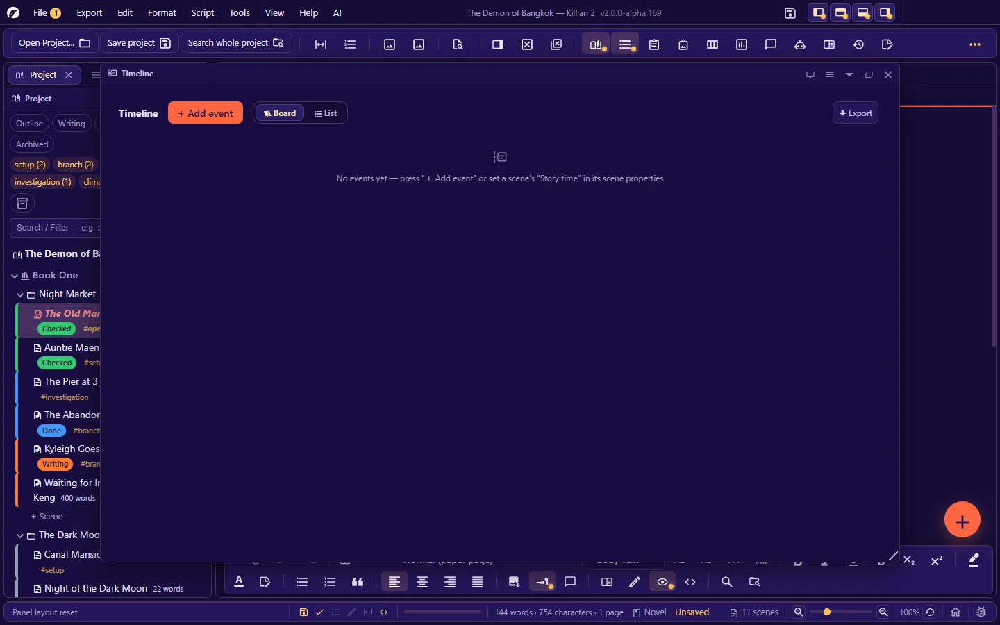
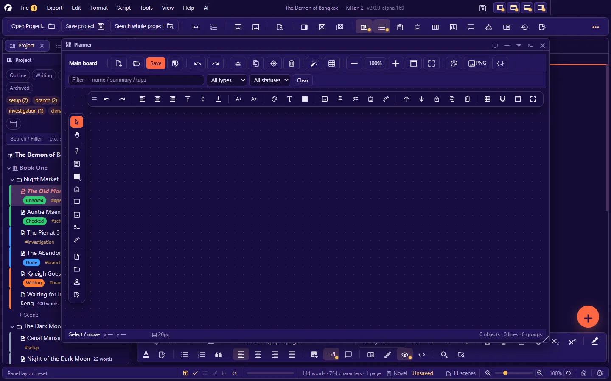
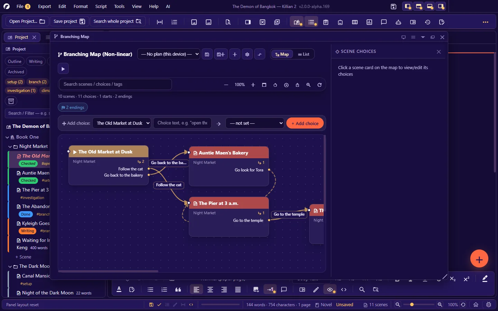
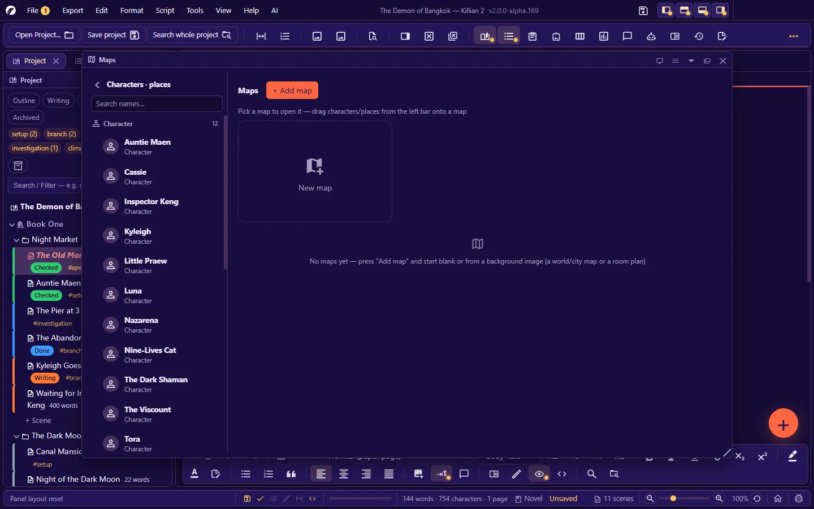
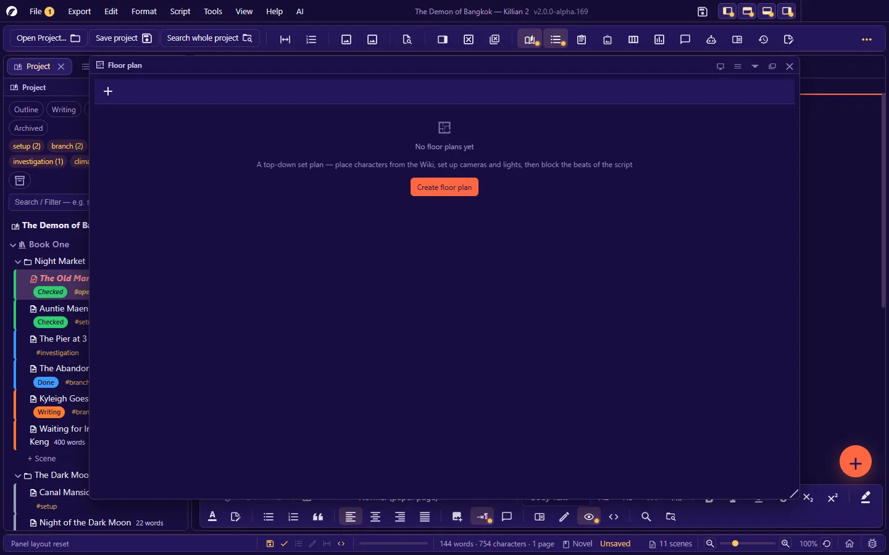

# 7. Planning tools

**Language:** English · [ภาษาไทย](../th/07-planning.md)

[← 6. Wiki, your story world, and the image library](06-wiki-world.md) · [Contents](README.md) · Next: [8. AI assistant →](08-ai.md)

---

Every tool in this chapter is a **panel** — open it from **View → Panels** · **View → Story tools** · a toolbar button · or a shortcut, then dock/float/tear it off as described in [chapter 2](02-interface.md#27-the-panel-system).

| Panel | Shortcut | The question it answers |
|---|---|---|
| [Dashboard](#71-dashboard) | `Ctrl+Alt+D` | How far along is the work? |
| [Kanban](#72-kanban) | `Ctrl+K` | Which scene is at which status? |
| [Timeline](#73-timeline) | `Ctrl+Alt+T` | What happens before what, in the story? |
| [Planning board](#74-planning-board) | `Ctrl+Alt+P` | Piecing the plot together freely |
| [Branching chart](#75-branching-chart-and-play-test) / Play-test | `Ctrl+Alt+B` / `Ctrl+Alt+Y` | Where do the story's choices lead? |
| [Maps](#76-maps) | `Ctrl+Alt+M` | Who is where, and how far apart? |
| [Floor plan](#77-floor-plan) | `Ctrl+Alt+F` | Where do the camera, lights and actors stand? |

Deleting something on a canvas (a pin · a card) with `Delete` shows a toast with an **Undo** button. Every kind of drag can be cancelled with `Esc`.

## 7.1 Dashboard

An overview of the project's progress:

- **Goals**: word count / goal (%) · milestones (how many words reached · how many to go)
- **Writing activity**: words added · days written out of how many · best day · current streak of consecutive writing days
- **Statistics**: books · chapters · scenes · average words per chapter · **Total reading time** (from an average reading speed)
- **Progress by scene status**, with a button to open Kanban
- **Length of each chapter** (bar chart)
- **Most-used words** (linking words and character names are not counted — shown as occurrences per ten thousand words)
- **Pick up where you left off** · pinned scenes · an image-library summary

Goals are set in **Settings → Project info → Word count goals**. When you open a project that has no tabs yet, the app opens the dashboard for you and tucks it away again once you start writing.

## 7.2 Kanban

A board of scenes arranged by **status** — one column per status, one card per scene.

| To… | Do this |
|---|---|
| Change a scene's status | **Drag the card to another column** (written to the file at once) |
| Open a scene | Double-click the card, or select it and press `Enter` |
| Search | The search box — scene title, tag, point-of-view character |
| Sort the cards | Board order · scene title · Longest first |
| Choose which draft is shown | The draft button in the board header |
| Add a status (column) | **+ Add status** — adds a status to the whole project; it shows in the Explorer at once |
| Column menu (⋯) | Change the status colour · collapse/expand the column · delete the column (its scenes move to another status, as the dialog tells you) |
| Manage statuses | The gear button in the board header |

A card shows: tags · title · synopsis · a length bar (relative to the longest scene on the board) · word count · point of view · chapter.
Locked scenes cannot be dragged. You can drag to reorder within a column only while sorted by "Board order" and not searching.
Export: **Export → Kanban → CSV table**

## 7.3 Timeline

The order of events in **story time** (not the order they are told in).

**Two kinds of thing appear on the timeline**

- **Scenes** that have "Story time" set in their properties — they appear by themselves
- **Events** you add yourself (**+ Add event**, or double-click empty space on the board): name · kind · track · start/end time · details · references (scenes/entities)

**Views**: **Board** (horizontal, cards as long as their time span) · **List** (vertical, in time order) · **Gantt** (needs events whose time is a number, such as "Year 1024")

| On the board | How |
|---|---|
| Move a card in time | Drag the card |
| Stretch its time span | Drag the card's left/right edge |
| Connect "leads to" | Drag the dot at the right of a card onto another card |
| Open the scene/edit the event | `Ctrl`+click · or click an event card |
| Zoom | `Ctrl+wheel` · the fit-to-view button |
| Give a time to something with "No time set" | Drag it up from the tray at the bottom onto the board |
| Reference a scene/character in an event | Drag it from the Explorer onto an event card (drop on empty space = a new event) |
| Hide/show a track | Click the track's name |

**Error-spotting aids**: a connection that goes **back in time** (the cause happens after the effect) is drawn as a red dashed line · places where events have **the same time** are highlighted in orange — check whether you meant it.
Export: PNG image · HTML page · Markdown · CSV table

## 7.4 Planning board

A free-form whiteboard canvas — place cards, notes and images and draw lines between them. Use it to piece a plot together before you start writing.
Each board is a JSON file in the `Planners/` folder. You can have several (**New** · **Open** to switch boards).

**What you can place**: sticky notes · to-do list cards (tick items on the card) · frames that group an area (acts/storylines) · image cards · cards linked to a file in the project (a scene/Wiki page — drag from the Explorer) · **connectors** (click the source card, then the target; lines can be bent)

| To… | Do this |
|---|---|
| Pan / zoom | Drag empty space / mouse wheel · **Fit to screen** |
| Select several | Drag a marquee, or `Shift`+click |
| Group | Select cards → **Group** |
| Undo/redo (the board's own) | `Ctrl+Z` / `Ctrl+Y` while this panel is the selected one |
| Duplicate / delete / lock / bring to front / send to back | The board's toolbar, or right-click |
| Fill colour · border colour · text colour · text size · text alignment (left/centre/right · top/middle/bottom) | The board's format bar |
| Grid | On/off · spacing · dots or lines · **snap to grid** (cards snap when moved, drawn and resized) |
| Board background | A colour or a background image (placement · blur · opacity) |
| Auto-arrange | Lays all the board's cards out as a grid |
| Fill the window | The full-screen button · `Esc` to leave |

**The card properties panel** (properties of the selected card or connector): name · summary · colour · status · tags · size · line style · a note for the writer.
A board with unsaved changes is in the pending-work list (**Save all**, `Ctrl+Alt+S`).
Export: PNG (double resolution, cropped to the part with content) · the whole board as JSON

## 7.5 Branching chart and play-test

For stories with choices — visual novels, story games, branching fiction.

### Creating choices

There are three ways; they all give the same result:

1. **Write them in the scene**: type `[choice text]` at the point where the story branches, e.g. `[Follow the cat] [Go back to the bakery]`, then **Tools → Create choices from [text] in this scene** (or the scan button in the panel, which finds every unlinked `[text]` in the whole project).
2. **The "add choice" bar** on the panel: choose the source scene · type the text · choose the destination scene → add the choice (it also inserts `[text]` at the end of the scene for you).
3. **Drag on the chart**: drag scenes in from the Explorer, then drag the dot at the right of a card and release on another scene's card.

### Working on the chart

| To… | Do this |
|---|---|
| Select a card / move it / open the scene | Click / drag / double-click |
| Edit a scene's choices | Click the card → the "Scene choices" panel on the right |
| Move a choice to another scene | Drag the choice's ⠿ handle onto another scene's card |
| Search | Type a scene title/choice/tag — whatever does not match fades |
| View | **Chart** or **List** · zoom · auto-layout |
| Card/line colour | The card's menu |

The panel header sums up: the number of scenes on the chart · choices · starting points · **endings**, and warns about **dead ends** (a choice with no destination) · **loops** · destinations that have been deleted.

**Plans**: the selector in the panel header — "No plan (this device)" = card positions are remembered on this machine only · or save them as a **plan** (a file in the `Branches/` folder). You can have several plans, compare them (right-click a plan in the Explorer → **Compare with another plan…**) and lock them.

Export: HTML · Markdown · JSON · SVG · PNG

### Play-test (Player Mode)

`Ctrl+Alt+Y`, or the ▶ button on the chart — read the story as a player would: the scene text is read-only, and you press a choice button to move on.

- **Step back one choice** · **start a new run** · start from any scene (right-click a card → open play-test starting at this scene)
- Every run is recorded — **View → Story tools → Decision history…** shows which choice is taken most often.
- Use it to check that every path really works before handing the story to a game team.

## 7.6 Maps

Maps of your story's world — use your own image as the background (or a blank canvas) and pin information onto it. A map has no edges: pan and zoom freely.

**What goes on a map**

| Thing | What it is | How to create it |
|---|---|---|
| **Pin** | A point on the map, optionally linked to a character/location/scene | Right-click → pin · or drag a name in from the left bar/Explorer |
| **Door pin** | The way down into a **sub-map** (world → city → room) | Drag another map in from the list |
| **Zone** | A polygon area (a territory · a forest · a danger zone), on the bottom layer under the pins · can be linked to an entity | Right-click → **Draw a zone**: click point by point · double-click/`Enter` = finish · `Backspace` = remove the last point · `Esc` = cancel |
| **Text** | A label on the map | Right-click → Text |
| **Story route** | A line through the scenes' locations in story-time order — shows how far the characters have to travel | A switch on the map's toolbar |

| To… | Do this |
|---|---|
| Pan / zoom | Drag empty space / mouse wheel |
| Select / move a pin | Click (a floating toolbar appears) / drag |
| Open what a pin links to | Double-click, or `Ctrl`+click |
| Say where a scene takes place | Drag the scene from the Explorer onto the map (or onto a pin) |
| Grid | Square cells; on/off |

**The background image** can be resized · re-proportioned · made translucent · rotated · tilted · flipped · sheared. Pins and zones do not move with the image (turn on move-image mode to drag the image directly).

**Scale and real coordinates**: set the scale (real distance per map unit) · north · and a latitude/longitude reference point — the map can then tell you **distances · travel times · zone areas · latitude/longitude** for its points.

Export: PNG image · **GeoJSON** (once real coordinates are set) · print
Maps are context for the AI — in chat you can ask "who is near whom" and it answers from the map data.

## 7.7 Floor plan

A top-down set plan — for planning a scene's blocking and cameras.

**What goes on a plan**

- **Characters/items from the Wiki** — with the direction they face and their eyeline (add with a button, or drag from the Explorer)
- **Cameras** — choose the body (which sets the sensor size) · the lens (mm) · the support/track. **The field of view is computed from sensor + lens**: change the lens and the view cone changes with it.
- **Lights** · **shapes/furniture** · **walls** (click point by point · double-click/`Enter` = finish · `Backspace` = remove the last point)
- **A background image** (the real room plan)

| To… | Do this |
|---|---|
| Place things | Choose a tool and click on the plan · hold `Shift` = keep placing more · `Esc` cancels |
| Select/move | The select tool — drag empty space = pan · wheel = zoom |
| Undo/redo | `Ctrl+Z` / `Ctrl+Y` while this panel is the selected one |
| Properties of the selected item | The properties panel at the right of the plan |

**Beats** — the beat strip at the bottom. Each beat is "one moment of the scene", and things on the plan can be in different positions in each.

- The first beat = the starting positions · later beats store only the items that **moved** (the rest are inherited from the beat before)
- Attach a beat to **a line of the scene** (choose a line from the script, or type your own) — click to jump to that line in the scene
- Beats can be added · deleted · swapped · inserted

**Plans for a scene**: a plan is attached to a scene (scene properties have a "Plans for this scene" shortcut). A scene can have several plans. Plans are stored in the `FloorPlans/` folder.

**AI image/video prompts**: place the camera first, then let the AI read the scene's line plus the shot data from the plan (camera, lens, who is where in frame, lighting) and write English prompts for both a still and a video of that beat. You can set one "visual style" for the whole plan. If the plan changes after a prompt was generated, the app tells you to write it again.

Export: PNG image (white background, for printing) · CSV table · Markdown (the shot list)

## 7.8 Visual telling

The **Visual telling** button on the toolbar (or right-click a chapter → **Visual telling**) — a storyboard table for a scene.

- **Add rows from lines of the scene**: tick the lines you want to turn into pictures (several lines can be attached to one row)
- Give each row an image — pick from the library or add a new one
- If the source line in the scene is edited, the row shows a warning; press it to update the text
- Drag to change the column widths

## 7.9 Writing sprints

**Tools → Writing sprint** (`Ctrl+Alt+Shift+S`)

- Set the **Duration (minutes)** and the **goal (words)**, then press **Start** · **Pause** / **Resume** / **Finish**
- Only words typed during the round are counted, **across every tab** — you can open another scene mid-round without anything being counted twice
- Shows words per minute and a history (how many rounds · total words · average), kept in the project

## 7.10 Journal and logline

**Journal** (`Ctrl+Alt+J`) — record what you did today: text · mood (Flowing/normal/Stuck/tired) · word count · time spent · tags · searchable later · **export as CSV**

**Logline** (**Settings → Project info**) — a six-field compass for the story: a one-sentence logline · the protagonist · the inciting incident · the goal · the obstacle/antagonist · the stakes.
Once filled in, the AI uses it as the yardstick for checking that the text does not drift away from the story's goal, obstacle or stakes.

## 7.11 Exporting from panels

Every panel that can export is gathered in the **Export** menu (and each has an export button on its own toolbar):

| Panel | Formats |
|---|---|
| Timeline | PNG · HTML · Markdown · CSV |
| Map | PNG · GeoJSON · print |
| Mood board | PNG · HTML |
| Relationship map | PNG |
| Planning board | PNG |
| Branching chart | HTML · Markdown · JSON · SVG · PNG |
| Kanban | CSV |
| Image library | ZIP (images in use) |
| AI analysis | CSV |
| Floor plan | PNG · CSV · Markdown |

---

Next: [8. AI assistant →](08-ai.md)
