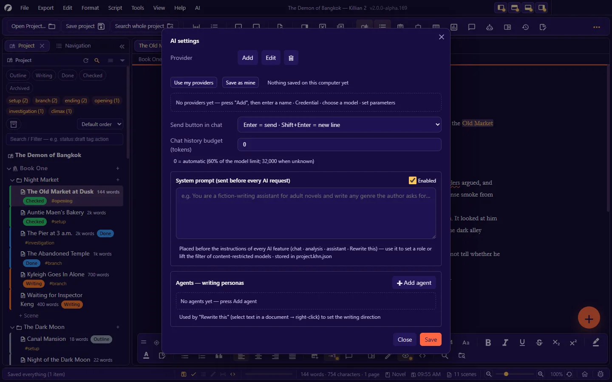
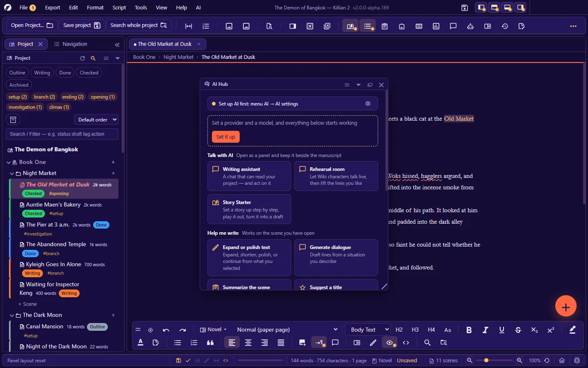
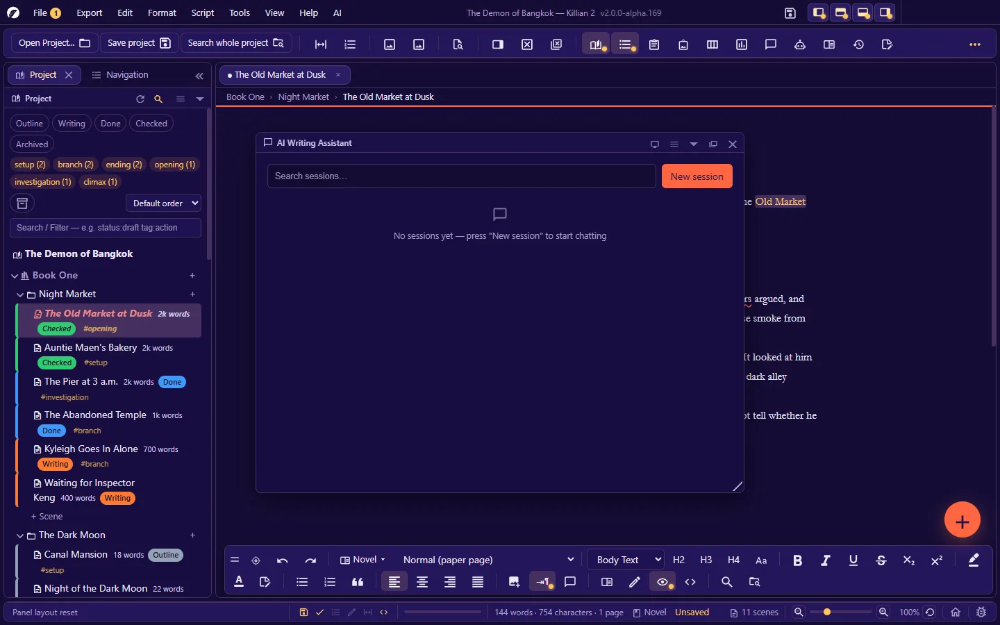
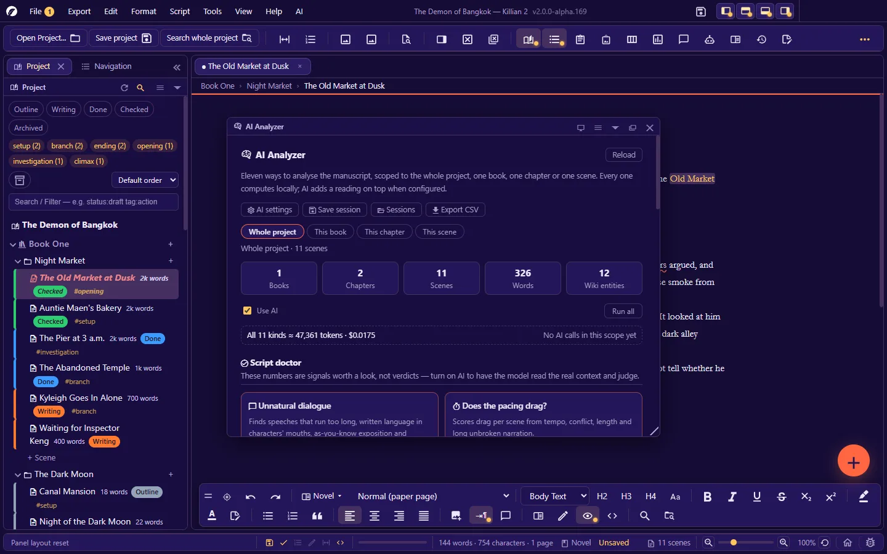
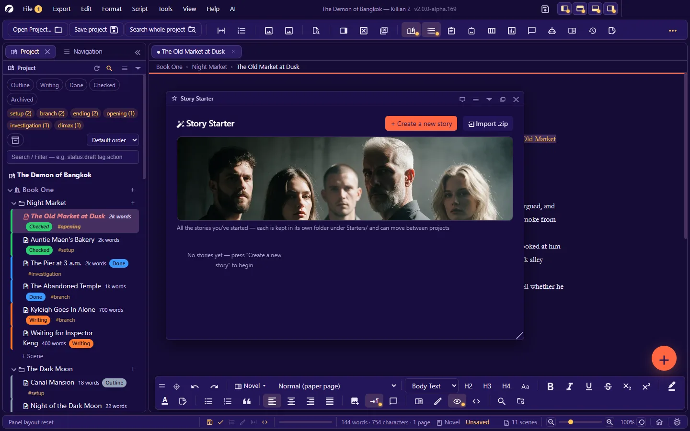

# 8. AI assistant

**Language:** English · [ภาษาไทย](../th/08-ai.md)

[← 7. Planning tools](07-planning.md) · [Contents](README.md) · Next: [9. Export, import and print →](09-export-import-print.md)

---

## 8.1 What to know first

- **Killian 2 has no built-in AI service.** You connect it to a provider of your choice with your own key (or to a model running on your own machine). Costs and terms are that provider's.
- **Everything else works without AI.** Several checking features also have a "computed layer" that works offline, with no key at all.
- **Text leaves your machine only when you tell it to**, and goes only to the endpoint you configured. Nothing is sent in the background.
- **You choose how much of your work the AI can see** (the access level in chat) and **how much it can do** (the mode).
- What the AI returns is a suggestion. Wherever it would replace your text, the app shows you first or lets you undo.

## 8.2 Setting up a provider

**AI → AI settings…** (or Settings → AI assistant → open the AI settings)



Press **Add**, then fill in 4 parts:

| Part | What to enter |
|---|---|
| **1. Provider name** | The name you will see in selectors, e.g. "OpenAI at work" or "Ollama on my machine" |
| **2. Credential** | A credential name · the **API key** (may be left blank if the server needs none, e.g. a local model) · the **API address (Base URL)**, which must start with `http://` or `https://` · the **domains requests may be sent to** (separated by commas or new lines; `*.example.com` is supported) → press the button that tests the connection |
| **3. Model** | Press the button that fetches the model list from that provider's API, then choose |
| **4. Parameters** | See the table below |

The app talks to the endpoint in the **OpenAI chat/completions format**, which most providers and local model servers support.

**Parameters**

| Parameter | Default | Notes |
|---|---|---|
| Thinking mode | off | off / auto / on — only for models that support it |
| Temperature (creativity) | 0.7 | 0–2 |
| Max tokens (longest reply) | 2048 | **-1 = unlimited** (the value is not sent; the provider decides) |
| Timeout | 60 seconds | Counted from "silent for too long" — a long reply that is still streaming is not cut off |
| Max retries | 2 | |
| Reasoning effort | (not sent) | minimal / low / medium / high |
| Response format | text | text / json_object |
| Frequency penalty · presence penalty · Top K · Top P | (not sent) | Blank = that value is not sent |
| Extra HTTP headers | — | `X-Header: value`, one pair per line |
| Chat history budget (tokens) | 0 | 0 = automatic (60% of the model limit; 32,000 when unknown) |

**Where keys are stored**

- Provider settings (everything except the key) are in the project's `project.khn.json`.
- The **API key** is stored separately in `ai-key.json` at the root of the project. It is left out of the backups/ZIPs the app makes. **Do not share this file.**
- **Save as mine / Use my providers**: keeps a set of providers on this computer (the key is encrypted by the operating system; on a machine that cannot encrypt, the key is not stored) so you can apply it to another project in one click.

The settings dialog shows usage statistics: tokens · number of calls · estimated cost.

### System prompt and agents

In the same AI settings dialog:

- **System prompt (sent before every AI request)** — text placed before the instructions of every AI feature (chat · analysis · assistant · Rewrite this). Use it to set a role or rules for the whole work.
- **Agents — writing personas** — "assistant writers" you define yourself: a **persona** (writing style · themes · tone · sources · rules) + **references** (samples of prose/paragraphs you like — paste the text, or import `.txt` files, which are copied into the `References/` folder). Used by **Rewrite this**.

## 8.3 AI Hub — one way in to everything

`Ctrl+Alt+Q`, or the **AI tools** button on the toolbar



| Group | Features |
|---|---|
| **Talk with AI** | Writing assistant (chat) · Rehearsal Room · Story Starter |
| **Help me write** (works on the open scene) | Expand/polish text · generate dialogue · summarise the scene · suggest a title |
| **Check my work** | AI analysis · plot-hole check · consistency check |
| **World builder** | Worldbuilding (drafts places, cultures and world rules into the Wiki) |
| **Settings** | AI settings |

The Hub also tells you whether setup is complete. If it is not, there is a **Set it up** button.

## 8.4 Chat with your story (the AI writing assistant panel)

`Ctrl+Alt+W` — a chat that can read your project and, with the permission you give it, make changes for you.



### Sessions

Chat is divided into **sessions**, stored in the project — **New session** (**AI → New chat session**) · switch back to an older session · **Start over** (clears the conversation but keeps the mode/model/attachments).

### Mode — what the AI can *do*

| Mode | It can |
|---|---|
| **Plan (read-only)** | Read the project, analyse, propose — **it may not change or create files** (asked to change something, it describes in text what should change) |
| **Co-write (can create/edit)** | Really create and edit books, chapters, scenes and entities — **it cannot delete** |
| **Fully unlocked (can do anything)** | Including delete — deleted things go to the trash and can be restored |

What the AI can ask the app to do (depending on the mode): see the project structure · read scenes/entities · ask where things are on a map · create/edit/delete entities · create/delete books · create/rename/delete chapters · create/write/rename/delete scenes.
The commands the AI sends are shown to you as blocks in the chat. The AI stops by itself after a set number of rounds, to prevent endless loops (type "continue" if it is not finished).

### Access level — what the AI can *see*

| Level | What is sent as context |
|---|---|
| No access at all | Nothing from the project |
| This scene only | The open scene (including unsaved work) |
| This chapter only / this book only | As named |
| Whole project | Everything |
| **Only relevant parts** | The app searches for the scenes/Wiki pages/timeline entries related to your question and sends only those — it saves tokens, and it works even with no key for embeddings |

### Other session options

- **The model for this session** — overrides the AI settings for this session only
- **Thinking: minimal / low / medium / high / provider default** — how much reasoning the model uses
- **Skills** — turn your own instruction files on/off per session (see below)
- **View**: conversation only · normal · thinking (if the model returns it) · everything (system prompt · the context sent · raw commands · results · tokens · timing)
- **Sending**: `Enter` = send · `Shift+Enter` = new line (swappable with the button in the panel) · a **Stop** button while it is replying · **Continue** from where a reply broke off
- If the context exceeds the model's limit, the app trims the history to fit on the next round.

### Skills — standing instructions you write yourself

`.md` files in the project's `Skills/` folder, for example "the tone of this story" · "words never to use" · "how the main character talks".

```markdown
---
name: Writing tone
description: Enforces the language tone of this story
---
Write in short, tight sentences. No filler words.
Use the pronouns the characters actually use in the story; never change them.
Do not wrap up the ending unless the author asks.
```

(The header is optional — without it, the file name is used as the skill's name.) If there are no skill files yet, press the skills button in the chat panel to create the folder with a sample file. Skills that are on are attached to the request (no more than 12,000 characters in total), and the AI is told to put them above general guidance.

## 8.5 Writing assistant — expand, summarise, rewrite

**AI → Writing assistant (Expand/Summarize/Rewrite)…** (`Ctrl+Alt+Shift+A`) — select text in the scene first, then choose a task:

| Task | Result |
|---|---|
| **Expand** | More detailed, keeping the meaning, point of view and voice — adds setting, senses and feelings, but no new events |
| **Summarise** | Shorter and easier to follow, keeping the key events and character names |
| **Rewrite** | Smoother and tighter, with the same meaning |
| **Change tone** | Moves it to the tone you choose, keeping the content and order of events |
| **Continue writing** | Carries on from the text, keeping the style and point of view |

You see the result and **decide yourself** whether to use it. If the source is a screenplay, the result is in screenplay format.

## 8.6 Rewrite this — rewriting in place with an agent

1. Select text in a document → right-click → **Rewrite this**
2. A floating bar appears: type how you want it rewritten (e.g. "more tense" · "tighter" · "add dialogue"). You may leave it blank (= improve it and make it read more smoothly).
3. Choose an **agent** (if you have any) to set the writing direction.
4. `Enter` = send · the result replaces the selected text (`Ctrl+Z` undoes it)

- The AI receives the text before and after, so the new text fits in · it writes in the same language as the original · it keeps names, pronouns and point of view.
- In a screenplay, the element type of each line is preserved.
- If you edit the text at that spot while waiting, the app **does not replace it** (you can copy the result and paste it yourself).

## 8.7 The ✨ buttons beside fields

- **Scene properties**: synopsis · point of view · mood · conflict — the AI reads the scene and fills them in
- **Wiki pages**: fill in an entity's data fields
- **Image library**: caption images
- **Story Starter**: help with the title/synopsis
- **AI → Summarise the project…** · **AI → Suggest a title…** (pick one and it can become the project title)

## 8.8 AI analysis and the script doctor

`Ctrl+Alt+A`



Choose the **Scope** (whole project · one book · one chapter · one scene), then choose a card. Each card has two layers: a **computed layer** (numbers from the manuscript — no AI needed) and an **AI layer** (opinions from reading it).

**Analysis cards**

| Card | What it looks at |
|---|---|
| Story pacing | Which scenes drag and which are rushed — from the share of dialogue and sentence length |
| Character arcs | How often each character appears in each chapter, and where they vanish |
| Most-used words | The most frequent words with their rate per ten thousand words |
| Conflict | Which scenes have conflict and which are flat |
| Scene length | Compared with the median, plus an estimated reading time |
| Plot holes | Places where the story contradicts itself; threads opened and never closed |
| Consistency | Whether details of characters and the world stay consistent |
| Repeated words | The same word recurring close together |
| Shipping / love interest | Pairs who are together often and carry romantic weight |
| Score | A two-layer score: from the numbers, and from the AI's reading |
| Screentime / character weight | Who takes up how much of the storytelling |
| Scene composition | Dialogue / inner thoughts / narration, as percentages |

**Script-doctor cards (🩺)**

| Card | What it looks at |
|---|---|
| Unnatural dialogue | Signals from each character's vocabulary, pronouns and sentence endings |
| Pacing — does it drag? | A drag score per scene |
| Plot logic | Events that happen by coincidence; decisions with no motivation |
| Out of character | Behaviour/voice compared with the Wiki profile and with the same character in other scenes |
| Story tone (comedy/drama) | Which scenes break the tone, and where to add/reduce |

Analysis results are saved as sessions you can reopen · token counts are shown before/after · export as **CSV** (**Export → AI analysis**) · AI settings can be opened from the panel.

**Single-purpose dialogs** (the AI menu):

- **Check for plot holes…** — has an offline layer (time running backwards · a mismatched narrator) before the AI layer
- **Check character consistency…** — has an offline layer that checks Thai sentence endings/pronouns
- **Generate dialogue…** — drafts dialogue from a situation you describe, reading personalities from the Wiki
- **Worldbuilding…** — choose a template, state the brief, and save the result as Wiki pages (the AI is told not to contradict what already exists)

## 8.9 Rehearsal Room

`Ctrl+Alt+V` — let the AI play characters from your Wiki, talking turn by turn, then lift the lines you like into the script. Open it when the dialogue will not come.

1. **New session** → set the scene's situation (e.g. "the whole band is drinking in the beer garden after work; the rain has just stopped")
2. Choose characters from the Wiki to join. Each has a **role sheet** (written in plain language, e.g. "short answers, cuts people off, hates explaining himself") · **pronouns**, locked so the model does not switch mid-conversation · a **one-line pitch** (the other characters see only this line, not the full role sheet) · a relationship for this scene only (blank = as in the Wiki)
3. Press **send** — blank = the AI speaks for the selected character · typing something = that line is yours (it costs no tokens)
4. Drop in an **interruption** (the lights go out · a knock at the door) · have a character deliver a **monologue** (an inner voice the others cannot hear)
5. Select the lines you like → **Insert into scene** at the cursor (open the scene and place the cursor first)

The panel shows the number of calls, tokens in/out and total time.

## 8.10 Story Starter

`Ctrl+Alt+Z` — set up a story step by step, then **play it in episodes** with the AI before turning it into a real manuscript.



**Setup steps**

| Step | What you do |
|---|---|
| **Genre** (required) | Choose genre tags · tone · setting · rating (more than one, or type your own tags) — the AI uses them to set the tone of the whole story |
| **Title + synopsis** (required) | Give the story a title and a one-paragraph synopsis (the AI can help) |
| **Characters** (required) | Add as many as you like, created here or pulled from the Wiki — characters created here are saved to the Wiki |
| **4W** | What · when · where · why — fill in whatever comes to mind (optional) |
| **Story cover** | The image shown on the story's card in the overview (optional) |

**Playing in episodes**: the AI is the Game Master telling the story · choose the characters you will play yourself (the GM will not speak for those — you may also choose none) · you can stop the AI midway · have the AI **summarise the whole episode** to carry into the next.

**Bringing it out as a manuscript**: turn the story you played into novel scenes or screenplay scenes in the project.

Each story you set up is kept as its own folder under `Starters/`. It can be exported/imported as a `.zip` and moved between projects (on import you choose, for each character, whether to link it to an existing Wiki entry or create a new one).

## 8.11 If the AI is not working

| Symptom | Check |
|---|---|
| It says it is not set up | AI Hub tells you what is missing: provider · model · key |
| The connection test fails | Is the Base URL right? (Enter only the base address, e.g. `https://api.example.com` or `…/v1` — the app adds the rest of the path.) · Is the key right? · Is the domain in the allowed list? · Network/firewall |
| The model list cannot be fetched | Some endpoints respond but return no model list — check the Base URL and that provider's documentation |
| Replies are cut short | Raise **Max tokens**, or enter -1 |
| It times out | Raise the **Timeout** (local models are often slow) |
| An error message from the provider | See the details in the **Log** panel — keys are always masked in the log |

---

Next: [9. Export, import and print →](09-export-import-print.md)
