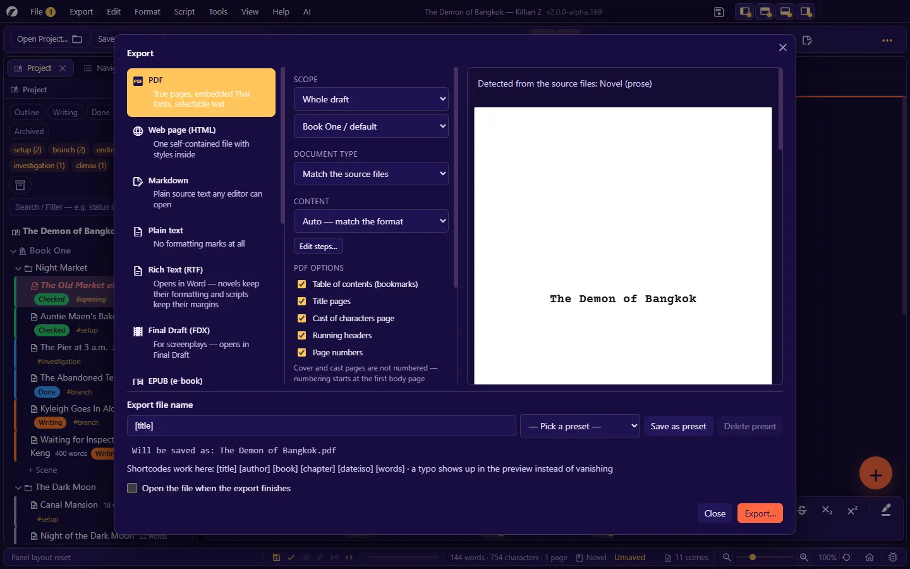
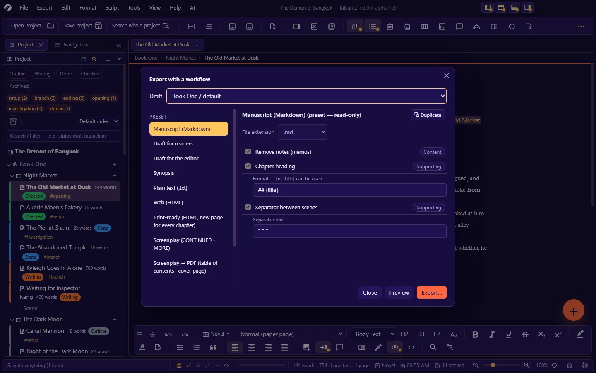

# 9. Export, import and print

**Language:** English · [ภาษาไทย](../th/09-export-import-print.md)

[← 8. AI assistant](08-ai.md) · [Contents](README.md) · Next: [10. Saving, history, backup and recovery →](10-history-backup.md)

---

Every way of exporting is in one menu, **Export**:

| Item | What it is for |
|---|---|
| **Export Hub…** (`Ctrl+Shift+E`) | Export the **manuscript** in any format, with a preview before saving |
| **Edit export workflow steps…** (`Ctrl+Alt+X`) | Define, step by step, "what goes into the file" |
| Timeline · Map · boards · charts, etc. | Export the contents of a panel ([7.11](07-planning.md#711-exporting-from-panels)) |
| **Whole project as ZIP…** | Back up or hand over the entire work folder |
| **Export panel layout (JSON)…** | Attach when reporting a problem with panels |
| **Export language as CSV…** | For translators ([chapter 13](13-language-themes-a11y.md)) |

## 9.1 The Export Hub

The dialog has 4 parts:

1. **Left — destination**: choose the file format
2. **Middle — options**: scope · document type · content · format-specific options
3. **Right — preview**: see the result before saving (a PDF is shown as real pages)
4. **Bottom — the export file name** and the **Export…** button

The app remembers your choices for next time.

### Destinations (file formats)

| Format | What you get | Notes |
|---|---|---|
| **PDF** | True pages, embedded fonts (Thai included), selectable text | Built in the app itself, never through the system printer |
| **Web page (HTML)** | One self-contained file with the styles inside | You can choose "use the same page format as on screen" |
| **Markdown** | Plain source text any editor can open | |
| **Plain text** (`.txt`) | No formatting marks at all | |
| **Rich Text (RTF)** | Opens in Word — novels keep bold/italic/headings · scripts keep their indents | The font size can be set |
| **Final Draft (FDX)** | Opens in Final Draft | Only for documents that are screenplays |
| **EPUB (e-book)** | Opens in standard readers, split into chapters with a table of contents and embedded images | Files inside the book are split at heading levels 1–2 and at page breaks |
| **DOCX (Word)** | An editor can keep working on it; keeps bold/italic/alignment/lists/images | Uses the same paper size, margins and typeface as the screen · headings use Word's heading styles |
| **Blog page (themed)** | A web page with built-in themes, ready to post | Opens its own dialog ([9.5](#95-other-ways-to-export)) |
| **Watermarked PDFs** | A separate file per recipient, with their name as the watermark | Screenplays only · opens its own dialog |
| **Whole project (.zip)** | A full backup, with images and metadata | |
| **Whole project (.json)** | The project structure only, for other tools | |

### The middle options

| Field | Choices |
|---|---|
| **Scope** | **Whole draft** (choose the book/draft) or **Current tab** |
| **Document type** | **Match the source files** (the app decides from the majority of scenes — memos do not count; a tie counts as a novel) · **Novel (prose)** · **Screenplay** |
| **Content** | The workflow to use — **Auto — match the format**, or pick a set yourself · the **Edit steps…** button |

### PDF options

| Option | Effect |
|---|---|
| Table of contents (bookmarks) | A table of contents in the PDF reader's sidebar |
| Title pages | Attaches the title pages you set up (Script → Title Pages · or the book's title page) |
| Cast of characters page | Attaches the book's Cast of Characters page |
| Running headers | Uses the headers you set up (Script → Page Headers) |
| Page numbers · scene numbers | These boxes override the Script-format settings — tick and you get them |
| Watermark | Text over every page (blank = none) |
| Colour mode | **Black and white** = the convention for scripts sent to a shoot · **Colour** = a reading copy |

- The dialog shows only the options that apply to the kind of document: **Running headers** and **scene numbers** appear for screenplays only, and **Cast of characters page** appears for a novel only when that book actually has a cast list.
- After an export **the dialog stays open** — it shows an "Exported:" line with the file name and a **Show in folder** button, so you can go straight on to another format (close it with Esc or the close button).
- Cover and cast pages are **not numbered** — numbering starts at the first body page.
- The PDF embeds fonts itself. If the app cannot find an embeddable font for a script used in the text (Thai, for instance), it warns you that those characters will come out as `?`. Set a font (`.ttf`/`.otf`) in **Settings → Fonts by language**.
- The fonts, sizes, margins, alignment, colours and images in the file match what you see in layout view.

### The export file name

The box at the bottom lets you build the file name from **shortcodes**, e.g. `[title]` `[author]` `[book]` `[chapter]` `[date:iso]` `[words]`. The "Will be saved as:" line shows the real name you will get (a mistyped code shows up there).

- **Presets**: Title · Title + book · Title + chapter · Title + date · Author + title · Draft + date + word count
- **Save as preset** for your own (the same name overwrites the old one). This is a user-level setting, available in every project.
- Characters a file system will not accept are filtered out (the Windows rules are applied on every system, so files can move between machines).
- **Open the file when the export finishes** · after exporting, the status bar has a link to **open the folder**.

## 9.2 Export workflows

A workflow is a sequence of "steps" that transform the manuscript before it is written to a file. Turn steps on/off one by one, and set each step's options.

**Presets**: Manuscript (Markdown) · Draft for readers · Draft for the editor · Synopsis · Plain text (.txt) · Web (HTML) · Print-ready (HTML, new page for every chapter) · Screenplay (CONTINUED · MORE) · Screenplay → PDF (table of contents · cover page)
Presets are read-only — **Duplicate** one and edit the copy, or **Create blank** to start your own.

**The steps available**

| Stage | Step | What it does |
|---|---|---|
| Content | Remove notes (memos) | Keeps memos out of the file |
| | Screenplay: leave out elements by type | Drops note / summary / outline1–3 / image (your choice) · an option draws a box around notes that are kept |
| | Only scenes with status… | Name the statuses (comma-separated) |
| | Use the synopsis instead of the scene text | Gives you a synopsis document |
| | Number the scene titles | |
| | Remove comments `%%…%%` and `<!-- … -->` | (Formatting comments such as alignment/page break are not removed) |
| | Turn wiki links `[[name]]` into plain text | |
| | Remove Markdown symbols (plain text) | |
| | Expand `{{name}}` variables from the Wiki | |
| | Expand shortcodes `[title]` `[chapter]` `[date]` | |
| Assembly | Cover page (title / author / word count) | Author blank = taken from the project |
| | Cast of Characters page | |
| | Chapter heading | A format you define, e.g. `## {title}` — `{n}` and `{title}` can be used |
| | Scene name | e.g. `### {title}` |
| | Attach each scene's status/word count (for the editor) | |
| | Separator between scenes | Default `* * *` |
| | New page for every chapter | |
| | Append a statistics summary | |
| Final text | Screenplay: insert (CONTINUED)/(MORE) at page breaks | For text destinations (PDF paginates by itself) |
| | Convert to HTML | |
| | **Custom JavaScript** | Your code receives the variables `text` (the whole text) and `model` (the document structure) and `return`s the new text — for advanced users (see the [Extension Guide](../../extension/en/04-hooks-lifecycle.md#45-other-hooks-outside-plugins)) |

Workflows are stored with the project. The Export Hub adjusts the "Convert to HTML" step to suit the destination you chose, without modifying the workflow you saved.

## 9.3 What travels with the file, and what does not

| Travels | Does not travel |
|---|---|
| Bold/italic/underline/strikethrough/superscript/subscript | Spell-check underlines |
| Text and highlight colours (can be turned off with black-and-white mode) | Wiki-name highlights |
| Alignment (left/centre/right/justify) | A scene's comments |
| Headings, lists, block quotes, dividers | Note · Future Note · scene properties (unless the "attach status/word count" step is on) |
| Images (including the full-page/width/corner options) | Line numbers · margin guides · the cursor-line highlight |
| Forced page breaks | The on-screen paper colour (a PDF is always white) · the app theme |
| Fonts, sizes, line spacing, indents, margins | The script checker's error markers · the "problem scene" colour bars |

A scene you are currently viewing as the "original" of a problem scene → the exported file always uses the **revised** version.

## 9.4 Checks before sending

- **Screenplays**: with **Script → Check before printing/exporting** on, the app checks the script format every time and asks you if it finds problems.
- Always look at the **preview** in the Export Hub first — especially page breaks and full-page images.
- **Open the resulting file** once in the real destination program (Word · an e-book reader · Final Draft) before sending it to anyone. Each program renders things slightly differently.

## 9.5 Other ways to export

### Blog page (`Ctrl+Shift+B`)

A single HTML page ready to paste into a blog/website: choose the **scope** · the **theme** (plain, no frame · Medium, cream card · dark, for night reading) · include chapter titles (H2) / scene titles (H3) · **embed images in the file (base64)** — the file is bigger, but the images show wherever you paste it · there is a **Preview** button.

### Watermarked PDFs

For handing a script to several people, each getting a file watermarked with their own name: enter the list of recipients (one per line) · the watermark text · a file-name prefix · the destination folder · the size and angle of the watermark → the app builds the files one by one and shows its progress.

### Whole project as ZIP

**Export → Whole project as ZIP…** (or the **Export** button on Home) — every file of the project **except `ai-key.json`** (your AI key).
To bring it back in: the **Import** button on Home → choose the `.zip` → choose the destination folder.

> The ZIP of a project that has plugins in its `Plugins/` folder carries those plugins with it. The recipient has to allow them before they will run ([chapter 14](14-plugins.md)).

## Import

### Screenplays from other programs

**File → Import screenplay…** (or drop the file on the window)

| Format | Extension |
|---|---|
| Fountain | `.fountain` (a `.txt` file is read as Fountain) |
| Final Draft | `.fdx` |
| Celtx | `.celtx` |
| Fade In Pro | `.fadein` |
| Adobe Story | `.astx` |

The import dialog shows **a preview of the script to be imported** with a summary (word count · dialogue · action), then you choose to **create a new scene** or **replace the text in the open tab**.

- Standard Fountain files are converted to Killian's syntax (for instance, Fountain's `[[…]]` notes are not mistaken for Wiki links).
- Older Celtx files that store raw XML may not be readable.

### Manuscripts from Word, Markdown or plain text

**File → Import Manuscript (Word · Markdown · Text)…** — brings existing work into the open project **as a new book**. Your original files are never changed.

1. Choose the source: **Choose files…** (several `.docx` / `.md` / `.txt` files at once) · **Choose folder…** (every supported file in the folder, sorted by name so "Chapter 2" comes before "Chapter 10") · **Paste text** (for a story copied from a web novel site).
2. Pick how to split it:

| Option | Result |
|---|---|
| Automatic | One file → split by headings · several files → one chapter per file |
| One chapter per file | Headings inside a file become its scenes |
| By headings | The top heading level becomes chapters, the next level becomes scenes |
| One scene per file | All files become scenes of a single chapter |

3. Check the preview (chapters, scenes, approximate word count, images, warnings), name the book, then press **Import**. The first scene opens straight away.

- **Headings** are read from Word's heading styles (also custom styles based on them, and Word in any language). If a document has no heading styles, lines typed as plain text such as "Chapter 1", "Prologue", "ตอนที่ 1" or "บทนำ" are used as chapter breaks (turn this off with the checkbox).
- Bold, italic, underline, strikethrough, centred paragraphs, lists, quotes, line breaks and page breaks are kept. Hand-typed scene breaks (`***`, `---`, `◇◇◇`) become the standard `* * *`.
- Images are copied into the image library in an album named after the book. EMF/WMF drawings are skipped (a warning tells you how many).
- Empty paragraphs that Word users add between *every* paragraph for spacing are removed; a deliberate gap of several empty lines is kept as one.
- Tables become plain paragraphs, cell by cell. Old `.doc` files must be saved as `.docx` in Word first. Comments and tracked deletions are not imported (to bring an editor's comments back into existing scenes, see [Working with an editor in Word](04-writing-novel.md#working-with-an-editor-in-word)).
- Markdown front matter is removed (its `title:` becomes the chapter name) and `[[links]]` from Obsidian stay as Wiki links.

### Scrivener projects

**File → Import from Scrivener (.scriv)…** (`Ctrl+Alt+Shift+I`) — choose the `.scriv` folder, then a destination folder. The app reads the Binder structure and the text, and converts them into a Killian project with chapters and scenes. A summary dialog tells you how many chapters/scenes/files will be created. Warnings raised during the import are in the Log.

### Everything else

| To import | Where |
|---|---|
| A project from a `.zip` | Home → **Import** |
| A Killian v1 project | Just open the folder; no import needed |
| Images | Drag and drop · the image library → add images · Explorer → image library → Import image… |
| A scene-status set | Manage scene statuses → import |
| A translation from CSV | Tools → Import language from CSV… |
| A Story Starter story | The Story Starter panel → import a `.zip` |
| Reference files for an agent | AI settings → agent → import a `.txt` |

## 9.6 Printing

**File → Print…** (`Ctrl+P`) — prints the document in the open tab through the system's print dialog.

- Every page of the document is printed · on-screen decorations (highlights, underlines, colour bars) are left out · text is in a colour meant for white paper, even with a dark theme.
- If **Check before printing/exporting** is on, a screenplay is checked first.

> **A limitation to know about**: the Print command uses the system's page breaker, not the app's own paginator. A screenplay printed this way therefore has **no CONTINUED and no page headers**, and the page count may differ from the PDF.
> When the pages must be exact (for a shoot · for a publisher): **export a PDF from the Export Hub, and print that PDF**.

---

Next: [10. Saving, history, backup and recovery →](10-history-backup.md)
