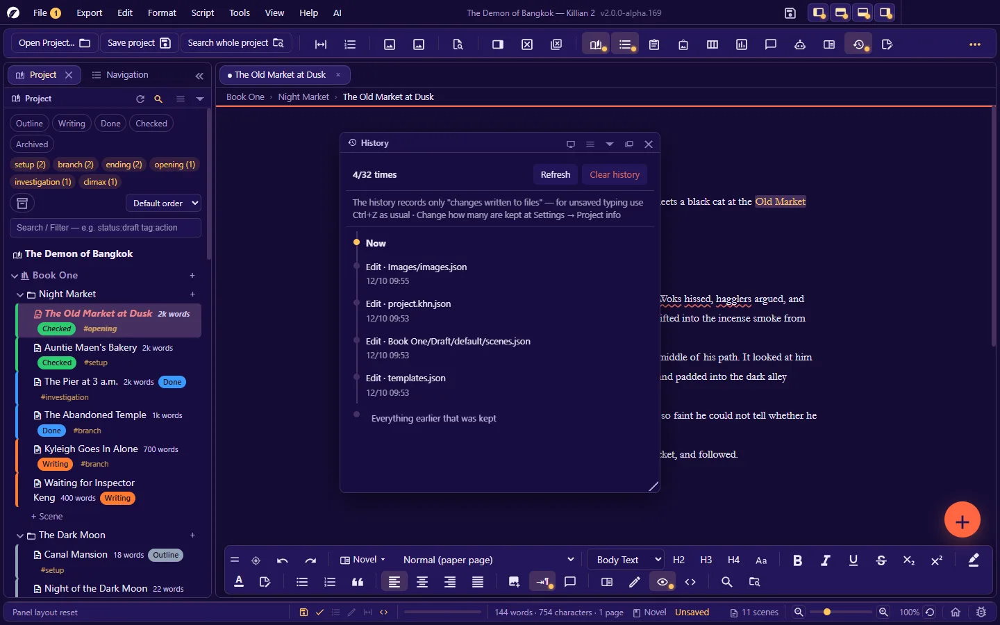

# 10. Saving, history, backup and recovery

**Language:** English · [ภาษาไทย](../th/10-history-backup.md)

[← 9. Export, import and print](09-export-import-print.md) · [Contents](README.md) · Next: [11. Find, replace and navigate →](11-search-navigate.md)

---

Killian 2 has **5 layers** of safety net against lost work, each solving a different problem:

| Layer | Guards against | Stored in | How far back |
|---|---|---|---|
| **Undo** (`Ctrl+Z`) | A typo or wrong deletion just now | Memory | To when you opened this tab |
| **Version history** | The file's content at each save | `Snapshots/` | The 10 most recent automatic versions per file + named versions (never deleted) |
| **Activity history** | Actions on files (write, move, rename, delete), project-wide | `.k2history/` | The last 32 steps (4–500, configurable) |
| **Trash** | Things you deleted | `Recycle/` | 30 days (configurable · 0 = never emptied automatically) |
| **Backups** | The whole project breaking or disappearing | `Backups/<date>/` | The last 7 days |

> All of these live **inside the same project folder**. If the disk fails or the folder is deleted, every layer goes at once. **Always keep an off-machine copy** (cloud · external drive · Git) of work you cannot afford to lose. The simplest way: **Export → Whole project as ZIP…** from time to time.

## 10.1 Saving

| Command | Key | What it does |
|---|---|---|
| **Save** | `Ctrl+S` | Saves the open tab |
| **Save all** | `Ctrl+Alt+S` | Saves everything pending: document tabs · planning board · branching chart · floor plan, and so on |
| **Save as…** | `Ctrl+Shift+S` | Saves this tab's content as a new `.md` file wherever you choose — the original file is not changed |
| **Revert to the last saved version** | The File menu | Throws away unsaved edits and reloads the content from the file |

**Autosave**: every 5 minutes by default — set it in **Settings → Saving & backups → Auto-save every (minutes)** (`0` = off). There is a quick switch on the status bar.
The status bar shows the **last-saved time**, or "Unsaved".

Many things save themselves at once, with nothing to press: scene properties · dragging a Kanban card · reordering in the Explorer · panel settings.

Every write is done as "write a temporary file, then swap the name". If the power fails mid-write you get either the old file or the complete new one — never half a file.

## 10.2 Pending work — before closing or switching projects

When you are about to **quit · close/switch projects · restart the app** (after an update or a language change, for example) and something is unsaved, the app shows **a list of every pending item** so you can tick what to save.

- An item you ticked that then fails to save (disk full · file locked) **is not closed and thrown away** — the app keeps it open for you to deal with.
- Closing a *panel* does not lose the work in it. The work stays in memory and stays in the pending list.

## 10.3 A file's version history

Every time you save, the app keeps a copy of the previous version (on by default: **Settings → Saving & backups → Auto-backup versions on save** · at most 10 automatic versions per file).

Right-click a scene/memo in the Explorer (or use the buttons in the Properties panel · on a Wiki page):

| Command | What it does |
|---|---|
| **Save this version** | Keeps the current version **with a name**, e.g. "before changing the backstory" — named versions are never deleted automatically |
| **Version history…** | The list of all versions — view the content, then **Restore** the one you want |
| **Compare versions…** | See the differences between a version and the current text |

- The row in the Explorer shows how many versions are kept.
- Move/rename a scene or chapter and its version history follows.
- Before a big edit: **Save this version** and give it a name — you can always come back.

## 10.4 Activity history (go back to any point)

`Ctrl+Alt+H` — a timeline of **every action that has reached a file** in the project: writes · moves/renames · things copied in · images added · deletions.

- Click **Go back to here** on any entry → the app tells you how many actions it will undo and how many files it will touch, then returns every file to its state "after that action".
- Use it to recover from wide-reaching actions: a wrong **Find and replace in project** · an AI editing many files · a mistaken batch delete/move.
- How many steps are kept: **Settings → Project info → History to keep (steps)** (default 32 — more lets you go back further but uses more space). Recording can be turned off in the same place.
- **Clear history** does not touch your work files — you only lose the ability to go back.

Worth knowing:

- This history records only **changes that have reached a file**. For typing you have not saved yet, use `Ctrl+Z`.
- After going back, files that were overwritten after that point return to their earlier state — **you cannot redo the step back** (make a ZIP first if you are unsure).

## 10.5 The trash

Everything you **delete** in the app — scenes · chapters · books · memos · Wiki pages · images · albums · floor plans — is moved to the project's `Recycle/` folder.

The **Trash** section at the bottom of the Project panel:

| To… | Do this |
|---|---|
| **Restore** | Right-click the item → Restore — it goes back where it was |
| See it in its folder | Right-click → Show in folder |
| **Empty trash** | **Permanently** deletes everything in the trash (it asks you to confirm — this cannot be undone) |
| Empty old items by age | Empties only what is older than your setting |
| Set the auto-empty schedule | Takes you to **Settings → Saving & backups → Auto-empty trash older than (days)** |

- Restoring a scene whose chapter has since been deleted → the app **recreates the chapter**.
- Restoring when the name clashes with something that exists → it is saved under a new name (with a suffix).
- When items in the trash pass the age limit, the app **asks before deleting them permanently** (you can choose to keep them).
- An AI in fully-unlocked mode that deletes something sends it to this same trash.

## 10.6 Project backups

**Automatically, once a day** — kept in the project's `Backups/<year-month-day>/` folder, with the 7 most recent sets retained (backing up again on the same day overwrites that day's set).

| Not included in a backup | Why |
|---|---|
| `Recycle/` · `Snapshots/` · `.k2history/` · `Backups/` | They are already other layers of the net |
| `Research/` | Large reference files |
| `ai-key.json` | An AI key belongs to this machine, not to the work |

- **Back up now**: **File → Back up the project now** — a good idea before a big edit.
- **Back up one item**: right-click a book/chapter/scene → **Back up** · **Restore from backup…** → choose a set (the current item is moved to the trash first, so you can still get it back).
- If there is pending work that fails to save, the backup is **cancelled** (it will not quietly back up a stale version).

**Restoring a whole project from a backup**: close the app → copy the `Backups/<date>/` folder to a new folder outside the project → open that folder as a project.

## 10.7 When files are changed outside the app

Killian 2 lets you edit files with other programs (a text editor · cloud sync · Git), and watches for it:

| Situation | What the app does |
|---|---|
| The file changed outside, and its tab has **nothing pending** | Reloads the content by itself and tells you how many tabs were reloaded |
| The file changed outside while its tab **has pending edits** | Warns you — when you save, it asks whether to **Overwrite with this tab's text** or **Use the version on disk (discard tab edits)** |
| Autosave meets a file that changed outside | **Skips that file**; it never overwrites on its own — it waits for you to press Save and choose |
| A tab's file has disappeared from the disk | Offers to **Recreate the file** from the tab's content |
| A file/folder was renamed outside the app | Pairs things up and brings the registries into line ([3.8](03-project-structure.md#38-names-on-disk-and-renaming-outside-the-app)) |
| You edited scene properties in the `.md` header by hand | **Tools → Sync scene properties from the .md file** |
| **A JSON registry file cannot be read** (half-synced · a slip while hand-editing) | Keeps a copy `<name>.unreadable-<time>.json` beside it and tells you · **does not overwrite the original** if it could not make that copy |

After editing files outside, press **Refresh** in the Project panel's header, or just switch back to the app window.

## 10.8 What comes back when you restart the app

- Your open tabs · panel layout · scroll positions · the views/zoom you set
- If the app was closed abruptly (power cut · force-quit): everything that was saved is intact · whatever you typed after the last autosave may be lost. Shorten the autosave interval if your machine is unstable.

## 10.9 Recommended practice

1. Leave **autosave** and **Auto-backup versions on save** on (both are on by default).
2. Before a big edit: **Save this version** (with a name), or **Back up the project now**.
3. Once a week (or every time you finish a chapter): **export a ZIP** and store it off the machine.
4. A cloud-synced folder is fine, but **open it on one machine at a time** and wait for syncing to finish before opening it on another.
5. Git is fine — the files are plain text and diffs are readable (put `Backups/` `Snapshots/` `.k2history/` `Recycle/` and `ai-key.json` in `.gitignore`).
6. The app is still in alpha — never let the app's own safety nets be the **only** copy of your work.

---

Next: [11. Find, replace and navigate →](11-search-navigate.md)
