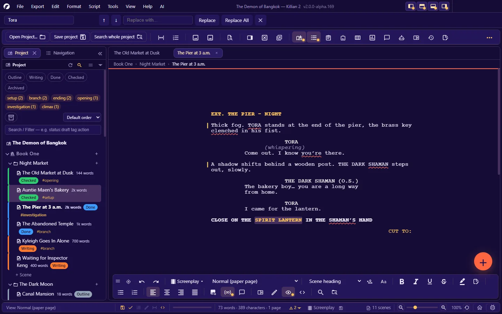
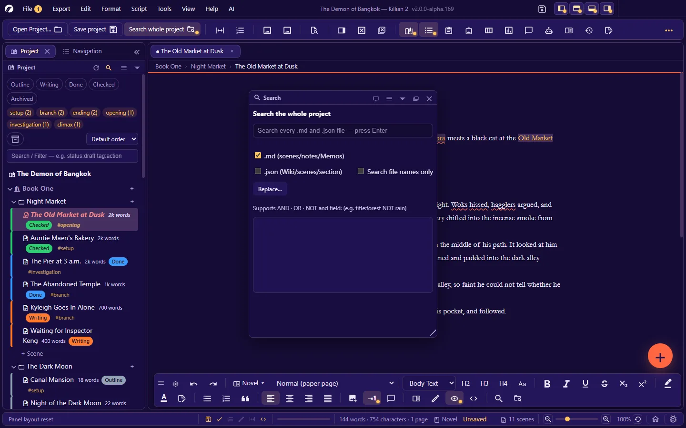
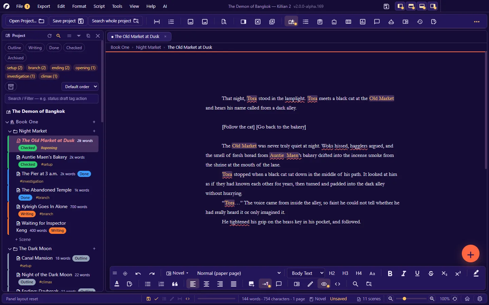
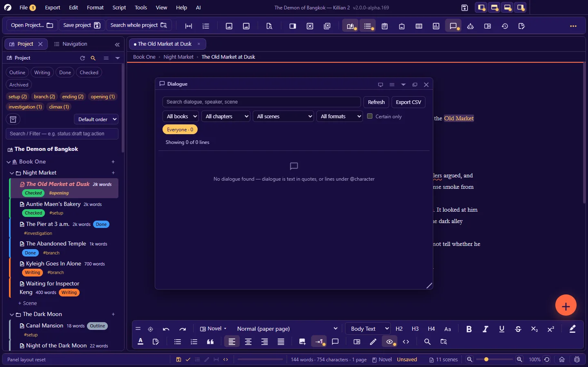

# 11. Find, replace and navigate

**Language:** English · [ภาษาไทย](../th/11-search-navigate.md)

[← 10. Saving, history, backup and recovery](10-history-backup.md) · [Contents](README.md) · Next: [12. Settings →](12-settings.md)

---

| You want to | Use | Shortcut |
|---|---|---|
| Find a word in the open document | [Find in a document](#111-find-and-replace-in-a-document) | `Ctrl+F` / `Ctrl+H` |
| Find a word in the whole project | [Search the whole project](#112-search-the-whole-project) | `Ctrl+Shift+F` |
| Change a word across the whole project | [Find and replace in project](#113-find-and-replace-in-project) | `Ctrl+Alt+Shift+H` |
| Find scenes by status/tag/point of view | [Filters in the Project panel](#114-filters-in-the-project-panel) | — |
| Jump around a long document | [The Navigation panel](#115-the-navigation-panel) · go to page/scene | `Ctrl+Alt+7` · `Ctrl+G` |
| Open a file by name | [Quick Open](#116-quick-open) | `Ctrl+Shift+O` |
| Find a character's lines | [The All dialogue panel](#117-the-all-dialogue-panel) | `Ctrl+Alt+L` |

## 11.1 Find and replace in a document

`Ctrl+F` opens the find bar above the toolbar. `Ctrl+H` opens the same bar with the cursor in the replace box.

| Button | What it does |
|---|---|
| ↑ / ↓ | Previous / next match (`Enter` = next) |
| **Replace** | Replaces the current match and moves to the next |
| **Replace All** | Replaces every match in this document at once (`Ctrl+Z` undoes it) |
| × | Closes the find bar (`Esc`) |

It works only on the document in the open tab.

## 11.2 Search the whole project

`Ctrl+Shift+F` (or the **Search whole project** button on the toolbar) opens the **Search panel**.

- Type, and results appear a moment after you stop · `↑` `↓` choose a result · `Enter` opens it · `Esc` leaves
- Results are ranked by relevance, with **a snippet that highlights your search terms** — click one to open the file and **jump straight to the match**
- It shows the total number of files found (and how many are shown)
- Options: search `.md` only (scenes/notes/memos) or include `.json` (Wiki pages) · **Search file names only**
- Right-click a book/chapter in the Explorer → **Search in here** = limit the scope of the search

**Query syntax**

| Write | Meaning |
|---|---|
| `Tora cake` | Every word must be found |
| `forest OR sea` | Either one |
| `forest NOT rain` | Has "forest" but not "rain" |
| `title:forest` | Search one field only (e.g. `title:` `tag:` `status:`) |

Thai text is segmented into words before searching, so a Thai word in the middle of a sentence can be found.

**Not searched**: the trash (`Recycle/`) · version history (`Snapshots/`) · backups (`Backups/`) · the originals of problem scenes (`OnSet/`). A deleted scene therefore never shows up in the results.

The first time, the app builds an index (with a progress bar; it can be cancelled) and then keeps it up to date as files change.

## 11.3 Find and replace in project

**Tools → Find and replace in project** (`Ctrl+Alt+Shift+H`)

1. Enter **Find** and **Replace with** (blank = delete the word)
2. Options: **Match case** · **Whole word** (Latin script only) · **Regular expression**
3. **Preview** — a list of the places that will change in each file, plus a summary "N places in M files"
4. **Replace all** → confirm

Safety rules:

- Only **scene and note text (`.md`)** is changed — never file headers (scene properties) · Wiki data · comments
- **Locked scenes are skipped** (you are told how many places were skipped)
- A scene open in a tab with unsaved edits is changed **in its tab** first, and is not written to the file until you save
- It **can be undone** from the Activity history panel ([10.4](10-history-backup.md#104-activity-history-go-back-to-any-point))

> Renaming a character throughout the story: if the character has a Wiki page, rename it there with automatic entity-name syncing turned on (Settings → Automation) — or use Find and replace in project.

## 11.4 Filters in the Project panel

The **Search / Filter** box in the Project panel filters the tree by scene properties.

**Free search**: type a word — it is looked for in titles, tags, statuses, synopses, notes, and so on.

**Field search** `field:value`:

| Field | Write it as | Example |
|---|---|---|
| Status | `status:` | see the note below |
| Tags | `tag:` `tags:` `#:` | `tag:action` |
| Point of view | `pov:` | `pov:Tora` |
| Mood | `emotion:` | `emotion:sad` |
| Conflict | `conflict:` | |
| Colour | `color:` | `color:#6fae6f` — compared with the stored **colour code** (a colour name such as "green" does not work) |
| Synopsis | `synopsis:` | |
| Note | `note:` | |
| Starred | `flag:` `fav:` | `flag:1` |
| File name | `file:` `filename:` | `file:scene-01` |
| Scene title | `title:` | |

(Each field also has a Thai name, e.g. `สถานะ:` for `status:`. Field names are not translated with the interface, so a query you have memorised keeps working in every language.)

> **Statuses in a non-Thai interface.** A field query is compared with the value *stored in the file*. The five built-in statuses are stored under their Thai names and only translated on screen, so typing `status:writing` finds nothing in alpha.169. **Click the status chip instead** — it inserts the stored value for you. Statuses you create yourself are stored exactly as you typed them and can be typed in a query normally.

**Combining conditions**

| Write | Meaning |
|---|---|
| `tag:action pov:Tora` | Both must match (AND) |
| `tag:setup OR tag:climax` | Either one (use `OR` or `\|`) |
| `-tag:cut` or `NOT tag:cut` | Exclude (a leading `-`, or `NOT`) |
| `status:"needs fixing"` | A value containing a space goes in quotation marks |

The **status chips/tag chips** above the filter box write the query for you — clicking several chips in the same group = OR · words you typed yourself in the box are kept.
**Tag cloud**: click a tag to make the Explorer show only scenes with that tag.
**Archived** scenes are always hidden unless you press the archive button to show them.

## 11.5 The Navigation panel

`Ctrl+Alt+7` — an outline of the open document. Click a row to jump to that place.

**The rows** come from block types: headings · scenes (a screenplay's scene headings) · transitions · notes · paragraphs — showing ordinary paragraphs can be turned on/off.

| To… | Do this |
|---|---|
| Jump to a place | Click the row (if you are in a page-at-a-time page view, the app takes you to the right page) |
| Search the outline | The **Search the outline…** box |
| Filter by type | The filter buttons (headings/scenes/transitions/notes/paragraphs) · **Starred only** · **Clear all filters** |
| Star a row / give it a colour | Right-click the row — the mark is tied to the row's text, not its position (insert a paragraph above and the mark does not slip) |
| See the whole book | Switch "the open scene only" ↔ "the whole book" |
| Two columns | Text · line/page |

**Symbols in the list**: bold = a branching point · the choices icon (this scene has a branch) · star · colour bar · work pending (`TODO` / `???` in the text) · no content yet · scene locked · has unresolved comments · forced page break

**A very long list**: in **Settings → Navigation panel** choose **One long list** or **Split into pages** (5–500 rows per page)

**Go to a page/scene**: `Ctrl+G`, then type a page or scene number · `Ctrl+Shift+.` go to a page · `Ctrl+Shift+,` go to a scene (for a screenplay with several scene headings in one file)

## 11.6 Quick Open

`Ctrl+Shift+O` — type part of a name and open the file at once, without hunting through the tree.

| Key | What it does |
|---|---|
| `↑` `↓` | Choose |
| `Enter` | Open (a scene opens as a scene · a Wiki page opens as a Wiki page) |
| `Esc` | Close |
| `Ctrl+R` | Rescan the file list |

The list leaves out the app's internal files (registries · the AI key · trash · history · backups).

Other shortcuts: **reopen the tab you just closed** `Ctrl+Alt+Shift+Z` · **Reveal Open File in Explorer** `Ctrl+Shift+1` · the **Pinned** list in the Explorer

## 11.7 The All dialogue panel

`Ctrl+Alt+L` — every line of dialogue in the whole work, in one place.

- **Filter** by book / chapter / scene / character · **search** in the lines, speaker names and scene titles
- **Click** = go to that line in its scene · **double-click** = edit it right here
- It reads both modes:
  - Screenplay: the speaker comes from `@CHARACTER`
  - Novel: dialogue = text inside quotation marks · the speaker comes from a name before/after the quotation marks, or is **guessed from the turn-taking** — rows that are guesses can be hidden
- It warns about lines whose quotation marks are not closed
- A button re-reads the files of the whole work (use it after editing files elsewhere)

Use it to check one character's voice at a time: filter by the character, then read their lines back to back across the whole story.

---

Next: [12. Settings →](12-settings.md)
