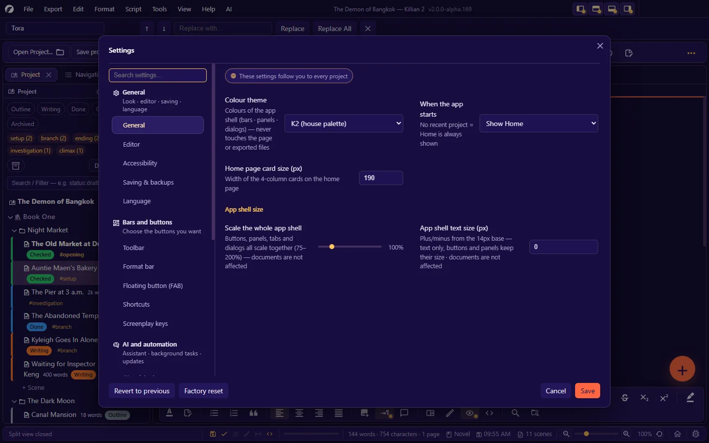
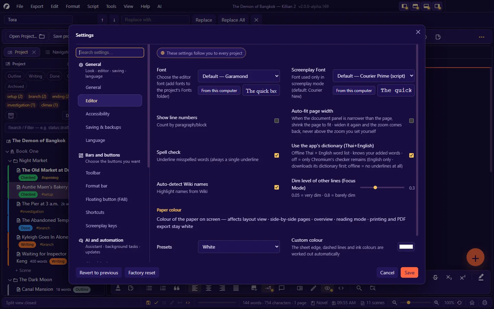
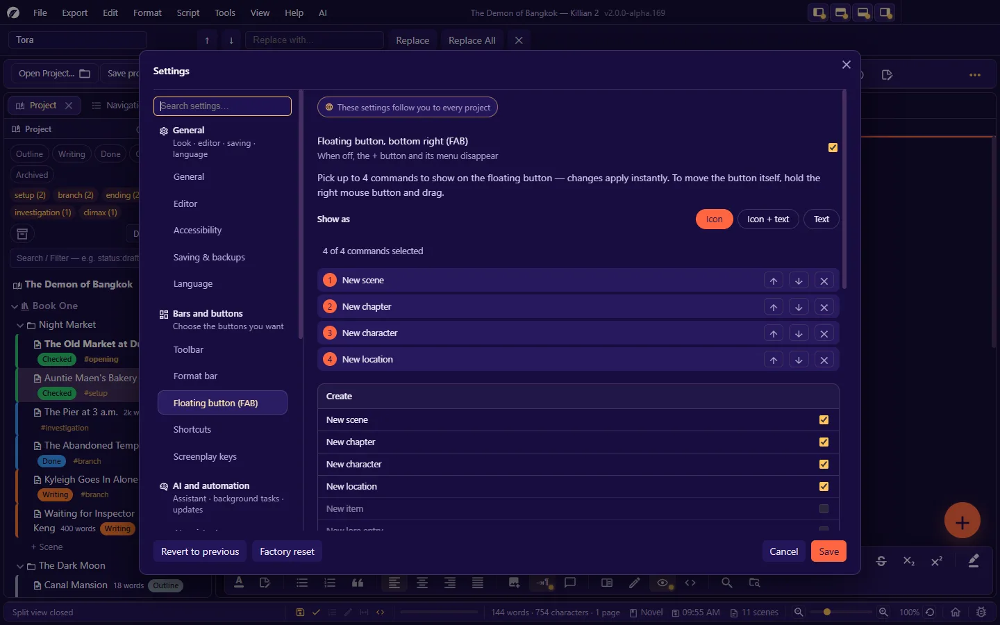
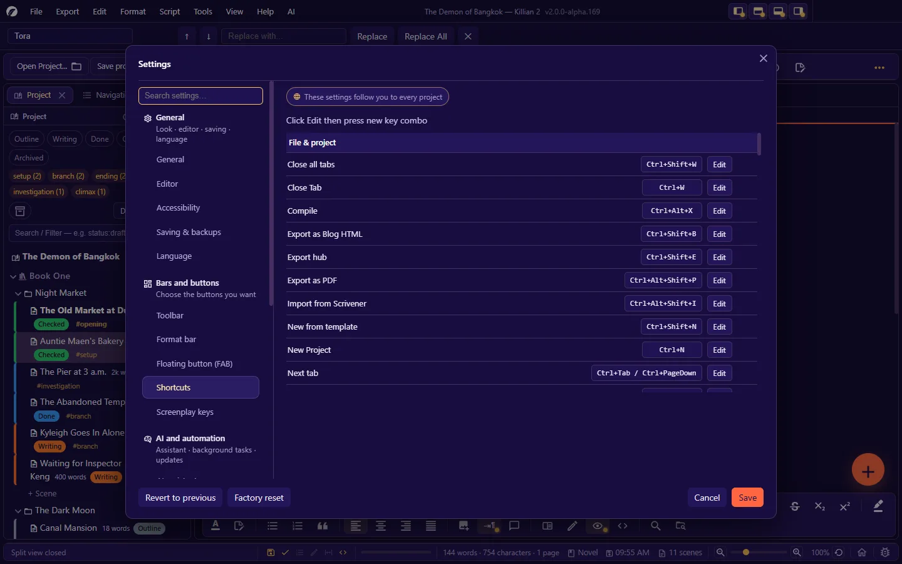
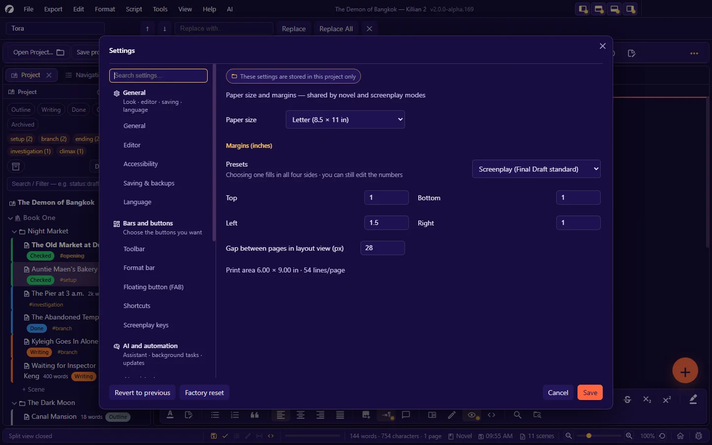
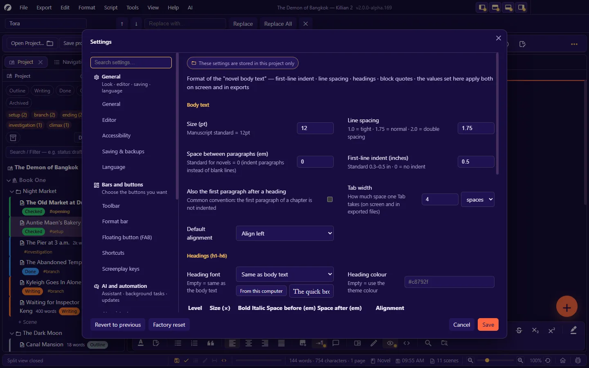
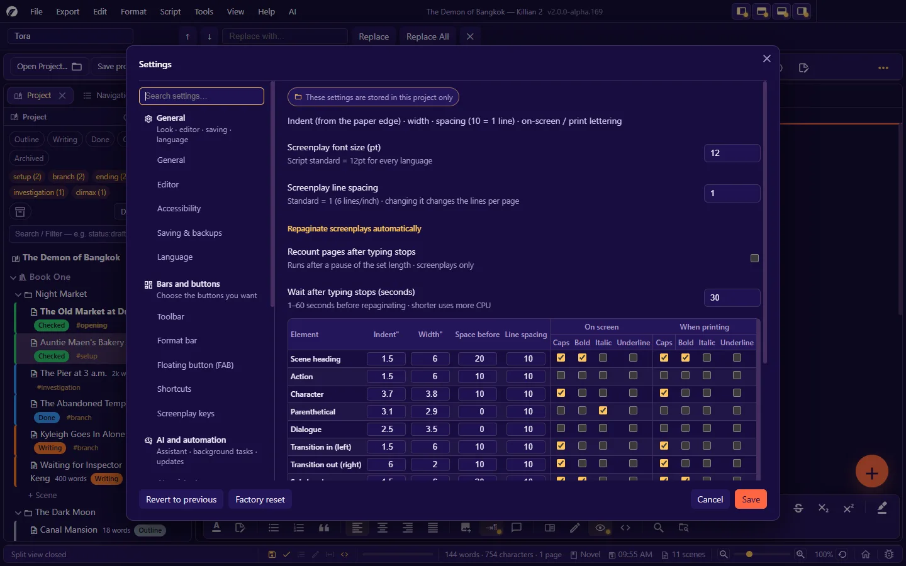

# 12. Settings

**Language:** English · [ภาษาไทย](../th/12-settings.md)

[← 11. Find, replace and navigate](11-search-navigate.md) · [Contents](README.md) · Next: [13. Language, themes, fonts and accessibility →](13-language-themes-a11y.md)

---

Open the Settings dialog: `Ctrl+,` · **File → Settings → Project settings…** · the gear button on the toolbar or on Home.

## 12.1 Know this first: "user" settings versus "project" settings

Every page has a label at the top that states its scope:

| Label | Meaning | Stored in |
|---|---|---|
| **These settings follow you to every project** | Set once, used for every project on this machine | The user-data folder (`settings.json`) |
| **These settings are stored in this project only** | They belong to the open project — hand the project to someone and these go with it | `project.khn.json` |

| Follow the user | Belong to the project |
|---|---|
| General · Editor · Accessibility · Saving & backups · Language · Toolbar · Format bar · Floating button (FAB) · Shortcuts · AI assistant · Automation | Screenplay keys · Paper · Novel format · Script format · Scene & page numbers (script) · Fonts by language · Project info · Navigation panel · Story Network |

- You can open Settings **with no project open** — the project pages are hidden.
- Most fields **show their effect at once as a preview**, but are only really saved when you press **Save**. Pressing **Cancel** returns every field to its previous value.
- (The exceptions are the 3 pages that say "changes apply instantly": Toolbar · Format bar · Floating button.)
- The dialog has a search box — type what you want to change (e.g. "font", "margin") to find the right page.

---

## General

| Field | Default | Description |
|---|---|---|
| **Colour theme** | K2 | Colours of the app shell (bars · panels · dialogs) — never touches the page or exported files. The themes are listed in [chapter 13](13-language-themes-a11y.md#132-colour-themes). |
| **When the app starts** | Show Home | Show Home · Open the last project right away · Open the last project, with Home on top (no recent project = Home is always shown) |
| **Home page card size (px)** | 190 | The width of the project cards on Home |
| **App shell size** | 100% | Scales buttons, panels, tabs and dialogs together (75–200%) — documents are not affected |
| **App shell text size (px)** | 0 | Plus/minus from the 14px base — text only; buttons and panels keep their size |

## Editor

| Field | Default | Description |
|---|---|---|
| **Font** | Garamond | The font of the novel editor — pick from the list, or **From this computer** (fonts installed on this machine) · there is a box for sample text · add fonts to a project by placing the files in its `Fonts/` folder |
| **Screenplay Font** | Courier Prime | The font used only in screenplay mode (the script standard) |
| **Show line numbers** | Off | Counted by paragraph/block |
| **Auto-fit page width** | Off | When the document panel is narrower than the page, shrink the page to fit · widen the panel and the zoom comes back, never above the zoom you set yourself |
| **Spell check** | On | Underlines misspelled words |
| **Use the app's dictionary (Thai+English)** | On | An offline word list that knows the words you added · off = only Chromium's checker remains (English only; it must first download its dictionary from the internet) |
| **Auto-detect Wiki names** | On | Highlights names from the Wiki in the text |
| **Dim level of other lines (Focus Mode)** | 0.3 | 0.05 = very dim · 0.8 = barely dim |
| **Paper colour** — Presets | White | White · Cream · Sepia · Light grey · Mint · Dark · Custom — the colour of the paper **on screen** (layout view · side-by-side pages · overview · reading mode). Printing and PDF export stay white. |
| **Custom colour** | `#ffffff` | The sheet edge, dashed lines and ink colours are worked out automatically |
| **Page margin guides** | Off | A dashed line around the print area in layout view |

## Accessibility

See the details and how to use them in [chapter 13](13-language-themes-a11y.md#134-accessibility).

| Group | Fields | Defaults |
|---|---|---|
| Vision and colour | Buttons for the 8 vision themes + back to your previous theme | — |
| Show pressed keys | On/off · which keys to show (Every key / Typed characters only / Special keys and shortcuts) · position on screen (Centre / Top / Bottom) · text size · stays on screen for · **Show a sample** | Off · Every key · Centre · 160 px · 0.9 s |
| Cursor line highlight | On/off · highlight colour · highlight strength | Off · `#ffe066` · 40% |
| Typewriter mode | Keep the line you are typing mid-screen (stays on the next time you open the app) | Off |
| Typewriter sound | On/off · when it plays (the whole time you type / only in typewriter mode) · volume · preview buttons | Off · the whole time · 50% |
| On-screen keyboard | The **Open on-screen keyboard** button (the system's own) | — |

## Saving & backups

| Field | Default | Description |
|---|---|---|
| **Auto-save every (minutes)** | 5 | 0 = disable auto-save |
| **Auto-backup versions on save** | On | Keeps each file's version history |
| **Max auto backups** | 10 | Per file — named versions are not deleted |
| **Auto-empty trash older than (days)** | 30 | 0 = never |

(Activity history is set per project, on the **Project info** page.)

## Language

| Part | Description |
|---|---|
| **Interface Language** | Deutsch · English · Français · 日本語 · Português · ไทย · 简体中文 (+ any language whose file you add) |
| Where language files are looked for | The list of folders in which the app looks for `k2_<language code>.csv` files |
| **Export translation file (CSV)** · **Open the language folder** · **Reload language files** | For translators — see [13.1](13-language-themes-a11y.md#131-language) |

## Toolbar

Choose which buttons appear on the toolbar — changes apply instantly. They are grouped as on the bar ([2.2](02-interface.md#22-toolbar)) · each group has all-on/all-off buttons · the divider of a group that is entirely off disappears by itself · a reset button.

## Format bar

Choose the buttons on the format bar, separately for 4 contexts: **novel** · **screenplay** · **Everywhere (Wiki · dashboard)** · **planning board**.
The button groups: undo/redo · block type and headings · character formatting · colours and notes · lists · alignment · insert and switches · reading/writing modes · search · a reset button.

## Floating button (FAB)

| Field | Description |
|---|---|
| **Floating button, bottom right (FAB)** | When off, the + button and its menu disappear |
| **Show as** | Icon · Icon + text · Text |
| The selected commands (up to 4) | Move up/down/remove |
| Commands to choose from | **Create**: scene · chapter · character · location · item · lore/knowledge · memo · from a template — **While writing**: scratchpad · quick note for the scene · search the whole work · quick open · insert image — **View/panels**: dashboard · timeline · maps · Kanban · image library · focus mode — **File**: save all · back up now · Export Hub · settings |

## Shortcuts

A list of every command that has a shortcut, grouped as in [Appendix B](B-shortcuts.md).

- Click **Edit**, then press the new combination (it must include `Ctrl`/`⌘`)
- A combination that **clashes with another command is flagged**
- The reset button at the end of the row restores that command's default
- After a change, tooltips, menus and the "Keyboard Shortcuts" dialog show the new keys

> This page lists only commands that already have a shortcut. In this version you cannot yet add a shortcut here to a command that has none by default.

## Screenplay keys *(project)*

| Field | Default | Description |
|---|---|---|
| **Turn on the element-switching keys** | On | Off = `Enter` starts a new line of the same type; the other keys do nothing |
| **Line after dialogue = more dialogue** | Off | Off (Final Draft style) = the next line is Action · On = for long dialogue over several lines; action must then start with `!` |
| **Keys used** | `Enter` · `Ctrl+Tab` · `Ctrl+Shift+Tab` | Go to the next element · cycle forward · cycle backward — press **Change**, then press the new key |
| **The element table** | Per the standard | For each type: `Enter` → ? · `Ctrl+Tab` → ? · `Ctrl+Shift+Tab` → ? |

## AI assistant

Shows the provider currently in use and the **Open AI assistant settings** button ([chapter 8](08-ai.md#82-setting-up-a-provider)). Keys are kept separately in a file on this machine and never go into the project file.

## Automation

| Field | Default | Description |
|---|---|---|
| **Auto-sync** | Off | Rename an entity in the Wiki and its name is updated in every file automatically |
| **Thesaurus (synonyms/antonyms)** | Off | On = the selected word is sent to an online service to look up synonyms · off = only the built-in Thai thesaurus |
| **Check for updates on startup** | On | Off = no internet access at startup |
| Current version · last checked · update source | — | The **Check now** button · stop skipping a version ([chapter 15](15-update-bug-log.md)) |

## Paper *(project)*

Paper size and margins — shared by novel and screenplay modes.

| Field | Default | Choices |
|---|---|---|
| **Paper size** | Letter | Letter (8.5 × 11 in) · A4 (8.27 × 11.69) · Legal (8.5 × 14) · Digest (5.5 × 8.5) · US Trade (6 × 9) · Compact/Novella (5 × 8) · Mass Market (4.25 × 6.87) · Bunkobon/A6 (4.1 × 5.8) · Tankōbon (5 × 7.5) · Pocket Book (14.5 × 21 cm) · A5 (14.8 × 21 cm) · Custom |
| **Margin presets** | Screenplay (Final Draft standard) | Normal — 1 in all round · Narrow — 0.5 in all round · Moderate · Wide · Screenplay · Novel (manuscript submission) · A4 narrow (2 cm) · A4 normal (2.5 / 3.17 cm) · Custom |
| **Top / Bottom / Left / Right (inches)** | 1 / 1 / 1.5 / 1 | You can still edit the numbers after choosing a preset |
| **Gap between pages in layout view (px)** | 28 | The distance between sheets on screen |

A box shows the result: the print area (e.g. 6.00 × 9.00 in) and the number of lines per page (e.g. 54).

## Novel format *(project)*

The values set here apply both on screen and in exported files.

**Body text**

| Field | Default | Description |
|---|---|---|
| Size (pt) | 12 | Manuscript standard = 12pt |
| Line spacing | 1.75 | 1.0 = tight · 1.75 = normal · 2.0 = double spacing |
| Space between paragraphs (em) | 0 | Standard for novels = 0 (indent paragraphs instead of leaving blank lines) |
| First-line indent (inches) | 0.5 | Standard 0.3–0.5 in · 0 = no indent |
| Also the first paragraph after a heading | Off | Common convention: the first paragraph of a chapter is not indented |
| Tab width | 4 spaces | Unit: spaces · inches · cm — on screen and in exported files |
| Default alignment | Align left | Align left · Justify |

**Headings (h1–h6)**

| Field | Description |
|---|---|
| Heading font | Empty = same as the body text |
| Heading colour | Empty = use the theme colour |
| The per-level table | Size (×) · Bold · Italic · Space before (em) · Space after (em) · Alignment — defaults h1 = 2× · h2 = 1.6 · h3 = 1.35 · h4 = 1.2 · h5 = 1.1 · h6 = 1 · bold at every level |
| Number chapters automatically | Drawn on screen/in exported files — no numbers are written into the source file |
| Chapter number format | Uses `{n}`, e.g. `Chapter {n}` |
| Number headings of level | Default 1 |

**Block quote**: Italic (on) · Left border line (on) · Indent 0.35 in · Text colour (empty = the theme colour)

**Preset buttons**: **Set to standard novel style** · **Manuscript for publishers (double-spaced)** · **Restore defaults**
A box shows the approximate result: lines per page and characters per line · the **Go to page numbers** button takes you to the Scene & page numbers page.

## Script format *(project)*

| Field | Default | Description |
|---|---|---|
| Screenplay font size (pt) | 12 | Script standard = 12pt for every language |
| Screenplay line spacing | 1 | 1 = 6 lines/inch · changing it changes the lines per page |
| Recount pages after typing stops | Off | Repaginates screenplays automatically |
| Wait after typing stops (seconds) | 30 | 1–60 — shorter uses more CPU |

**The per-element table** — Indent (inches from the paper edge) · Width (inches) · Space before · Line spacing (10 = 1 line) · and Caps/Bold/Italic/Underline, separately for **On screen** and **When printing**

| Element | Indent | Width | Space before | Default lettering |
|---|---|---|---|---|
| Scene heading | 1.5 | 6 | 20 | Caps + bold |
| Action | 1.5 | 6 | 10 | — |
| Character | 3.7 | 3.8 | 10 | Caps |
| Parenthetical | 3.1 | 2.9 | 0 | Italic (on screen) |
| Dialogue | 2.5 | 3.5 | 0 | — |
| Transition in (left) | 1.5 | 6 | 10 | Caps |
| Transition out (right) | 6 | 2 | 10 | Caps |
| Sub-header · Intercut · Shot | 1.5 | 6 | 20 | Caps + bold |
| Act break | 1.5 | 6 | 20 | Caps + bold (+ underline when printing) |
| Note · Continued · Summary | 1.5 | 6 | 10 | Italic |
| Outline 1 / 2 / 3 | 1.5 / 1.7 / 1.9 | 6 / 5.8 / 5.6 | 10 | Bold |

A **Restore defaults** button.

## Scene & page numbers (script) *(project)*

| Group | Field | Default |
|---|---|---|
| **Scene numbers** | Show scene numbers beside scene headings (both left and right) | Off |
| | After the number (e.g. empty or ".") | Empty |
| | Distance from the left / right paper edge (inches) | 0.75 / 1 |
| **Page numbers** | Show page numbers (the same switch as for novels) | Off |
| | Also number the first page | On |
| | Distance from the right / top edge (inches) | 1 / 0.5 |
| | After the number | `.` |
| **Continued (CONTINUED)** | Add CONTINUED automatically | On |
| | Added even when the page has no scene heading | Off |
| **Page-break rules (widow / orphan)** | Action: leave at the bottom of the page at least / carry to the new page at least (lines) | 2 / 3 |
| | Dialogue: leave at the bottom of the page at least / carry to the new page at least | 2 / 3 |
| | Hyphens at line ends in a row, at most | 2 |
| | A scene heading at the page bottom must be followed by content | 2 |
| **On-screen checking** | Underline errors in the script | On |
| **Standard wording** | Page bottom when a scene continues | `(CONTINUED)` |
| | Page top when a scene continues | `CONTINUED:` |
| | Dialogue not finished | `(MORE)` |
| | Repeat the character name | `(cont'd)` |
| | Scene / Time headings (cast page) | `Scene` / `Time` |

A **Restore defaults** button.

## Fonts by language *(project)*

One table controls fonts for the whole app: **which character range → which font → in which mode → scaled by what %**

| Column | Choices |
|---|---|
| Row on/off | A tick box |
| Character range | Thai · Latin (English) · Lao · Khmer · Burmese · Chinese/Japanese (kanji) · Korean · Cyrillic · Arabic · Devanagari · every character · a custom range… |
| Font | A font bundled with the app · a file imported into the project · or type the name of a font installed on the machine (several names separated by commas act as fallbacks) · a **From this computer** button |
| Used in | Both modes · novel · screenplay |
| % | Shrinks/enlarges the glyphs to fit the line box |

- The top row has priority · **Add row** as many times as you like · **Import a font file into the project…** · **Restore defaults** · there is a text preview box
- A default row: **Thai in screenplays = 85%**. The screenplay font stack starts with Courier, which has no Thai letters, so Thai falls through to a fallback font whose glyphs are larger and would overflow the script's fixed line height (6 lines/inch).
- The font set here for a script is also the one **embedded in the PDF** — it should be a `.ttf`/`.otf` file.

## Project info *(project)*

| Group | Fields |
|---|---|
| **Logline** (the AI's compass) | Logline (one sentence) · Protagonist · Inciting incident · Goal · Antagonist / Obstacle · Stakes |
| **Title-page information** (used when printing and exporting) | Project Name · Author · Author email · Contact information · Phone |
| **Script credit** | Screenplay By · Based On · Revisions by |
| **Agent** | Name · Address · Phone · Email |
| **Copyright** | Copyright by |
| **Word count goals** | Daily word goal (500) · Project word goal (50,000) |
| **Activity history** | History to keep (steps) — 4–500 · default 32 · **Turn off history recording** |

Open this page directly: **File → Settings → Project info (author · agent · copyright)…**

## Navigation panel *(project)*

| Field | Default | Description |
|---|---|---|
| Layout | One long list (scroll bar) | Or Split into pages |
| Rows per page | 50 | Only used in "Split into pages" mode — 5 to 500 |

This page also explains what the Navigation panel's marks mean ([11.5](11-search-navigate.md#115-the-navigation-panel)).

## Story Network *(project)*

| Group | Fields |
|---|---|
| **Mouse controls** | Button to rotate the 3D view (Middle button · Right click · Left click) · Button to pan the chart (Left click by default) — a line sums up what the caption under the chart will say |
| **Colour preset** | Default · Cable · Flower · X-Rite · Rainbow · custom — **Save as new set** · **Delete set** |
| **Node colours** (by category) | Characters · locations · items · lore · scenes · chapters · books · acts/parts |
| **Line colours** (by relationship type) | Family · Romantic · Ally · Rival · Enemy · Mentor · Acquaintance · Neutral · Other |
| **Other link colours** | Links between scenes · appearing together in a scene · entity ↔ scene |
| **Chart background / text** | Chart background · grid lines · node-name text · node-name label background · node border · node border on hover · the direction axes (empty = follow the theme) |

Click a swatch to choose, or type a hex code · empty = the default.

---

## 12.2 Settings that live outside this dialog

| Subject | Where |
|---|---|
| AI providers · system prompt · agents | **AI → AI settings…** |
| Scene statuses | **File → Settings → Manage scene statuses…** |
| Colour tags | **File → Settings → Manage colour tags (Visual Tags)…** |
| Title pages · page headers · cast page | The **Script** menu |
| Export workflows · export file names | The **Export** menu / the Export Hub |
| Panel layout · workspaces | The **View** menu |
| Plugins | The **Plugins** panel |
| Quick switches | The status bar · the **View** / **Script** / **Tools** menus |

---

Next: [13. Language, themes, fonts and accessibility →](13-language-themes-a11y.md)
