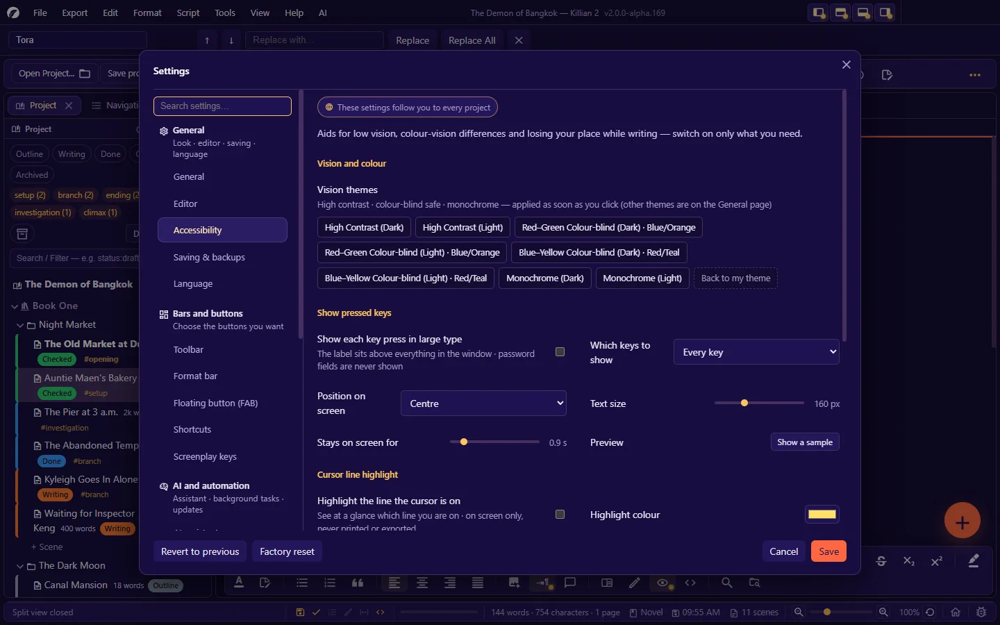

# 13. Language, themes, fonts and accessibility

**Language:** English · [ภาษาไทย](../th/13-language-themes-a11y.md)

[← 12. Settings](12-settings.md) · [Contents](README.md) · Next: [14. Plugins (for users) →](14-plugins.md)

---

## 13.1 Language

### Changing the app's language

**Settings → Language → Interface Language**, or the globe button on Home.

| Built-in language | Code |
|---|---|
| ไทย (Thai) | `th` |
| English | `en` |
| Deutsch | `de` |
| Français | `fr` |
| 日本語 | `ja` |
| Português | `pt` |
| 简体中文 | `zh` |

- The language is a **user setting**. It is not tied to a project — whichever project you open, you get the same language.
- After a change, the app asks whether **to restart so the change takes effect everywhere** (if you agree, it asks about unsaved work first). Restarting is recommended, because some text is built when the app starts. The system menus change to the new language.
- **Dates, numbers and alphabetical sorting** follow the chosen language: Thai uses the Buddhist Era; every other language uses the Gregorian calendar.

**What does not change with the language** (because it is data in your own work files): the names of scene statuses you saved · tags · book/chapter/scene titles · the screenplay codes in the files · the page-header variable names you typed (`${PAGE}` and `${หน้า}` both work in every language).

### Adding a language, or correcting a translation

A language file is **plain CSV**, named `k2_<language code>.csv`. The app discovers languages from the **file names** in the `languages` folder: drop a file in, restart, and that language is available — nothing to install.

**Where the app looks** (earlier wins over later, message by message — a message missing or blank in an earlier file is taken from the next):

1. `<project>/languages/` — translations for this project only
2. the `languages` folder next to the program file
3. `<user data>/languages/` — yours, used in every project
4. the language files shipped with the app

The **Settings → Language** page lists the real folders on your machine and has an **Open the language folder** button.

**File format**

```csv
meta.code,ja
meta.name,Japanese
meta.nativeName,日本語
meta.version,3
meta.author,Translator's name
ui.common.cancel,キャンセル
ui.app.saveDone,保存しました
# a line whose first cell starts with # is a translator's comment
```

- Two columns: **key , text**. Text containing a comma or a line break goes inside `"…"`, with `"` doubled as `""`.
- Placeholders `{0}` `{1}` must be kept. `{sc:save}` = the current shortcut of that command (never type `Ctrl+S` in directly, because users can rebind keys).
- Plurals (for languages that have them): `{0} {0|page|pages}` → "1 page" / "2 pages"
- No HTML tags. Save as UTF-8 (a BOM is fine — it lets Excel open the file without mangling non-Latin text).

**Steps for translators**

1. **Export → Export language as CSV (key · Thai · English)…** — gives you a three-column table to open in a spreadsheet program
2. Translate in a column for the new language
3. **Tools → Import language from CSV…** — merges the translations into the project's language file, with immediate effect (importing **merges over** what is there; keys not in the table are not deleted)
4. Or save it as a two-column `k2_<code>.csv` and put it in `<user data>/languages/`
5. **Settings → Language → Reload language files** re-reads the file of the language in use without closing the app

To get your language into the app itself: send the file as a pull request to the project's `languages/` folder.

## 13.2 Colour themes

Change it in **Settings → General → Colour theme**, or **View → Colour theme**.

A theme changes **the app shell** (bars · panels · tabs · dialogs · the system menus and title bar). It **does not change the paper colour** and has no effect on exported files. (The paper colour is set separately, in Settings → Editor → Paper colour.)

| Group | Themes |
|---|---|
| House themes | **K2** (the default · dark) · **K2 Light** |
| Palettes | Sakura Mist · Plum Wine · Sunny Lagoon · Neon Pop · Tropical · Fruit Salad · Flower Garden · Rainbow |
| In the style of familiar programs | Terracotta (Claude Code) · Terminal Peach (opencode) · Moonlight (Kimi) · Code Dark (VS Code) · Document Blue (Word) · Grid Green (Excel) · Slide Brick (PowerPoint) · Platinum (Classic Macintosh) · Tricolor Mobile Suit (Gundam) · Gamer Pink (D.Va) |
| Vision themes | High Contrast (Dark/Light) · Red–Green Colour-blind (Dark/Light) · Blue–Yellow Colour-blind (Dark/Light) · Monochrome (Dark/Light) |

In the Settings dialog, choosing a theme previews it at once — press **Cancel** to return to your previous theme.

> Themes deliberately have no toolbar button and no shortcut. Adding a new theme has to be done from the app's source code (see the [Extension Guide](../../extension/en/10-other-extension-points.md#106-colour-themes)).

## 13.3 Fonts

There are three layers, set in different places:

| Layer | Set in | Scope |
|---|---|---|
| **The editor's main font** | Settings → Editor → Font / Screenplay Font | User — defaults Garamond (novel) · Courier Prime (screenplay) |
| **Fonts by character range** | Settings → Fonts by language (or File → Settings → Fonts by language…) | Project — e.g. one font for Thai, another for Latin · separately for novel/screenplay mode · a % scale |
| **Heading font for novels** | Settings → Novel format → Heading font | Project |

**Where fonts come from**: bundled with the app · files imported into the project (the `Fonts/` folder — they travel with the project) · fonts installed on the machine (the **From this computer** button)

- **The fonts in an exported file match what the screen is actually using.**
- Sending a project to someone else: fonts "installed on your machine" do not go with it. Use **Import a font file into the project…** if you want it to look the same on every machine.
- **PDF** embeds fonts in the file. The font for each script should be a `.ttf`/`.otf` (a `.ttc` file cannot be embedded).
- **The text size of the app shell** (not of documents): Settings → General.

## 13.4 Accessibility

**Settings → Accessibility**, or **Tools → Accessibility** — these are user settings and follow you to every project.



### Vision themes

Press a theme button and it is applied at once. You can go back to your previous theme.

| Theme | For |
|---|---|
| **High Contrast** (Dark/Light) | Low vision — the highest contrast between text and background |
| **Red–Green Colour-blind** (Dark: Blue/Orange · Light: Blue/Orange) | Warning and danger colours switch to a pair that can be told apart |
| **Blue–Yellow Colour-blind** (Red/Teal) | Likewise |
| **Monochrome** (Dark/Light) | Pure greys; nothing depends on colour |

Important states in the app are never signalled by colour alone (there is an icon or text as well).

### Show Pressed Keys

Shows the key you just pressed in large type on screen — for people who cannot easily look at the keyboard, or for teaching and screen recording.

- Show: Every key · Typed characters only · Special keys and shortcuts
- Position: Centre · Top · Bottom · text size · how long it stays on screen · a **Show a sample** button
- **Password fields and AI-key fields are never shown**
- Quick on/off: **Tools → Accessibility → Show Pressed Keys**

### Cursor Line Highlight

Paints a coloured band on the cursor's line, so you can see at a glance which line you are writing on. Choose the colour and the strength. It is on screen only; never printed or exported.

### Typewriter mode and typewriter sound

- **Typewriter mode** (`Ctrl+Shift+T`): keeps the line you are typing in the middle of the screen, so your eyes stay in one place. It stays on the next time you open the app.
- **Typewriter sound**: key clacks · space · delete · a bell at the end of the line — played the whole time you type, or only in typewriter mode · adjustable volume · preview buttons

### On-screen keyboard

The **Open on-screen keyboard** button calls the operating system's own keyboard (Windows / macOS / Linux), which already knows the languages and layouts set up on your machine.

### Using the app from the keyboard

| Part | How |
|---|---|
| Menu bar | Tap `Alt` or press `F10` → `←` `→` · `Enter`/`↓` · `Esc` |
| Pop-up menus | `↑` `↓` · `Enter` · `Esc` · `→` enters a submenu |
| Dialogs | `Tab` cycles inside the dialog · `Enter` the primary button · `Esc` cancel |
| Toolbar | `Tab` into the bar, then `←` `→` between buttons |
| Panel tab bars · panel-header buttons | `Tab` to reach · `Enter`/`Space` to press |
| Project panel | `↑` `↓` `Home` `End` `Enter` `F2` `Shift+F10` |
| Every command | Rebind shortcuts in Settings → Shortcuts |

### Other things that help

- **UI size 75–200%** and the **app shell text size** (Settings → General) · **page zoom** is separate
- **Paper colour** (Cream · Sepia · Dark) to cut glare
- **Focus mode** reduces distraction · **line numbers** help you refer to a place
- The app respects the operating system's **reduced motion** setting
- Tooltips appear after you hover for a moment; they do not pop up and get in the way

> Not in this version yet: read aloud · default shortcuts for the "Show Pressed Keys" and "Cursor Line Highlight" switches.

---

Next: [14. Plugins (for users) →](14-plugins.md)
