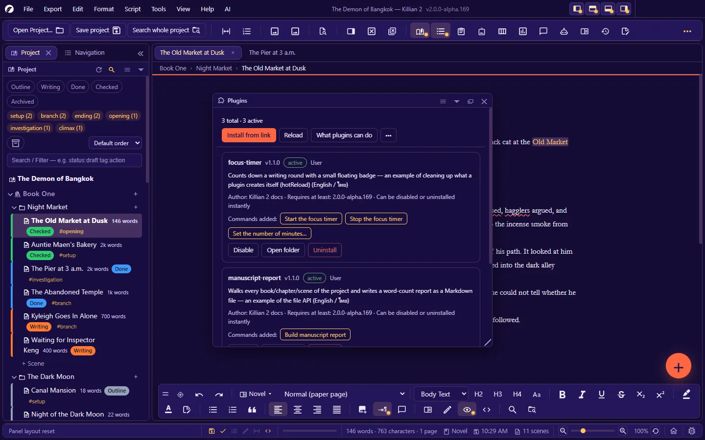

# 14. Plugins (for users)

**Language:** English · [ภาษาไทย](../th/14-plugins.md)

[← 13. Language, themes, fonts and accessibility](13-language-themes-a11y.md) · [Contents](README.md) · Next: [15. Updates, bug reports and the activity log →](15-update-bug-log.md)

---

A plugin is a small piece of code that someone else (or you) wrote to add abilities to the app — new commands, panels, shortcuts, or automatic work when you save or open a project.

This chapter is for people who **use** plugins. If you want to **write** one, see the [Extension Guide](../../extension/en/README.md).

## 14.1 Read before installing: what a plugin can do

> **A plugin runs code with full access inside the app.** It can read, write and delete files in your project, and it can reach the internet.
> **Install only from people you trust**, exactly as you would with any program.

- There is no plugin store yet and no vetting by the Killian developers — you decide whom to trust.
- A plugin's source is plain text files; you can open and read them before installing.
- Before trying a new plugin on real work: **back up the project**, or try it on a test project first.

## 14.2 The Plugins panel

Open it: **View → Panels → Plugins** (`Ctrl+Alt+E`), or the plugins button on the toolbar.

| Part | What it does |
|---|---|
| Summary line | Total · active · failed |
| **Install from link** | Paste a plugin's GitHub link and the app downloads and installs it |
| **Reload** | Re-reads the plugin folders — only plugins whose files changed are run again |
| **What plugins can do** | The full list of abilities the app offers to plugins |
| **⋯** | User folder · Project folder · Create sample |

**A plugin's card** shows: name · version · status badge · origin (user/project) · description · author · minimum app version · "Can be disabled or uninstalled instantly" or "Needs an app restart after disabling or uninstalling" · **Commands added** (you can run them from the card) · the **Disable/Enable** · **Open folder** · **Uninstall** buttons.

| Status badge | Meaning | What to do |
|---|---|---|
| **active** | Loaded successfully | — |
| **off** | You disabled it | Press **Enable** |
| **Needs permission** | The plugin came with the project and has not been allowed yet — **it has not run at all** | See [14.4](#144-plugins-that-come-with-a-project--permission-first) |
| **error** | It failed while loading, and was disabled automatically so the app still starts | Read the error on the card · tell the author · fix the file, then press **Enable** |
| **too old** | It needs a newer version of the app | Update Killian |
| **name clash** | Two plugins share this name — the project one wins, the user one is shadowed | Uninstall the one you do not want |

## 14.3 Installing

### From a link (the usual way)

1. Press **Install from link**
2. Paste the link. Accepted forms:
   - `https://github.com/user/repo`
   - `https://github.com/user/repo/tree/branch` (a specific branch)
   - `https://github.com/user/repo/tree/branch/subfolder`
   - `user/repo` (shorthand)
   - `https://…/file.zip` (a zip file directly — it must be http/https)
3. The app downloads and inspects it, then tells you **which folder name it will install into and how many files it will write**, with a warning about access → confirm
4. If a folder with that name already exists, the app asks before overwriting
5. The plugin starts working at once — **no restart needed**

Plugins installed this way go into the **User folder** (available in every project). The largest file allowed is 25 MB.

If it will not install:

| Message | Cause |
|---|---|
| Cannot read that link | Use the form `https://github.com/user/repo` |
| Only GitHub links or .zip files are supported | A link to another site that is not a zip |
| Download failed (status …) | Check the link and the branch name · the repository is private · no internet |
| No plugin.json inside | It is not a Killian plugin |
| The subfolder in the link was not found | The path in the link is wrong |
| File too large (over 25MB) | — |

### By hand

Put the plugin's folder (the one containing `plugin.json`) in a plugins folder, then press **Reload**.

| Where | Open it from | Use it when |
|---|---|---|
| **User folder** — `<user data>/Plugins/` (Windows: `%APPDATA%\Killian 2\Plugins\`) | ⋯ → User folder | For every project on this machine |
| **Project folder** — `<project>/Plugins/` | ⋯ → Project folder | To make the plugin travel with the project (copy/zip the project and the plugin goes too) |

## 14.4 Plugins that come with a project — permission first

When you open a project that has a `Plugins/` folder (one that someone sent you, say), the plugins in it **are not run** until you allow them. The status bar tells you how many plugins have not been allowed yet, and their cards show **Needs permission**.

To allow them: the Plugins panel → **Allow this project's plugins** → confirm.

- You are allowing "**this exact set of files**", not "this project forever". If someone adds or changes a plugin in the folder later (sync · unzipping over it), the app **asks for permission again**.
- The permission is stored on your machine, not in the project — whoever sent the project cannot set it for you in advance.
- **If in doubt, do not allow.** The project still opens and works fully without the plugins.

## 14.5 Using a plugin's commands

| Way | Where |
|---|---|
| Buttons on the card | The Plugins panel → "Commands added" |
| The **Plugin Commands** button | On the toolbar (it appears once a plugin has added a command · on a narrow bar it is under the » button) |
| The plugin's shortcuts | As set by the author — if one clashes with an app shortcut, the app's command wins |
| The plugin's panels | Opened by a plugin command, then docked/floated/tabbed like the built-in panels |

A plugin's settings, and whether it is enabled, are **remembered per project** (stored in `project.khn.json`).

## 14.6 Disable, update, uninstall

| To… | Do this | Notes |
|---|---|---|
| **Disable temporarily** | The **Disable** button on the card | Remembered per project |
| **Update** | **Install from link** again with the same link → confirm the overwrite | There is no automatic updating yet |
| **Uninstall** | The **Uninstall** button → confirm | **Deletes the folder permanently** (it does not go to the trash) · the plugin's settings in the project file are not deleted |

**"Restart the app to finish unloading"** — some plugins cannot remove themselves cleanly on the spot. When you disable/uninstall/update one of those, the panel shows a notice with a **Restart now** button (it always asks about unsaved work first). Each card tells you in advance which kind the plugin is. Installing or enabling for the first time never needs a restart.

## 14.7 When a plugin causes trouble

1. The Plugins panel → **Disable** the suspect (or disable them one at a time) and see whether the problem goes away.
2. A plugin that fails while loading is already disabled automatically — the app always starts.
3. Read the error: the **Log** panel — a plugin's lines start with `[plugin name]`.
4. You can always remove one by hand: close the app, then delete/move the plugin's folder out of `Plugins/`.
5. Tell the plugin's author (the address is on the plugin's repository page). A problem caused by a plugin is not a Killian bug.

## 14.8 Write one yourself in a minute

The Plugins panel → **⋯ → Create sample** → give it a name → you get a plugin that works straight away (a word-count command + a sample panel) in the User folder. Open its `main.js`, edit it, and press **Reload**.
From there: the [Extension Guide](../../extension/en/README.md).

**Extending without writing code**: language files · dictionaries · AI skills · Wiki templates · export workflows — see [Other extension points](../../extension/en/10-other-extension-points.md).

---

Next: [15. Updates, bug reports and the activity log →](15-update-bug-log.md)
