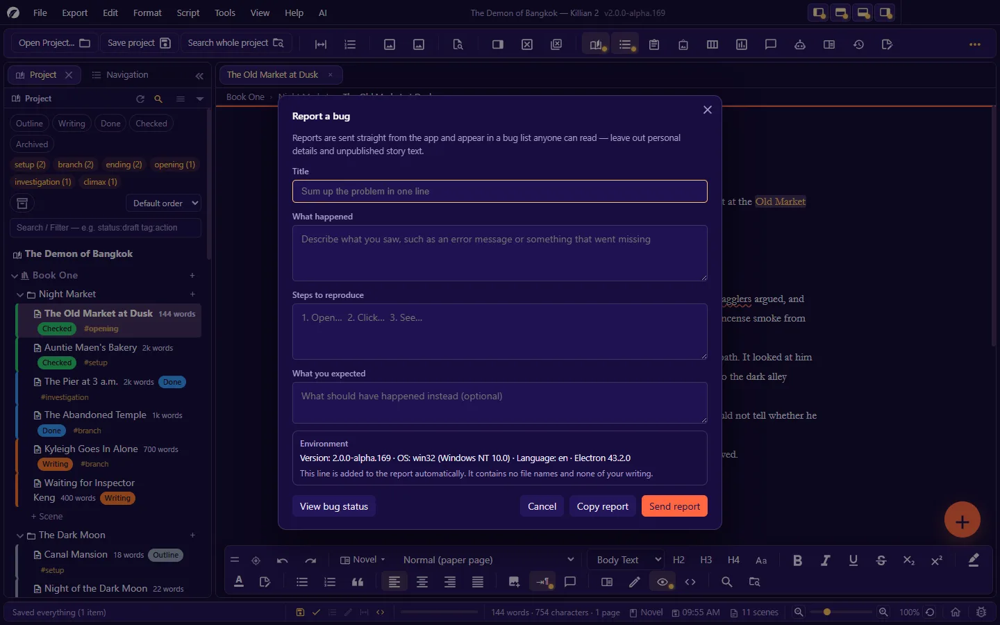
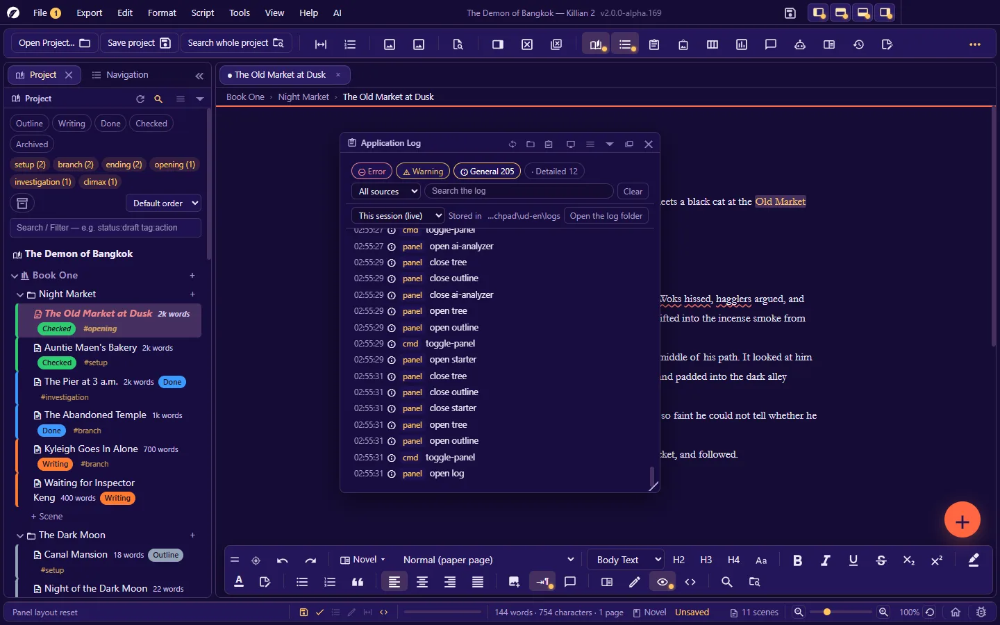

# 15. Updates, bug reports and the activity log

**Language:** English · [ภาษาไทย](../th/15-update-bug-log.md)

[← 14. Plugins (for users)](14-plugins.md) · [Contents](README.md) · Next: [16. Troubleshooting and FAQ →](16-troubleshooting.md)

---

## 15.1 Knowing which version you have

- **The window's title bar**: `Project title — Killian 2 vX.Y.Z`
- **Help → About Killian 2** (`Ctrl+Alt+Shift+/`) — the version number · credits and licences of the components · buttons for what's new · checking for a new version · reporting a bug · bug status · the project folder
- **Help → Changelog** — read what each version added or fixed, one version at a time

## 15.2 Updating the app

The app takes updates from **one official repository only**: <https://github.com/Nbcybg/Killian-Editor-V2>

### Checking for updates

| Way | Where |
|---|---|
| Automatically at startup | On by default — turn it off in **Settings → Automation → Check for updates on startup** (when off, the app does not contact the internet at startup) |
| Manually | **Help → Check for updates…** · the **Check now** button in Settings · the button in the About dialog — it always tells you the result, even when you are already up to date |

### When there is a new version

The **Program update** dialog shows your current version · the latest version · **what changed in this version**, and these buttons:

| Button | What it does |
|---|---|
| **Download the new version** | Downloads the file for your system, then checks that it matches that release's checksum (a file damaged on the way = nothing is replaced) |
| **Replace with the new version** | Replaces the program file, then offers **Restart now** (after asking about unsaved work) |
| **Later** | Closes the dialog — you are reminded again the next time the app starts |
| **Skip this version** | Stops reminding you about this version (you can still check from the Help menu · stop skipping in Settings → Automation) |
| **Open the release page** | Opens the Releases page in your browser |

Special cases:

- **The running program is not a portable file** (it is running from source, say) → it cannot replace itself. The app downloads the file for you and offers a button to open the folder it was saved in, so you can swap it yourself.
- **The new version has no file for your system yet** → open the release page and download it yourself.
- The app never downloads from a link that does not come from the designated repository.

**Before updating**: your work is in the project folder and is not touched — but during alpha, **export a ZIP** of important projects before changing versions.
**Going back a version**: keep the old `.exe`/`.dmg`. Project files work across versions.

## 15.3 Reporting a bug

**Help → Report a bug…**, or the bug button at the end of the status bar.

| Field | What to enter |
|---|---|
| **Title** (required) | Sum up the problem in one line |
| **What happened** | What you saw, such as an error message or something that went missing |
| **Steps to reproduce** | 1. Open… 2. Click… 3. See… |
| **What you expected** | What should have happened instead (optional) |
| **Environment** | Added automatically — app version · operating system · language · Electron version |

- Press **Send report** → the report is sent straight from the app, and the app tells you the **Bug ID** it was given.
- **Copy report** — for sending by another channel when it cannot be sent from the app.
- If sending fails, the dialog tells you why (no internet · too many reports in a short time · the computer's date and time are wrong, and so on) and **what you typed is still there** so you can try again.

### Privacy of reports

> **A report you send appears in a public bug list that anyone can read** (the project's GitHub Issues).

- The only thing added automatically is the environment line you can see in the dialog — **no file names, no file paths, no activity log, no project name and none of your work's content**.
- **Do not paste unpublished story text, API keys or personal information** into the report fields.
- The app sends a report only when you press the send button. No usage data is ever sent in the background.

### Writing a good report

1. One report = one problem.
2. Try to reproduce it first. If you can, write out every step, starting from launching the app.
3. Say which mode it happened in (novel/screenplay) · which view · which panel.
4. Copy the error message from the status bar or the Log panel into the report (check first that it contains nothing private).
5. For panel-layout problems: send the file from **Export → Export panel layout (JSON)…** through whatever channel the maintainers indicate.

## 15.4 Checking bug status

**Help → Bug status…** — a table of reported bugs.

| Column | |
|---|---|
| Bug ID · Details | Click a row = open that bug in your browser |
| Status | Awaiting review · Confirmed · Being fixed · Needs more info · Fixed · Duplicate · Won't fix |
| Found in · Fixed in | |
| Reported | |

- **Filters**: status (all / still open / closed / one status) · Found in · Fixed in · a search box (ID · details · version) · **Clear filters**
- Click a column header to sort · reload · **Open on GitHub**
- A bug you have just sent from this machine appears in the list at once (even before the list from the server has caught up).
- If the latest load failed, the app shows the list it loaded earlier and tells you when that was.

Anyone can view the status. **Reporting** is done from inside the app.

## 15.5 The activity log

**Help → Developer → App activity log…** (`Ctrl+Alt+9`)

It records what the app does: commands run · saves · opening/closing · errors with their codes · lines from plugins (`[plugin name]`).

| To… | Do this |
|---|---|
| Filter by level | All / warnings / errors |
| Copy the filtered lines | The copy button in the panel header |
| Re-read | The refresh button |
| Look back | Choose the file for the day you want (read-only) |
| Open the log folder | The folder button — `<user data>/logs/`, one file per day |

- API keys and tokens are always **masked** in the log. Web links are not recorded in full.
- The log stays on your machine and is sent nowhere — but **read it before sharing it**, because it may contain your file paths and file names.

## 15.6 Developer tools

The **Help → Developer** menu:

- **Developer console…** (`Ctrl+Shift+\``) — a box for running commands that inspect the app's internals when tracking down a problem (a maintainer may ask you to run a short command and send back the result). `Ctrl+Enter` runs · `Ctrl+↑` recalls the previous command.
- **Open Chromium DevTools** — only present when running from source or in developer mode.

> Do not run console commands you do not understand or that came from someone you do not know. The console can reach your files.

---

Next: [16. Troubleshooting and FAQ →](16-troubleshooting.md)
