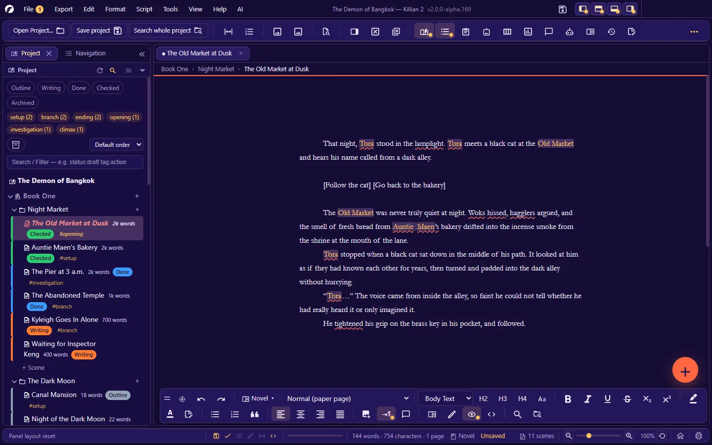

# Killian 2 User Manual

**Language:** English · [ภาษาไทย](../th/README.md)

> For Killian 2 version **2.0.0-alpha.169**. Screenshots were taken with the **K2** theme and the English interface, on Windows.
> The app is still in alpha — menus, button names and behaviour can change with every release. If what you see on screen does not match this manual, trust the screen, then check **Help → Changelog**.

Killian 2 (K2) is a portable writing app for **game stories, novels and screenplays**. It runs on your own machine with no account and no server, and everything is stored as **Markdown + JSON** files in an ordinary folder that you own.

## How to read this manual

| If you… | Start at |
|---|---|
| have just opened the app for the first time | [1. Getting started](01-getting-started.md), then [2. The interface](02-interface.md) |
| just want to write | [4. Writing a novel](04-writing-novel.md) or [5. Writing a screenplay](05-writing-screenplay.md) |
| are moving from Scrivener / Final Draft / Celtx | [9. Export, import and print](09-export-import-print.md#import) |
| are worried about losing work | [10. Saving, history, backup and recovery](10-history-backup.md) |
| cannot find a button or a shortcut | [Appendix A — Menus](A-menus.md) · [B — Shortcuts](B-shortcuts.md) · [C — Every command](C-commands.md) |
| want to write a plugin | [Extension Guide](../../extension/en/README.md) |

Conventions: **bold** = the name of a menu or button on screen · `Ctrl+S` = a shortcut (on macOS: `Ctrl` → `⌘`, `Alt` → `⌥`) · **A → B** = open menu A, then choose B.

## Contents

### Part 1 — Basics
1. [Getting started](01-getting-started.md) — system requirements · installing · the Home screen · creating/opening a project · your first ten minutes
2. [The interface](02-interface.md) — menu bar · toolbar · tabs · format bar · floating button · status bar · the panel system · workspaces · split view
3. [Projects, books, chapters, scenes](03-project-structure.md) — the Project panel (Explorer) · context menus · scene properties · statuses · drafts · memos · book/chapter managers · project health check

### Part 2 — Writing
4. [Writing a novel](04-writing-novel.md) — text formatting · images · the page and its views · focus/reading/typewriter modes · spell check · SmartType · thesaurus · notes · comments · shortcodes
5. [Writing a screenplay](05-writing-screenplay.md) — elements and their keys · CONTINUED/MORE · scene and page numbers · title pages · page headers · the script checker · reports · comparing scripts · problem scenes
6. [Wiki, your story world, and the image library](06-wiki-world.md) — categories and entities · relationships · automatic links · the Encyclopedia · Story Network · image library · mood board

### Part 3 — Planning and review
7. [Planning tools](07-planning.md) — dashboard · Kanban · timeline · planning board · branching chart and play-test · maps · floor plan · visual storytelling · sprints · journal
8. [AI assistant](08-ai.md) — setting up a provider · AI Hub · chat · writing assistant · Rewrite this · agents and skills · analysis · script doctor · worldbuilding · rehearsal room · Story Starter

### Part 4 — Delivering and looking after your work
9. [Export, import and print](09-export-import-print.md) — the Export Hub · PDF · export file names · workflows · exporting from panels · importing · printing
10. [Saving, history, backup and recovery](10-history-backup.md) — autosave · unsaved work · version history · activity history · the trash · backups · files changed outside the app
11. [Find, replace and navigate](11-search-navigate.md) — find in a document · search the whole project · replace in the whole project · Explorer filters · the Navigation panel · Quick Open

### Part 5 — Customising and system
12. [Settings](12-settings.md) — every page of the Settings dialog, field by field
13. [Language, themes, fonts and accessibility](13-language-themes-a11y.md)
14. [Plugins (for users)](14-plugins.md) — installing · allowing · disabling · removing · safety
15. [Updates, bug reports and the activity log](15-update-bug-log.md)
16. [Troubleshooting and FAQ](16-troubleshooting.md)

### Appendices
- [A — Every menu](A-menus.md)
- [B — Every shortcut](B-shortcuts.md)
- [C — Every command](C-commands.md)
- [D — Folder layout and file formats](D-file-formats.md)
- [E — Glossary](E-glossary.md)

## Five things to know before you start

1. **A project is a folder.** There is no database and no special container file. Back up by copying the whole folder; open any `.md` file in another program and it is readable.
2. **Deleting means moving to the project's trash.** A deleted scene, chapter, book or Wiki page can be restored until you empty the trash.
3. **Your work is saved automatically and has version history** — but the app is still in alpha: always keep a copy of anything you cannot afford to lose somewhere else.
4. **AI is optional and uses your own key.** There is no built-in AI service. Everything else works without it, and text only leaves your machine when you tell it to.
5. **Shortcuts bind to physical keys.** They keep working when your keyboard is set to another language, and every one of them can be rebound.

## About this documentation

- Appendices A–C are generated straight from the app's own registries (the real menu, the shortcut dialog, `icons/commands.csv` plus the language file), so they match the stated version.
- Chapters 1–16 describe the behaviour of alpha.169. Where a feature is very new or has not been tested on every operating system, the manual says so at that point.
- Found something wrong or missing in the manual? Report it from inside the app (**Help → Report a bug…**).
