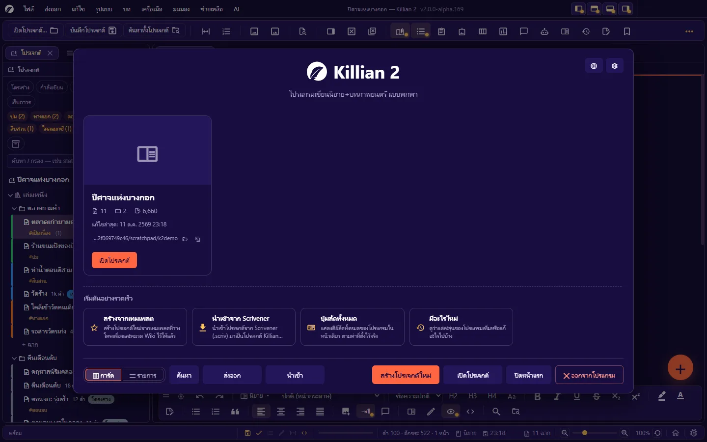
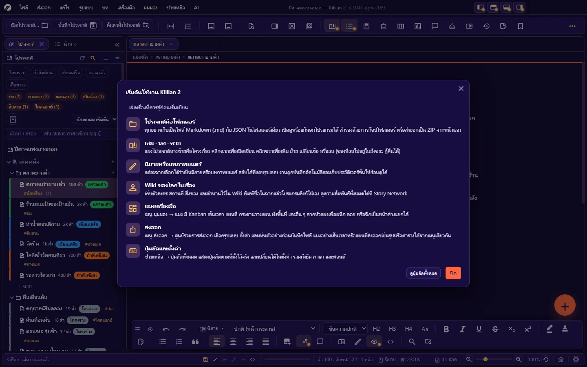

# 1. เริ่มต้นใช้งาน

**ภาษา:** ไทย · [English](../en/01-getting-started.md)

[← สารบัญ](README.md) · ถัดไป: [2. รู้จักหน้าจอ →](02-interface.md)

---

## 1.1 ความต้องการของระบบ

| | ขั้นต่ำ | แนะนำ |
|---|---|---|
| ระบบปฏิบัติการ | Windows 10 64-bit · macOS 12 Monterey (Intel x64 หรือ Apple Silicon) · Linux x64 | Windows 10/11 64-bit · macOS 14 ขึ้นไป · Linux รุ่นปัจจุบัน |
| CPU | 2 คอร์ ~2 GHz | 4 คอร์ขึ้นไป |
| RAM | 4 GB | 8 GB (โปรเจกต์ใหญ่ · เปิดหลายแผงพร้อมกัน) |
| พื้นที่ดิสก์ | ว่าง ~500 MB บน Windows · ~600 MB บน macOS + พื้นที่เก็บงาน | SSD · ว่าง 2 GB ขึ้นไป |
| หน้าจอ | 1366 × 768 | 1920 × 1080 ขึ้นไป |
| การ์ดจอ | ไม่บังคับ | รองรับ WebGL (ใช้กับ Story Network โหมด 3D และโมเดล 3 มิติ) |

- **ไม่รองรับ** Windows 7 / 8 / 8.1 และเครื่อง 32-bit
- ตัวเลขข้างบนเป็น **ค่าประมาณ** จากการวัดบนโปรเจกต์ขนาดเล็ก (ใช้หน่วยความจำราว 460 MB บน Windows · ราว 400 MB บน macOS) ยังไม่ได้ทดสอบบนเครื่องสเปกต่ำหรือโปรเจกต์ขนาดใหญ่มาก
- **อินเทอร์เน็ต** ใช้เฉพาะ 4 เรื่อง: เรียก AI (ถ้าคุณตั้งค่าไว้) · ตรวจ/ดาวน์โหลดอัปเดต · ส่งรายงานบั๊ก · ดูสถานะบั๊ก — การเขียนทั้งหมดทำงานออฟไลน์

## 1.2 ดาวน์โหลดและเปิดโปรแกรม

ดาวน์โหลดจากหน้า Releases ของโครงการ: <https://github.com/Nbcybg/Killian-Editor-V2/releases>

### Windows — ตัวพกพา (portable `.exe`)

1. ดาวน์โหลดไฟล์ `.exe` (ราว 92 MB) ไปวางที่ไหนก็ได้ เช่น `D:\Apps\Killian2\` หรือแฟลชไดรฟ์
2. ดับเบิลคลิกเปิดได้เลย — **ไม่ต้องติดตั้ง ไม่ต้องมีสิทธิ์ผู้ดูแลเครื่อง**
3. ครั้งแรก Windows SmartScreen อาจเตือนว่าไม่รู้จักผู้เผยแพร่ ให้กด **More info → Run anyway** (ถ้าคุณดาวน์โหลดจากหน้า Releases ทางการ)

สิ่งที่ควรรู้ของตัวพกพา:

- ทุกครั้งที่เปิด โปรแกรมแตกตัวเองลงโฟลเดอร์ชั่วคราว (ราว 380 MB ใน `%TEMP%`) — เผื่อที่ว่างของไดรฟ์ระบบไว้ และการเปิดครั้งแรกหลังบูตเครื่องจะช้ากว่าปกติเล็กน้อย
- **ค่าตั้งของผู้ใช้ไม่ได้อยู่ข้างไฟล์ `.exe`** แต่อยู่ที่ `%APPDATA%\Killian 2\` (ดู [1.7](#17-ข้อมูลของโปรแกรมอยู่ที่ไหน)) ย้ายไฟล์ `.exe` ไปเครื่องอื่นจึงได้โปรแกรมเปล่า — ส่วน **งานเขียนของคุณอยู่ในโฟลเดอร์โปรเจกต์** ซึ่งย้ายไปไหนก็ได้
- ถอนการติดตั้ง = ลบไฟล์ `.exe` (และลบ `%APPDATA%\Killian 2\` ถ้าต้องการล้างค่าตั้ง)

### macOS — ไฟล์ `.dmg` (Intel x64 · Apple Silicon arm64)

1. ดาวน์โหลด `.dmg` ให้ตรงกับเครื่อง — `mac-arm64` สำหรับ Apple Silicon (M1 ขึ้นไป) · `mac-x64` สำหรับ Intel (ดูได้ที่ **เมนู Apple → About This Mac**) เปิดแล้วลากไอคอนโปรแกรมเข้า Applications ตัว Intel ไฟล์ `.dmg` ราว 143 MB และใช้ที่ใน Applications ราว 330 MB
2. ตัวโปรแกรม **ยังไม่ได้ลงนาม (code sign)** — เปิดครั้งแรกให้คลิกขวาที่ไอคอน → **Open** → **Open** อีกครั้ง ถ้า macOS ยังไม่ยอม ให้รัน `xattr -cr "/Applications/Killian 2.app"` ใน Terminal หนึ่งครั้ง
3. ตัวเลขในตารางด้านล่างวัดจากตัว Intel

| macOS | |
|---|---|
| รุ่น | macOS 12 Monterey ขึ้นไป (ขั้นต่ำที่ Electron 43 รองรับ) |
| หน่วยความจำที่ใช้ | ราว 400 MB ขณะเปิดโปรเจกต์ขนาดเล็ก |
| เวลาเปิดโปรแกรม | ราว 2 วินาทีตั้งแต่สั่งเปิดจนโปรเจกต์พร้อมใช้ (ครั้งแรกสุดราว 5 วินาที) บนเครื่องทดสอบ |
| ทดสอบบน | MacBook Pro 15 นิ้ว ปี 2019 (Intel Core i9 8 คอร์ 2.4 GHz · RAM 32 GB · macOS 15.7 Sequoia) — ชุดทดสอบ end-to-end ของโปรแกรมผ่านครบบนเครื่องนี้ |

> บน macOS หน้าต่างใช้ปุ่มไฟจราจรของระบบ แถบเมนูของโปรแกรมอยู่บนแถบเมนูของระบบ และคีย์ลัดใช้ `⌘` แทน `Ctrl`

### Linux

ดาวน์โหลด `linux-x64.AppImage` สั่ง `chmod +x` แล้วเปิดได้เลย บางดิสโทรต้องติดตั้ง `libfuse2` ก่อน

หรือรันจากซอร์ส:

```bash
git clone https://github.com/Nbcybg/Killian-Editor-V2.git
cd Killian-Editor-V2
npm install
npm run build
npm start
```

### ทำไม Windows หรือ macOS ถึงขึ้นคำเตือน และวิธีตรวจไฟล์

คำเตือนขึ้นเพราะตัวโปรแกรม **ยังไม่ได้ลงนาม (code sign)** Windows และ macOS จึงไม่มีใบรับรองของผู้เผยแพร่ให้แสดง เลยขึ้นว่า "ไม่รู้จักผู้เผยแพร่" (Windows SmartScreen) หรือ "ตรวจสอบแอปไม่ได้" (macOS Gatekeeper) ไม่ใช่การแจ้งว่ามีไวรัส ตอนนี้กำลังเตรียมการลงนามอยู่ ระบบสร้างตัวโปรแกรมจะลงนามให้เองเมื่อได้ใบรับรอง แล้วขั้นตอนข้ามคำเตือนพวกนี้จะไม่จำเป็นอีก

ระหว่างนี้ตรวจได้ว่าไฟล์ที่โหลดมาตรงกับไฟล์ที่โปรเจกต์เผยแพร่ทุกไบต์:

1. ดาวน์โหลดจากหน้า Releases ทางการเท่านั้น: <https://github.com/Nbcybg/Killian-Editor-V2/releases>
2. ในรุ่นเดียวกัน เปิดไฟล์ `SHA256SUMS-Windows.txt` · `SHA256SUMS-macOS.txt` หรือ `SHA256SUMS-Linux.txt` (มีตั้งแต่รุ่นนี้เป็นต้นไป)
3. คำนวณค่าของไฟล์ที่โหลดมา แล้วเทียบกับบรรทัดที่มีชื่อไฟล์นั้น

```bash
certutil -hashfile Killian2-<รุ่น>-win-x64-portable.exe SHA256
```

(Windows ใน Command Prompt หรือ PowerShell) · macOS / Linux ใช้ `shasum -a 256 <ไฟล์>` ถ้าค่าตรงกันทุกตัว แปลว่าไฟล์ไม่ถูกแก้ตั้งแต่ถูกสร้าง

## 1.3 เปิดครั้งแรก: หน้าแรก (Home)

เมื่อยังไม่มีโปรเจกต์ล่าสุด โปรแกรมเปิด **หน้าแรก** ให้เสมอ



| ส่วน | ทำอะไร |
|---|---|
| การ์ดโปรเจกต์ | โปรเจกต์ที่เคยเปิด — แสดงจำนวนฉาก · บท · คำ · เวลาแก้ไขล่าสุด · ที่อยู่โฟลเดอร์ ปุ่มเล็กข้างที่อยู่ = เปิดโฟลเดอร์ในตัวจัดการไฟล์ / คัดลอกที่อยู่ · โปรเจกต์ที่หาโฟลเดอร์ไม่เจอแล้วจะขึ้นว่า **เปิดไม่ได้** พร้อมปุ่ม **เอาออกจากรายการ** |
| **เริ่มต้นอย่างรวดเร็ว** | สร้างจากเทมเพลต · นำเข้าจาก Scrivener · ปุ่มลัดทั้งหมด · มีอะไรใหม่ |
| **การ์ด / รายการ** | สลับมุมมองของรายการโปรเจกต์ |
| **ค้นหา** | ค้นโปรเจกต์จากชื่อ / ผู้เขียน / ที่อยู่ไฟล์ |
| **ส่งออก / นำเข้า** | ส่งออกโปรเจกต์ที่เปิดอยู่เป็นไฟล์ `.zip` / นำเข้าโปรเจกต์จาก `.zip` |
| **สร้างโปรเจกต์ใหม่ · เปิดโปรเจกต์ · ปิดหน้าแรก · ออกจากโปรแกรม** | ตามชื่อ |
| ปุ่มมุมขวาบน | **ภาษา** (รูปลูกโลก) และ **ตั้งค่า** (รูปเฟือง) — เปลี่ยนภาษา/ธีม/คีย์ลัดได้ตั้งแต่ยังไม่เปิดโปรเจกต์ |

กลับมาหน้าแรกเมื่อไรก็ได้: เมนู **มุมมอง → หน้าแรก (Home)** หรือปุ่มรูปบ้านท้ายแถบสถานะ

**เลือกว่าเปิดโปรแกรมแล้วเจออะไร**: **ตั้งค่า → ทั่วไป → เมื่อเปิดโปรแกรม** — แสดงหน้าแรก (ค่าเริ่มต้น) · เปิดโปรเจกต์ล่าสุดทันที · เปิดโปรเจกต์ล่าสุดแล้วแสดงหน้าแรกทับ

**เปลี่ยนภาษาของโปรแกรม**: ปุ่มลูกโลกบนหน้าแรก หรือ **ตั้งค่า → ภาษา** มี 7 ภาษาในตัว (ไทย · English · Deutsch · Français · 日本語 · Português · 简体中文) ดูรายละเอียดที่ [บทที่ 13](13-language-themes-a11y.md)

## 1.4 สร้างโปรเจกต์ใหม่

**ไฟล์ → สร้างโปรเจกต์ใหม่…** (`Ctrl+N`) หรือปุ่ม **สร้างโปรเจกต์ใหม่** บนหน้าแรก

1. เลือก **แบบของโปรเจกต์** — ตัวแรกคือ **โปรเจกต์ว่าง** ตัวที่เหลือคือเทมเพลต (ดูตารางข้างล่าง)
2. เลือก **โฟลเดอร์แม่** ที่จะสร้างโปรเจกต์ไว้ข้างใน เช่น `D:\งานเขียน\`
3. ตั้ง **ชื่อโปรเจกต์** — โปรแกรมสร้างโฟลเดอร์ชื่อนั้นในโฟลเดอร์แม่ พร้อมไฟล์ `project.khn.json` (ชื่อเรื่องแก้ทีหลังได้ที่ **ตั้งค่า → ข้อมูลผลงาน**)
4. โปรแกรมเปิดโปรเจกต์ให้พร้อมเล่มแรก (ชื่อ `Book 1`) บทแรก และฉากแรก — เปลี่ยนชื่อได้ด้วยคลิกขวา → **เปลี่ยนชื่อ** หรือ `F2`

ถ้าในโฟลเดอร์นั้นมีโปรเจกต์ชื่อเดียวกันอยู่แล้ว โปรแกรมจะ **เปิดของเดิม** ไม่สร้างทับ

> **เลือกที่เก็บให้ดี**: โปรเจกต์เป็นโฟลเดอร์ธรรมดา จึงวางในโฟลเดอร์ที่ซิงก์คลาวด์ (OneDrive · Dropbox · iCloud) ได้ — แต่ **อย่าเปิดโปรเจกต์เดียวกันจากสองเครื่องพร้อมกัน** และรอให้ซิงก์เสร็จก่อนเปิดอีกเครื่อง ไฟล์ที่ซิงก์มาครึ่งทางอาจอ่านไม่ออก (โปรแกรมจะเก็บสำเนาของไฟล์ที่อ่านไม่ออกไว้ให้และไม่เขียนทับ — ดู [บทที่ 10](10-history-backup.md))

### สร้างจากเทมเพลต

**ไฟล์ → สร้างโปรเจกต์จากเทมเพลต…** (`Ctrl+Shift+N`) ให้โครงเรื่องและหมวด Wiki ตั้งต้น:

| เทมเพลต | ได้อะไร |
|---|---|
| **โปรเจกต์ว่าง** | หนึ่งเล่ม หนึ่งบท ไม่มีหมวด Wiki ตั้งต้น — เริ่มจากศูนย์เอง |
| **โครงสร้างนิยายทั่วไป** | บท + ฉาก + ตัวละคร + สถานที่ |
| **แฟนตาซี** | นิยายแฟนตาซี — worldbuilding · เผ่าพันธุ์ · เวทมนตร์ |
| **สืบสวน/ลึกลับ** | นิยายสืบสวน — ตัวละคร suspects · clues · timeline |
| **บทภาพยนตร์** | โครงสร้างบทภาพยนตร์ 3 องก์ ฉากเป็นบทภาพยนตร์ |
| **นิยายเว็บ** | ตอนต่อเนื่อง (ตอนที่ 1, 2, 3 …) สำหรับลงเว็บทีละตอน · ตัวละคร สถานที่ ตำนาน |
| **นิยายภาพ (VN)** | เล่ม *เส้นทางหลัก* กับเล่ม *เส้นทาง A* (เล่มละเส้นทาง) · ตัวละคร สถานที่ สิ่งของ ตำนาน · ทำทางเลือกด้วยผังแตกสาย ([7](07-planning.md)) |

เทมเพลตเป็นแค่จุดเริ่ม — ทุกอย่างแก้ เพิ่ม ลบได้หลังสร้าง

## 1.5 เปิดโปรเจกต์ที่มีอยู่

มีหลายทาง ได้ผลเหมือนกัน:

- **ไฟล์ → เปิดโปรเจกต์…** (`Ctrl+O`) แล้วเลือกโฟลเดอร์ที่มีไฟล์ `project.khn.json`
- **ไฟล์ → โปรเจกต์ล่าสุด** หรือการ์ดบนหน้าแรก
- **ลากโฟลเดอร์โปรเจกต์** จากตัวจัดการไฟล์มาวางบนหน้าต่างโปรแกรม
- เปิดจากบรรทัดคำสั่ง: ส่งทางของโฟลเดอร์โปรเจกต์เป็นอาร์กิวเมนต์ เช่น `"Killian 2.exe" "D:\งานเขียน\นิยายของฉัน"` (โปรแกรมที่เปิดอยู่แล้วจะรับไปเปิดให้ ไม่เปิดหน้าต่างซ้อน)

**โปรเจกต์จาก Killian v1** (รุ่น Python/Tkinter เดิม) เปิดได้ทันทีโดยไม่ต้องแปลง และไฟล์ที่ Killian 2 บันทึกกลับยังเปิดใน v1 ได้ — ดูข้อแตกต่างเล็กน้อยของชื่อไฟล์ที่ [บทที่ 3](03-project-structure.md#38-ชื่อไฟล์บนดิสก์-และการเปลี่ยนชื่อจากนอกโปรแกรม)

**ถ้าเปิดไม่ได้** โปรแกรมจะบอกสาเหตุค้างไว้บนแถบสถานะและไม่ปิดโปรเจกต์เดิมที่เปิดอยู่ สาเหตุที่พบบ่อย: โฟลเดอร์ไม่มี `project.khn.json` · ไฟล์นั้นเสีย (ดู [บทที่ 16](16-troubleshooting.md))

## 1.6 สิบนาทีแรก

เปิด **ช่วยเหลือ → เริ่มต้นใช้งาน** ในโปรแกรมได้ตลอด — หน้านั้นสรุปเจ็ดเรื่องเดียวกับด้านล่าง



1. **ดูแผงโปรเจกต์ทางซ้าย** — โครงของเรื่อง: เล่ม → บท → ฉาก คลิกฉากเพื่อเปิดเขียน คลิกขวาเพื่อเพิ่ม/ย้าย/เปลี่ยนชื่อ/ลบ
2. **พิมพ์ในพื้นที่เขียนตรงกลาง** — บันทึกด้วย `Ctrl+S` (และโปรแกรมบันทึกอัตโนมัติทุก 5 นาทีเป็นค่าเริ่มต้น)
3. **เลือกชนิดของฉาก** — แต่ละฉากเป็น *นิยาย* หรือ *บทภาพยนตร์* สลับที่ปุ่มโหมดบนแถบรูปแบบลอยด้านล่าง หรือ `Ctrl+Shift+M`
4. **สร้างตัวละครตัวแรก** — `Ctrl+Alt+3` แล้วพิมพ์ชื่อ ต่อจากนี้เมื่อพิมพ์ชื่อนั้นในฉาก โปรแกรมจะไฮไลต์และลิงก์ไปหน้า Wiki ให้เอง
5. **เพิ่มฉากและบท** — ปุ่มลอย **+** มุมขวาล่าง หรือ `Ctrl+Alt+2` (ฉาก) · `Ctrl+Alt+1` (บท)
6. **ลองเปิดแผงเครื่องมือ** — เมนู **มุมมอง → แผง** เช่น Kanban (`Ctrl+K`) · แดชบอร์ด (`Ctrl+Alt+D`) · ลากหัวแผงเพื่อผนึกข้าง/ลอย/รวมเป็นแท็บ
7. **ส่งออก** — **ส่งออก → ศูนย์รวมการส่งออก…** (`Ctrl+Shift+E`) เลือกรูปแบบ ดูตัวอย่าง แล้วบันทึกไฟล์

หลงทางตรงไหน: ชี้เมาส์ค้างที่ปุ่มใดก็ได้เพื่ออ่านคำอธิบาย · เปิด **ช่วยเหลือ → ปุ่มลัดทั้งหมด…** (`Ctrl+Alt+/`)

## 1.7 ข้อมูลของโปรแกรมอยู่ที่ไหน

มีของสองกองที่แยกกันเด็ดขาด:

### (ก) โฟลเดอร์โปรเจกต์ — งานของคุณ

ทุกอย่างของเรื่อง: ฉาก · Wiki · รูป · กระดาน · ประวัติ · ถังขยะ · ชุดสำรอง · ค่าตั้งของผลงาน ย้าย/ก๊อป/ซิปทั้งโฟลเดอร์แล้วได้งานครบ (โครงเต็มดูที่ [ภาคผนวก D](D-file-formats.md))

### (ข) โฟลเดอร์ข้อมูลผู้ใช้ — ของเครื่องนี้

| ระบบ | ที่อยู่ |
|---|---|
| Windows | `%APPDATA%\Killian 2\` (พิมพ์ลงในแถบที่อยู่ของ File Explorer ได้เลย) |
| macOS | `~/Library/Application Support/Killian 2/` |
| Linux | `~/.config/Killian 2/` |

ข้างในมี:

| ไฟล์/โฟลเดอร์ | เก็บอะไร |
|---|---|
| `settings.json` | ค่าตั้งระดับผู้ใช้ (ธีม · ภาษา · ฟอนต์ตัวแก้ไข · คีย์ลัด · การช่วยการเข้าถึง ฯลฯ) |
| `recent.json` | รายการโปรเจกต์ล่าสุด |
| `sessions/` | สภาพของเซสชัน (แท็บที่เปิด · เลย์เอาต์แผง) และการอนุญาตปลั๊กอินของโปรเจกต์ |
| `Plugins/` | ปลั๊กอินของผู้ใช้ (ใช้ได้ทุกโปรเจกต์) |
| `languages/` | ไฟล์ภาษาที่คุณวางเพิ่มเอง (ถ้ามี) |
| `dictionaries/` | คลังคำของตัวตรวจคำผิดที่ดาวน์โหลดมา (ถ้ามี) |
| `logs/` | บันทึกการทำงานของโปรแกรมรายวัน |

ของในกองนี้ **ไม่ติดไปกับโปรเจกต์** — ส่งโปรเจกต์ให้คนอื่นแล้วเขาจะไม่ได้ธีม คีย์ลัด หรือคีย์ AI ของคุณ

> **คีย์ของผู้ให้บริการ AI** เก็บในไฟล์ `ai-key.json` ที่รากโฟลเดอร์โปรเจกต์ (แยกจาก `project.khn.json`) — ชุดสำรองอัตโนมัติและ **ส่งออก → ทั้งโปรเจกต์เป็น ZIP…** ของโปรแกรม **ไม่พาไฟล์นี้ไปด้วย** แต่ถ้าคุณก๊อปหรือซิปทั้งโฟลเดอร์เองด้วยมือ ไฟล์นี้จะติดไป ลบออกก่อนส่งให้คนอื่น

## 1.8 ออกจากโปรแกรม

**ไฟล์ → ออกจากโปรแกรม** หรือปิดหน้าต่าง — ถ้ามีงานที่ยังไม่บันทึก โปรแกรมแสดง **รายการงานค้างทั้งหมด** (แท็บเอกสาร · กระดานวางแผน · ผังแตกสาย · ผังพื้นที่ ฯลฯ) ให้เลือกว่าจะบันทึกอะไรก่อนปิด ไม่มีอะไรหายเงียบ ๆ

เปิดครั้งถัดไป โปรแกรมคืนแท็บที่เปิดค้างและการจัดวางแผงให้เหมือนเดิม

---

ถัดไป: [2. รู้จักหน้าจอ →](02-interface.md)
