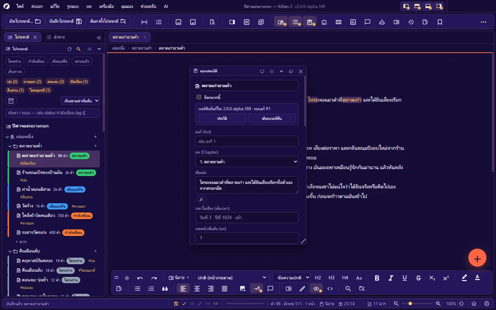
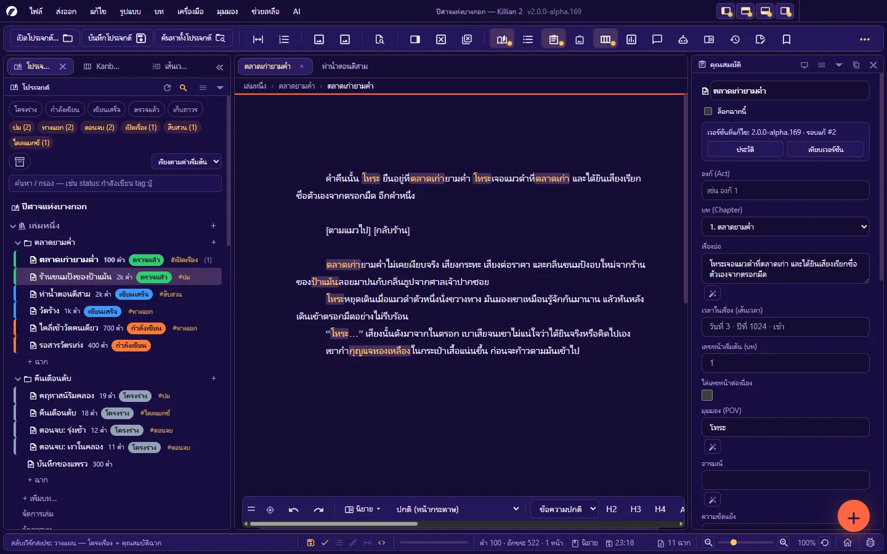
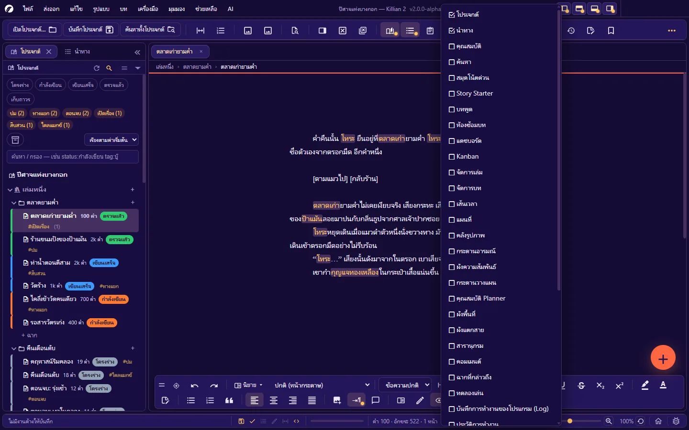
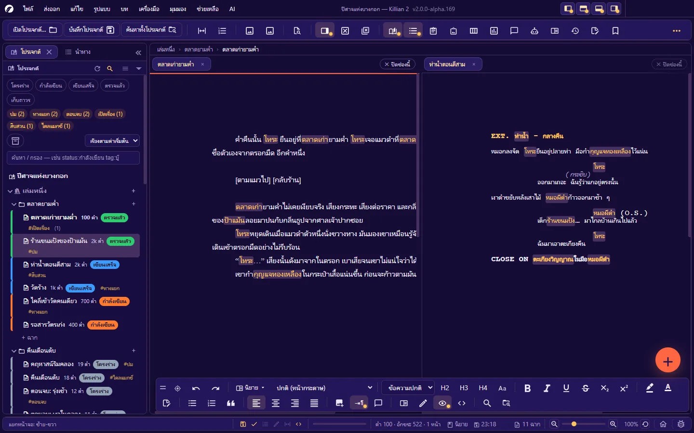

# 2. รู้จักหน้าจอ

**ภาษา:** ไทย · [English](../en/02-interface.md)

[← 1. เริ่มต้นใช้งาน](01-getting-started.md) · [สารบัญ](README.md) · ถัดไป: [3. โปรเจกต์ เล่ม บท ฉาก →](03-project-structure.md)

---

หน้าต่างของ Killian 2 แบ่งเป็นแถบแนวนอนสี่ชั้น กับพื้นที่ตรงกลางที่เป็น **ระบบแผง** จัดเองได้ทั้งหมด

| จากบนลงล่าง | คืออะไร |
|---|---|
| **แถบชื่อ + แถบเมนู** | โลโก้ · เมนู ไฟล์/แก้ไข/รูปแบบ/บท/ส่งออก/เครื่องมือ/มุมมอง/AI/ช่วยเหลือ · ชื่อผลงานกับเลขรุ่น · ปุ่มซ่อนแผงทีละฝั่ง · ปุ่มหน้าต่างของระบบ |
| **แถบเครื่องมือ** | ปุ่มโปรเจกต์ (เปิด · บันทึกทั้งหมด · ค้นหาทั้งโปรเจกต์) และปุ่มเปิด/ปิดแผงกับโหมดต่าง ๆ |
| **พื้นที่แผง** | แผงโปรเจกต์ · พื้นที่เขียน (แท็บเอกสาร) · แผงอื่นที่คุณเปิด — ผนึก ลอย รวมแท็บ หรือฉีกเป็นหน้าต่างได้ |
| **แถบสถานะ** | ข้อความล่าสุด · สวิตช์ด่วน · เป้าหมายวันนี้ · จำนวนคำ/หน้า · ซูม · หน้าแรก · รายงานบั๊ก |

นอกจากนี้มีของลอยสองชิ้นบนพื้นที่เขียน: **แถบรูปแบบลอย** (ปุ่มจัดรูปแบบ) และ **ปุ่มลอย +** (สร้างของใหม่)

## 2.1 แถบชื่อและแถบเมนู

- **เมนู** — ผังเต็มอยู่ที่ [ภาคผนวก A](A-menus.md) · เข้าด้วยคีย์บอร์ด: แตะ `Alt` (หรือ `F10`) แล้ว `←` `→` เดิน · `Enter`/`↓` เปิด · `Esc` ออก
- **ชื่อผลงาน — Killian 2 vX.Y.Z** กลางแถบ — เลขรุ่นของโปรแกรมอยู่ตรงนี้เสมอ (ใช้บอกตอนรายงานบั๊ก)
- **ปุ่มสี่ปุ่มมุมขวาบน** — ซ่อน/แสดงแผงที่ผนึกอยู่ **ด้านซ้าย · ด้านบน · ด้านล่าง · ด้านขวา** ทีละฝั่ง (กดซ้ำเพื่อเรียกคืน)
- **ปุ่มย่อ/ขยาย/ปิด** — เป็นปุ่มของระบบปฏิบัติการจริง บน Windows 11 ชี้ที่ปุ่มขยายเพื่อใช้ Snap Layouts ได้
- ลากที่ว่างของแถบชื่อ = ย้ายหน้าต่าง · ดับเบิลคลิก = ขยาย/คืนขนาด

> บน macOS เมนูอยู่บนแถบเมนูของระบบ และปุ่มหน้าต่างเป็นไฟจราจรมุมซ้ายบน

## 2.2 แถบเครื่องมือ

ซ้ายสุดคือ **ปุ่มโปรเจกต์ 3 ปุ่มที่ซ่อนไม่ได้**: **เปิดโปรเจกต์…** · **บันทึกโปรเจกต์** (บันทึกทั้งหมด) · **ค้นหาทั้งโปรเจกต์**
ถัดไปเป็นปุ่มไอคอนที่จัดเป็นหมวด มีเส้นคั่นระหว่างหมวด:

| หมวด | ปุ่ม |
|---|---|
| มุมมองและโหมด | โหมดโฟกัส · แสดงเลขบรรทัด |
| แทรก | คลังรูปภาพ · เล่าด้วยภาพ (สตอรีบอร์ดของฉากนี้) |
| ค้นหา | ค้นหาไฟล์ด่วน |
| แท็บและหน้าจอ | แยกหน้าจอ · ปิดแท็บ · ปิดทุกแท็บ |
| แผง | โปรเจกต์ · สารบัญ (นำทาง) · คุณสมบัติ · ค้นหา · จัดการแผง · Kanban · แดชบอร์ด · บทพูดทั้งผลงาน · ห้องซ้อมบท · สารานุกรม · ประวัติการทำงาน · บันทึกประจำวัน · สมุดโน้ตด่วน · บันทึกการทำงาน |
| AI | ผู้ช่วย AI (เมนูรวม) · AI Hub · เครื่องมือ AI · AI ผู้ช่วยเขียน · AI วิเคราะห์ · Story Starter |
| เครื่องมือเล่าเรื่อง | เส้นเวลา · แผนที่ · จัดการเล่ม · จัดการบท · ผังความสัมพันธ์ · กระดานวางแผน · ผังแตกสาย · ผังพื้นที่ · ทดลองเล่น · กระดานอารมณ์ · ฉากที่กล่าวถึง |
| ส่วนเสริม | ปลั๊กอิน · ตั้งค่า · คำสั่งจากปลั๊กอิน (โผล่เมื่อมีปลั๊กอินลงทะเบียนคำสั่ง) |
| ซ่อน/แสดงแผงทีละฝั่ง | ซ้าย · บน · ล่าง · ขวา |

- **ปุ่มที่ติดไฟ** (มีจุดสี) = แผง/โหมดนั้นเปิดอยู่ กดซ้ำเพื่อปิด
- **ปุ่มสีจาง กดไม่ได้** = ใช้ไม่ได้ในบริบทนี้ (เช่น ยังไม่ได้เปิดเอกสาร)
- **หน้าต่างแคบจนปุ่มล้น** → ปุ่มที่ล้นไปรวมอยู่ในปุ่ม **»** (สามจุด) ท้ายแถบ
- **เลือกเองว่าจะให้ปุ่มไหนโผล่**: **ตั้งค่า → แถบเครื่องมือ** หรือ **มุมมอง → แผง → ปรับปุ่มบนแถบเครื่องมือ…** หรือคลิกขวาบนแถบ — ติ๊กแล้วเห็นผลทันที (ค่าเริ่มต้นเปิด 40 จาก 46 ปุ่ม · ปุ่ม AI แยกชิ้นถูกปิดไว้ เข้าผ่านปุ่ม **ผู้ช่วย AI (เมนู)** แทน)
- ชี้เมาส์ค้างที่ปุ่มใดก็ได้ = ทูลทิปบอกชื่อ คำอธิบาย และคีย์ลัดตามที่ตั้งไว้จริง

## 2.3 แท็บเอกสารและเส้นทาง (breadcrumb)

พื้นที่เขียนมีแถบแท็บด้านบน — หนึ่งแท็บต่อหนึ่งไฟล์ที่เปิด (ฉาก · หน้า Wiki · Memo ฯลฯ)

| ทำอะไร | วิธี |
|---|---|
| สลับแท็บ | คลิก · `Ctrl+Tab` / `Ctrl+Shift+Tab` (หรือ `Ctrl+PageDown` / `Ctrl+PageUp` — ใช้ชุดนี้ตอนอยู่ในบทภาพยนตร์ เพราะ `Ctrl+Tab` ที่นั่นใช้วนชนิด element) |
| ปิดแท็บ | ปุ่ม × บนแท็บ · `Ctrl+W` · ปิดทุกแท็บ `Ctrl+Shift+W` |
| เปิดแท็บที่เพิ่งปิด | `Ctrl+Alt+Shift+Z` (ย้อนได้ทีละแท็บตามลำดับที่ปิด) |
| เรียงลำดับ | ลากหัวแท็บ |
| หาไฟล์ของแท็บในต้นไม้ | **มุมมอง → แสดงไฟล์ที่เปิดอยู่ในต้นไม้** (`Ctrl+Shift+1`) |

- แท็บที่ **ยังไม่บันทึก** มีเครื่องหมายบนแท็บ และแถวของไฟล์นั้นใน Explorer เปลี่ยนสี
- ปิดแท็บที่ยังไม่บันทึก โปรแกรม **ถามก่อนเสมอ**
- แท็บเยอะจนล้น: แท็บหดชื่อเป็น … (แท็บที่เปิดอยู่หดทีหลังสุด)
- ใต้แถบแท็บคือ **เส้นทาง** `เล่ม › บท › ฉาก` ของเอกสารที่เปิดอยู่
- **ยังไม่ได้เปิดเอกสาร**: พื้นที่เขียนแสดงคำแนะนำและปุ่ม **เปิดแดชบอร์ด**

## 2.4 แถบรูปแบบลอย

แถบปุ่มจัดรูปแบบที่ลอยอยู่ล่างพื้นที่เขียน (ค่าเริ่มต้น: ชิดขอบล่าง กึ่งกลาง)

**ปุ่มบนแถบ** (โหมดนิยาย): หูจับ · เรียกแถบมาที่เมาส์ · ย้อนกลับ/ทำซ้ำ · **สลับโหมดนิยาย/บทภาพยนตร์** · **มุมมองหน้ากระดาษ** · ชนิดบล็อก (ข้อความปกติ/หัวข้อ/คำพูดยกมา) · H2 H3 H4 · สลับรูปตัวพิมพ์ · ตัวหนา/เอียง/ขีดเส้นใต้/ขีดฆ่า/ตัวห้อย/ตัวยก · สีเน้น · สีตัวอักษร · โน้ตด่วน · รายการหัวข้อย่อย/ตัวเลข · คำพูดยกมา · จัดหน้า 4 แบบ · แทรกรูป · ย่อหน้าอัตโนมัติ · คอมเมนต์ · โหมดอ่าน · โหมดเครื่องพิมพ์ดีด · ซ่อนรหัสนำหน้าบรรทัด · ดู Markdown ดิบ · ค้นหาในเอกสาร · ค้นหาทั้งโปรเจกต์

ในโหมดบทภาพยนตร์ แถบเปลี่ยนเป็นชุดของบท (ช่องเลือกชนิด element · ส่วนเสริมชื่อตัวละคร · สวิตช์ CONTINUED ฯลฯ)

| ทำอะไร | วิธี |
|---|---|
| ย้ายแถบ | ลากที่ **หูจับ** ซ้ายสุด |
| สลับชิดขอบบน/ล่าง | `Ctrl+Shift+;` |
| เรียกแถบมาที่ตำแหน่งเมาส์ | `Ctrl+Shift+/` หรือปุ่มเป้าบนแถบ |
| ล็อก/ปลดล็อก (กันเผลอลาก) | `Ctrl+Shift+=` |
| วนความจาง 100% → 50% → 5% | `Ctrl+Shift+'` (แถบที่จางกลับมาชัดเองเมื่อชี้เมาส์) |
| ตัวเลือกทั้งหมด + รีเซ็ต (ตำแหน่ง · ความจาง · ล็อก) | **คลิกขวาที่หูจับ** |
| เลือกปุ่มที่จะแสดง | **ตั้งค่า → แถบรูปแบบลอย** — ตั้งแยก 4 ชุด: นิยาย · บทภาพยนตร์ · ทุกที่ (Wiki/แดชบอร์ด) · กระดานวางแผน |

แถบจัดตัวเองเป็นแถวเดียวเมื่อพื้นที่แคบ และไม่ล้นออกนอกจอ

## 2.5 ปุ่มลอย + (FAB)

ปุ่มกลมมุมขวาล่าง กดแล้วกางคำสั่ง "สร้างของใหม่" ออกมา (ค่าเริ่มต้น: สร้างฉาก · สร้างบท · สร้างตัวละคร · สร้างสถานที่)

- **ตั้งเองได้สูงสุด 4 คำสั่ง** ที่ **ตั้งค่า → ปุ่มลอย (FAB)** — เลือกจากกลุ่ม สร้างของใหม่ / ระหว่างเขียน / มุมมอง-แผง / ไฟล์ · เลือกแสดงเป็นไอคอน, ไอคอน+ข้อความ, หรือข้อความ
- **ย้ายตัวปุ่ม**: คลิกขวาค้างแล้วลาก
- **ซ่อนทั้งปุ่ม**: **มุมมอง → ปุ่มลอยมุมขวาล่าง (FAB)**
- ถ้าตำแหน่งตั้งต้นของปุ่มทับแถบรูปแบบลอย ปุ่มจะขยับขึ้นหลบให้เอง (เว้นแต่คุณวางตำแหน่งเองแล้ว)

## 2.6 แถบสถานะ

แถบล่างสุดเรียงเป็นช่องตายตัว ทุกช่องมีทูลทิป:

| ช่อง | แสดงอะไร | คลิกแล้ว |
|---|---|---|
| **ข้อความ** (ซ้ายสุด) | ผลของสิ่งที่เพิ่งทำ — ข้อความทั่วไปหายเองในไม่กี่วินาที · **ข้อความผิดพลาดค้างไว้** จนมีข้อความใหม่ · บางข้อความมีลิงก์ให้ทำต่อ | — |
| **สวิตช์ด่วน** | บันทึกอัตโนมัติ · ตรวจคำผิด · เลขบรรทัด · โหมดพิมพ์ดีด · ซูมพอดีความกว้างอัตโนมัติ · แสดงรหัสมาร์กดาวน์ | สลับเปิด/ปิด (ตัวที่ต้องตั้งค่าละเอียดจะพาไปหน้าตั้งค่าของเรื่องนั้น) |
| **ความคืบหน้า** | แถบเป้าหมายการเขียนของวันนี้ | — |
| **สถานะเอกสาร** | `คำ · อักขระ · หน้า` · หน้าที่เคอร์เซอร์อยู่ · ชนิดเอกสาร (นิยาย/บทภาพยนตร์) · เวลาบันทึกล่าสุด หรือ "ยังไม่ได้บันทึก" · ในบทภาพยนตร์มีป้ายผลตรวจรูปแบบบทภาพยนตร์ | ป้ายตรวจบท = เมนูของตัวตรวจ (รวมสวิตช์เส้นบอกจุดผิด) |
| **จำนวนฉาก** | ฉากทั้งโปรเจกต์ | — |
| **ซูม** | − ตัวเลื่อน + · เปอร์เซ็นต์ · รีเซ็ต | ซูมหน้ากระดาษ |
| **หน้าแรก** | รูปบ้าน | เปิดหน้าแรก |
| **รายงานบั๊ก** | รูปแมลง | เปิดกล่องรายงานบั๊ก |

เมื่อโปรเจกต์มีปัญหาทะเบียนไฟล์ (ไฟล์หาย · แถวซ้ำ ฯลฯ) จะมีป้ายเตือนบนแถบสถานะ คลิกเพื่อเปิด **ตรวจสุขภาพโปรเจกต์**

**ข้อความลอย (toast)** มุมจอใช้กับงานที่โปรแกรมทำเองเบื้องหลัง (เช่น สำรองอัตโนมัติ) บางอันมีปุ่ม **ย้อนกลับ**

## 2.7 ระบบแผง

ทุกส่วนของหน้าต่างคือ "แผง" — จัดได้แบบโปรแกรมแต่งภาพ: **ผนึก** ติดขอบ · **ลอย** เหนือพื้นที่เขียน · **รวมเป็นกลุ่มแท็บ** · **พับ** · **ฉีกออกเป็นหน้าต่างแยก** ไปจออื่น

### เปิดและปิดแผง

- **มุมมอง → แผง** — รายการแผงทั้งหมดแบ่ง 4 หมวด: เขียน · วางแผน · ตรวจ · AI
- ปุ่มของแผงบนแถบเครื่องมือ หรือคีย์ลัดของแผง (ตระกูล `Ctrl+Alt+…` — ดู [ภาคผนวก B](B-shortcuts.md#แผง))
- **มุมมอง → แผง → จัดการแผง (แสดง/ซ่อน)…** — กล่องรวมทุกแผงพร้อมคำอธิบายว่าแต่ละแผงใช้ทำอะไร

แผงที่เปิดครั้งแรกจะ **ผนึก** เข้าข้างพื้นที่เขียน (แผงแคบอย่างคุณสมบัติไปทางขวา · แผงกว้างอย่างกระดานไปทางซ้าย) และถ้ามีแผงพวกเดียวกันผนึกอยู่แล้วก็เข้าไปเป็นแท็บในกลุ่มนั้น — หน้าต่างแคบจนไม่มีที่จึงจะลอย คุณลากออกมาให้ลอยเองได้เสมอ โปรแกรมจำขนาดและตำแหน่งของแต่ละแผงไว้ (แยกจำระหว่างตอนลอยกับตอนผนึก) แผงที่คุณเคยทำให้ลอยไว้จะกลับมาลอยที่เดิม

### ปุ่มบนหัวแผง

| ปุ่ม | ทำอะไร |
|---|---|
| ย้ายไปหน้าต่างแยก | ฉีกแผงออกเป็นหน้าต่างของระบบ ลากไปจออื่นได้ — **ปิดหน้าต่างนั้น** เพื่อเอาแผงกลับ |
| ☰ เมนูของแผง | คำสั่งทั้งหมดของแผงนี้: ลอย · ฉีก · ปิด · จัดพื้นที่ · "นี่คืออะไร" |
| ▾ พับ | พับเหลือแต่หัวแผง กดอีกครั้งเพื่อคลี่ |
| ลอย/ผนึก | ยกแผงออกมาลอย หรือผนึกแผงที่ลอยอยู่กลับเข้าหน้าต่าง (กลับไปตำแหน่งล่าสุดของมัน) |
| × ปิด | ปิดแผง — เปิดคืนจากปุ่มบนแถบเครื่องมือหรือเมนู มุมมอง → แผง |

ปุ่มทุกตัวกดด้วยคีย์บอร์ดได้ (`Tab` ไปที่ปุ่ม แล้ว `Enter`/`Space`)

### ลากเพื่อจัดวาง

- **ลากหัวแผง** ไปที่ขอบของพื้นที่ทำงานหรือขอบของแผงอื่น → เห็นโซนสีบอกว่าจะ **แทรก** ตรงไหน ปล่อยเพื่อผนึก
- **ลากไปวางบนหัวแผง/แถบแท็บของแผงอื่น** → รวมเป็น **กลุ่มแท็บ** (แผงหลายตัวซ้อนกัน สลับด้วยแท็บ)
- **ลากแท็บออกจากกลุ่ม** → แยกกลับเป็นแผงเดี่ยว
- **กด `Ctrl` ค้างตอนลากแผงลอย** = ย้ายอย่างเดียว ไม่ผนึก
- **กด `Esc` ระหว่างลาก** = ยกเลิก กลับที่เดิม
- **ลากเส้นแบ่งระหว่างแผง** = ปรับสัดส่วน · ดับเบิลคลิกเส้นแบ่ง = 50%
- **ลากมุมขวาล่างของแผงลอย** = ปรับขนาด

ในกลุ่มแท็บ: ปุ่ม × บนแท็บปิดเฉพาะแผงนั้น · ย่อทั้งกลุ่มเป็น **แถบไอคอน** แคบ ๆ ได้ · กลุ่มที่ลอยอยู่มีปุ่มปิดทั้งกลุ่มและผนึกทั้งกลุ่ม

### ซ่อนแผงชั่วคราว (ได้พื้นที่เขียนเต็ม)

| ทำอะไร | คีย์ลัด |
|---|---|
| ซ่อน/แสดงแผงทั้งหมด เหลือแต่พื้นที่เขียน | `Ctrl+\` |
| ซ่อนแผงฝั่งซ้าย | `Ctrl+Shift+[` |
| ซ่อนแผงฝั่งขวา | `Ctrl+Shift+]` |
| ซ่อนทีละฝั่ง (ซ้าย/บน/ล่าง/ขวา) | ปุ่มสี่ปุ่มมุมขวาบนของหน้าต่าง |

กดซ้ำเพื่อคืนแผงกลับที่เดิม

### เวิร์กสเปซ — ชุดการจัดวางแผง

**มุมมอง → จัดพื้นที่ทำงาน → เวิร์กสเปซ…** (`Ctrl+Shift+Y`) สลับชุดการจัดวางได้ในคลิกเดียว

| ชุดสำเร็จรูป | จัดอะไร |
|---|---|
| **Essentials (ค่าเริ่มต้น)** | การจัดวางเริ่มต้นของโปรแกรม |
| **เขียน — จอโล่ง มีแค่สารบัญ** | แผงโปรเจกต์แคบ ๆ + พื้นที่เขียนกว้าง |
| **วางแผน — โครงเรื่อง + คุณสมบัติฉาก** | กลุ่มแท็บ โปรเจกต์/Kanban/เส้นเวลา ทางซ้าย · พื้นที่เขียน · คุณสมบัติทางขวา |
| **ตรวจแก้ — คอมเมนต์ + โน้ต** | โปรเจกต์/นำทาง ทางซ้าย · พื้นที่เขียน · คอมเมนต์/สมุดโน้ต ทางขวา |

จัดแผงตามใจแล้ว **บันทึกเป็นเวิร์กสเปซของคุณเอง** ได้จากเมนูเดียวกัน (ตั้งชื่อซ้ำ = เขียนทับของตัวเอง · ชุดสำเร็จรูปแก้/ลบไม่ได้)

### แผงพัง หาแผงไม่เจอ

**มุมมอง → แผง → รีเซ็ตการจัดวางแผงทั้งหมด** คืนทุกอย่างเป็นค่าเริ่มต้น — ไม่กระทบงานเขียน
ต้องการแนบการจัดวางตอนรายงานปัญหา: **ส่งออก → ส่งออกการจัดวางแผง (JSON)…**

## 2.8 แยกหน้าจอ (Split View)

เปิดสองเอกสารเทียบกัน หรือเปิดฉากเดียวกันคนละตำแหน่ง

- **มุมมอง → แยกหน้าจอ → แยกซ้าย-ขวา / แยกบน-ล่าง** หรือ `Ctrl+Shift+\`
- ช่องใหม่เริ่มว่าง — **ลากหัวแท็บมาวางในช่อง** หรือคลิกช่องแล้วคลิกแท็บด้านบน
- ลากเส้นแบ่งเพื่อปรับสัดส่วน (ดับเบิลคลิก = 50%)
- เพิ่มช่องซ้อนได้อีก ทั้งแนวนอนและแนวตั้ง
- **เอาออกจากช่องนี้** = ช่องว่างลง แต่แท็บยังเปิดอยู่ · **ยกเลิกแยกหน้าจอ** = รวมกลับเป็นช่องเดียว
- จาก Explorer: คลิกขวาที่ฉาก → **เปิดในแยกหน้าจอ (Split view)**

## 2.9 กล่องโต้ตอบ เมนู และทูลทิป

- **กล่องโต้ตอบ**: `Enter` = ปุ่มหลัก (อยู่ขวาสุด) · `Esc` = ยกเลิก/ปิด · `Tab` วนอยู่ในกล่อง · ลากที่หัวกล่องเพื่อย้าย · ดับเบิลคลิกหัวกล่อง = กลับกลางจอ · ปุ่ม × มุมขวาบน
- **เมนูคลิกขวา**: มีแทบทุกที่ — ในเอกสาร (ตัด/คัดลอก/วาง · รูปแบบ · คำแนะนำคำผิด · คำพ้อง · Rewrite this) · แถวใน Explorer · หัวแผง · แถบเครื่องมือ · หูจับแถบรูปแบบ · รูป · การ์ดบนกระดานต่าง ๆ · เดินในเมนูด้วย `↑` `↓` `Enter` `Esc`
- **ทูลทิป**: ชี้เมาส์ค้างสักครู่ — บอกชื่อ คำอธิบาย และคีย์ลัดปัจจุบัน
- **งานที่ใช้เวลานาน** (สร้างดัชนีค้นหา · ส่งออกไฟล์ใหญ่ · อ่านทั้งโปรเจกต์): มีกล่องบอกความคืบหน้าพร้อมปุ่ม **ยกเลิก** ไอคอนบนแถบงานของระบบแสดงความคืบหน้า และกะพริบเรียกเมื่องานจบตอนคุณสลับไปหน้าต่างอื่น

## 2.10 ลากของเข้ามาและลากของข้ามแผง

**จากนอกโปรแกรม (ตัวจัดการไฟล์):**

| ลากอะไรมาวาง | เกิดอะไร |
|---|---|
| โฟลเดอร์โปรเจกต์ | เปิดโปรเจกต์นั้น |
| ไฟล์รูป | แทรกลงเอกสารตรงที่วาง หรือเข้าคลังรูป (ถ้าวางบนคลังรูป/กระดาน) |
| ไฟล์บทภาพยนตร์ (Fountain · FDX · Celtx · Adobe Story · Fade In) | เปิดตัวนำเข้าบท |
| ไฟล์ชนิดอื่น | โปรแกรมบอกว่ารับไฟล์อะไรได้บ้าง |

**ภายในโปรแกรม ("หยิบใส่"):** ลากฉาก · หน้า Wiki · รูป จาก Explorer/คลังรูป ไปวางบนแผงอื่นได้ เช่น ลากฉากลงเส้นเวลา = สร้าง/อ้างอิงเหตุการณ์ · ลงผังแตกสาย = วางการ์ดฉาก · ลงแผนที่ = ปักว่าฉากเกิดที่ไหน · ลากตัวละครลงแผนที่/ผังพื้นที่ = ปักหมุด/วางตัวละคร · ลากชื่อเอนทิตี้ลงเอกสาร = แทรกชื่อ · ระหว่างลากจะมีป้ายข้างเคอร์เซอร์บอกว่าปล่อยตรงนั้นแล้วได้อะไร

## 2.11 ขนาด UI กับซูมหน้ากระดาษ (สองอย่างที่แยกกัน)

| | ปรับอะไร | วิธี |
|---|---|---|
| **ซูมหน้ากระดาษ** | ขนาดของเอกสารบนจอ (ไม่เปลี่ยนขนาดฟอนต์จริงในไฟล์) | `Ctrl+=` / `Ctrl+-` / `Ctrl+Shift+0` · `Ctrl+ล้อเมาส์` · ตัวเลื่อนบนแถบสถานะ · **มุมมอง → ซูม → พอดีความกว้างหน้ากระดาษ** |
| **ขนาด UI** | แถบเครื่องมือ แผง แท็บ กล่อง (75–200%) — ไม่แตะเอกสาร | **มุมมอง → ขนาด UI** หรือ **ตั้งค่า → ทั่วไป → ขนาดของหน้าตาโปรแกรม** |

**ซูมพอดีความกว้างอัตโนมัติ** (ปิดเป็นค่าเริ่มต้น): เมื่อแผงเอกสารแคบกว่ากระดาษ โปรแกรมย่อหน้ากระดาษให้พอดีเอง และขยายกลับเมื่อแผงกว้างขึ้น — ไม่เกินซูมที่คุณตั้งไว้เอง

---

ถัดไป: [3. โปรเจกต์ เล่ม บท ฉาก →](03-project-structure.md)
