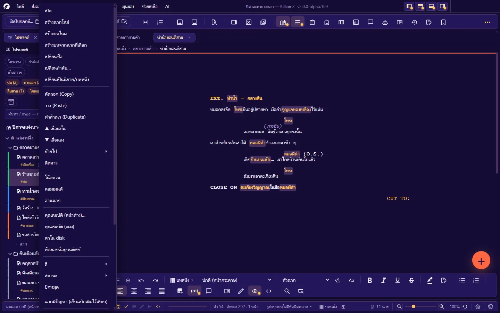
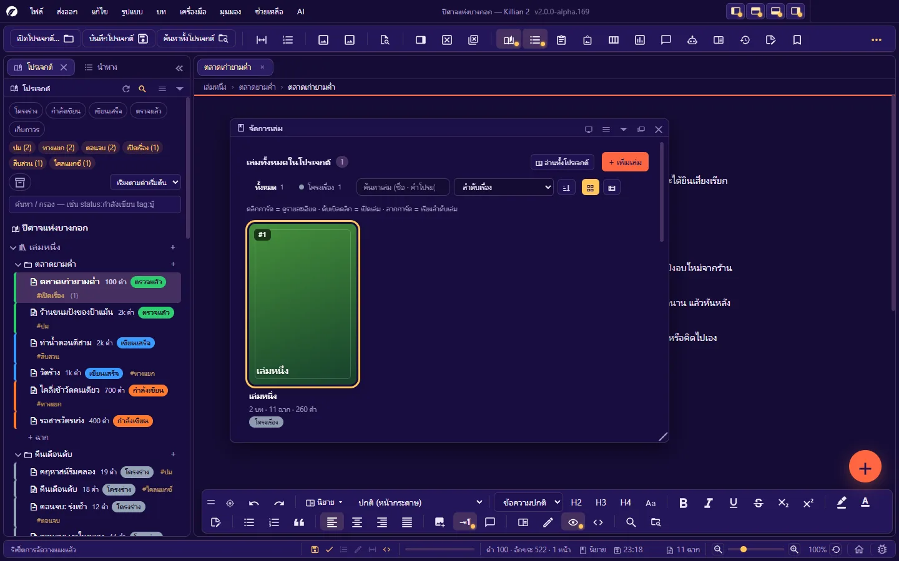
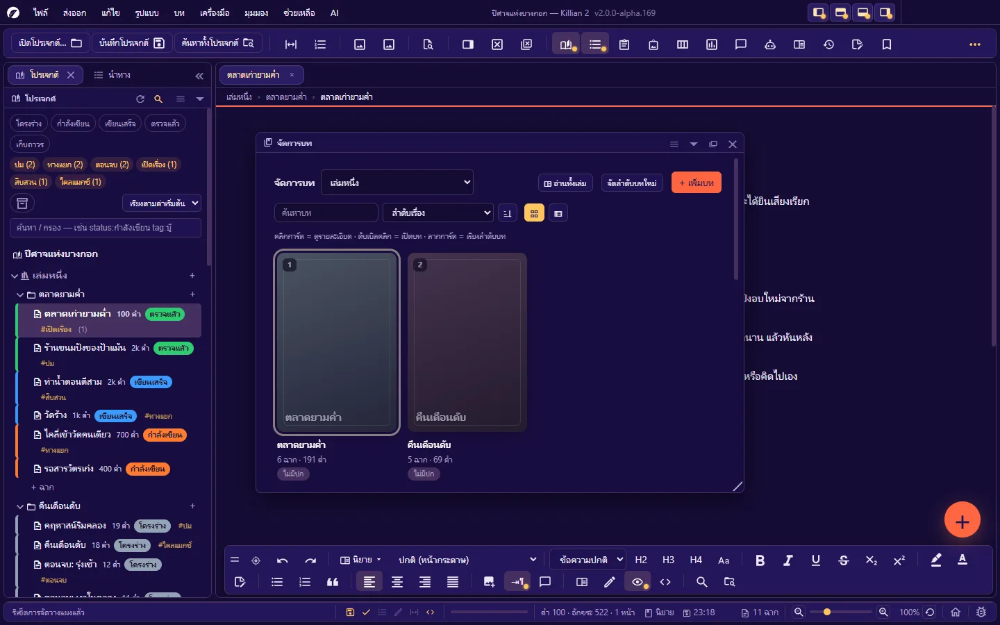
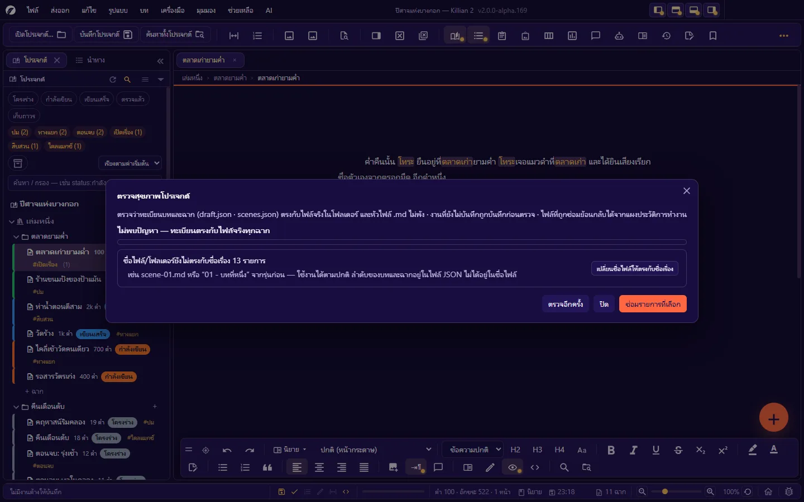

# 3. โปรเจกต์ เล่ม บท ฉาก

**ภาษา:** ไทย · [English](../en/03-project-structure.md)

[← 2. รู้จักหน้าจอ](02-interface.md) · [สารบัญ](README.md) · ถัดไป: [4. เขียนนิยาย →](04-writing-novel.md)

---

## 3.1 โครงของผลงาน

```
โปรเจกต์ (โฟลเดอร์หนึ่งใบ)
├─ เล่ม (Book)                 ← ผลงานหนึ่งเรื่องมีได้หลายเล่ม
│   └─ ฉบับร่าง (Draft)         ← เล่มหนึ่งมีได้หลายร่าง มี "ร่างหลัก" หนึ่งร่าง
│       └─ บท (Chapter)
│           └─ ฉาก (Scene)      ← หน่วยเล็กที่สุด = ไฟล์ .md หนึ่งไฟล์
├─ บันทึกช่วยจำ (Memo)          ← โน้ต/ข้อมูลค้นคว้า ไม่ปนกับต้นฉบับ
├─ Wiki                         ← ตัวละคร สถานที่ สิ่งของ ตำนาน และหมวดที่ตั้งเอง
├─ คลังรูป · กระดานวางแผน · แผนผังแตกสาย · ผังพื้นที่ · แผนที่ · เส้นเวลา
└─ ถังขยะ · ประวัติ · ชุดสำรอง
```

| คำ | ความหมาย |
|---|---|
| **ฉาก** | ไฟล์ `.md` หนึ่งไฟล์ แต่ละฉากเลือกได้ว่าเป็น **นิยาย** หรือ **บทภาพยนตร์** และมีคุณสมบัติของตัวเอง (สถานะ · เรื่องย่อ · มุมมอง · แท็ก …) |
| **บท** | กล่องรวมฉาก มีลำดับ องก์ สถานะ และหน้าปกบทได้ |
| **เล่ม** | กล่องรวมบท = โฟลเดอร์ชั้นบนสุดในโปรเจกต์ มีปก คำโปรย หน้ารายชื่อตัวละคร |
| **ฉบับร่าง** | สำเนาโครงทั้งเล่มสำหรับลองแก้ใหญ่ ๆ โดยไม่แตะของเดิม |
| **Memo** | โน้ตอิสระของโปรเจกต์ แปลงเป็นฉากได้ และแปลงฉากเป็น Memo ได้ |

ลำดับของเล่ม/บท/ฉากเก็บในไฟล์ทะเบียน (JSON) **ไม่ได้อยู่ในชื่อไฟล์** — ลากเรียงใหม่ได้โดยชื่อไฟล์ไม่ต้องเปลี่ยน

## 3.2 แผงโปรเจกต์ (Explorer)

แผงซ้ายสุด (`Ctrl+Alt+6`) คือสารบัญของทั้งผลงาน



### ส่วนต่าง ๆ จากบนลงล่าง

| ส่วน | ทำอะไร |
|---|---|
| หัวแผง | **รีเฟรช** (อ่านโฟลเดอร์ของโปรเจกต์ใหม่ — ใช้เมื่อแก้ไฟล์จากนอกโปรแกรม) · **ค้นหา** (เปิด/ปิดช่องค้นหาชื่อ) |
| ชิปสถานะ | `โครงร่าง` `กำลังเขียน` `เขียนเสร็จ` `ตรวจแล้ว` `เก็บถาวร` + สถานะที่คุณเพิ่มเอง — คลิกเพื่อกรองเฉพาะฉากสถานะนั้น (เลือกหลายชิปได้ = อย่างใดอย่างหนึ่ง) |
| ชิปแท็ก | แท็กที่ใช้ในโปรเจกต์พร้อมจำนวนฉาก — คลิกเพื่อกรอง |
| ปุ่มเก็บถาวร | แสดง/ซ่อนฉากที่มีสถานะ **เก็บถาวร** (ค่าเริ่มต้นซ่อน — ฉากยังอยู่ครบ แค่ไม่รกตา) |
| ช่องเรียง | เรียงตามค่าเริ่มต้น (ลำดับเรื่อง) หรือแบบอื่น |
| ช่อง **ค้นหา / กรอง** | พิมพ์คำ หรือคิวรีเจาะช่อง เช่น `status:กำลังเขียน tag:บู๊` — ไวยากรณ์เต็มที่ [บทที่ 11](11-search-navigate.md#114-ตัวกรองของแผงโปรเจกต์) |
| ต้นไม้ | ชื่อโปรเจกต์ → เล่ม → (ฉบับร่าง) → บท → ฉาก · แถว **+ ฉาก** ท้ายแต่ละบท · ปุ่ม **+** ท้ายแถวเล่ม/บท |
| หมวดอื่น | บันทึกช่วยจำ · Wiki (แยกตามหมวด) · คลังรูป · กระดานวางแผน · แผนผังแตกสาย · รายการปักหมุด · ถังขยะ |

### อ่านแถวของฉาก

`ไอคอน ชื่อฉาก  จำนวนคำ  [ป้ายสถานะ]  #แท็ก` และ:

- **แถบสีซ้ายของแถว** = สีที่ตั้งให้ฉาก (หรือสีของสถานะ)
- **ไอคอนประกอบ**: ติดดาว · ปักหมุด · ล็อก · มีคอมเมนต์ · "ฉากมีปัญหา" · จำนวนเวอร์ชันที่เก็บไว้
- **แถวเปลี่ยนสี** = แท็บของฉากนี้ยังไม่ได้บันทึก
- ชี้เมาส์ค้าง = การ์ดสรุป (ชื่อไฟล์ · สถานะ · แท็ก · มุมมอง · จำนวนคำ · เรื่องย่อ)

### ใช้เมาส์

| ทำอะไร | วิธี |
|---|---|
| เปิดฉาก | คลิกที่แถว |
| พับ/กาง เล่มหรือบท | คลิกลูกศรหน้าแถว |
| เมนูคำสั่งของแถว | คลิกขวา |
| เลือกหลายรายการ | `Ctrl`+คลิก หรือ `Shift`+คลิก — แล้วคัดลอก/ตัด/ทำซ้ำ/ลบ/ย้ายทั้งชุดได้ |
| เรียงลำดับ / ย้ายข้ามบท | ลากแถวไปวาง |
| ลากไปใช้ที่แผงอื่น | ลากฉาก/หน้า Wiki/รูป ไปวางบนเส้นเวลา ผังแตกสาย แผนที่ กระดาน ฯลฯ |

### ใช้คีย์บอร์ด

คลิกในต้นไม้หนึ่งครั้ง (หรือ `Tab` มาถึง) แล้ว:

| คีย์ | ทำอะไร |
|---|---|
| `↑` `↓` | เลื่อนไปแถวก่อนหน้า/ถัดไป |
| `Home` `End` | แถวแรก/แถวสุดท้าย |
| `Enter` | เปิดแถวที่เลือก |
| `F2` | เปลี่ยนชื่อในแถว (เฉพาะฉาก — แถวชนิดอื่นใช้เมนูคลิกขวา → เปลี่ยนชื่อ) |
| `Shift+F10` | เปิดเมนูคลิกขวาของแถว |

## 3.3 เมนูคลิกขวา — ครบทุกชนิดแถว

รายการเรียงตามที่เห็นจริงในเมนู · รายการที่ไม่เกี่ยวกับบริบทจะไม่แสดง · รายการ **หาในดิสก์** และ **คัดลอกที่อยู่บนดิสก์** มีทุกเมนู

### แถวชื่อโปรเจกต์

| กลุ่ม | รายการ |
|---|---|
| โครง | เพิ่มเล่ม · เปลี่ยนชื่อ |
| ไปที่ | ค้นหาไฟล์ด่วน · ค้นหาทั้งโปรเจกต์ · แดชบอร์ด · Kanban · บันทึกประจำวัน |
| เรื่องแตกสาย | เล่น · ประวัติการตัดสินใจ · แผงแตกสาย |
| ตั้งค่า/ไฟล์ | ตั้งค่าโปรเจกต์ · ตั้งค่า AI · หาในดิสก์ · คัดลอกที่อยู่บนดิสก์ |
| ต้นไม้ | กางทั้งหมด · พับทั้งหมด · รีเฟรชรายการ |

### เล่ม

| กลุ่ม | รายการ |
|---|---|
| โครง | เพิ่มเล่ม · เปลี่ยนชื่อ · เปลี่ยนลำดับ… |
| ข้างใน | สร้างบทใหม่ · ทำสำเนา (Duplicate) · ติดดาว |
| จัดการ/อ่าน | จัดการเล่ม · จัดการบท · ค้นหาในนี้ · อ่านทั้งเล่ม |
| หน้าพิเศษ | รายชื่อตัวละคร (Cast of Characters) · หน้าปก (Title Page)… |
| โน้ต | โน้ตด่วน · ดู Quick note |
| คุณสมบัติ/ไฟล์ | คุณสมบัติ (หน้าต่าง)… · คุณสมบัติ (แผง) · หาในดิสก์ · คัดลอกที่อยู่บนดิสก์ |
| ป้าย | สี · สถานะ · ปักหมุด |
| ป้องกัน | ล็อก · สำรอง (Backup) · กู้คืนจากชุดสำรอง… |
| | **ลบ (ย้ายลงถังขยะ)** |

### บท

| กลุ่ม | รายการ |
|---|---|
| โครง | สร้างบทใหม่ · สร้างเล่มจากบทนี้ · เล่าด้วยภาพ · เปลี่ยนชื่อ · เปลี่ยนลำดับ… |
| ข้างใน | สร้างฉากใหม่ · คัดลอก · วาง · ทำสำเนา · ย้ายไป (เล่มอื่น) · ติดดาว |
| จัดการ/อ่าน | จัดการบท · จัดการฉาก · ค้นหาในนี้ · อ่านทั้งบท · อ่านทั้งเล่ม |
| คุณสมบัติ/ไฟล์ | คุณสมบัติ (หน้าต่าง)… · คุณสมบัติ (แผง) · หาในดิสก์ · คัดลอกที่อยู่บนดิสก์ |
| ป้าย | สี · สถานะ · ปักหมุด |
| ป้องกัน | ล็อก · สำรอง · กู้คืนจากชุดสำรอง… |
| | **ลบ (ย้ายลงถังขยะ)** — ทุกฉากในบทย้ายไปถังขยะด้วย |

### ฉาก

| กลุ่ม | รายการ |
|---|---|
| โครง | เปิด · สร้างฉากใหม่ · สร้างบทใหม่ · สร้างบทจากฉากที่เลือก · เปลี่ยนชื่อ · เปลี่ยนลำดับ… · เปลี่ยนเป็นนิยาย/บทภาพยนตร์ |
| ย้าย/สำเนา | คัดลอก · วาง · ทำสำเนา · ▲ เลื่อนขึ้น · ▼ เลื่อนลง · ย้ายไป (บทอื่น) · ติดดาว |
| โน้ต/อ่าน | โน้ตด่วน · คอมเมนต์ · อ่านฉาก |
| คุณสมบัติ/ไฟล์ | คุณสมบัติ (หน้าต่าง)… · คุณสมบัติ (แผง) · หาในดิสก์ · คัดลอกที่อยู่บนดิสก์ |
| ป้าย | สี · สถานะ · ปักหมุด |
| ฉากมีปัญหา | ฉากมีปัญหา (เก็บฉบับเดิมไว้เทียบ) · สลับฉบับเดิม / ฉบับแก้ไข · เมนูฉากมีปัญหา — ดู [บทที่ 5](05-writing-screenplay.md#510-ฉากมีปัญหา--เทียบฉบับหน้ากองถ่าย) |
| เวอร์ชัน | บันทึกเวอร์ชันนี้ · ประวัติเวอร์ชัน… · เทียบเวอร์ชัน… |
| อื่น ๆ | เปิดในแยกหน้าจอ (Split view) · เปลี่ยนเป็น Memo |
| ป้องกัน | ล็อก · สำรอง · กู้คืนจากชุดสำรอง… |
| | **ลบ (ย้ายลงถังขยะ)** |

### Memo · รูป · กระดาน · แผนผังแตกสาย

| แถว | รายการ |
|---|---|
| หัวหมวด **บันทึกช่วยจำ** | เปิด · สร้าง Memo · หาในดิสก์ |
| **Memo** | เปิด · สร้าง Memo · **สร้างฉากจาก Memo นี้…** · เปลี่ยนชื่อ · คัดลอก/วาง/ทำสำเนา · เลื่อนขึ้น/ลง · ย้ายไป · ติดดาว · โน้ตด่วน · คอมเมนต์ · คุณสมบัติ · สี/สถานะ/ปักหมุด · เวอร์ชัน (บันทึก/ประวัติ/เทียบ) · เปิดในแยกหน้าจอ · ล็อก/สำรอง/กู้คืน · ลบ |
| หัวหมวด **คลังรูป** | เปิดคลังรูป · สร้างอัลบั้ม · นำเข้ารูป (Import)… · กระดานอารมณ์ (Mood board) · หาในดิสก์ |
| **รูป** | ดูรูปเต็ม · แทรกในฉากที่เปิดอยู่ · เปลี่ยนชื่อ (โปรแกรมแก้ลิงก์ในไฟล์ที่ใช้รูปนี้ให้) · คัดลอก/วาง/ทำสำเนา · คุณสมบัติ · หาในดิสก์ · ลบ |
| หัวหมวด **กระดานวางแผน** | สร้างกระดานใหม่ · เปิดแผงกระดานวางแผน · หาในดิสก์ |
| **กระดาน** | เปิด · สร้างกระดานใหม่ · เปลี่ยนชื่อ · คัดลอก/วาง/ทำสำเนา · ติดดาว · คุณสมบัติ · สี/สถานะ/ปักหมุด · ล็อก · ลบ |
| หัวหมวด **แผนผังแตกสาย** | เปิดแผงแตกสาย · สร้างแผนใหม่ · หาในดิสก์ |
| **แผน** | เปิด · สร้างแผนใหม่ · เปลี่ยนชื่อ · คัดลอก/วาง/ทำสำเนา · ติดดาว · คุณสมบัติ · สี/สถานะ/ปักหมุด · เทียบกับแผนอื่น… · ล็อก · ลบ |

## 3.4 สร้าง ย้าย ทำสำเนา ลบ

### สร้าง

| สร้างอะไร | ทางเร็ว |
|---|---|
| ฉาก | `Ctrl+Alt+2` · แถว **+ ฉาก** ท้ายบท · ปุ่มลอย + |
| บท | `Ctrl+Alt+1` · ปุ่ม **+** ท้ายแถวเล่ม |
| เล่ม | คลิกขวาที่ชื่อโปรเจกต์ → **เพิ่มเล่ม** · หรือจากแผงจัดการเล่ม |
| Memo | `Ctrl+Alt+5` |
| ตัวละคร / สถานที่ | `Ctrl+Alt+3` / `Ctrl+Alt+4` |

ชื่อเล่มใหม่ที่ไม่ได้พิมพ์เองจะเป็น `Book N` (ภาษาอังกฤษเสมอ เพราะเป็นชื่อโฟลเดอร์) เปลี่ยนได้ทันที

### ย้ายและเรียงลำดับ

- **ลากแถว** ไปตำแหน่งใหม่ (ในบทเดียวกันหรือข้ามบท)
- คลิกขวา → **▲ เลื่อนขึ้น / ▼ เลื่อนลง** · **เปลี่ยนลำดับ…** (พิมพ์ตำแหน่งที่ต้องการ) · **ย้ายไป** (เลือกบท/เล่มปลายทาง)
- **สร้างบทจากฉากที่เลือก** — เลือกหลายฉากแล้วรวมเป็นบทใหม่ · **สร้างเล่มจากบทนี้** — ยกบทออกไปเป็นเล่มใหม่
- ย้ายฉากข้าม **ฉบับร่าง** ไม่ได้ (รายการที่ข้ามร่างจะถูกข้ามพร้อมแจ้ง)

### คัดลอก วาง ทำสำเนา

- **คัดลอก → วาง** ใช้ได้กับฉาก บท Memo รูป กระดาน แผน · **ทำสำเนา** = ได้ของใหม่ชื่อต่อท้าย `(สำเนา)` ข้างตัวเดิม
- ถ้าต้นฉบับมีงานที่ยังไม่บันทึก โปรแกรม **บันทึกก่อนคัดลอก** เพื่อให้สำเนาได้เนื้อหาล่าสุด — ถ้าบันทึกไม่ผ่าน รายการนั้นจะถูกข้ามพร้อมแจ้ง
- สำเนาของฉากพาคอมเมนต์ไปด้วย · สำเนาของเล่ม/ร่างได้รหัสภายในชุดใหม่ ไม่ชนกับต้นฉบับ

### ลบ

**ลบ = ย้ายลงถังขยะของโปรเจกต์เสมอ** (โฟลเดอร์ `Recycle/`) กู้คืนได้จากหมวด **ถังขยะ** ท้ายต้นไม้ ดู [บทที่ 10](10-history-backup.md#105-ถังขยะ)

- ถ้าไฟล์ที่จะลบเปิดเป็นแท็บและมีงานค้าง โปรแกรมบันทึกก่อน — บันทึกไม่ผ่าน = **ยกเลิกการลบ**
- ของที่ถูก **ล็อก** ลบไม่ได้จนกว่าจะปลดล็อก

## 3.5 คุณสมบัติของฉาก

เปิดได้สองแบบ: **แผงคุณสมบัติ** (`Ctrl+Alt+I` — เปลี่ยนตามแท็บที่เปิดอยู่) หรือคลิกขวา → **คุณสมบัติ (หน้าต่าง)…**

| ช่อง | ใช้ทำอะไร |
|---|---|
| **ชื่อฉาก** | แก้แล้วกด `Enter` — ชื่อไฟล์บนดิสก์เปลี่ยนตาม |
| **ล็อกฉากนี้** | ล็อกแล้วแก้เนื้อหา/ย้าย/ลบไม่ได้จนกว่าจะปลด |
| **เวอร์ชัน** | ปุ่ม **ประวัติ** และ **เทียบเวอร์ชัน** |
| **องก์ (Act)** | เป็นของ "บท" — ทุกฉากในบทเดียวกันใช้องก์เดียวกัน |
| **บท (Chapter)** | เลือกบทอื่น = ย้ายฉากนี้ไปไว้ท้ายบทนั้น |
| **เรื่องย่อ** | สรุปฉากสั้น ๆ — ใช้ใน Kanban · การ์ดต่าง ๆ · การส่งออกแบบ "เรื่องย่อแทนเนื้อ" |
| **เวลาในเรื่อง** | เช่น `วันที่ 3 · ปีที่ 1024 · เช้าวันจันทร์` — ฉากที่ตั้งค่านี้ขึ้นบน **เส้นเวลา** เอง |
| **เลขหน้าเริ่มต้น** / **ไล่เลขหน้าต่อเนื่อง** | เลขหน้าของฉากนี้เริ่มที่เท่าไร หรือให้ไล่ต่อจากฉาก/บทก่อนหน้าในเล่มเดียวกัน |
| **มุมมอง (POV)** | ใครเป็นผู้เล่า |
| **อารมณ์** · **ความขัดแย้ง** | โน้ตเชิงโครงเรื่อง ใช้ในการวิเคราะห์และตัวกรอง |
| **สถานะ** | ดู [3.6](#36-สถานะฉาก) |
| **สี** · **แท็ก** | ป้ายสำหรับจัดกลุ่มและกรอง |
| **โน้ต** · **Future Note** | โน้ตของนักเขียน — ไม่อยู่ในเนื้อเรื่อง ไม่ถูกส่งออก |
| **ย้อนอดีต / ไปอนาคต** | ธงของฉากที่เล่านอกลำดับเวลา |
| **ฉากนี้กล่าวถึง** | รายชื่อจาก Wiki ที่พบในเนื้อฉาก (คลิกเปิดหน้า Wiki) |
| **แสดงบนแผนที่** / **ผังของฉากนี้** | ทางลัดไปหมุดบนแผนที่ และผังพื้นที่ที่ผูกกับฉาก |

- ปุ่ม **✨ ข้างช่อง** (เรื่องย่อ · มุมมอง · อารมณ์ · ความขัดแย้ง) = ให้ AI อ่านฉากแล้วเติมช่องนั้น (ต้องตั้งค่า AI ก่อน)
- ค่าทั้งหมด **บันทึกอัตโนมัติขณะพิมพ์** และเก็บใน **หัวไฟล์ (frontmatter) ของไฟล์ `.md`** ของฉากนั้นเอง — แก้จากโปรแกรมอื่นก็ได้ แล้วใช้ **เครื่องมือ → ซิงก์คุณสมบัติฉากจากไฟล์ .md** ให้โปรแกรมอ่านกลับ

**คุณสมบัติของบท**: ชื่อ · องก์ · สถานะ · วันที่/กำหนดส่ง · บทสำคัญ (Favorite) · โน้ตของบท · หน้าปกบท
**คุณสมบัติของเล่ม**: ชื่อ · คำโปรย · ปก · สถานะ · สี · แท็ก · โน้ต

## 3.6 สถานะฉาก

สถานะตั้งต้น: **โครงร่าง · กำลังเขียน · เขียนเสร็จ · ตรวจแล้ว · เก็บถาวร**

- เปลี่ยนสถานะ: คลิกขวา → **สถานะ** · แผงคุณสมบัติ · หรือ **ลากการ์ดข้ามคอลัมน์ใน Kanban**
- **เพิ่ม/ลบ/เปลี่ยนสี/เรียงลำดับ/ซ่อนสถานะ**: **ไฟล์ → ตั้งค่า → จัดการสถานะฉาก…** หรือจากหัวกระดาน Kanban (เพิ่มคอลัมน์ = เพิ่มสถานะของทั้งโปรเจกต์)
- **ส่งออก/นำเข้าชุดสถานะ** เป็นไฟล์ `.json` เพื่อใช้กับโปรเจกต์อื่น (นำเข้า = รวมกับของเดิม ไม่ลบทิ้ง)
- ลบสถานะที่ยังมีฉากใช้อยู่: ฉากเหล่านั้น **เก็บค่าเดิมไว้** จนกว่าคุณจะเปลี่ยนเอง (ในช่องเลือกจะเห็นเป็น "… (ลบออกจากรายการแล้ว)")
- ฉากสถานะ **เก็บถาวร** ถูกซ่อนจากต้นไม้เป็นค่าเริ่มต้น — กดปุ่มเก็บถาวรบน Explorer เพื่อแสดง

## 3.7 ดาว หมุด ล็อก สี — ต่างกันอย่างไร

| ป้าย | ความหมาย | ผล |
|---|---|---|
| **ติดดาว** | ของสำคัญ/ชอบ | มีไอคอนดาว · กรองได้ (`flag:1`) · แดชบอร์ดนับ |
| **ปักหมุด** | อยากเข้าถึงเร็ว | ขึ้นในรายการ **ปักหมุด** ของ Explorer — **แถวจริงไม่ย้ายที่** (ลำดับฉากคือเนื้อเรื่อง) |
| **ล็อก** | ห้ามแก้ | แก้เนื้อหา เปลี่ยนชื่อ ย้าย ลบ ไม่ได้ · ล็อกเล่ม/บท = ล็อกทุกฉากข้างใน · **แทนที่ทั้งโปรเจกต์** ข้ามฉากที่ล็อก |
| **สี** | จัดกลุ่มด้วยสายตา | แถบสีที่แถว · การ์ด Kanban · กรองได้ด้วยรหัสสี (`color:#6fae6f`) |

จัดการชุดแท็กสี: **ไฟล์ → ตั้งค่า → จัดการแท็บสี (Visual Tags)…**

## 3.8 ชื่อไฟล์บนดิสก์ และการเปลี่ยนชื่อจากนอกโปรแกรม

- **ชื่อบนดิสก์ตามชื่อเรื่อง**: เปลี่ยนชื่อเล่ม/บท/ฉากในโปรแกรม → โฟลเดอร์/ไฟล์เปลี่ยนชื่อตาม (อักขระที่ระบบไฟล์ไม่รับ เช่น `: ? /` ถูกตัดจากชื่อไฟล์ แต่ชื่อเรื่องยังเก็บครบ · ชื่อชนกัน = ต่อเลข ` 2`)
- **ชื่อเล่มต้องตรงกับชื่อโฟลเดอร์** และห้ามซ้ำกับโฟลเดอร์ของโปรแกรม (เช่น `Wiki` `Images` `Planners` `Recycle`) — พิมพ์ชื่อที่ชน โปรแกรมจะบอกให้ตั้งใหม่
- **เปลี่ยนชื่อจากตัวจัดการไฟล์ของระบบได้** — เมื่อกลับมาที่หน้าต่างโปรแกรม (หรือกดรีเฟรชบน Explorer) โปรแกรมจับคู่ "ของที่หายไป" กับ "ของที่โผล่มาใหม่" แล้วปรับชื่อเรื่องและทะเบียนให้ตรง แท็บที่เปิดอยู่และงานที่ยังไม่บันทึกตามไปด้วย · กรณีกำกวม (หายสองโผล่สองโดยไม่มีหลักฐาน) โปรแกรม **ไม่เดา** — จะรายงานในตรวจสุขภาพโปรเจกต์แทน
- **โปรเจกต์รุ่นเก่า** ที่ไฟล์ชื่อ `scene-01.md` หรือโฟลเดอร์ `01 - บทที่หนึ่ง` ใช้ได้ตามปกติ ไม่ถือเป็นปัญหา — จะได้ชื่อตามชื่อเรื่องเมื่อคุณเปลี่ยนชื่อ/ย้าย หรือกดปุ่ม **เปลี่ยนชื่อไฟล์ให้ตรงกับชื่อเรื่อง** ในกล่องตรวจสุขภาพ

> ไฟล์ `.md` ที่วางเข้าโฟลเดอร์บทเองจากนอกโปรแกรม **ยังไม่ถูกขึ้นทะเบียนอัตโนมัติ** — ตรวจสุขภาพโปรเจกต์จะรายงานเป็น "ไฟล์ไม่มีฉากไหนอ้างถึง" ให้กด **ผูกกลับเป็นฉากในบทนี้**

## 3.9 ฉบับร่าง (Draft)

เล่มหนึ่งมีได้หลายฉบับร่าง — ใช้ลองรื้อโครงโดยของเดิมยังอยู่

- จัดการที่แผง **จัดการเล่ม** (`Ctrl+Alt+K`): **+ สร้างร่างใหม่** (ก๊อบโครงจากร่างที่เลือก หรือสร้างเปล่า) · **ตั้งหลัก** · เปลี่ยนชื่อร่าง · ลบร่าง (ร่างหลักลบไม่ได้)
- แถว **ฉบับร่าง** ใน Explorer ใช้เลือกว่าจะแสดงร่างไหนในต้นไม้ · Kanban มีช่องเลือกร่างของตัวเอง
- **ร่างหลัก** คือร่างที่ใช้ตอนส่งออก · นับสถิติ · อ่านทั้งเล่ม

## 3.10 จัดการเล่ม และ จัดการบท

แผงแบบ "ห้องสมุด" สำหรับงานทั้งชุด



**จัดการเล่ม** (`Ctrl+Alt+K`) — การ์ดปกของทุกเล่ม: คลิก = รายละเอียด · ดับเบิลคลิก = เปิดเล่ม · ลาก = เรียงลำดับ
แก้ชื่อ · คำโปรย · ปก (เลือกรูป/เอาปกออก) · สถานะ · ฉบับร่าง · ดูสถิติ (บท · ฉาก · คำ) · ส่งออก · ค้นหา · เรียงตาม ลำดับเรื่อง/ชื่อ/สถานะ/แก้ล่าสุด/จำนวนคำ · สลับมุมมองปก/รายการ



**จัดการบท** (`Ctrl+Alt+Shift+K`) — เลือกเล่ม แล้วเห็นทุกบท: ลากเรียงลำดับ · แก้ชื่อ · เปลี่ยนสถานะ · **จัดลำดับบทใหม่** (ตั้งชื่อบทเป็นเลขตามลำดับทั้งเล่ม) · สถิติ (ฉาก · คำ) · และ **หน้าปกบท**:

- ติ๊ก **ใช้หน้าปกบท** → หน้าปกถูกนับเป็นหน้าจริงทั้งตอนอ่านทั้งเล่มและตอนไล่เลขหน้า
- ใส่รูปปก และ/หรือข้อความบนปก · **ใช้ภาพเต็มหน้า** = รูปกินทั้งผืนกระดาษไม่มีชื่อบททับ
- โปรแกรมบอกขนาดรูปที่แนะนำตามขนาดกระดาษที่เลือก

> ลากเรียงได้เฉพาะตอนเรียงตาม **ลำดับเรื่อง** และไม่ได้กรอง/ค้นหาอยู่ (ลำดับที่เห็นตอนเรียงแบบอื่นไม่ใช่ลำดับจริง)

## 3.11 Memo

บันทึกช่วยจำ = ไฟล์ `.md` ในโฟลเดอร์ `Memos/` ของโปรเจกต์ ใช้จดไอเดีย ข้อมูลค้นคว้า หรือสิ่งที่ยังไม่รู้จะใส่ตรงไหน

- สร้าง: `Ctrl+Alt+5` · เขียนได้เหมือนฉาก (มีประวัติเวอร์ชัน คอมเมนต์ ล็อก)
- **สร้างฉากจาก Memo นี้…** — เลือกบทปลายทาง · **เปลี่ยนเป็น Memo** (จากฉาก) — ถอนฉากออกจากต้นฉบับมาเก็บเป็นโน้ต
- Memo **ไม่ถูกนับ** ตอนตัดสินว่าเอกสารเป็นนิยายหรือบท และตัดออกจากไฟล์ส่งออกได้ด้วยขั้น "ตัดโน้ต (memo) ออก"

## 3.12 ตรวจสุขภาพโปรเจกต์

**เครื่องมือ → ตรวจสุขภาพโปรเจกต์** (`Ctrl+Alt+Shift+D`) ตรวจว่าทะเบียนบท/ฉากตรงกับไฟล์จริง และหัวไฟล์ไม่พัง



| ปัญหาที่ตรวจ | ทางซ่อมที่เสนอ |
|---|---|
| ฉากชี้ไปที่ไฟล์ที่ไม่มีอยู่จริง | สร้างไฟล์เปล่าแทน |
| ไฟล์ `.md` ที่ไม่มีฉากไหนอ้างถึง | ผูกกลับเป็นฉากในบทนี้ |
| สองฉากใช้ไฟล์เดียวกัน | แยกเป็นไฟล์สำเนาของตัวเอง |
| บทไม่มีโฟลเดอร์ | สร้างโฟลเดอร์ใหม่ |
| โฟลเดอร์ที่ไม่อยู่ในรายการบท | เพิ่มกลับเป็นบท พร้อมฉากข้างใน |
| หัวไฟล์ (frontmatter) พัง | กู้หัวไฟล์ (บอกค่าที่กู้ได้) |
| ไฟล์ทะเบียน JSON เสีย · ฉากไม่มีบทรองรับ | รายงาน — ต้องแก้เอง |
| ชื่อไฟล์/โฟลเดอร์ยังไม่ตรงกับชื่อเรื่อง | (ไม่ใช่ปัญหา) ปุ่มเปลี่ยนชื่อให้ตรงทั้งชุด |

ติ๊กรายการที่ต้องการแล้วกด **ซ่อมรายการที่เลือก** · **ตรวจอีกครั้ง** เพื่อยืนยัน
เมื่อโปรเจกต์มีปัญหา จะมีป้ายเตือนบนแถบสถานะให้คลิกเข้ามาที่นี่

---

ถัดไป: [4. เขียนนิยาย →](04-writing-novel.md)
