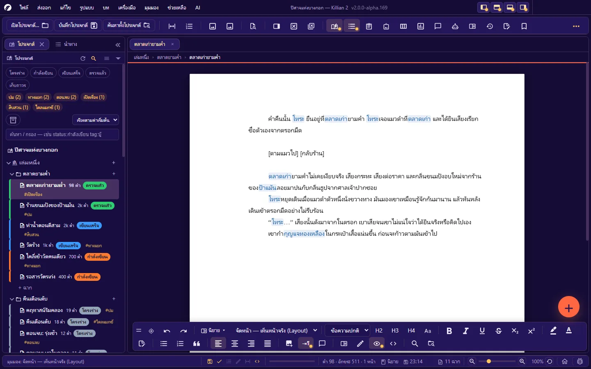
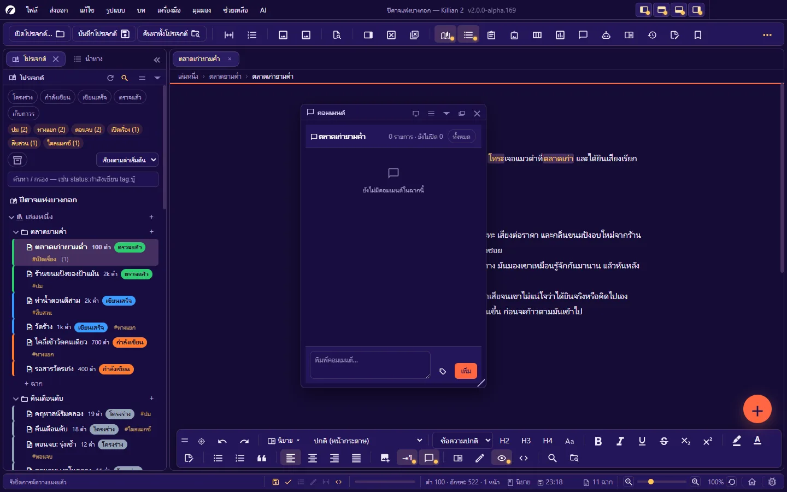

# 4. เขียนนิยาย

**ภาษา:** ไทย · [English](../en/04-writing-novel.md)

[← 3. โปรเจกต์ เล่ม บท ฉาก](03-project-structure.md) · [สารบัญ](README.md) · ถัดไป: [5. เขียนบทภาพยนตร์ →](05-writing-screenplay.md)

---


แต่ละฉากมีโหมดของตัวเอง: **นิยาย** (ร้อยแก้ว — บทนี้) หรือ **บทภาพยนตร์** ([บทที่ 5](05-writing-screenplay.md)) สลับด้วยปุ่มโหมดบนแถบรูปแบบลอย · เมนู **รูปแบบ → โหมดเอกสาร** · หรือ `Ctrl+Shift+M` (เนื้อหาเดิมถูกแปลงตามไวยากรณ์ของอีกโหมด)

ตัวแก้ไขเป็นแบบ WYSIWYG — สิ่งที่เห็นคือสิ่งที่ได้ตอนส่งออก — แต่ไฟล์ที่บันทึกเป็น **Markdown ธรรมดา** เปิดด้วยโปรแกรมอื่นได้

## 4.1 พื้นฐานการพิมพ์

| ทำอะไร | วิธี |
|---|---|
| ขึ้นย่อหน้าใหม่ | `Enter` |
| ขึ้นบรรทัดใหม่ในย่อหน้าเดิม | `Shift+Enter` |
| **บังคับขึ้นหน้าใหม่** | `Ctrl+Enter` (แทรกบล็อก "ขึ้นหน้าใหม่") |
| เลิกทำ / ทำซ้ำ | `Ctrl+Z` / `Ctrl+Shift+Z` หรือ `Ctrl+Y` — ย้อนได้ทุกอย่างรวมรูปแบบ จนถึงตอนเปิดฉาก |
| ตัด / คัดลอก / วาง | `Ctrl+X` / `Ctrl+C` / `Ctrl+V` |
| วางแบบข้อความล้วน (ไม่เอารูปแบบ) | `Ctrl+Shift+V` (**แก้ไข → วางแบบข้อความล้วน**) |
| เลือกทั้งหมด | `Ctrl+A` |
| ลบทั้งบรรทัดที่เคอร์เซอร์อยู่ | `Ctrl+Shift+Delete` |
| ช่องว่างไม่ตัดคำ (กันคำแยกบรรทัด เช่น ตัวเลขกับหน่วย) | `Ctrl+Shift+Space` |
| บันทึก | `Ctrl+S` (ฉากนี้) · `Ctrl+Alt+S` (ทุกอย่างที่ค้าง) |

คลิกขวาในเอกสารได้เมนูเดียวที่มีครบ: ตัด/คัดลอก/วาง · รูปแบบ · คำแนะนำของคำที่สะกดผิด · คำพ้อง · Rewrite this (AI) ฯลฯ

## 4.2 รูปแบบตัวอักษร

| รูปแบบ | คีย์ลัด | เก็บในไฟล์เป็น |
|---|---|---|
| **ตัวหนา** | `Ctrl+B` | `**ข้อความ**` |
| *ตัวเอียง* | `Ctrl+I` | `*ข้อความ*` |
| ขีดเส้นใต้ | `Ctrl+U` | `_ข้อความ_` |
| ~~ขีดฆ่า~~ | `Ctrl+Shift+X` | `~~ข้อความ~~` |
| ตัวยก | `Ctrl+Alt+=` | `^ข้อความ^` |
| ตัวห้อย | `Ctrl+Alt+-` | `~ข้อความ~` |
| สีตัวอักษร | ปุ่ม **A** บนแถบรูปแบบ | `<span style="color:#rrggbb">…</span>` |
| สีเน้น (ไฮไลต์) | ปุ่มปากกาเน้น | span สีพื้น — เก็บลงไฟล์ไปด้วย |
| ล้างรูปแบบ | `Ctrl+Space` หรือ `Ctrl+Alt+Space` | — |

**สีตัวอักษร** เปิดกล่องเลือกสี: จานสีสำเร็จ · วงล้อสี · สีที่เพิ่งใช้ · ชุดสีที่บันทึกไว้ (เพิ่ม/เอาออกได้) — ใช้ได้เฉพาะโหมดนิยาย และสีติดไปกับไฟล์ที่ส่งออก (เลือกส่งออกแบบขาวดำได้)

**รูปตัวพิมพ์ (Change Case)** สำหรับตัวอักษรละติน: **รูปแบบ → รูปตัวพิมพ์** มี 7 แบบ — Sentence case · lower case · UPPER CASE · Capitalize Case · aLtErNaTe cAsE · Title Case · iNVERSE cASE · หรือกด `Ctrl+Alt+U` วนไปทีละแบบ

**อักขระพิเศษ**: **รูปแบบ → แผนที่อักขระพิเศษ…** เลือกแทรกเครื่องหมายที่ไม่มีบนแป้นพิมพ์

## 4.3 ย่อหน้า หัวข้อ รายการ

| รูปแบบ | คีย์ลัด | เก็บในไฟล์เป็น |
|---|---|---|
| หัวข้อ 1 / 2 / 3 | `Ctrl+1` / `Ctrl+2` / `Ctrl+3` | `# ` / `## ` / `### ` |
| หัวข้อ 4 | ปุ่ม H4 บนแถบ | `#### ` |
| ข้อความปกติ (ถอดหัวข้อ/คำพูดยกมา) | `Ctrl+0` | — |
| คำพูดยกมา | ปุ่มอัญประกาศบนแถบ | `> ` |
| รายการหัวข้อย่อย | `Ctrl+Shift+8` | `- ` |
| รายการตัวเลข | `Ctrl+Shift+7` | `1. ` |
| บล็อกโค้ด | **รูปแบบ → บล็อกโค้ด** | ` ``` ` |
| เส้นคั่น | **รูปแบบ → แทรกเส้นคั่น (---)** | `---` |
| ชิดซ้าย / กึ่งกลาง / ชิดขวา / เต็มบรรทัด | `Ctrl+Shift+L` / `K` / `R` / `J` | คอมเมนต์รูปแบบ `<!--align:…-->` |

- **หัวข้อ** คือสิ่งที่แผงนำทางและสารบัญของไฟล์ส่งออกใช้ — ตั้งหน้าตา (ขนาด/หนา/เอียง/ระยะเว้น/จัดหน้า/เลขบทอัตโนมัติ) ได้ที่ **ตั้งค่า → รูปแบบนิยาย**
- **ปุ่มรายการเป็นสวิตช์**: เลือกช่วงที่เป็นรายการชนิดนั้นอยู่แล้ว = ถอดออก · ไม่ใช่ = เปลี่ยนเป็นชนิดนั้น · กด `Enter` ในข้อว่าง = ออกจากรายการ
- **การจัดหน้าเดินทางไปกับไฟล์ที่ส่งออก** (รวมข้อในรายการและย่อหน้าในคำพูดยกมา)
- **ย่อหน้าอัตโนมัติ** (บรรทัดแรกของย่อหน้าเยื้องเข้า — แบบหนังสือ): ปุ่มบนแถบรูปแบบ · ระยะเยื้องตั้งที่ **ตั้งค่า → รูปแบบนิยาย → ย่อหน้าบรรทัดแรก** (ค่าเริ่มต้น 0.5 นิ้ว · ย่อหน้าแรกหลังหัวข้อไม่ย่อตามธรรมเนียมสากล — เปลี่ยนได้)
- **ความกว้างของ Tab**: ตั้งได้เป็นจำนวนช่องว่าง นิ้ว หรือซม. — มีผลทั้งบนจอและไฟล์ที่ส่งออก

## 4.4 รูปในเอกสาร

**แทรกรูป**: `Ctrl+Shift+I` · ปุ่มแทรกรูปบนแถบ · ลากไฟล์รูปจากเครื่องมาวาง · ลากจากแผงคลังรูป
รูปถูก **คัดลอกเข้าโฟลเดอร์ `Images/`** ของโปรเจกต์ให้เอง · รองรับทุกสกุลที่ Chromium แสดงได้: PNG · JPG · GIF · WebP · SVG · AVIF · BMP · ICO

**รูปทั้งบรรทัด** (รูปประกอบ) — คลิกขวาที่รูป:

| ตัวเลือก | ผล |
|---|---|
| **เต็มหน้า** | รูปกินทั้งหน้ากระดาษ ชนขอบ — เหมาะกับภาพประกอบเต็มหน้าของไลต์โนเวล (หน้านั้นไม่พิมพ์เลขหน้า) |
| **ความกว้าง %** | 1–100% ของความกว้างพื้นที่พิมพ์ |
| **ขอบมน** | รัศมีมุมเป็นพิกเซล (0 = เหลี่ยม) |
| คำบรรยายใต้รูป / ข้อความแทนรูป (alt) | แก้ได้จากเมนูเดียวกัน |

ตัวเลือกพวกนี้เก็บใน "ชื่อกำกับ" ของมาร์กดาวน์มาตรฐาน: `` จึงยังเปิดในโปรแกรมอื่นได้ และหน้าตาตรงกันทั้งบนจอ มุมมองจัดหน้า ตัวอย่างส่งออก และไฟล์จริง

**รูปกลางย่อหน้า** (อยู่ในบรรทัดเดียวกับข้อความ): เขียน `ข้อความ  ข้อความ` — ความสูงเป็น **จำนวนบรรทัด** (`h=2` = สูงสองบรรทัด)

รูปที่สูงเกินหนึ่งหน้าจะถูกจำกัดให้พอดีพื้นที่พิมพ์ · จัดการรูปทั้งโปรเจกต์ที่ [คลังรูป](06-wiki-world.md#67-คลังรูปภาพ)

## 4.5 หน้ากระดาษและมุมมอง

### มุมมองหน้ากระดาษ 6 แบบ

เลือกที่ช่องมุมมองบนแถบรูปแบบ หรือ **มุมมอง → มุมมองหน้ากระดาษ** — มุมมองเป็นของ "ฉากที่เปิดอยู่" แต่ละแท็บจำของตัวเอง

| มุมมอง | เห็นอะไร | ใช้เมื่อ |
|---|---|---|
| **ปกติ (หน้ากระดาษ)** | เขียนต่อเนื่องบนความกว้างของกระดาษ ไม่ตัดหน้า | เขียนทั่วไป |
| **จัดหน้า — เห็นหน้าจริง (Layout)** | แผ่นกระดาษจริงทีละแผ่น ตัดหน้าแบบเดียวกับไฟล์ที่ส่งออก มีเลขหน้า | ตรวจรอยต่อหน้า · จัดรูป |
| **ร่าง — ข้อความล้วน (Draft)** | ไม่มีกระดาษ เนื้อล้วน | เขียนเร็ว ๆ บนจอเล็ก |
| **เรียงหน้าคู่ (Side-by-Side)** | หน้าซ้าย-ขวาเหมือนหนังสือกาง | ดูเป็นเล่ม |
| **ภาพรวม 4px/ตัวอักษร** | ย่อจนเห็นโครงของหลายหน้า | ดูจังหวะ/ความหนาแน่น |
| **ภาพรวม 1px/ตัวอักษร** | ย่อที่สุด เห็นรูปร่างของทั้งเรื่อง | ดูภาพรวม |



- **เส้นบอกระยะขอบกระดาษ**: **มุมมอง → มุมมองหน้ากระดาษ → เส้นบอกระยะขอบกระดาษ** — เส้นประรอบพื้นที่พิมพ์ทั้งสี่ด้าน
- **สีกระดาษบนจอ**: **ตั้งค่า → ตัวแก้ไข → สีกระดาษ** — ขาว · ครีม · ซีเปีย · เทาอ่อน · เขียวมิ้นต์ · เข้ม · หรือเลือกเอง (ตอนพิมพ์/ส่งออก PDF ยังเป็นขาวเสมอ)
- **ธีมของโปรแกรมไม่เปลี่ยนสีกระดาษ** — ธีมแต่งแค่เปลือก (แถบ แผง กล่อง)

### ขนาดกระดาษและระยะขอบ

**รูปแบบ → หน้ากระดาษ · ระยะขอบ…** (หรือ **ตั้งค่า → หน้ากระดาษ**) — ใช้ร่วมกันทั้งนิยายและบทภาพยนตร์ และเป็นค่าของผลงานนั้น

- **ขนาดกระดาษ**: Letter · A4 · Legal · Digest · US Trade · Compact/Novella · Mass Market · Bunkobon/A6 · Tankōbon · Pocket Book · A5 · กำหนดเอง
- **ระยะขอบ**: ชุดสำเร็จรูป (ปกติ 1 นิ้ว · แคบ · ปานกลาง · กว้าง · บทภาพยนตร์ · นิยายต้นฉบับส่งสำนักพิมพ์ · A4 แคบ · A4 ปกติ) หรือกรอกเองสี่ด้าน
- กล่องบอก **พื้นที่พิมพ์** และจำนวนบรรทัดต่อหน้าให้ทันที

### รูปแบบของเนื้อเรื่อง

**รูปแบบ → รูปแบบนิยาย…** (หรือ **ตั้งค่า → รูปแบบนิยาย**): ขนาดตัวอักษร (pt) · ช่วงบรรทัด · ระยะระหว่างย่อหน้า · ย่อหน้าบรรทัดแรก · ความกว้าง Tab · จัดหน้าเริ่มต้น · ฟอนต์/สี/ขนาดของหัวข้อ h1–h6 · เลขบทอัตโนมัติ · หน้าตาคำพูดยกมา · มีปุ่มสำเร็จรูป **ตั้งเป็นแบบนิยายมาตรฐาน** และ **ต้นฉบับส่งสำนักพิมพ์ (เว้นบรรทัดคู่)** — รายละเอียดทุกช่องที่ [บทที่ 12](12-settings.md#รูปแบบนิยาย-ของผลงาน)

ค่าที่ตั้งใช้ **ทั้งบนจอและตอนส่งออก**

### เลขหน้า

- เปิด/ปิด: **ตั้งค่า → เลขฉาก · เลขหน้า (บท) → แสดงเลขหน้า** (สวิตช์เดียวใช้ทั้งนิยายและบท)
- **เลขหน้าเริ่มต้น** ของแต่ละฉาก และ **ไล่เลขหน้าต่อเนื่อง** (ต่อจากฉาก/บทก่อนหน้าในเล่ม) ตั้งที่คุณสมบัติฉาก
- หน้าปกเล่มไม่นับเลข · หน้าปกบทนับ · หน้ารูปเต็มหน้าไม่พิมพ์เลข

### เลขบรรทัด

`Ctrl+Alt+R` — แสดงเลขบรรทัดที่รางซ้ายของพื้นที่เขียน (นับตามย่อหน้า/บล็อก) ใช้อ้างตำแหน่งเวลาคุยงาน · เป็นของจอเท่านั้น ไม่ติดไปกับงานพิมพ์

## 4.6 ซูม และโหมดการเขียน

| โหมด | คีย์ลัด | ทำอะไร |
|---|---|---|
| ซูมเข้า / ออก / รีเซ็ต | `Ctrl+=` / `Ctrl+-` / `Ctrl+Shift+0` | ซูมหน้ากระดาษ (หรือ `Ctrl+ล้อเมาส์`) |
| พอดีความกว้าง | **มุมมอง → ซูม** | ปรับซูมให้กระดาษกว้างพอดีพื้นที่เขียน |
| **โหมดโฟกัส** | `Ctrl+Shift+D` | ซ่อนสิ่งรอบพื้นที่เขียนเหลือแต่หน้ากระดาษ และหรี่บรรทัดอื่นให้บรรทัดที่กำลังเขียนเด่น (ตั้งความจางของบรรทัดอื่นได้ที่ ตั้งค่า → ตัวแก้ไข) |
| **โหมดอ่าน (เต็มจอ)** | `Ctrl+Shift+H` | ซ่อนแถบเครื่องมือและแผงทั้งหมด เหลือแต่หน้ากระดาษ · `Esc` เพื่อออก |
| **โหมดเครื่องพิมพ์ดีด** | `Ctrl+Shift+T` | ตรึงบรรทัดที่กำลังพิมพ์ไว้กลางจอ หน้ากระดาษเลื่อนมาหาเอง |
| **เสียงเครื่องพิมพ์ดีด** | **เครื่องมือ → การช่วยการเข้าถึง** | เสียงเคาะแป้น · วรรค · ลบ · กระดิ่งตอนขึ้นบรรทัด |
| **อ่านทั้งเล่ม** | `Ctrl+Alt+Shift+R` | ต่อทุกฉากของเล่มเป็นเอกสารเดียว อ่านอย่างเดียว เปิดเป็นหน้า ๆ |
| เต็มจอ | **มุมมอง → เต็มจอ** | หน้าต่างเต็มจอ |

**อ่านทั้งเล่ม**: เลือกเล่ม (หรือทั้งโปรเจกต์) · `←` `→` / `PageUp` `PageDown` / `Space` เปลี่ยนหน้า · `Home` `End` · พิมพ์เลขหน้าแล้ว `Enter` เพื่อกระโดด · สลับหน้าเดียว/สองหน้า · `Ctrl+ล้อ` ซูม · `Esc` ออก — เลขหน้าที่เห็นเป็นชุดเดียวกับเลขหน้าไล่ต่อเนื่องของตัวแก้ไข

## 4.7 ตรวจคำผิด

เปิดเป็นค่าเริ่มต้น (**ตั้งค่า → ตัวแก้ไข → ตรวจคำผิด**) — ขีดเส้นใต้คำที่น่าจะสะกดผิด **ทั้งไทยและอังกฤษ แบบออฟไลน์** ด้วยพจนานุกรมของโปรแกรม

คลิกขวาที่คำที่ถูกขีด:

- **คำแนะนำ** — เลือกแล้วแทนที่ในเอกสารทันที
- **ข้ามคำนี้ครั้งนี้** — เลิกขีดคำนี้ในรอบการทำงานนี้ (ไม่จำถาวร)
- **เพิ่ม "คำ" ลงพจนานุกรม** — จำถาวรในโปรเจกต์นี้ (ไฟล์ `dictionary.json`)

สิ่งที่ควรรู้:

- คำสั้นไม่เกิน 2 ตัวอักษร และคำยาวเกิน 65 ตัวอักษร (ลิงก์ · รหัส) ไม่ถูกตรวจ
- เพิ่มคลังคำทั้งชุดได้: วางไฟล์ `.txt` (บรรทัดละคำ · บรรทัดขึ้นต้น `#` = คอมเมนต์) ที่ `<โปรเจกต์>/Plugins/dictionaries/`
- ปิด **ใช้พจนานุกรมของโปรแกรม** = เหลือตัวตรวจของ Chromium ซึ่งมีแต่อังกฤษและต้องโหลดคลังคำจากอินเทอร์เน็ตก่อน — โดยทั่วไป **ควรเปิดไว้**
- เส้นขีดอยู่บนจอเท่านั้น ไม่ติดไปกับงานพิมพ์/ไฟล์ส่งออก

## 4.8 SmartType — เติมชื่อจาก Wiki

พิมพ์ตัวอักษรต้นของชื่อใน Wiki ตั้งแต่ 2 ตัวขึ้นไป → มีกล่องรายชื่อเด้งขึ้น

| คีย์ | ทำอะไร |
|---|---|
| `↑` `↓` | เลือกชื่อ |
| `Tab` | ยืนยันชื่อที่เลือก |
| `Esc` | ปิดกล่อง |
| `Enter` | ขึ้นบรรทัดใหม่ตามปกติ (ไม่ยืนยันชื่อ) |

ในบทภาพยนตร์ SmartType ยังจำชื่อตัวละครที่คุณพิมพ์ซ้ำ ๆ ให้ — ถ้าจำคำผิด ลบได้ที่ **บท → จัดการ SmartType (ลบคำที่จำผิด)…**

## 4.9 ชื่อจาก Wiki ในเนื้อเรื่อง

เมื่อเปิด **จับชื่อ Wiki อัตโนมัติ** (ค่าเริ่มต้นเปิด) ชื่อและชื่อเล่นของเอนทิตี้ใน Wiki ที่ปรากฏในฉากจะถูกไฮไลต์

- **`Ctrl`+คลิก** ที่ชื่อ = เปิดหน้า Wiki นั้น
- ต้องการลิงก์แบบระบุชัด: พิมพ์ `[[ชื่อ]]` หรือ `[[ชื่อ|ข้อความที่แสดง]]`
- ไฮไลต์เป็นของจอ ไม่ติดไปกับไฟล์ส่งออก · รายชื่อที่พบในฉากดูได้ที่แผงคุณสมบัติ ("ฉากนี้กล่าวถึง") และแผง **ฉากที่กล่าวถึง** (`Ctrl+Alt+Shift+B`)

## 4.10 คลังคำพ้อง / คำตรงข้าม

**เครื่องมือ → คลังคำพ้อง/คำตรงข้าม…** (`Ctrl+Alt+Shift+T`) หรือคลิกขวาที่คำ — หาคำพ้องและคำตรงข้ามของคำที่เลือก แล้วแทนที่ได้ทันที

- ค่าเริ่มต้นใช้ **คลังไทยในตัว** (ออฟไลน์)
- เปิด **ตั้งค่า → อัตโนมัติ → คลังคำพ้อง/คำตรงข้าม** = คำที่เลือกจะถูกส่งออกไปค้นคำพ้องทางอินเทอร์เน็ตด้วย (ปิดเป็นค่าเริ่มต้น)

**ตรวจหาคำซ้ำ · สถิติการใช้คำ**: **เครื่องมือ → ตรวจหาคำซ้ำ · สถิติการใช้คำ (Word History)…** — จับคำติดปากและคำที่ใช้บ่อยเกินไป

## 4.11 โน้ต 3 แบบ (ที่ไม่ปนกับต้นฉบับ)

| แบบ | เปิด | ลักษณะ |
|---|---|---|
| **โน้ตด่วน** | `Ctrl+Shift+Q` | จดความคิดที่ผุดขึ้นโดยไม่ออกจากฉาก — โน้ตผูกกับฉากที่เปิดอยู่ตอนจด · ติ๊ก **ไว้ทำภายหลัง** ได้ |
| **สมุดโน้ตด่วน** (แผง) | `Ctrl+Alt+8` | รวมโน้ตด่วนทั้งหมด + ที่จดอิสระ · ย้ายโน้ตเข้า Memo ได้ · ดูทั้งหมด: **แก้ไข → ดูโน้ตทั้งหมด…** |
| **Memo** | `Ctrl+Alt+5` | ไฟล์โน้ตเต็มรูปแบบของโปรเจกต์ ([บทที่ 3](03-project-structure.md#311-memo)) |

นอกจากนี้ คุณสมบัติฉากมีช่อง **โน้ต** และ **Future Note** ของแต่ละฉาก

## 4.12 คอมเมนต์

ฝากความเห็นผูกกับข้อความ — สำหรับบรรณาธิการ ผู้อ่านทดลอง หรือเตือนตัวเอง



1. เลือกข้อความในฉาก
2. กดปุ่มคอมเมนต์บนแถบรูปแบบ (หรือเปิดแผง `Ctrl+Alt+O` · **แก้ไข → คอมเมนต์ในฉากนี้**)
3. พิมพ์แล้วส่ง — คอมเมนต์ผูกกับข้อความที่เลือก

- **ตอบกลับ** เป็นเธรด · **ปิดเรื่อง (resolve)** · **เปิดเรื่องอีกครั้ง** · แก้ไข/ลบ
- ชี้ที่คอมเมนต์ = ไฮไลต์ข้อความในฉาก · คลิก = เลื่อนไปหา
- สลับกรอง **ทั้งหมด / เฉพาะที่ยังไม่ปิด**
- ถ้าข้อความที่ผูกไว้ถูกแก้หรือลบ คอมเมนต์ยังอยู่ แต่ขึ้นว่าไม่พบข้อความที่ผูกไว้แล้ว
- คอมเมนต์เก็บ **ในไฟล์ `.md` ของฉากนั้นเอง** (บล็อกท้ายไฟล์) จึงไปกับไฟล์เสมอ · ไม่ถูกส่งออกไปกับต้นฉบับ

## 4.13 โค้ดสั้น และตัวแปรจาก Wiki

**โค้ดสั้น** คือข้อความในวงเล็บเหลี่ยมที่จะถูกแทนด้วยค่าจริง **ตอนส่งออก** (เมื่อเวิร์กโฟลว์เปิดขั้น "แทนโค้ดสั้น") — แทรกจาก **รูปแบบ → แทรกโค้ดสั้น…**

| กลุ่ม | โค้ด |
|---|---|
| เกี่ยวกับผลงาน | `[title]` `[author]` `[project]` `[book]` `[language]` `[appversion]` |
| ที่ที่โค้ดนี้อยู่ | `[chapter]` `[chapterno]` `[scene]` `[sceneno]` `[status]` `[pov]` `[synopsis]` `[tags]` `[emotion]` `[conflict]` `[note]` `[futurenote]` `[storydate]` `[color]` `[flag]` `[locked]` `[chapterstatus]` `[chapteract]` `[chapterdate]` `[chapterflag]` |
| ตัวเลข | `[words]` `[chars]` `[pages]` `[totalwords]` `[totalscenes]` `[totalchapters]` `[totalbooks]` `[totalcharacters]` `[totallocations]` `[dailygoal]` `[projectgoal]` `[progress]` `[commentcount]` |
| วันเวลา | `[date]` (ใส่รูปแบบได้ เช่น `[date:iso]` · `year` · `time`) `[time]` `[year]` `[weekday]` |
| ข้อมูลจาก Wiki | `[wiki:โทระ.อายุ]` `[var:อายุ]` `[field:อายุ]` `[entity]` `[entitycat]` `[entitysummary]` `[entitytags]` `[relation:พ่อ]` |

กติกา:

- โค้ดที่โปรแกรม **ไม่รู้จัก = ปล่อยไว้เป็นข้อความเดิม** (พิมพ์ผิดจะเห็นในไฟล์ ไม่หายเงียบ)
- อยากพิมพ์ `[title]` เป็นตัวอักษรจริง ให้เขียน `[[title]]`
- `[tags sep=", "]` — บางโค้ดรับตัวเลือกแบบ `คีย์=ค่า`
- วงเล็บเหลี่ยมที่มีข้อความไทยข้างใน เช่น `[ไปตลาด]` ไม่ใช่โค้ดสั้น (ชื่อโค้ดเป็นอังกฤษเท่านั้น) — รูปแบบนั้นใช้กับ **ทางเลือกของเรื่องแตกสาย** ([บทที่ 7](07-planning.md#75-ผังแตกสาย-และทดลองเล่น))

**ตัวแปรจาก Wiki** `{{ชื่อ}}` / `{{ชื่อ.ฟิลด์}}` — เช่น `{{โทระ.อายุ}}` ถูกแทนด้วยค่าฟิลด์ของเอนทิตี้เมื่อเวิร์กโฟลว์เปิดขั้น "แก้ไขตัวแปร {{ชื่อ}} จาก Wiki"

โค้ดสั้นใช้ได้ในช่องของหน้า Wiki · แชท AI · คอมเมนต์ และ **ชื่อไฟล์ส่งออก** ด้วย

## 4.14 ดูสิ่งที่ถูกเขียนลงไฟล์จริง

- **ดู Markdown ดิบของฉากนี้** (ปุ่ม `<>` บนแถบรูปแบบ) — เปิดดูข้อความที่บันทึกลงไฟล์จริง
- **ซ่อน/แสดงรหัสนำหน้าบรรทัด** (**มุมมอง → ซ่อนรหัสนำหน้าบรรทัด**) — ซ่อนไว้อ่านง่าย · แสดงไว้เห็นโครงสร้างจริง — ไฟล์ไม่ถูกแก้ไม่ว่าจะเปิดหรือปิด
- ไวยากรณ์ของไฟล์ทั้งหมด: [ภาคผนวก D](D-file-formats.md#ไวยากรณ์ของไฟล์ฉาก-md)

## 4.15 จำนวนคำ และเป้าหมาย

- แถบสถานะ: `คำ · อักขระ · หน้า` ของเอกสารที่เปิดอยู่ (คำไทยตัดด้วยตัวตัดคำ ไม่ได้นับจากช่องว่าง)
- **เป้าหมายคำต่อวัน / ทั้งโปรเจกต์**: **ตั้งค่า → ข้อมูลผลงาน → เป้าหมายจำนวนคำ** — แถบความคืบหน้าบนแถบสถานะและแดชบอร์ดอ่านจากค่านี้
- **สปรินต์การเขียน** (`Ctrl+Alt+Shift+S`) — จับเวลาเขียนเป็นรอบ ([บทที่ 7](07-planning.md#79-สปรินต์การเขียน))

---

ถัดไป: [5. เขียนบทภาพยนตร์ →](05-writing-screenplay.md)
