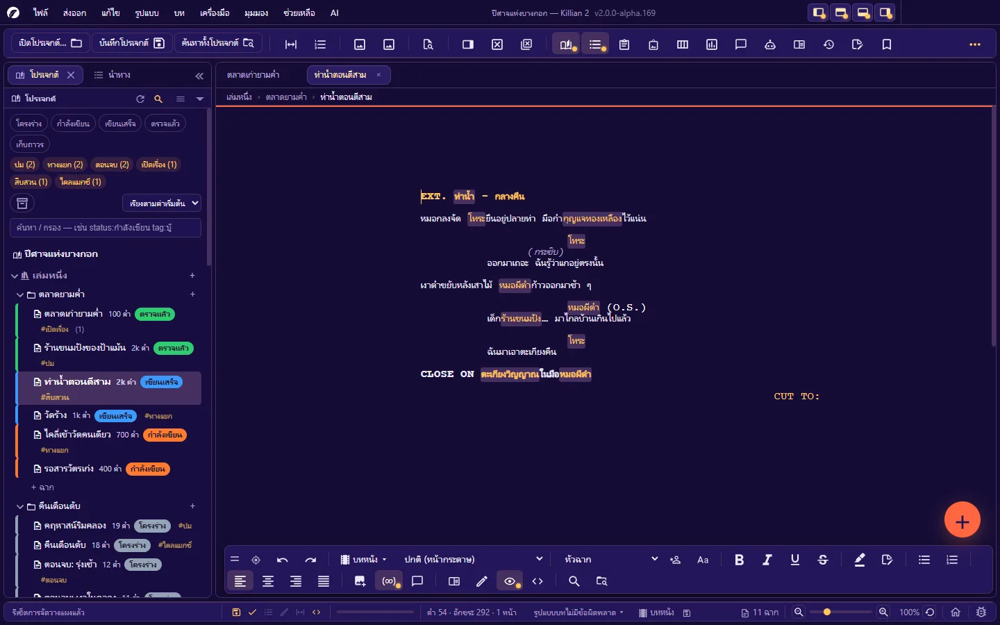
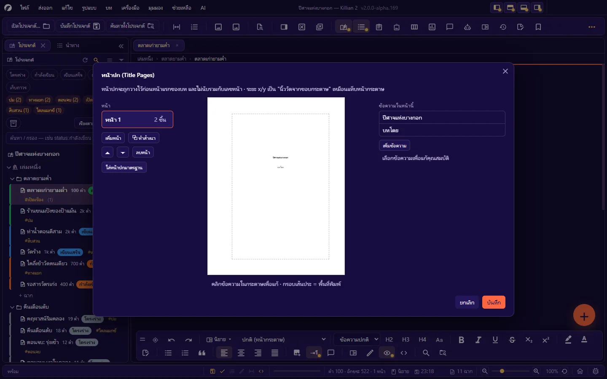
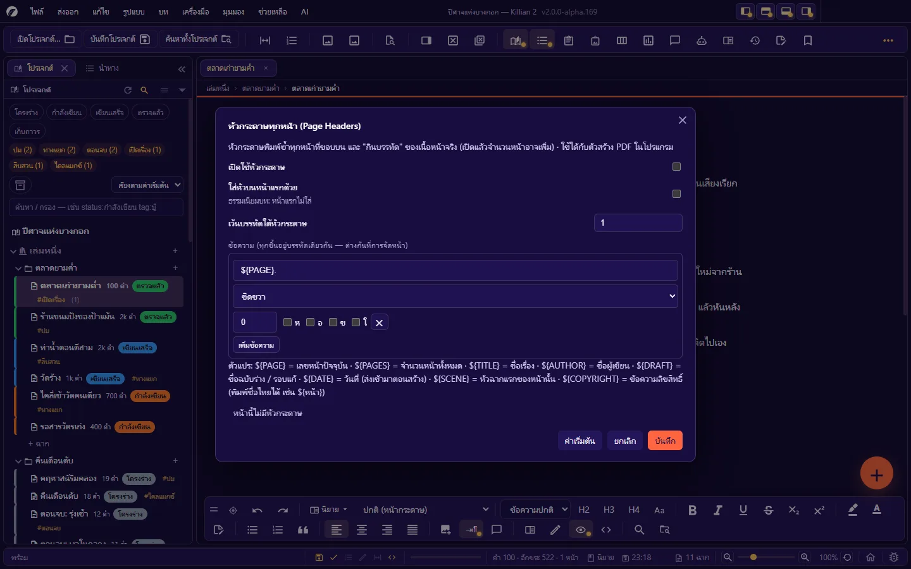

# 5. เขียนบทภาพยนตร์

**ภาษา:** ไทย · [English](../en/05-writing-screenplay.md)

[← 4. เขียนนิยาย](04-writing-novel.md) · [สารบัญ](README.md) · ถัดไป: [6. Wiki โลกของเรื่อง และคลังรูป →](06-wiki-world.md)

---

โหมดบทภาพยนตร์จัดรูปแบบตามมาตรฐานบท (แนว Final Draft): แต่ละบรรทัดเป็น **element** ชนิดหนึ่ง โปรแกรมจัดระยะเยื้อง ความกว้าง และตัวพิมพ์ให้เอง

**เปลี่ยนฉากเป็นบทภาพยนตร์**: ปุ่มโหมดบนแถบรูปแบบ · **รูปแบบ → โหมดเอกสาร → บทภาพยนตร์** · `Ctrl+Shift+M` · หรือคลิกขวาที่ฉากใน Explorer → **เปลี่ยนเป็นนิยาย/บทภาพยนตร์** — เนื้อหาเดิมถูกแปลงให้ (หัวข้อ 3 ของนิยาย ↔ หัวฉากของบท ฯลฯ)
หรือเริ่มทั้งโปรเจกต์ด้วยเทมเพลต **บทภาพยนตร์** (3 องก์)

## 5.1 element ของบท

| element | ใช้ทำอะไร | คีย์ลัด | รหัสในไฟล์ `.md` |
|---|---|---|---|
| **หัวฉาก** | `INT. ห้องครัว - กลางวัน` | `Ctrl+1` | `### ` |
| **บรรยาย** | สิ่งที่เห็นและได้ยิน | `Ctrl+2` | (ข้อความเปล่า) |
| **ตัวละคร** | ชื่อผู้พูด | `Ctrl+3` | `@ชื่อ` |
| **วงเล็บ** | กำกับการพูด เช่น (กระซิบ) — อยู่ใต้ชื่อตัวละครเท่านั้น | `Ctrl+4` | `((กระซิบ))` |
| **บทพูด** | คำพูดของตัวละคร | `Ctrl+5` | (บรรทัดใต้ตัวละคร) |
| **ทรานซิชันออก (ขวา)** | `CUT TO:` ชิดขวา | `Ctrl+6` | `>> ` |
| **ทรานซิชันเข้า (ซ้าย)** | `FADE IN:` ชิดซ้าย | ช่องเลือก element | `<< ` |
| **ช็อต** | `CLOSE ON …` | `Ctrl+7` | `! ` |
| **ตอน** (ตัวแบ่งองก์) | คั่นช่วงใหญ่ของเรื่อง | `Ctrl+8` | `$act ` |
| **โน้ต** | โน้ตของผู้เขียน ไม่ใช่เนื้อบท | `Ctrl+9` | `/// ` |
| **ฉากย่อย** | หัวฉากย่อย (mini-slug) ไม่มีเลขฉาก | ช่องเลือก element | `#### ` |
| **สลับฉาก** | `INTERCUT WITH:` | ช่องเลือก element | `$intercut ` |
| **ขึ้นหน้าใหม่** | บังคับขึ้นหน้าใหม่ | ช่องเลือก element | `---` |
| **ต่อเนื่อง (ซ้าย/ขวา)** | ข้อความ CONTINUED แบบพิมพ์เอง | ช่องเลือก element | `$contl ` / `$contr ` |
| **สรุป · โครง 1–3** | บรรทัดวางโครง | ช่องเลือก element | `= ` · `# ` · `## ` · `##### ` |
| **รูปภาพ** | รูปในบท | แทรกรูป | `` |

**ช่องเลือก element** บนแถบรูปแบบแสดงชนิดของบรรทัดที่เคอร์เซอร์อยู่ และใช้เปลี่ยนชนิดได้

> รหัสในไฟล์เป็นมาร์กดาวน์ให้มากที่สุด — สลับฉากไปโหมดนิยายแล้วหัวฉากกลายเป็นหัวข้อ 3 อ่านรู้เรื่องทั้งสองฝั่ง · ไฟล์จาก Killian v1 (รหัส `.หัวฉาก` `>ทรานซิชัน` `$shot`) ยังเปิดได้ และจะถูกบันทึกด้วยรหัสใหม่เอง
> ซ่อนรหัสนำหน้าบรรทัดบนจอได้ที่ **มุมมอง → ซ่อนรหัสนำหน้าบรรทัด** (ไฟล์ไม่ถูกแก้)

## 5.2 พิมพ์บทให้ไหล: Enter และปุ่มสลับ element

| คีย์ | ทำอะไร |
|---|---|
| `Enter` | ขึ้นบรรทัดใหม่เป็น **element ถัดไปตามตาราง** (ค่าเริ่มต้น: หัวฉาก → บรรยาย · บรรยาย → หัวฉาก · ตัวละคร → บทพูด · วงเล็บ → บทพูด · บทพูด → ตัวละคร · ทรานซิชัน → หัวฉาก) — ผ่ากลางบรรทัดที่มีข้อความทั้งสองฝั่งของเคอร์เซอร์ = ท่อนหลังคงชนิดเดิม |
| `Ctrl+Tab` | วนชนิด element ของบรรทัดนี้ไปข้างหน้า |
| `Ctrl+Shift+Tab` | วนย้อนกลับ |
| `Ctrl+↑` / `Ctrl+↓` | สลับชนิด element |
| `Ctrl+1` … `Ctrl+9` | เปลี่ยนบรรทัดนี้เป็นชนิดนั้นทันที (ตารางข้างบน) |

> ขณะเคอร์เซอร์อยู่ในบท `Ctrl+Tab` ใช้วน element — จะสลับแท็บให้ใช้ `Ctrl+PageDown` / `Ctrl+PageUp`

**ตั้งเองได้ทั้งหมด** ที่ **ตั้งค่า → ปุ่มบทภาพยนตร์** (ค่าของผลงาน):

- เปิด/ปิดระบบปุ่มสลับ element (ปิด = `Enter` ขึ้นบรรทัดใหม่ชนิดเดิม)
- เปลี่ยนปุ่มของ "ไป element ถัดไป" และ "วนชนิด"
- **ตารางต่อ element**: ระบุว่าจากชนิดนี้ `Enter` / `Ctrl+Tab` / `Ctrl+Shift+Tab` จะได้ชนิดอะไร
- **บรรทัดถัดจากบทพูด = บทพูดต่อ**
  - ปิด (ค่าเริ่มต้น · แนว Final Draft): บรรทัดถัดจากบทพูดเป็น **บรรยาย** เขียนเปล่า ๆ ได้เลย
  - เปิด: ใช้เมื่อเขียนบทพูดยาวหลายบรรทัดติดกันเป็นปกติ — แล้วบรรยายต้องขึ้นต้นด้วย `!`

### ตัวช่วยพิมพ์

- **SmartType** เสนอคำตามชนิดของบรรทัด: คำนำหัวฉาก (`INT.` `EXT.` `INT./EXT.` `ฉาก` …) · เวลา (`DAY` `NIGHT` `เช้า` `กลางคืน` …) · ทรานซิชัน (`CUT TO:` `DISSOLVE TO:` …) · วงเล็บที่ใช้บ่อย · ชื่อตัวละครจาก Wiki และชื่อที่เคยพิมพ์ในบทนี้ — `↑` `↓` เลือก · `Tab` ยืนยัน
- **ส่วนเสริมท้ายชื่อตัวละคร**: **บทภาพยนตร์ → ส่วนเสริมท้ายชื่อตัวละคร (V.O. · O.S. · cont'd)…** หรือปุ่มบนแถบ — เติม `(V.O.)` `(O.S.)` `(O.C.)` `(CONT'D)` `(เสียง)` `(นอกจอ)` `(ในใจ)` ต่อท้ายชื่อโดยเว้นหนึ่งวรรคให้เสมอ
- **เลือกทั้งฉาก**: `Ctrl+Shift+A` — เลือกตั้งแต่หัวฉากจนก่อนหัวฉากถัดไป (ใช้คัดลอก/ย้ายฉากภายในไฟล์)
- **ลบ element ตามประเภท**: **บทภาพยนตร์ → ลบ element ตามประเภท…** — เช่น ลบโน้ตทั้งหมดก่อนส่งบท (ย้อนกลับได้)

## 5.3 ตัวพิมพ์ใหญ่/เล็ก

เมนู **บทภาพยนตร์ → ตัวพิมพ์ใหญ่/เล็ก (ให้อิสระ)**:

| สวิตช์ | ผล |
|---|---|
| บังคับพิมพ์ใหญ่ตามรูปแบบบทภาพยนตร์มาตรฐาน | หัวฉาก · ชื่อตัวละคร · ทรานซิชัน เป็นตัวพิมพ์ใหญ่อัตโนมัติ |
| แก้ตัวแรกของประโยคเป็นตัวใหญ่ให้อัตโนมัติ | ขณะพิมพ์ |
| แก้ i เดี่ยว ๆ เป็น I ให้อัตโนมัติ | สำหรับบทภาษาอังกฤษ |
| บังคับตัวพิมพ์ใหญ่เฉพาะชนิด | ติ๊กรายชนิด: หัวฉาก · ตัวละคร · ทรานซิชันเข้า/ออก · ฉากย่อย · สลับฉาก · ช็อต · ตอน |

(มีผลกับตัวอักษรละติน — ภาษาไทยไม่มีตัวพิมพ์ใหญ่)

## 5.4 การตัดหน้า · CONTINUED · MORE

บทถูกจัดหน้าตามขนาดกระดาษจริง (ค่าเริ่มต้น Letter · ระยะขอบแบบบทภาพยนตร์ · 54 บรรทัด/หน้า) ดูผลได้ในมุมมอง **จัดหน้า (Layout)**

**ข้อความต่อเนื่องอัตโนมัติ** — **บทภาพยนตร์ → ข้อความต่อเนื่อง (CONTINUED · MORE · cont'd)**:

| เมื่อ | โปรแกรมใส่ |
|---|---|
| ฉากยาวข้ามหน้า | `(CONTINUED)` ท้ายหน้า และ `CONTINUED:` ต้นหน้าถัดไป |
| บทพูดถูกหั่นคร่อมหน้า | `(MORE)` ท้ายหน้า และทวนชื่อตัวละคร + `(cont'd)` ต้นหน้าถัดไป |

- ข้อความพวกนี้เป็นของ "การจัดหน้า" ไม่ได้อยู่ในไฟล์ — เปลี่ยนถ้อยคำได้ที่ **ตั้งค่า → เลขฉาก · เลขหน้า → ข้อความมาตรฐาน**
- **ใส่ได้แม้หน้านั้นไม่มีหัวฉาก**: ปิดอยู่ = ใส่ `(CONTINUED)` เฉพาะหน้าที่มีหัวฉากอยู่ก่อน (ธรรมเนียมบทถ่ายทำ)
- อยากคุมเอง: ปิดตัวอัตโนมัติ แล้วใช้ element **ต่อเนื่อง (ซ้าย/ขวา)** พิมพ์เอง

**กฎการตัดหน้า (widow / orphan)** ตั้งได้ที่หน้าเดียวกัน: บรรยาย/บทพูดต้องเหลือท้ายหน้าและยกไปหน้าใหม่อย่างน้อยกี่บรรทัด · หัวฉากท้ายหน้าต้องมีเนื้อตามกี่บรรทัด · ขีดท้ายบรรทัดติดกันไม่เกินกี่บรรทัด

**ปรับหน้าใหม่อัตโนมัติ** (ตั้งค่า → รูปแบบบทภาพยนตร์): เปิดแล้วโปรแกรมคำนวณจำนวนหน้าใหม่หลังหยุดพิมพ์ตามเวลาที่ตั้ง (1–60 วินาที)

## 5.5 เลขฉาก และเลขหน้า

| | เปิด/ปิด | ตั้งละเอียด |
|---|---|---|
| **เลขฉาก** (ข้างหัวฉากทั้งสองฝั่ง) | **บทภาพยนตร์ → เลขฉาก** | ตั้งค่า → เลขฉาก · เลขหน้า: ท้ายเลข · ระยะจากขอบซ้าย/ขวา |
| **เลขหน้า** (ชิดขวาบนกระดาษ) | **บทภาพยนตร์ → เลขหน้า** | ใส่เลขบนหน้าแรกด้วยไหม · ระยะจากขอบขวา/บน · ท้ายเลข (ค่าเริ่มต้น `.`) |

- เลขฉากและเลขหน้าแสดงทั้งบนจอและในไฟล์ที่ส่งออก
- **เลขหน้าเริ่มต้น** ของแต่ละไฟล์ฉากตั้งที่คุณสมบัติฉาก · หน้าปกและหน้ารายชื่อตัวละครไม่นับเลข
- ไปที่หน้า/ฉาก: `Ctrl+G` (กล่องรวม) · `Ctrl+Shift+.` (หน้า) · `Ctrl+Shift+,` (ฉาก) · **บทภาพยนตร์ → ไปหน้าแรก**

## 5.6 รูปแบบของบท (ปรับได้ทุก element)

**ตั้งค่า → รูปแบบบทภาพยนตร์** — ตารางต่อ element:

- **เยื้อง** และ **กว้าง** (นิ้ว วัดจากขอบกระดาษ) · **เว้นก่อน** · **ระยะบรรทัด** (10 = 1 บรรทัด)
- ตัวพิมพ์ใหญ่ / หนา / เอียง / ขีดเส้นใต้ — ตั้งแยก **บนจอ** กับ **ตอนพิมพ์**
- ขนาดฟอนต์บท (มาตรฐาน 12pt) · ช่วงบรรทัด (มาตรฐาน 1 = 6 บรรทัด/นิ้ว — เปลี่ยนแล้วจำนวนบรรทัดต่อหน้าเปลี่ยนตาม)
- ปุ่ม **คืนค่าเริ่มต้น**

ค่าตั้งต้นตามมาตรฐาน เช่น หัวฉากเยื้อง 1.5" กว้าง 6" · ตัวละครเยื้อง 3.7" · บทพูดเยื้อง 2.5" กว้าง 3.5" · วงเล็บเยื้อง 3.1" · ทรานซิชันออกเยื้อง 6"

**ฟอนต์**: ค่าเริ่มต้น **Courier Prime** (มาตรฐานบท) — ตัวไทยใช้ฟอนต์ไทยที่จับคู่ไว้ในตาราง **ตั้งค่า → ฟอนต์ตามภาษา** (ย่อ 85% ให้พอดีระยะบรรทัดของบท) เปลี่ยนฟอนต์บทได้ที่ **ตั้งค่า → ตัวแก้ไข → แบบอักษรบทภาพยนตร์**

**แสดงรูปแบบ**: **บทภาพยนตร์ → แสดงรูปแบบ** — เส้นขอบของแต่ละ element + เครื่องหมายจบบรรทัด ช่วยดูว่าบรรทัดไหนเป็นชนิดอะไร

## 5.7 หน้าปก · หัวกระดาษ · หน้ารายชื่อตัวละคร

### หน้าปก (Title Pages)

**บทภาพยนตร์ → หน้าปก (Title Pages)…**

- มีได้หลายหน้า: **เพิ่มหน้า · ทำสำเนาหน้า · ลบหน้า**
- **เพิ่มข้อความ** แล้วคลิกข้อความบนกระดาษเพื่อแก้ · ตั้งตำแหน่ง x/y เป็น **นิ้ววัดจากขอบกระดาษ** · ตัวหนา/เอียง/ขีดเส้นใต้/ตัวพิมพ์ใหญ่ · จัดซ้าย/กลาง/ขวา
- ปุ่ม **สร้างจากข้อมูลผลงาน** เติมชื่อเรื่อง/ผู้เขียน/ติดต่อ/ลิขสิทธิ์จาก **ตั้งค่า → ข้อมูลผลงาน**
- หน้าปกถูกวางก่อนหน้าแรกของบทตอนส่งออก และ **ไม่นับเลขหน้า**

(หน้าปกของ "เล่ม" สำหรับนิยาย: คลิกขวาที่เล่ม → **หน้าปก (Title Page)…**)

### หัวกระดาษทุกหน้า (Page Headers)

**บทภาพยนตร์ → หัวกระดาษทุกหน้า (Page Headers)…**

- ข้อความหลายชิ้นบนบรรทัดเดียวกัน ต่างกันที่การจัด (ซ้าย/กลาง/ขวา) และระยะเลื่อน
- ใช้ **ตัวแปร** ได้ — พิมพ์เป็นอังกฤษหรือไทยก็ได้:

  | ตัวแปร | ความหมาย |
  |---|---|
  | `${PAGE}` · `${หน้า}` | เลขหน้าปัจจุบัน |
  | `${PAGES}` · `${จำนวนหน้า}` | จำนวนหน้าทั้งหมด |
  | `${TITLE}` · `${เรื่อง}` | ชื่อเรื่อง |
  | `${AUTHOR}` · `${ผู้เขียน}` | ชื่อผู้เขียน |
  | `${DRAFT}` · `${ฉบับ}` | ชื่อฉบับร่าง / รอบแก้ |
  | `${DATE}` · `${วันที่}` | วันที่สร้างไฟล์ |
  | `${SCENE}` · `${ฉาก}` | หัวฉากแรกของหน้านั้น |
  | `${COPYRIGHT}` · `${ลิขสิทธิ์}` | ข้อความลิขสิทธิ์ |

- หัวกระดาษ **กินบรรทัดจริงของหน้า** (กล่องบอกว่ากินไปกี่บรรทัด/หน้า) — เปิดแล้วจำนวนหน้าอาจเพิ่ม
- ธรรมเนียมบทภาพยนตร์: หน้าแรกไม่ใส่หัวกระดาษ (เปลี่ยนได้)
- ปิดเป็นค่าเริ่มต้น (บทมาตรฐานใช้เลขหน้าชิดขวาอยู่แล้ว)

### หน้ารายชื่อตัวละคร (Cast of Characters)

**บทภาพยนตร์ → หน้ารายชื่อตัวละคร (Cast of Characters)…** — เป็นของแต่ละเล่ม

- **+ เพิ่มตัวละคร** หรือ **↓ ดึงจาก Wiki** · ลบรายชื่อที่ไม่ต้องการ
- เลือกแสดงหัวข้อ **Scene** และ **Time**
- สวิตช์ **ใส่ตอนพิมพ์/ส่งออก** (ปิด = ข้ามหน้านี้)

## 5.8 ตัวตรวจรูปแบบบทภาพยนตร์

โปรแกรมตรวจรูปแบบบทภาพยนตร์ให้ตลอดเวลาและขีดเส้นหยักใต้บรรทัดที่น่าจะผิด ผลสรุปอยู่ที่ป้ายบนแถบสถานะ (เช่น "รูปแบบบทภาพยนตร์ไม่มีข้อผิดพลาด")

| คำสั่ง | ที่ไหน |
|---|---|
| ไปยังจุดผิดถัดไป | `Ctrl+Shift+U` · **บทภาพยนตร์ → ตรวจหาข้อผิดพลาดถัดไป** |
| รายการจุดผิดทั้งบท (คลิกเพื่อไปบรรทัดนั้น) | **บทภาพยนตร์ → ตรวจบทภาพยนตร์ทั้งเรื่อง (รายการข้อผิดพลาด)…** |
| ตรวจทุกครั้งก่อนพิมพ์/ส่งออก (พบจุดผิดจะถามก่อนทำต่อ) | **บทภาพยนตร์ → ตรวจก่อนพิมพ์/ส่งออก** |
| เปิด/ปิดเส้นบอกจุดผิดบนจอ | ป้ายบนแถบสถานะ · ตั้งค่า → เลขฉาก · เลขหน้า → การตรวจทานบนจอ |

สิ่งที่ตรวจ ได้แก่: มีเนื้อบทก่อนหัวฉากแรก · หัวฉากติดกันสองอัน (ฉากไม่มีเนื้อ) · element ที่เป็นบรรทัดว่าง · บรรทัดยาวเกินเกณฑ์ของ element นั้น · วงเล็บไม่ครบคู่ — ตัวตรวจ "ทัก" เท่านั้น ไม่แก้ไฟล์ให้ และเส้นบอกจุดผิดไม่ติดไปกับไฟล์ส่งออก

## 5.9 รายงานของบท และเปรียบเทียบบท

เมนู **บทภาพยนตร์** (กดได้เมื่อแท็บที่เปิดอยู่เป็นบทภาพยนตร์):

| รายงาน | บอกอะไร |
|---|---|
| **รายงานสถานที่ (Location Report)** | แต่ละสถานที่ถูกใช้ในฉากไหน กี่หน้า — ช่วยวางแผนการถ่ายทำ |
| **รายงานตัวละคร (Character Report)** | ตัวละครแต่ละคนปรากฏในฉากไหน พูดกี่บรรทัด |
| **กราฟบทพูดต่อหน้า (Dialogue Chart)** | สัดส่วนบทพูด/บรรยายของแต่ละหน้า และของใครมากน้อยแค่ไหน |

**เปรียบเทียบบท**: **เครื่องมือ → เปรียบเทียบบทภาพยนตร์สองฉบับ…** — เลือกเอกสารสองแท็บ แล้วดูผลต่างทีละบรรทัดแบบแยกสี (เพิ่ม · ลบ · แก้)

## 5.10 ฉากมีปัญหา — เทียบฉบับหน้ากองถ่าย

ใช้เมื่อฉากหนึ่งต้องถูกแก้หน้างาน และคุณอยากเห็นตลอดว่า **แก้อะไรไปจากฉบับเดิม**

1. คลิกขวาที่ฉากใน Explorer → **ฉากมีปัญหา (เก็บฉบับเดิมไว้เทียบ)** — โปรแกรมเก็บสำเนาฉบับเดิมไว้ (โฟลเดอร์ `OnSet/`)
2. แก้ฉากตามปกติ — บรรทัดที่เปลี่ยนจะมี **แถบสี + เครื่องหมาย !** หน้าบรรทัด (ชี้เพื่อดูว่าเพิ่ม/แก้/ลบ)
3. **สลับดูฉบับเดิม ⇄ ฉบับแก้ไข**: `Ctrl+Alt+Shift+O` · ปุ่มบนชิป "ฉากมีปัญหา" · **เครื่องมือ → ฉากมีปัญหา: สลับฉบับเดิม/ฉบับแก้ไข**
4. เสร็จแล้ว: เมนูฉากมีปัญหา → **เลิกเป็นฉากมีปัญหา…**

- ฉบับเดิมเป็น **อ่านอย่างเดียว** — เป็นระบบ "เทียบ" ไม่ใช่กู้คืน
- **พิมพ์ · ส่งออก · บันทึก ใช้ฉบับแก้ไขเสมอ** แม้กำลังเปิดดูฉบับเดิมอยู่
- เปลี่ยนสีแถบได้ (ฟ้า · เขียว · ม่วง · แดง · ส้ม · เหลือง) · ชิปบอกจำนวนจุดที่แก้
- ใช้ได้ทั้งฉากนิยายและบทภาพยนตร์

## 5.11 มุมมอง พิมพ์ และส่งออก

- มุมมองหน้ากระดาษ 6 แบบใช้ได้เหมือนโหมดนิยาย ([4.5](04-writing-novel.md#45-หน้ากระดาษและมุมมอง))
- ส่งออกบทเป็น **PDF** (หน้าปก · หัวกระดาษ · เลขฉาก/หน้า · สารบัญ · ลายน้ำ) · **FDX** (Final Draft) · **RTF** · **HTML** · **PDF ลายน้ำรายคน** — ดู [บทที่ 9](09-export-import-print.md)
- นำเข้าบทจาก Fountain · FDX · Celtx · Fade In · Adobe Story — ดู [บทที่ 9](09-export-import-print.md#นำเข้า)
- เครื่องมือกองถ่ายที่ต่อจากบท: [ผังพื้นที่](07-planning.md#77-ผังพื้นที่-floor-plan) (ผังกล้อง/ไฟ/บล็อกกิ้ง) · [เล่าด้วยภาพ](07-planning.md#78-เล่าด้วยภาพ-visual-telling) (สตอรีบอร์ด) · [ห้องซ้อมบท](08-ai.md#89-ห้องซ้อมบท)

---

ถัดไป: [6. Wiki โลกของเรื่อง และคลังรูป →](06-wiki-world.md)
