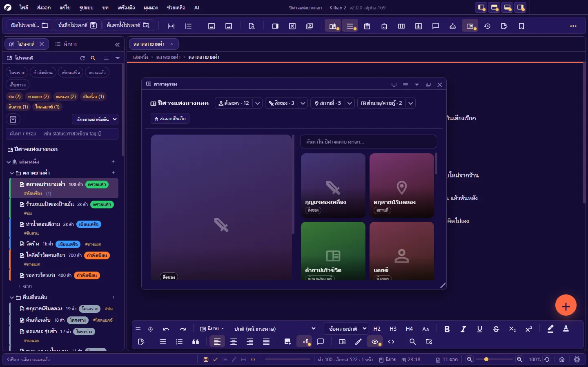
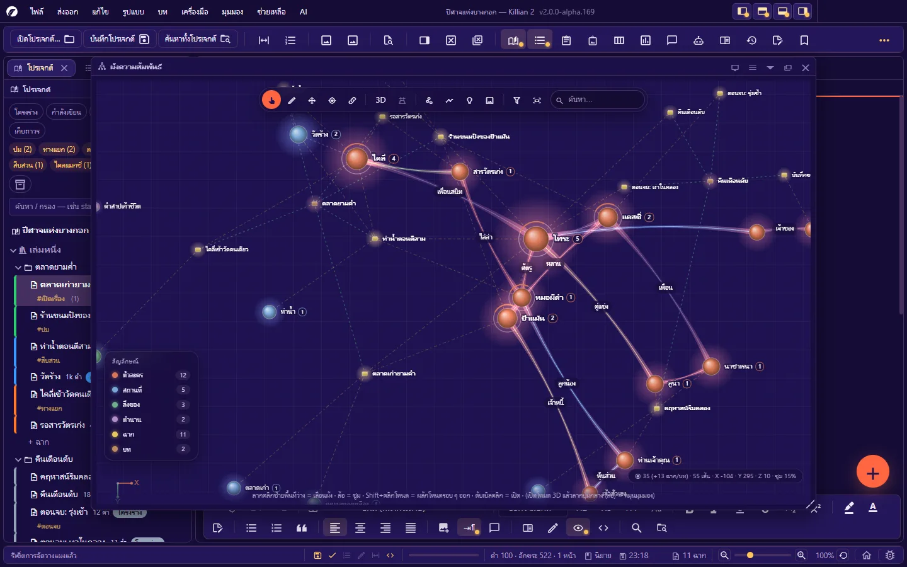
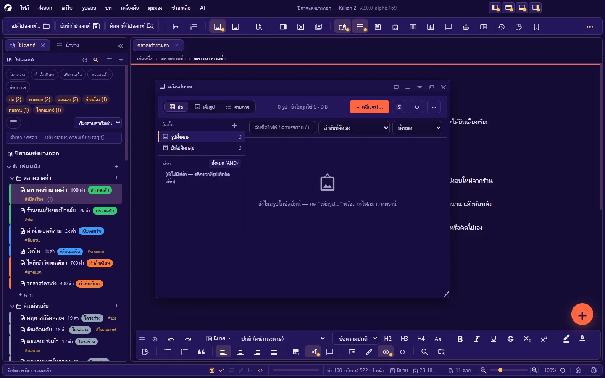

# 6. Wiki โลกของเรื่อง และคลังรูป

**ภาษา:** ไทย · [English](../en/06-wiki-world.md)

[← 5. เขียนบทภาพยนตร์](05-writing-screenplay.md) · [สารบัญ](README.md) · ถัดไป: [7. เครื่องมือวางแผน →](07-planning.md)

---

Wiki คือ "ไบเบิลของเรื่อง" — เก็บตัวละคร สถานที่ สิ่งของ ตำนาน และอะไรก็ตามที่ต้องอ้างอิงระหว่างเขียน ทุกหน้าคือไฟล์ `.json` หนึ่งไฟล์ในโฟลเดอร์ `Wiki/<หมวด>/` ของโปรเจกต์

## 6.1 หมวด และเอนทิตี้

**เอนทิตี้** = หนึ่งหน้า Wiki (ตัวละครหนึ่งคน · สถานที่หนึ่งแห่ง …) จัดอยู่ใน **หมวด**

| หมวดตั้งต้น | สร้างด้วย |
|---|---|
| ตัวละคร | `Ctrl+Alt+3` |
| สถานที่ | `Ctrl+Alt+4` |
| สิ่งของ | ปุ่มลอย + / คลิกขวาที่หมวดใน Explorer |
| ตำนาน/ความรู้ | ปุ่มลอย + / คลิกขวาที่หมวดใน Explorer |

- **สร้างหมวดของคุณเอง** (เช่น เผ่าพันธุ์ · องค์กร · เวทมนตร์): คลิกขวาที่หัว **Wiki** ใน Explorer → **สร้างหมวดใหม่** · แก้ไข/ลบหมวดได้ (หมวดหลักลบไม่ได้ · หมวดที่ยังมีรายการอยู่ลบไม่ได้)
- เปิดหน้า Wiki: คลิกชื่อใน Explorer · `Ctrl`+คลิกชื่อในเนื้อเรื่อง · ดับเบิลคลิกโหนดใน Story Network · จากสารานุกรม
- ลบเอนทิตี้ = ย้ายลงถังขยะ กู้คืนได้

## 6.2 หน้าเอนทิตี้

หน้า Wiki เปิดเป็นแท็บเหมือนฉาก บันทึกด้วย `Ctrl+S`

| ส่วน | ทำอะไร |
|---|---|
| **ชื่อ** | เปลี่ยนชื่อได้ — ถ้าเปิด **ซิงก์ชื่อเอนทิตี้อัตโนมัติ** (ตั้งค่า → อัตโนมัติ) โปรแกรมไล่อัปเดตชื่อในทุกไฟล์ให้ |
| **ชื่ออื่น** | ชื่อเล่น/ฉายา คั่นด้วยจุลภาค — ใช้จับชื่อในเนื้อเรื่องและในการค้นหา |
| **รูปประจำตัว** | คลิกวงกลมด้านบนเพื่อตั้งรูป (คลิกขวา = เอารูปออก) — ขึ้นทุกที่ที่เอนทิตี้ปรากฏ (ผัง · การ์ด · สารานุกรม) |
| **รูปอื่น ๆ** | เพิ่มรูปจากไฟล์ (คัดลอกเข้าคลังรูปของโปรเจกต์) หรือเลือกจากคลังรูป · แก้คำบรรยาย/ข้อความแทนรูป · ตั้งรูปใดรูปหนึ่งเป็นรูปประจำตัว · รูปในคลังที่ติดแท็ก `@ชื่อ` ขึ้นที่นี่ด้วย |
| **ข้อมูล (จากเทมเพลต)** | ช่องข้อมูลตามเทมเพลตของหมวด เช่น อายุ · อาชีพ · บุคลิก |
| **ข้อมูลเพิ่มเอง** | **เพิ่มช่องข้อมูลของตัวเอง** — ตั้งชื่อช่องอะไรก็ได้ |
| **หัวข้อ** | **เพิ่มหัวข้อ** ข้อความยาว เช่น ประวัติ · นิสัย · ปม |
| **แท็ก** | คั่นด้วยจุลภาค |
| **ความสัมพันธ์** | **เพิ่มความสัมพันธ์** — เลือกว่าผูกกับใคร · บทบาท (เช่น พี่ชาย / เพื่อน / ศัตรู) · ประเภท |
| **คำสั่งสำหรับ AI** | ข้อกำหนดที่อยากให้ AI ยึดทุกครั้งที่เขียนถึงเอนทิตี้นี้ เป็นคู่ "หัวข้อ — สิ่งที่ให้ทำ/เลี่ยง" เช่น น้ำเสียง — พูดสั้น ห้วน |
| **โค้ดสั้น** | ชื่อย่อสำหรับอ้างถึงเอนทิตี้นี้ (เว้นว่าง = ใช้ชื่อเอนทิตี้) — หน้า Wiki บอกรูปแบบที่ต้องพิมพ์ให้ |
| **ฉากที่กล่าวถึง** | ฉากทั้งหมดที่เอ่ยถึงเอนทิตี้นี้ พร้อมจำนวนครั้ง คลิกเพื่อเปิดฉาก |

- ปุ่ม **✨** ข้างช่อง = ให้ AI เติมช่องนั้นจากบริบทของเรื่อง (ถ้าช่องมีข้อความอยู่แล้วจะถามก่อนแทนที่)
- ปุ่ม **โค้ดสั้น** บนหน้า = แทรกโค้ดสั้น (ค่าฟิลด์ตัวเอง · ความสัมพันธ์ · ข้อมูลจาก Wiki อื่น · สถิติโปรเจกต์) ลงช่องที่โฟกัสอยู่
- **บันทึกเวอร์ชัน** (ตั้งชื่อได้) และ **ประวัติเวอร์ชัน** — ดู/กู้คืนเวอร์ชันเก่าของหน้านี้

### ประเภทความสัมพันธ์

ครอบครัว · คนรัก · พันธมิตร · คู่แข่ง · ศัตรู · ผู้สอน/อาจารย์ · รู้จัก · เป็นกลาง · อื่น ๆ
ประเภทกำหนด **สีของเส้น** ใน Story Network · บทบาท (ข้อความอิสระ) คือป้ายบนเส้น

### เทมเพลตของหมวด

ช่องข้อมูลของแต่ละหมวดมาจากไฟล์ **`templates.json`** ที่รากโปรเจกต์ — แก้ได้ด้วยโปรแกรมแก้ข้อความธรรมดา: เพิ่ม/ลบ/แก้ช่อง หัวข้อ และคุณสมบัติได้ทุกจุด

- ชนิดของช่องที่ใช้ได้: `String` · `Text` · `Int` · `Bool` · `Date` · `Enum` · `EntityRef` (อ้างถึงเอนทิตี้อื่น)
- หมวดหนึ่งมีได้หลายเทมเพลต — บนหน้าเอนทิตี้กด **เปลี่ยนเทมเพลต** ได้: ข้อมูลเดิมถูกรักษาไว้ เพิ่มเฉพาะช่องที่ขาด
- บล็อก `profile` ของเทมเพลตกำหนดหัวการ์ดโปรไฟล์ (บรรทัดรอง · สถานะ · ป้าย)

รูปแบบไฟล์เต็ม: [ภาคผนวก D](D-file-formats.md#wiki-และ-templatesjson)

## 6.3 ลิงก์อัตโนมัติ และ "ฉากที่กล่าวถึง"

- พิมพ์ชื่อ (หรือชื่ออื่น) ของเอนทิตี้ในฉาก → ถูกไฮไลต์เป็นลิงก์ · `Ctrl`+คลิกเพื่อเปิดหน้า Wiki
- โปรแกรมเก็บ **ดัชนีเชื่อมโยง** ว่าเอนทิตี้ไหนถูกเอ่ยถึงในฉากไหน — เห็นได้ 3 ที่:
  - ท้ายหน้าเอนทิตี้ (**ฉากที่กล่าวถึง**)
  - แผงคุณสมบัติของฉาก (**ฉากนี้กล่าวถึง**)
  - แผง **ฉากที่กล่าวถึง** (`Ctrl+Alt+Shift+B`) — รวมทุกเอนทิตี้ · มีปุ่ม **สร้างดัชนีเชื่อมโยงใหม่ทั้งโปรเจกต์** ใช้เมื่อแก้ไฟล์จากนอกโปรแกรม
- ปิดการไฮไลต์: **ตั้งค่า → ตัวแก้ไข → จับชื่อ Wiki อัตโนมัติ**

## 6.4 สารานุกรม (Codex)

`Ctrl+Alt+C` — มุมมองแบบสารานุกรมของ Wiki ทั้งเล่ม

- เรียกดูตามหมวด · ค้นด้วยชื่อ/ชื่อเล่น
- คลิกการ์ด = ดูบนภาพใหญ่ · ดับเบิลคลิก = เปิดหน้า Wiki
- **ส่งออกเป็นเว็บ** — สร้างเว็บสารานุกรมแบบ Fandom/Wikia ที่เปิดออฟไลน์ได้ ไม่ต้องต่อเน็ต (ส่งให้ทีมงานหรือผู้อ่านได้)

## 6.5 Story Network — ผังความสัมพันธ์

`Ctrl+Alt+N` — กราฟโต้ตอบของตัวละคร สถานที่ สิ่งของ ตำนาน ฉาก บท และเล่ม

### อ่านผัง

- **โหนด** = เอนทิตี้/ฉาก/บท/เล่ม — สีตามหมวด · ขนาดตามความสำคัญ · เลขข้างชื่อ = จำนวนความสัมพันธ์
- **เส้น** = ความสัมพันธ์ที่ตั้งไว้ (สีตามประเภท มีป้ายบทบาท) · เส้นประ = ปรากฏร่วมกันในฉาก / เอนทิตี้ ↔ ฉาก
- **การ์ดสัญลักษณ์** มุมซ้ายล่าง: จำนวนของแต่ละหมวด — คลิกเพื่อซ่อน/แสดงหมวดนั้น

### เมาส์และคีย์ (ค่าเริ่มต้น)

| ทำอะไร | วิธี |
|---|---|
| เลื่อนผัง | ลากพื้นที่ว่าง (คลิกซ้าย) |
| ซูม | ล้อเมาส์ |
| ย้ายโหนด | ลากโหนด |
| ดูข้อมูลของโหนดโดยไม่เปิดหน้า | คลิกโหนด (แผงข้อมูล: ความสัมพันธ์ · ฉากที่ปรากฏ) |
| เปิดหน้า Wiki/ฉาก | ดับเบิลคลิก |
| ผลักโหนดรอบ ๆ ออก | `Shift`+คลิกโหนด |
| เมนูของโหนด/ผัง | คลิกขวา |
| หมุนมุมมอง 3D | ลากปุ่มกลาง (ล้อ) |

เปลี่ยนว่าปุ่มเมาส์ไหนใช้หมุน/เลื่อน: **ตั้งค่า → ผังความสัมพันธ์ → การควบคุมด้วยเมาส์**

### เครื่องมือบนแถบของผัง

- **เลือก/ย้าย** · **ผูกความสัมพันธ์** (ลากจากโหนดหนึ่งไปวางบนอีกโหนด — เขียนลงหน้า Wiki ให้) · **ค้นหา** โหนด
- **3D** — สลับมุมมอง 2D ↔ 3D · **มุมมองระยะ** (ของไกลเล็กลง)
- **จัดใหม่อัตโนมัติ** (แรงผลัก/ดึง) · **ปลดหมุดทุกโหนดแล้วจัดผังใหม่**
- **หาเส้นทาง** — คลิกโหนดต้นทาง เลือก "หาเส้นทางไปหา…" แล้วคลิกโหนดปลายทาง: ผังไฮไลต์เส้นทางที่สั้นที่สุด (ถ้าไม่มีความสัมพันธ์ตรง จะบอกว่าเส้นทางผ่านฉากที่ปรากฏร่วมกัน)
- **ข้อสังเกต** — เช่น คู่ที่ "เจอกันบ่อยแต่ยังไม่ผูกความสัมพันธ์"
- **ไทม์ไลน์เรื่อง** — เรียงตามลำดับเรื่อง ผังโตตามลำดับฉาก
- **ตัวกรอง/การแสดงผล** — หมวดที่แสดง · ประเภทเส้น · ชื่อใต้โหนด
- **ฉากหลัง** — สี · รูป (ติดกับผังหรือติดจอ) · ในโหมด 3D: รูปพาโนรามา 2:1 หรือไฟล์ `.hdr` = ท้องฟ้ารอบตัวที่หมุนตามกล้อง
- **โมเดล 3 มิติ** — ตั้งโมเดลให้หมวดหรือโหนด (`.glb` `.gltf` `.obj` `.stl` — ไฟล์ถูกก๊อปเข้าโฟลเดอร์ `Models/`)

ผังจำตำแหน่งโหนดที่คุณจัดไว้ · **สี** ของโหนด/เส้น/พื้น และชุดสีสำเร็จรูป (สายไฟ · ดอกไม้ · แผ่นเทียบสี · สีรุ้ง) ตั้งที่ **ตั้งค่า → ผังความสัมพันธ์**
ส่งออก: **ส่งออก → ผังความสัมพันธ์ → รูปภาพ PNG**

> โหมด 3D และโมเดลต้องใช้การ์ดจอที่รองรับ WebGL

## 6.6 หน้ารายชื่อตัวละครของเล่ม

คลิกขวาที่เล่ม → **รายชื่อตัวละคร (Cast of Characters)** — หน้ารายชื่อประจำเล่มที่ดึงจาก Wiki ได้ และใส่ไว้หน้าแรก ๆ ของไฟล์ที่ส่งออก ดู [5.7](05-writing-screenplay.md#หน้ารายชื่อตัวละคร-cast-of-characters)

## 6.7 คลังรูปภาพ

`Ctrl+Shift+G` — รูปทั้งหมดในโฟลเดอร์ `Images/` ของโปรเจกต์

| ทำอะไร | วิธี |
|---|---|
| เพิ่มรูป | ปุ่ม **เพิ่มรูป…** หรือลากไฟล์จากเครื่องมาวาง |
| จัดอัลบั้ม | **มุมมอง → คลังรูปภาพ → สร้างอัลบั้มใหม่…** · ย้ายรูประหว่างอัลบั้ม (โปรแกรมอัปเดตลิงก์ในไฟล์ที่ใช้รูปให้) |
| มุมมอง | ภาพย่อขนาดเท่ากัน (ครอบตัด) · เห็นทั้งรูปตามสัดส่วนจริง · แถวละรูป (ชื่อ คำบรรยาย แท็ก ขนาด การใช้งาน) |
| ติดแท็ก | คลิกขวาที่รูป — แท็กคั่นด้วยช่องว่าง · `@ชื่อ` = ผูกกับเอนทิตี้ Wiki · `~ชื่อ` = ผูกกับฉาก |
| ใช้รูป | ลากลงเอกสารเพื่อแทรก · เลือกเป็นปก/รูปประจำตัวใน Wiki · ลากลงกระดานอารมณ์ |
| ดูว่ารูปถูกใช้ที่ไหน | มุมมองแถว หรือกรองตามการใช้งานจริงในต้นฉบับ |
| **รูปที่ยังไม่ถูกใช้** | **มุมมอง → คลังรูปภาพ → รูปที่ยังไม่ถูกใช้** |
| **หารูปซ้ำ** | **มุมมอง → คลังรูปภาพ → หารูปซ้ำในคลัง** |
| **ส่งออกเฉพาะรูปที่ใช้จริง** | **ส่งออก → คลังรูปภาพ → ZIP (รูปที่ใช้จริง)** |
| เปลี่ยนชื่อไฟล์รูป | คลิกขวาที่รูปใน Explorer → เปลี่ยนชื่อ — ลิงก์ในทุกไฟล์ถูกแก้ตาม |
| คำบรรยายด้วย AI | เลือกรูป → **AI: ตั้งคำบรรยายให้รูปที่เลือก** (ต้องใช้โมเดลที่อ่านภาพได้) |

ลบรูป/อัลบั้ม = ย้ายลงถังขยะ

## 6.8 กระดานอารมณ์ (Mood Board)

`Ctrl+Alt+G` — ผืนผ้าใบวางของอ้างอิงของแต่ละอัลบั้ม

เปิดคู่กับแผงคลังรูป แล้ว **ลากรูป ฉาก หรือตัวละคร** มาวางได้เลย

| ทำอะไร | วิธี |
|---|---|
| เพิ่มของ | ดับเบิลคลิกที่ว่าง = โน้ต · คลิกขวาที่ว่าง = โน้ต / แถบสี (palette) / กรอบกลุ่ม / การ์ดอ้างอิง / รูป |
| การ์ดอ้างอิง | ลิงก์เว็บหรือข้อความ — ลากลิงก์จากเบราว์เซอร์มาวางได้ |
| จัดวาง | ลาก = ย้าย · มุมขวาล่าง = ปรับขนาด · ดับเบิลคลิก = เปิด |
| ฉากหลังของกระดาน | สี · รูป · เบลอ · หรี่ |
| ลบของที่เลือก | `Delete` (มีปุ่มย้อนกลับในข้อความลอย) · `Ctrl+Z` ย้อนกลับบนกระดาน |
| ส่งออก | รูปภาพ PNG หรือหน้าเว็บ HTML (รูปฝังในไฟล์ ลิงก์กดได้) |

**ล้างกระดาน** ไม่ลบไฟล์รูป — แค่เอาการ์ดออกจากผืน

---

ถัดไป: [7. เครื่องมือวางแผน →](07-planning.md)
