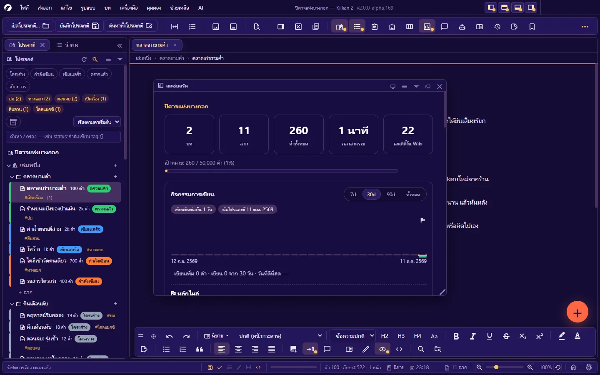
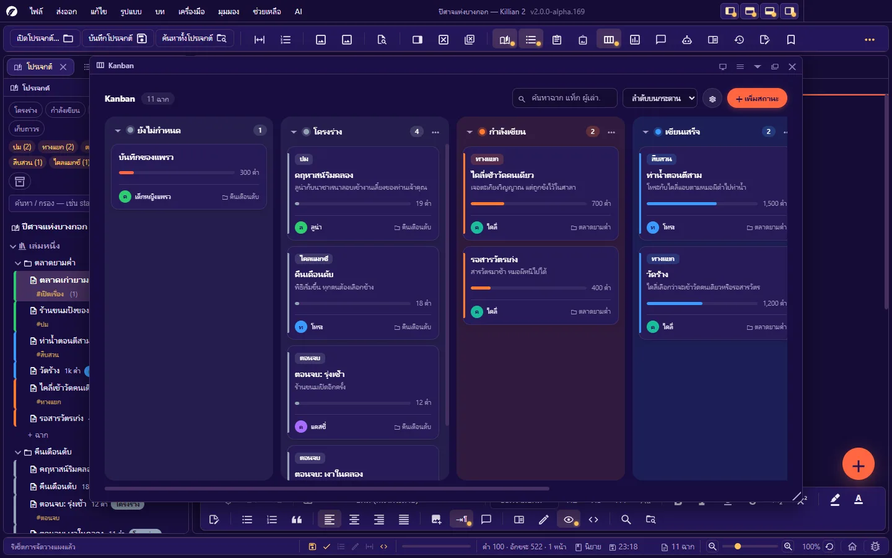
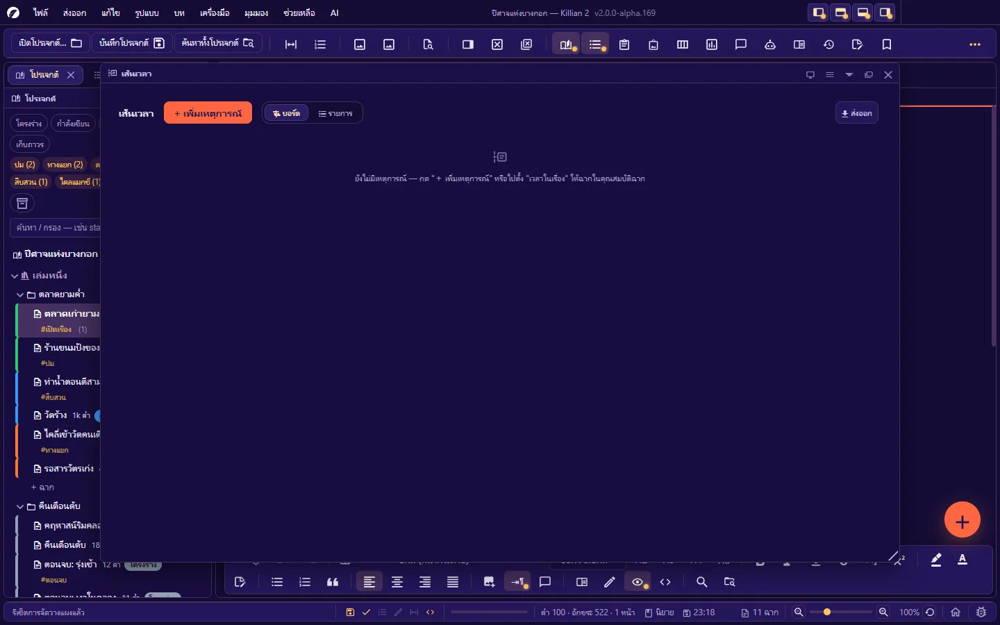
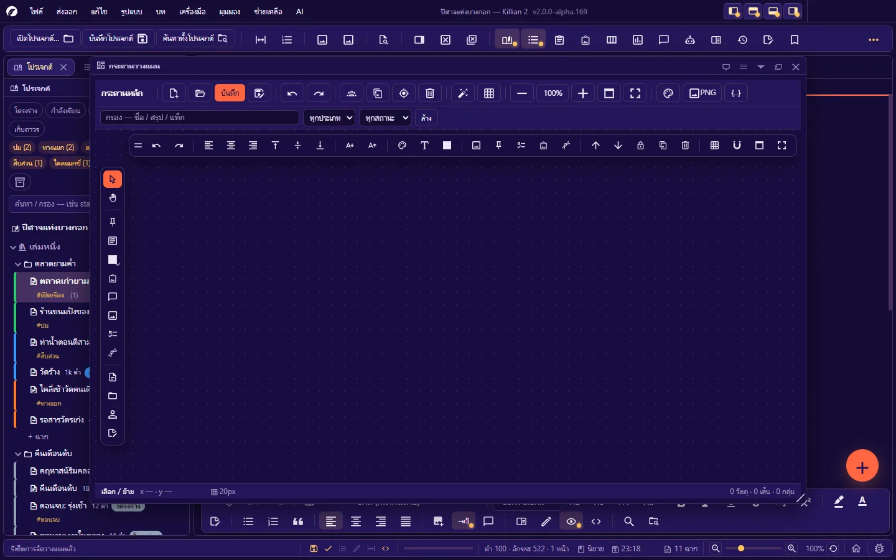
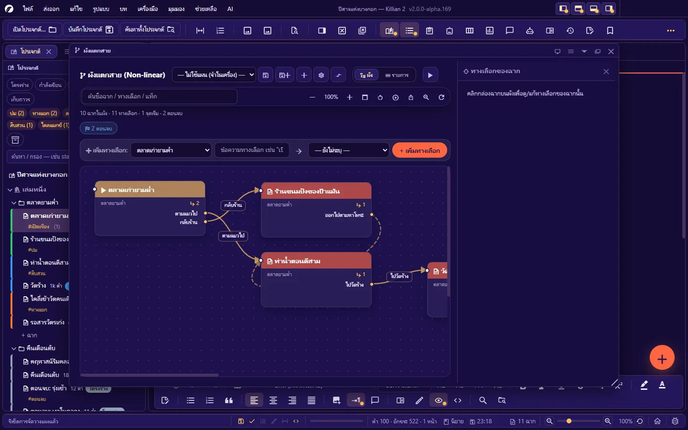
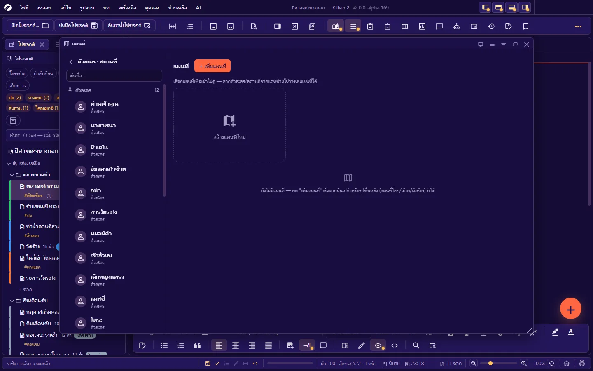
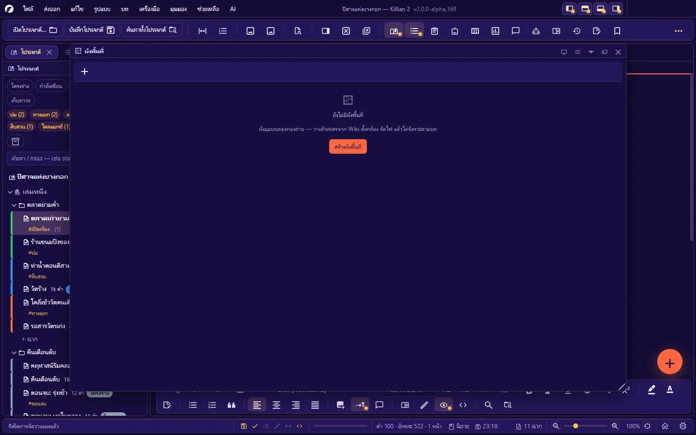

# 7. เครื่องมือวางแผน

**ภาษา:** ไทย · [English](../en/07-planning.md)

[← 6. Wiki โลกของเรื่อง และคลังรูป](06-wiki-world.md) · [สารบัญ](README.md) · ถัดไป: [8. ผู้ช่วย AI →](08-ai.md)

---

เครื่องมือในบทนี้เป็น **แผง** ทั้งหมด — เปิดจาก **มุมมอง → แผง** · **มุมมอง → เครื่องมือเล่าเรื่อง** · ปุ่มบนแถบเครื่องมือ · หรือคีย์ลัด แล้วผนึก/ลอย/ฉีกเป็นหน้าต่างได้ตาม [บทที่ 2](02-interface.md#27-ระบบแผง)

| แผง | คีย์ลัด | ใช้ตอบคำถาม |
|---|---|---|
| [แดชบอร์ด](#71-แดชบอร์ด) | `Ctrl+Alt+D` | งานคืบไปถึงไหนแล้ว |
| [Kanban](#72-kanban) | `Ctrl+K` | ฉากไหนอยู่สถานะอะไร |
| [เส้นเวลา](#73-เส้นเวลา-timeline) | `Ctrl+Alt+T` | อะไรเกิดก่อนหลังในเรื่อง |
| [กระดานวางแผน](#74-กระดานวางแผน-planner) | `Ctrl+Alt+P` | ปะติดปะต่อโครงเรื่องแบบอิสระ |
| [ผังแตกสาย](#75-ผังแตกสาย-และทดลองเล่น) / ทดลองเล่น | `Ctrl+Alt+B` / `Ctrl+Alt+Y` | ทางเลือกของเรื่องพาไปไหน |
| [แผนที่](#76-แผนที่) | `Ctrl+Alt+M` | ใครอยู่ที่ไหน ไกลกันแค่ไหน |
| [ผังพื้นที่](#77-ผังพื้นที่-floor-plan) | `Ctrl+Alt+F` | กล้อง ไฟ นักแสดงยืนตรงไหน |

การลบของบนผืน (หมุด · การ์ด) ด้วยปุ่ม `Delete` จะมีข้อความลอยพร้อมปุ่ม **ย้อนกลับ** · การลากทุกแบบกด `Esc` เพื่อยกเลิกได้

## 7.1 แดชบอร์ด

ภาพรวมความคืบหน้าของโปรเจกต์:

- **เป้าหมาย**: จำนวนคำ / เป้า (%) · หลักไมล์ (ถึงกี่คำแล้ว · เหลืออีกเท่าไร)
- **กิจกรรมการเขียน**: เขียนเพิ่มกี่คำ · เขียนกี่วันจากกี่วัน · วันที่ดีที่สุด · จำนวนวันเขียนติดต่อกัน
- **สถิติ**: เล่ม · บท · ฉาก · เฉลี่ยคำ/บท · **เวลาอ่านรวม** (คิดจากความเร็วอ่านเฉลี่ย)
- **ความคืบหน้าตามสถานะฉาก** + ปุ่มเปิด Kanban
- **ความยาวแต่ละบท** (กราฟแท่ง)
- **คำที่ใช้บ่อย** (ไม่นับคำเชื่อมและชื่อตัวละคร — บอกจำนวนครั้งต่อหมื่นคำ)
- **ไปต่อจากที่ค้าง** · ฉากปักหมุด · สรุปคลังรูป

เป้าหมายตั้งที่ **ตั้งค่า → ข้อมูลผลงาน → เป้าหมายจำนวนคำ** · เมื่อเปิดโปรเจกต์ที่ยังไม่มีแท็บ โปรแกรมเปิดแดชบอร์ดให้ และพับเก็บเองเมื่อคุณเริ่มเขียน

## 7.2 Kanban

กระดานฉากเรียงตาม **สถานะ** — หนึ่งคอลัมน์ต่อหนึ่งสถานะ หนึ่งการ์ดต่อหนึ่งฉาก

| ทำอะไร | วิธี |
|---|---|
| เปลี่ยนสถานะฉาก | **ลากการ์ดข้ามคอลัมน์** (เขียนลงไฟล์ทันที) |
| เปิดฉาก | ดับเบิลคลิกการ์ด หรือเลือกแล้วกด `Enter` |
| ค้นหา | ช่องค้นหา — ชื่อฉาก แท็ก ผู้เล่า |
| เรียงการ์ด | ลำดับบนกระดาน · ชื่อฉาก · ยาวที่สุดก่อน |
| เลือกฉบับร่างที่แสดง | ปุ่มร่างบนหัวกระดาน |
| เพิ่มสถานะ (คอลัมน์) | **+ เพิ่มสถานะ** — เพิ่มสถานะของทั้งโปรเจกต์ เห็นใน Explorer ทันที |
| เมนูคอลัมน์ (⋯) | เปลี่ยนสีสถานะ · พับ/กางคอลัมน์ · ลบคอลัมน์ (ฉากในคอลัมน์ย้ายไปสถานะอื่นตามที่บอก) |
| จัดการสถานะ | ปุ่มเฟืองบนหัวกระดาน |

การ์ดแสดง: แท็ก · ชื่อ · เรื่องย่อ · แถบความยาว (เทียบกับฉากที่ยาวที่สุดบนกระดาน) · จำนวนคำ · ผู้เล่า · บท
ฉากที่ล็อกอยู่ลากไม่ได้ · ลากจัดลำดับในคอลัมน์ได้เฉพาะตอนเรียงตาม "ลำดับบนกระดาน" และไม่ได้ค้นหาอยู่
ส่งออก: **ส่งออก → Kanban → ตาราง CSV**

## 7.3 เส้นเวลา (Timeline)

ลำดับเหตุการณ์ตาม **เวลาในเรื่อง** (ไม่ใช่ลำดับที่เล่า)

**ของบนเส้นเวลามีสองชนิด**

- **ฉาก** ที่ตั้ง "เวลาในเรื่อง" ไว้ในคุณสมบัติฉาก — ขึ้นเอง
- **เหตุการณ์** ที่คุณเพิ่มเอง (**+ เพิ่มเหตุการณ์** หรือดับเบิลคลิกที่ว่างบนบอร์ด): ชื่อ · ชนิด · เส้นเรื่อง · เวลาเริ่ม/จบ · รายละเอียด · อ้างอิง (ฉาก/เอนทิตี้)

**มุมมอง**: **บอร์ด** (แนวนอน การ์ดยาวตามช่วงเวลา) · **รายการ** (แนวตั้งเรียงตามเวลา) · **Gantt** (ต้องมีเหตุการณ์ที่ระบุเวลาเป็นตัวเลข เช่น "ปีที่ 1024")

| บนบอร์ด | วิธี |
|---|---|
| เลื่อนเวลาของการ์ด | ลากการ์ด |
| ยืดช่วงเวลา | ลากขอบซ้าย/ขวาของการ์ด |
| เชื่อม "นำไปสู่" | ลากจุดทางขวาของการ์ดไปวางบนการ์ดอื่น |
| เปิดฉาก/แก้เหตุการณ์ | `Ctrl`+คลิก · หรือคลิกการ์ดเหตุการณ์ |
| ซูม | `Ctrl+ล้อ` · ปุ่มพอดีกับกรอบ |
| ตั้งเวลาให้ของที่ "ยังไม่ระบุเวลา" | ลากจากถาดด้านล่างขึ้นบอร์ด |
| อ้างอิงฉาก/ตัวละครในเหตุการณ์ | ลากจาก Explorer มาวางบนการ์ดเหตุการณ์ (วางที่ว่าง = เหตุการณ์ใหม่) |
| ซ่อน/แสดงเส้นเรื่อง | คลิกชื่อเส้นเรื่อง |

**ตัวช่วยจับผิด**: เส้นเชื่อมที่ **ย้อนเวลา** (ต้นเหตุเกิดหลังผล) เป็นเส้นประแดง · จุดที่เหตุการณ์ **เวลาตรงกัน** ไฮไลต์สีส้ม — ให้ตรวจว่าตั้งใจหรือไม่
ส่งออก: รูป PNG · หน้าเว็บ HTML · Markdown · ตาราง CSV

## 7.4 กระดานวางแผน (Planner)

ผืนผ้าใบอิสระแบบไวท์บอร์ด — วางการ์ด โน้ต รูป แล้วโยงเส้น ใช้ปะติดปะต่อโครงเรื่องก่อนลงมือเขียน
กระดานแต่ละใบเป็นไฟล์ JSON ในโฟลเดอร์ `Planners/` · มีได้หลายใบ (**ใหม่** · **เปิด** สลับใบ)

**ของที่วางได้**: โพสต์อิต · การ์ดรายการสิ่งที่ต้องทำ (ติ๊กบนการ์ดได้) · เฟรมจัดกลุ่มพื้นที่ (แบ่งองก์/สายเรื่อง) · การ์ดรูป · การ์ดที่ผูกกับไฟล์ในโปรเจกต์ (ฉาก/หน้า Wiki — ลากจาก Explorer) · **เส้นเชื่อม** (คลิกการ์ดต้นทางแล้วปลายทาง · ดัดเส้นได้)

| ทำอะไร | วิธี |
|---|---|
| เลื่อนผืน / ซูม | ลากพื้นว่าง / ล้อเมาส์ · **พอดีจอ** |
| เลือกหลายชิ้น | ลากคลุม หรือ `Shift`+คลิก |
| จัดกลุ่ม | เลือกการ์ด → **จัดกลุ่ม** |
| ย้อนกลับ/ทำซ้ำ (ของกระดาน) | `Ctrl+Z` / `Ctrl+Y` ขณะแผงนี้ถูกเลือก |
| ทำสำเนา / ลบ / ล็อก / ยกขึ้นบนสุด / ส่งลงล่างสุด | แถบเครื่องมือของกระดานหรือคลิกขวา |
| สีพื้น · สีขอบ · สีตัวอักษร · ขนาดตัวอักษร · จัดข้อความ (ซ้าย/กลาง/ขวา · บน/กลาง/ล่าง) | แถบรูปแบบของกระดาน |
| กริด | เปิด/ปิด · ระยะห่าง · จุดหรือเส้น · **สแนป** (การ์ดลงล็อกกริดทั้งตอนย้าย วาด และยืดขอบ) |
| พื้นกระดาน | สี หรือรูปฉากหลัง (วิธีวาง · เบลอ · ความจาง) |
| จัดอัตโนมัติ | เรียงการ์ดทั้งกระดานเป็นตาราง |
| เต็มหน้าต่าง | ปุ่มเต็มจอ · `Esc` ออก |

**แผงคุณสมบัติของการ์ด** (คุณสมบัติของการ์ดหรือเส้นเชื่อมที่เลือก): ชื่อ · สรุป · สี · สถานะ · แท็ก · ขนาด · สไตล์เส้น · โน้ตสำหรับนักเขียน
กระดานที่แก้แล้วยังไม่บันทึกอยู่ในรายการงานค้าง (**บันทึกทั้งหมด** `Ctrl+Alt+S`)
ส่งออก: PNG (ความละเอียดสองเท่า ครอบเฉพาะส่วนที่มีของ) · JSON ทั้งกระดาน

## 7.5 ผังแตกสาย และทดลองเล่น

สำหรับเรื่องที่มีทางเลือก — นิยายภาพ เกมเนื้อเรื่อง นิยายแตกสาย

### สร้างทางเลือก

มีสามทาง ได้ผลเหมือนกัน:

1. **เขียนในฉาก**: พิมพ์ `[ข้อความทางเลือก]` ตรงจุดที่เรื่องแตกสาย เช่น `[ตามแมวไป] [กลับร้าน]` แล้ว **เครื่องมือ → สร้างทางเลือกจาก [ข้อความ] ในฉากนี้** (หรือปุ่มสแกนในแผง — หา `[ข้อความ]` ที่ยังไม่ได้ผูกทั้งโปรเจกต์)
2. **แถบ "เพิ่มทางเลือก"** บนแผง: เลือกฉากต้นทาง · พิมพ์ข้อความ · เลือกฉากปลายทาง → **+ เพิ่มทางเลือก** (แทรก `[ข้อความ]` ลงท้ายฉากให้ด้วย)
3. **ลากบนผัง**: ลากฉากจาก Explorer มาวาง แล้วลากจุดทางขวาของการ์ดไปปล่อยบนการ์ดฉากอื่น

### ทำงานบนผัง

| ทำอะไร | วิธี |
|---|---|
| เลือกการ์ด / ย้าย / เปิดฉาก | คลิก / ลาก / ดับเบิลคลิก |
| แก้ทางเลือกของฉาก | คลิกการ์ด → แผง "ทางเลือกของฉาก" ทางขวา |
| ย้ายทางเลือกไปฉากอื่น | ลากแถบ ⠿ ของทางเลือกไปวางบนการ์ดฉากอื่น |
| ค้นหา | พิมพ์ชื่อฉาก/ทางเลือก/แท็ก — ที่ไม่ตรงจะจางลง |
| มุมมอง | **ผัง** หรือ **รายการ** · ซูม · จัดผังอัตโนมัติ |
| สีการ์ด/เส้น | เมนูของการ์ด |

หัวแผงสรุป: จำนวนฉากในผัง · ทางเลือก · จุดเริ่ม · **ตอนจบ** และเตือน **ทางตัน** (ทางเลือกไม่มีปลายทาง) · **วงวน** · ปลายทางที่ถูกลบไปแล้ว

**แผน (Plan)**: ช่องเลือกบนหัวแผง — "ไม่ใช้แผน" = ตำแหน่งการ์ดจำในเครื่อง · หรือบันทึกเป็น **แผน** (ไฟล์ในโฟลเดอร์ `Branches/`) มีได้หลายแผน เทียบกันได้ (คลิกขวาที่แผนใน Explorer → **เทียบกับแผนอื่น…**) และล็อกได้

ส่งออก: HTML · Markdown · JSON · SVG · PNG

### ทดลองเล่น (Player Mode)

`Ctrl+Alt+Y` หรือปุ่ม ▶ บนผัง — อ่านเรื่องแบบผู้เล่น: เนื้อฉากอ่านอย่างเดียว แล้วกดปุ่มทางเลือกเดินต่อไป

- **ถอยหนึ่งก้าว** · **เริ่มรอบใหม่** · เริ่มจากฉากที่ต้องการ (คลิกขวาที่การ์ด → เปิดโหมดทดลองเล่นโดยเริ่มที่ฉากนี้)
- ทุกรอบการเล่นถูกบันทึก — **มุมมอง → เครื่องมือเล่าเรื่อง → ประวัติการตัดสินใจ…** บอกว่าเลือกทางไหนบ่อยสุด
- ใช้เช็กว่าทุกเส้นทางเดินได้จริงก่อนส่งให้ทีมเกม

## 7.6 แผนที่

แผนที่ของโลกในเรื่อง — ใช้รูปของคุณเองเป็นพื้นหลัง (หรือผืนเปล่า) แล้วปักข้อมูลลงไป แผนที่ไม่มีขอบ: เลื่อนและซูมได้อิสระ

**ของบนแผนที่**

| ของ | คืออะไร | สร้างยังไง |
|---|---|---|
| **หมุด** | จุดบนแผนที่ ผูกกับตัวละคร/สถานที่/ฉากได้ | คลิกขวา → หมุด · หรือลากชื่อจากแถบซ้าย/Explorer มาวาง |
| **หมุดประตู** | ทางลงไป **แผนที่ย่อย** (โลก → เมือง → ห้อง) | ลากแผนที่ใบอื่นจากรายการมาวาง |
| **โซน** | พื้นที่รูปหลายเหลี่ยม (อาณาเขต · ป่า · เขตอันตราย) อยู่ชั้นล่างสุดใต้หมุด · ผูกกับเอนทิตี้ได้ | คลิกขวา → วาดโซน: คลิกทีละจุด · ดับเบิลคลิก/`Enter` = เสร็จ · `Backspace` = ถอยจุด · `Esc` = ยกเลิก |
| **ตัวหนังสือ** | ป้ายชื่อบนแผนที่ | คลิกขวา → ตัวหนังสือ |
| **เส้นทางของเรื่อง** | เส้นลากผ่านตำแหน่งของฉากตามลำดับเวลาในเรื่อง — เห็นว่าตัวละครต้องเดินทางไกลแค่ไหน | สวิตช์บนแถบของแผนที่ |

| ทำอะไร | วิธี |
|---|---|
| เลื่อน / ซูม | ลากที่ว่าง / ล้อเมาส์ |
| เลือก / ย้ายหมุด | คลิก (มีแถบเครื่องมือลอย) / ลาก |
| เปิดสิ่งที่หมุดลิงก์ไป | ดับเบิลคลิก หรือ `Ctrl`+คลิก |
| บอกว่าฉากเกิดที่ไหน | ลากฉากจาก Explorer มาวางบนแผนที่ (หรือบนหมุด) |
| กริด | ช่องจัตุรัส เปิด/ปิดได้ |

**รูปพื้นหลัง**: ปรับขนาด · สัดส่วน · ความทึบ · หมุน · เอียง · พลิก · เฉือน ได้ — หมุดและโซนไม่ขยับตามรูป (เปิดโหมดย้ายรูปเพื่อลากรูปโดยตรง)

**มาตราส่วนและพิกัดจริง**: ตั้งมาตราส่วน (ระยะจริงต่อหน่วยบนแผนที่) · ทิศเหนือ · และจุดอ้างอิงละติจูด/ลองจิจูด — แล้วแผนที่จะบอก **ระยะทาง · เวลาเดินทาง · พื้นที่ของโซน · ละติจูด/ลองจิจูด** ของจุดต่าง ๆ ได้

ส่งออก: รูป PNG · **GeoJSON** (เมื่อตั้งพิกัดจริง) · พิมพ์
แผนที่เป็นบริบทให้ AI ได้ — แชทถามได้ว่า "ใครอยู่ใกล้ใคร" จากข้อมูลบนแผนที่

## 7.7 ผังพื้นที่ (Floor Plan)

ผังกองถ่ายมุมบน (แนว Shot Designer) — วางแผนบล็อกกิ้งและกล้องของฉาก

**ของบนผัง**

- **ตัวละคร/ของจาก Wiki** — พร้อมทิศที่หันและระยะสายตา (เพิ่มจากปุ่ม หรือลากจาก Explorer)
- **กล้อง** — เลือกบอดี้ (กำหนดขนาดเซนเซอร์) · เลนส์ (มม.) · ขาตั้ง/ราง — **มุมรับภาพคำนวณจากเซนเซอร์ + เลนส์** เปลี่ยนเลนส์แล้วกรวยภาพเปลี่ยนตาม
- **ไฟ** · **รูปทรง/เฟอร์นิเจอร์** · **ผนัง** (คลิกทีละจุด · ดับเบิลคลิก/`Enter` = จบ · `Backspace` = ลบจุดล่าสุด)
- **รูปพื้นหลัง** (แปลนห้องจริง)

| ทำอะไร | วิธี |
|---|---|
| วางของ | เลือกเครื่องมือแล้วคลิกบนผัง · `Shift` ค้าง = วางต่อหลายชิ้น · `Esc` ยกเลิก |
| เลือก/ย้าย | เครื่องมือเลือก — ลากพื้นว่าง = เลื่อนผัง · ล้อ = ซูม |
| ย้อนกลับ/ทำซ้ำ | `Ctrl+Z` / `Ctrl+Y` ขณะแผงนี้ถูกเลือก |
| คุณสมบัติของชิ้นที่เลือก | แผงคุณสมบัติทางขวาของผัง |

**จังหวะ (Beat)** — แถบจังหวะด้านล่าง: แต่ละจังหวะคือ "ช่วงหนึ่งของฉาก" ที่ของบนผังอยู่คนละตำแหน่งได้

- จังหวะแรก = ตำแหน่งตั้งต้น · จังหวะถัดไปเก็บเฉพาะชิ้นที่ **ขยับ** (ที่เหลือสืบทอดจากจังหวะก่อน)
- ผูกจังหวะกับ **บรรทัดของฉาก** (เลือกบรรทัดจากบท หรือพิมพ์เอง) — คลิกเพื่อกระโดดไปบรรทัดนั้นในฉาก
- เพิ่ม · ลบ · สลับ · แทรกจังหวะได้

**ผังของฉาก**: ผังผูกกับฉาก (คุณสมบัติฉากมีทางลัด "ผังของฉากนี้") · ฉากหนึ่งมีได้หลายผัง · ผังเก็บในโฟลเดอร์ `FloorPlans/`

**Prompt ภาพ/วิดีโอด้วย AI**: วางกล้องก่อน แล้วให้ AI อ่านบรรทัดของฉาก + ข้อมูลช็อตจากผัง (กล้อง เลนส์ ใครอยู่ตรงไหนในภาพ ไฟ) เขียน prompt ภาษาอังกฤษทั้งภาพนิ่งและวิดีโอของจังหวะนั้น · ตั้ง "สไตล์ภาพ" รวมของทั้งฉากได้ · ถ้าผังเปลี่ยนหลังสร้าง prompt โปรแกรมจะบอกให้เขียนใหม่

ส่งออก: รูป PNG (พื้นขาวสำหรับพิมพ์) · ตาราง CSV · Markdown (รายการช็อต)

## 7.8 เล่าด้วยภาพ (Visual Telling)

ปุ่ม **เล่าด้วยภาพ** บนแถบเครื่องมือ (หรือคลิกขวาที่บท → **เล่าด้วยภาพ**) — ตารางสตอรีบอร์ดของฉาก

- **เพิ่มแถวจากบรรทัดในฉาก**: ติ๊กบรรทัดที่อยากทำเป็นภาพ (ผูกหลายบรรทัดเข้าแถวเดียวได้)
- ใส่รูปให้แต่ละแถว — เลือกจากคลังหรือเพิ่มรูปใหม่
- ถ้าบรรทัดต้นทางในฉากถูกแก้ แถวจะขึ้นเตือน กดเพื่ออัปเดตข้อความ
- ลากปรับความกว้างคอลัมน์ได้

## 7.9 สปรินต์การเขียน

**เครื่องมือ → สปรินต์การเขียน** (`Ctrl+Alt+Shift+S`)

- ตั้ง **ระยะเวลา (นาที)** และ **เป้าหมาย (คำ)** แล้วกด **เริ่ม** · **พัก** / **ทำต่อ** / **จบรอบ**
- นับเฉพาะคำที่พิมพ์เพิ่มระหว่างรอบ **ในทุกแท็บ** — เปิดฉากอื่นระหว่างรอบได้โดยไม่ถูกนับซ้ำ
- แสดงคำ/นาที และประวัติ (กี่รอบ · รวมกี่คำ · เฉลี่ย) — เก็บไว้ในโปรเจกต์

## 7.10 บันทึกประจำวัน และ Logline

**บันทึกประจำวัน** (`Ctrl+Alt+J`) — จดว่าวันนี้ทำอะไรไปบ้าง: ข้อความ · อารมณ์ (ลื่นไหล/ปกติ/ติดขัด/ล้า) · จำนวนคำ · เวลาที่ใช้ · แท็ก · ค้นย้อนหลังได้ · **ส่งออก CSV**

**Logline** (**ตั้งค่า → ข้อมูลผลงาน**) — เข็มทิศของเรื่อง 6 ช่อง: Logline ประโยคเดียว · ตัวละครหลัก · เหตุการณ์กระตุ้น · เป้าหมาย · อุปสรรค/ตัวร้าย · เดิมพัน
เมื่อกรอกไว้ AI จะใช้เป็นแกนตรวจว่าเนื้อหาไม่หลุดจากเป้าหมาย อุปสรรค หรือเดิมพันของเรื่อง

## 7.11 ส่งออกจากแผง

ทุกแผงที่ส่งออกได้รวมอยู่ในเมนู **ส่งออก** ที่เดียว (และมีปุ่มส่งออกบนแถบของแผงเอง):

| แผง | รูปแบบ |
|---|---|
| เส้นเวลา | PNG · HTML · Markdown · CSV |
| แผนที่ | PNG · GeoJSON · พิมพ์ |
| กระดานอารมณ์ | PNG · HTML |
| ผังความสัมพันธ์ | PNG |
| กระดานวางแผน | PNG |
| ผังแตกสาย | HTML · Markdown · JSON · SVG · PNG |
| Kanban | CSV |
| คลังรูปภาพ | ZIP (รูปที่ใช้จริง) |
| AI วิเคราะห์ | CSV |
| ผังพื้นที่ | PNG · CSV · Markdown |

---

ถัดไป: [8. ผู้ช่วย AI →](08-ai.md)
