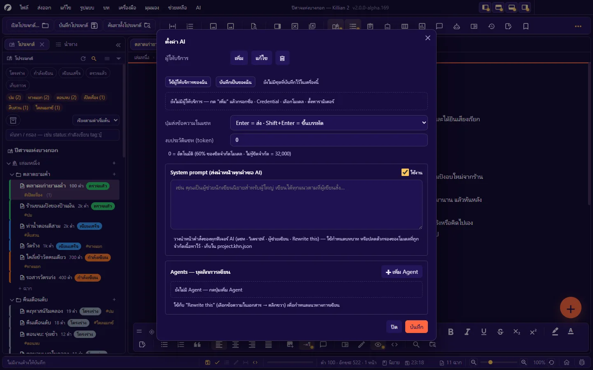
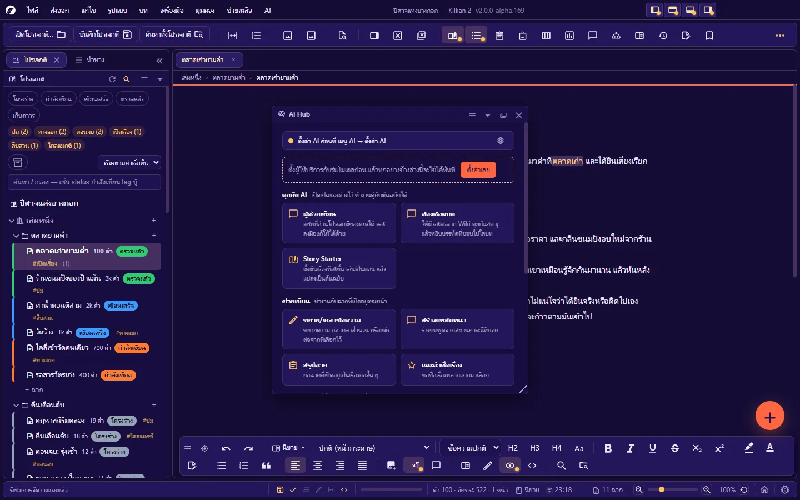
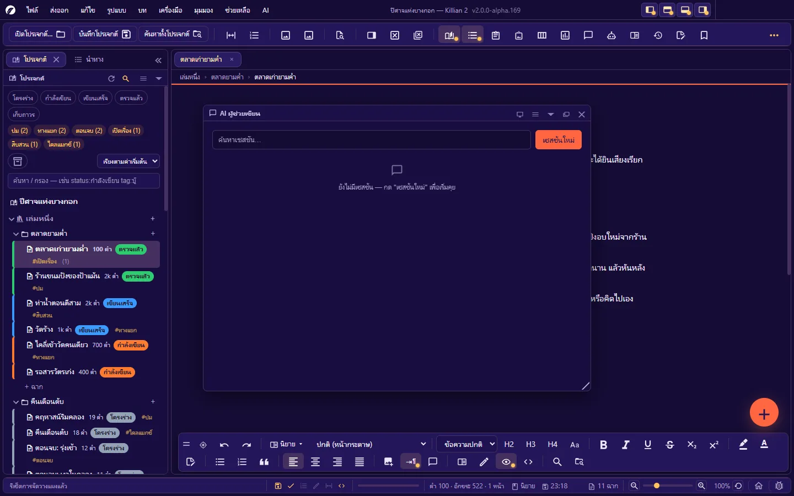
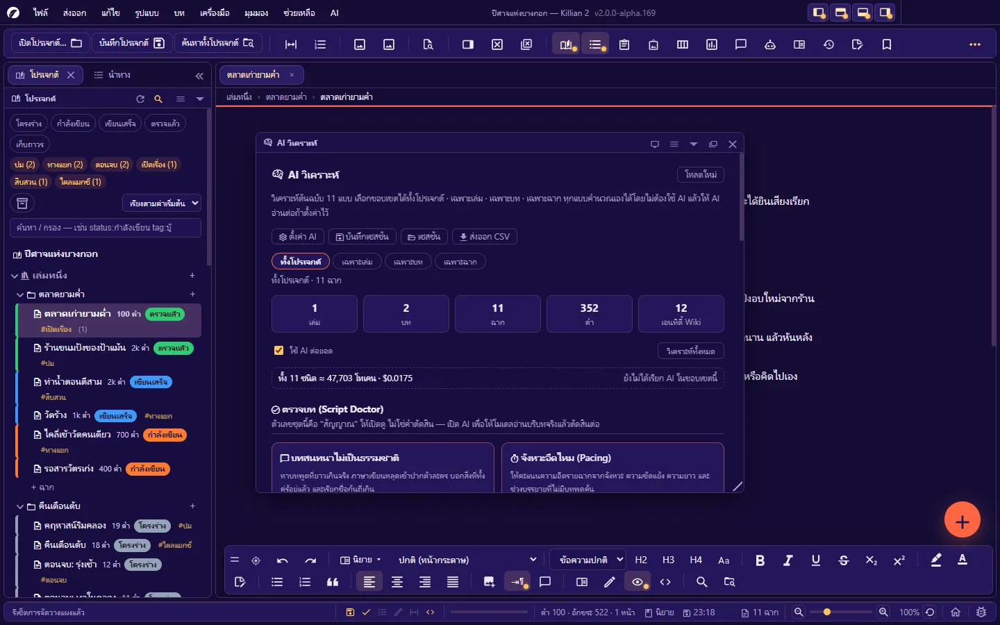
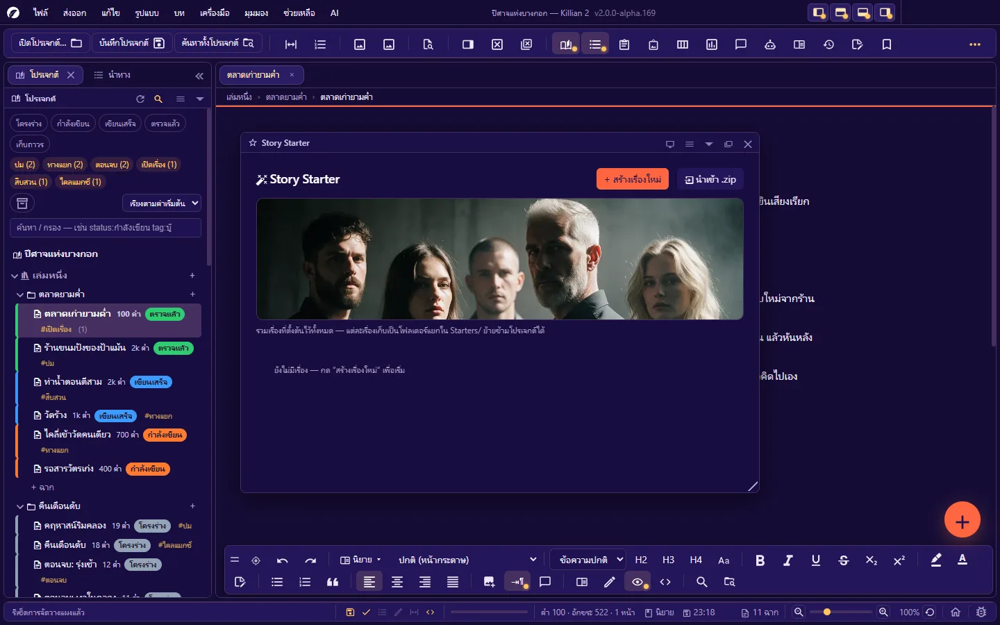

# 8. ผู้ช่วย AI

**ภาษา:** ไทย · [English](../en/08-ai.md)

[← 7. เครื่องมือวางแผน](07-planning.md) · [สารบัญ](README.md) · ถัดไป: [9. ส่งออก นำเข้า และพิมพ์ →](09-export-import-print.md)

---

## 8.1 สิ่งที่ต้องรู้ก่อนใช้

- **Killian 2 ไม่มีบริการ AI ในตัว** — คุณต่อกับผู้ให้บริการที่เลือกเองด้วยคีย์ของคุณเอง (หรือโมเดลที่รันในเครื่อง) ค่าใช้จ่ายและเงื่อนไขเป็นของผู้ให้บริการรายนั้น
- **ไม่ตั้งค่า AI ก็ใช้โปรแกรมได้ครบ** — ฟีเจอร์ตรวจสอบหลายตัวมี "ชั้นคำนวณเอง" ที่ทำงานออฟไลน์โดยไม่ต้องมีคีย์
- **ข้อความออกจากเครื่องเมื่อคุณสั่งเท่านั้น** และส่งไปยังปลายทางที่คุณตั้ง — ไม่มีการส่งเบื้องหลัง
- **คุณเลือกได้ว่า AI เห็นงานแค่ไหน** (ระดับการเข้าถึงในแชท) และ **ทำอะไรได้แค่ไหน** (โหมด)
- ผลจาก AI เป็นข้อเสนอ — ทุกจุดที่จะแทนข้อความของคุณ โปรแกรมให้ดูก่อน หรือย้อนกลับได้

## 8.2 ตั้งค่าผู้ให้บริการ

**AI → ตั้งค่า AI (ผู้ให้บริการ · Credential · โมเดล · พารามิเตอร์)…** (หรือ ตั้งค่า → ผู้ช่วย AI → เปิดการตั้งค่าผู้ช่วย AI)



กด **เพิ่ม** แล้วกรอก 4 ส่วน:

| ส่วน | กรอกอะไร |
|---|---|
| **1. ชื่อผู้ให้บริการ** | ชื่อที่จะเห็นในช่องเลือก เช่น "OpenAI ที่ทำงาน" หรือ "Ollama เครื่องตัวเอง" |
| **2. ข้อมูลรับรอง (Credential)** | ชื่อ Credential · **คีย์ API** (เว้นว่างได้ถ้าเซิร์ฟเวอร์ไม่ต้องใช้คีย์ เช่น โมเดลในเครื่อง) · **ที่อยู่ API (Base URL)** ต้องขึ้นต้นด้วย `http://` หรือ `https://` · **โดเมนที่อนุญาตให้ส่งคำขอ** (คั่นด้วยจุลภาคหรือขึ้นบรรทัดใหม่ · รองรับ `*.example.com`) → กด **ทดสอบการเชื่อมต่อ** |
| **3. โมเดล** | กด **ดึงรายชื่อโมเดล** เพื่อขอรายการจาก API ของเจ้านั้น แล้วเลือก |
| **4. พารามิเตอร์** | ดูตารางด้านล่าง |

โปรแกรมคุยกับปลายทางด้วย **รูปแบบ OpenAI chat/completions** ซึ่งผู้ให้บริการส่วนใหญ่และเซิร์ฟเวอร์โมเดลในเครื่องรองรับ

**พารามิเตอร์**

| พารามิเตอร์ | ค่าเริ่มต้น | หมายเหตุ |
|---|---|---|
| โหมดคิดก่อนตอบ (Thinking mode) | off | off / auto / on — ใช้ได้เฉพาะโมเดลที่รองรับ |
| ความสร้างสรรค์ (Temperature) | 0.7 | 0–2 |
| ความยาวคำตอบสูงสุด (Max tokens) | 2048 | **-1 = ไม่จำกัด** (ไม่ส่งค่านี้ ให้ผู้ให้บริการตัดสินเอง) |
| หมดเวลารอ (Timeout) | 60 วินาที | นับจาก "เงียบนานเกิน" — คำตอบยาวที่ยังไหลอยู่ไม่ถูกตัด |
| ลองใหม่สูงสุด (Max retries) | 2 | |
| ระดับการใช้เหตุผล (Reasoning effort) | (ไม่ส่ง) | minimal / low / medium / high |
| รูปแบบคำตอบ (Response format) | text | text / json_object |
| ลดการใช้คำซ้ำ · ดันให้พูดเรื่องใหม่ · Top K · Top P | (ไม่ส่ง) | เว้นว่าง = ไม่ส่งค่านั้น |
| ส่วนหัว HTTP เพิ่มเติม | — | `X-Header: ค่า` บรรทัดละหนึ่งคู่ |
| งบประวัติแชท (token) | 0 | 0 = อัตโนมัติ (60% ของขีดจำกัดโมเดล · ไม่รู้ขีดจำกัด = 32,000) |

**คีย์เก็บที่ไหน**

- การตั้งค่าผู้ให้บริการ (ยกเว้นคีย์) อยู่ใน `project.khn.json` ของผลงาน
- **คีย์ API** เก็บแยกในไฟล์ `ai-key.json` ที่รากโปรเจกต์ — ไม่ติดไปกับชุดสำรอง/ZIP ที่โปรแกรมสร้าง · **อย่าแชร์ไฟล์นี้**
- **บันทึกเป็นของฉัน / ใช้ผู้ให้บริการของฉัน**: เก็บชุดผู้ให้บริการไว้ในเครื่องนี้ (คีย์ถูกเข้ารหัสด้วยระบบของ OS — เครื่องที่เข้ารหัสไม่ได้จะไม่เก็บคีย์) แล้วนำมาใช้กับโปรเจกต์อื่นได้ในคลิกเดียว

กล่องตั้งค่าแสดงสถิติการใช้งาน: tokens · จำนวนครั้ง · ค่าใช้จ่ายโดยประมาณ

### System prompt และ Agent

ในกล่องตั้งค่า AI เดียวกัน:

- **System prompt (ส่งนำหน้าทุกคำขอ AI)** — ข้อความที่วางนำหน้าคำสั่งของทุกฟีเจอร์ AI (แชท · วิเคราะห์ · ผู้ช่วยเขียน · Rewrite this) ใช้กำหนดบทบาทหรือกติกาของทั้งผลงาน
- **Agent** — "นักเขียนผู้ช่วย" ที่คุณนิยามเอง: **บุคลิก** (สไตล์การเขียน · ธีม · โทน · แหล่งอ้างอิง · กฎ) + **อ้างอิง** (ตัวอย่างสำนวน/ย่อหน้าที่ชอบ — วางข้อความ หรือนำเข้าไฟล์ `.txt` ซึ่งจะถูกก๊อปเข้าโฟลเดอร์ `References/`) ใช้กับ **Rewrite this**

## 8.3 AI Hub — ทางเข้าเดียวของทุกความสามารถ

`Ctrl+Alt+Q` หรือปุ่ม **ผู้ช่วย AI** บนแถบเครื่องมือ



| กลุ่ม | ฟีเจอร์ |
|---|---|
| **คุยกับ AI** | ผู้ช่วยเขียน (แชท) · ห้องซ้อมบท · Story Starter |
| **ช่วยเขียน** (ทำงานกับฉากที่เปิดอยู่) | ขยาย/เกลาข้อความ · สร้างบทสนทนา · สรุปฉาก · แนะนำชื่อเรื่อง |
| **ตรวจงาน** | AI วิเคราะห์ · ตรวจรูโหว่พล็อต · ตรวจความสอดคล้อง |
| **สร้างโลก** | สร้างโลก (ร่างสถานที่ วัฒนธรรม กติกาของโลกลง Wiki) |
| **ตั้งค่า** | ตั้งค่า AI |

Hub บอกด้วยว่าตั้งค่าครบหรือยัง — ยังไม่ครบจะมีปุ่ม **ตั้งค่าเลย**

## 8.4 แชทกับเรื่อง (แผง AI ผู้ช่วยเขียน)

`Ctrl+Alt+W` — แชทที่อ่านโปรเจกต์ของคุณได้ และลงมือแก้ให้ได้ตามสิทธิ์ที่คุณให้



### เซสชัน

แชทแยกเป็น **เซสชัน** เก็บไว้ในโปรเจกต์ — **เซสชันใหม่** (**AI → เซสชันแชทใหม่**) · สลับกลับไปเซสชันเก่า · **เริ่มใหม่** (ล้างบทสนทนาแต่เก็บโหมด/โมเดล/ไฟล์แนบไว้)

### โหมด — AI *ทำ* อะไรได้

| โหมด | ทำได้ |
|---|---|
| **วางแผน (อ่านอย่างเดียว)** | อ่านโปรเจกต์ วิเคราะห์ เสนอ — **ห้ามแก้หรือสร้างไฟล์** (ถ้าขอให้แก้ จะเสนอเป็นข้อความว่าควรแก้อย่างไร) |
| **ช่วยเขียน (สร้าง/แก้ได้)** | สร้างและแก้ เล่ม บท ฉาก เอนทิตี้ ได้จริง — **ลบไม่ได้** |
| **ปลดล็อกเต็มที่ (ทำได้ทุกอย่าง)** | รวมทั้งลบ — ของที่ลบไปอยู่ถังขยะ กู้คืนได้ |

สิ่งที่ AI สั่งงานได้ (ตามโหมด): ดูโครงของโปรเจกต์ · อ่านฉาก/เอนทิตี้ · ถามตำแหน่งบนแผนที่ · สร้าง/แก้/ลบเอนทิตี้ · สร้าง/ลบเล่ม · สร้าง/เปลี่ยนชื่อ/ลบบท · สร้าง/เขียน/เปลี่ยนชื่อ/ลบฉาก
คำสั่งที่ AI ส่งมาแสดงเป็นบล็อกให้คุณเห็นในแชท · AI หยุดเองเมื่อทำครบจำนวนรอบที่กำหนดเพื่อกันวนไม่จบ (พิมพ์ "ทำต่อ" ถ้ายังไม่เสร็จ)

### ระดับการเข้าถึง — AI *เห็น* อะไร

| ระดับ | ส่งอะไรเป็นบริบท |
|---|---|
| ไม่ให้เข้าถึงเลย | ไม่ส่งเนื้อหาของโปรเจกต์ |
| เฉพาะฉากนี้ | ฉากที่เปิดอยู่ (รวมงานที่ยังไม่บันทึก) |
| เฉพาะบทนี้ / เฉพาะเล่มนี้ | ตามชื่อ |
| ทั้งโปรเจกต์ | ทั้งหมด |
| **เฉพาะส่วนที่เกี่ยวข้อง** | โปรแกรมค้นฉาก/Wiki/เส้นเวลาที่เกี่ยวกับคำถาม แล้วส่งเฉพาะส่วนนั้น — ประหยัด token และทำงานได้แม้ไม่มีคีย์สำหรับ embedding |

### ตัวเลือกอื่นของเซสชัน

- **โมเดลของเซสชันนี้** — ทับค่าในตั้งค่า AI เฉพาะเซสชัน
- **คิด: น้อยสุด / น้อย / กลาง / มาก / ตามผู้ให้บริการ** — ระดับการใช้ความคิดของโมเดล
- **ทักษะ (Skills)** — เปิด/ปิดไฟล์คำสั่งประจำตัวรายเซสชัน (ดูด้านล่าง)
- **มุมมอง**: เฉพาะบทสนทนา · ปกติ · ความคิด (ถ้าโมเดลส่งกลับ) · ทุกอย่าง (system prompt · บริบทที่ส่ง · คำสั่งดิบ · ผลลัพธ์ · token · เวลา)
- **ส่งข้อความ**: `Enter` = ส่ง · `Shift+Enter` = ขึ้นบรรทัด (สลับกันได้ที่ปุ่มในแผง) · ปุ่ม **หยุด** ระหว่างตอบ · **เขียนต่อ** จากจุดที่คำตอบค้าง
- ถ้าบริบทเกินขีดจำกัดของโมเดล โปรแกรมตัดประวัติให้พอดีในรอบถัดไป

### ทักษะ (Skills) — คำสั่งประจำตัวที่คุณเขียนเอง

ไฟล์ `.md` ในโฟลเดอร์ `Skills/` ของโปรเจกต์ เช่น "โทนการเขียนของเรื่องนี้" · "คำที่ห้ามใช้" · "ตัวละครหลักพูดยังไง"

```markdown
---
name: โทนการเขียน
description: บังคับโทนภาษาของเรื่องนี้
---
เขียนด้วยประโยคสั้น กระชับ ไม่ใช้คำฟุ่มเฟือย
ใช้คำสรรพนามตามที่ตัวละครใช้จริงในเรื่อง ห้ามเปลี่ยนเอง
ห้ามสรุปตอนจบให้ ถ้าผู้เขียนไม่ได้ขอ
```

(หัวไฟล์ไม่บังคับ — ไม่มีก็ใช้ชื่อไฟล์เป็นชื่อทักษะ) ในแผงแชทยังไม่มีไฟล์ทักษะ กดปุ่มทักษะเพื่อสร้างโฟลเดอร์พร้อมไฟล์ตัวอย่าง · ทักษะที่เปิดจะถูกแนบไปกับคำขอ (รวมไม่เกิน 12,000 ตัวอักษร) และ AI ถูกสั่งให้ยึดเหนือคำแนะนำทั่วไป

## 8.5 ผู้ช่วยเขียน — ขยาย สรุป เขียนใหม่

**AI → ผู้ช่วยเขียน (Expand/Summarize/Rewrite)…** (`Ctrl+Alt+Shift+A`) — เลือกข้อความในฉากก่อน แล้วเลือกงาน:

| งาน | ผล |
|---|---|
| **ขยายความ** | ละเอียดขึ้น คงใจความ มุมมอง น้ำเสียงเดิม — เพิ่มรายละเอียดฉาก ประสาทสัมผัส ความรู้สึก ไม่เพิ่มเหตุการณ์ใหม่ |
| **สรุป** | ย่อให้เข้าใจง่าย คงเหตุการณ์สำคัญและชื่อตัวละคร |
| **เขียนใหม่** | อ่านลื่นและกระชับขึ้น คงความหมายเดิม |
| **เปลี่ยนโทน** | ปรับเป็นโทนที่เลือก คงเนื้อหาและลำดับเหตุการณ์ |
| **เขียนต่อ** | ต่อจากข้อความให้ต่อเนื่อง คงสำนวนและมุมมอง |

ดูผลแล้ว **เลือกเอง** ว่าจะใช้หรือไม่ · ถ้าต้นฉบับเป็นบทภาพยนตร์ ผลลัพธ์จะเป็นรูปแบบบทภาพยนตร์

## 8.6 Rewrite this — เขียนใหม่ตรงจุดด้วย Agent

1. เลือกข้อความในเอกสาร → คลิกขวา → **Rewrite this**
2. แถบลอยขึ้นมา: พิมพ์ว่าอยากให้เขียนใหม่แบบไหน (เช่น "ให้ตึงเครียดขึ้น" · "กระชับลง" · "เพิ่มบทพูด") — เว้นว่างได้ (= เขียนให้ดีขึ้น อ่านลื่นขึ้น)
3. เลือก **Agent** (ถ้ามี) เพื่อกำหนดแนวการเขียน
4. `Enter` = ส่ง · ผลลัพธ์แทนที่ข้อความที่เลือก (`Ctrl+Z` ย้อนได้)

- AI ได้รับบริบทก่อนหน้าและถัดไปเพื่อให้ข้อความใหม่ต่อเนื่อง · ใช้ภาษาเดียวกับต้นฉบับ · รักษาชื่อ สรรพนาม มุมมอง
- บทภาพยนตร์: รักษาชนิด element เดิมทีละบรรทัด
- ถ้าคุณแก้ข้อความตรงนั้นระหว่างรอ โปรแกรม **ไม่แทนที่** (คัดลอกผลไปวางเองได้)

## 8.7 ปุ่ม ✨ ตามช่องต่าง ๆ

- **คุณสมบัติฉาก**: เรื่องย่อ · มุมมอง · อารมณ์ · ความขัดแย้ง — AI อ่านฉากแล้วเติมให้
- **หน้า Wiki**: เติมช่องข้อมูลของเอนทิตี้
- **คลังรูป**: ตั้งคำบรรยายให้รูป
- **Story Starter**: ช่วยตั้งชื่อเรื่อง/เรื่องย่อ
- **AI → สรุปเนื้อหาโปรเจกต์…** · **AI → แนะนำชื่อเรื่อง…** (เลือกแล้วตั้งเป็นชื่อโปรเจกต์ได้)

## 8.8 AI วิเคราะห์ และตรวจบท

`Ctrl+Alt+A`



เลือก **ขอบเขต** (ทั้งโปรเจกต์ · เฉพาะเล่ม · เฉพาะบท · เฉพาะฉาก) แล้วเลือกการ์ด แต่ละการ์ดมีสองชั้น: **ชั้นคำนวณเอง** (ตัวเลขจากต้นฉบับ — ไม่ต้องมี AI) และ **ชั้น AI** (ความเห็นจากการอ่าน)

**การ์ดวิเคราะห์**

| การ์ด | ดูอะไร |
|---|---|
| วิเคราะห์จังหวะเรื่อง | ฉากไหนยืด ฉากไหนรวบรัดเกิน — จากสัดส่วนบทพูด ความยาวประโยค |
| ส่วนโค้งตัวละคร | ตัวละครแต่ละตัวโผล่ถี่แค่ไหนในแต่ละบท หายไปช่วงไหน |
| คำที่ใช้บ่อย | คำที่ใช้บ่อยสุดพร้อมอัตราต่อหมื่นคำ |
| ความขัดแย้ง | ฉากไหนมีแรงขัดแย้ง ฉากไหนเรียบ |
| ความยาวฉาก | เทียบกับค่ากลาง + เวลาอ่านโดยประมาณ |
| ตรวจ Plot Hole | จุดที่เรื่องขัดกันเอง ปมที่เปิดแล้วไม่ปิด |
| ตรวจความสอดคล้อง | รายละเอียดของตัวละครและโลกคงเส้นคงวาไหม |
| ตรวจหาคำซ้ำ | คำเดียวกันโผล่ซ้ำในระยะใกล้ |
| คู่จิ้น / เส้นความสัมพันธ์ | คู่ที่อยู่ด้วยกันบ่อยและมีน้ำหนักเชิงรัก |
| ให้คะแนน | คะแนนสองชั้น: จากตัวเลข และจากการอ่านของ AI |
| Screentime / น้ำหนักตัวละคร | ใครกินพื้นที่เล่าเรื่องเท่าไร |
| สัดส่วนฉาก | บทพูด / ความคิดในใจ / บรรยาย กี่เปอร์เซ็นต์ |

**การ์ดตรวจบท (🩺)**

| การ์ด | ดูอะไร |
|---|---|
| บทสนทนาไม่เป็นธรรมชาติ | สัญญาณจากคลังคำ สรรพนาม คำลงท้ายของแต่ละตัวละคร |
| จังหวะอืดไหม (Pacing) | คะแนนความอืดรายฉาก |
| ปมไม่สมเหตุสมผล | เหตุการณ์ที่เกิดเพราะบังเอิญ การตัดสินใจที่ไม่มีแรงจูงใจ |
| Out of character | เทียบพฤติกรรม/น้ำเสียงกับโปรไฟล์ใน Wiki และกับตัวเองในฉากอื่น |
| โทนเรื่อง (ตลก/ดราม่า) | ฉากไหนหลุดโทน ควรเพิ่ม/ลดตรงไหน |

ผลวิเคราะห์บันทึกเป็นเซสชัน เปิดดูย้อนหลังได้ · บอกจำนวน token ก่อน/หลัง · ส่งออก **CSV** (**ส่งออก → AI วิเคราะห์**) · ตั้งค่า AI ได้จากบนแผง

**กล่องตรวจเฉพาะเรื่อง** (เมนู AI):

- **ตรวจสอบ Plot Hole…** — มีชั้นออฟไลน์ (เวลาย้อนกลับ · ผู้เล่าที่ไม่ตรง) ก่อนชั้น AI
- **ตรวจสอบความสม่ำเสมอของตัวละคร…** — มีชั้นออฟไลน์ตรวจคำลงท้าย/สรรพนามไทย
- **สร้างบทสนทนา…** — ร่างบทพูดจากสถานการณ์ที่บอก อ่านบุคลิกจาก Wiki
- **สร้างโลก (Worldbuilding)…** — เลือกเทมเพลต บอกโจทย์ แล้วบันทึกผลเป็นหน้า Wiki ได้ (AI ถูกสั่งให้ไม่ขัดกับของเดิมที่มีอยู่)

## 8.9 ห้องซ้อมบท

`Ctrl+Alt+V` — ให้ AI สวมบทตัวละครจาก Wiki คุยกันทีละเทิร์น แล้วหยิบบรรทัดที่ชอบไปใส่บท — เปิดตอนคิดบทพูดไม่ออก

1. **เซสชันใหม่** → ตั้งสถานการณ์ของซีน (เช่น "ทั้งวงนั่งดื่มที่ลานเบียร์หลังเลิกงาน ฝนเพิ่งหยุด")
2. เลือกตัวละครจาก Wiki เข้าวง — แต่ละตัวมี **ใบบทบาท** (เขียนเป็นภาษาคนได้ เช่น "พูดสั้น ตัดบท ไม่ชอบอธิบายตัวเอง") · **สรรพนาม** ที่ล็อกไว้กันโมเดลสลับกลางบทสนทนา · **คำโปรยหนึ่งบรรทัด** (ตัวละครอื่นเห็นแค่บรรทัดนี้ ไม่เห็นใบบทบาทเต็ม) · ความสัมพันธ์เฉพาะซีน (เว้นว่าง = ตาม Wiki)
3. กด **ส่ง** — เว้นว่าง = ให้ AI พูดแทนตัวละครที่เลือก · พิมพ์เอง = บรรทัดนี้เป็นของคุณ (ไม่เสีย token)
4. แทรก **เหตุการณ์กลางวง** (ไฟดับ · มีคนเคาะประตู) · ให้ตัวละคร **รำพึงคนเดียว** (เสียงในใจ ตัวอื่นไม่ได้ยิน)
5. เลือกบรรทัดที่ชอบ → **แทรกลงฉาก** ตรงเคอร์เซอร์ (เปิดฉากและวางเคอร์เซอร์ก่อน)

แผงบอกจำนวนครั้งที่ยิง token เข้า/ออก และเวลารวม

## 8.10 Story Starter

`Ctrl+Alt+Z` — ตั้งต้นเรื่องทีละขั้น แล้ว **เล่นเป็นตอน** กับ AI ก่อนแปลงเป็นต้นฉบับจริง



**ขั้นตั้งต้น**

| ขั้น | ทำอะไร |
|---|---|
| **แนวเรื่อง** (บังคับ) | เลือกแท็กแนว · โทน · ฉากหลัง · เรต (เลือกได้มากกว่าหนึ่ง หรือพิมพ์แท็กเอง) — AI ใช้กำหนดโทนทั้งเรื่อง |
| **ชื่อเรื่อง + เรื่องย่อ** (บังคับ) | ตั้งชื่อเรื่องและเรื่องย่อหนึ่งย่อหน้า (ให้ AI ช่วยได้) |
| **ตัวละคร** (บังคับ) | เพิ่มได้ไม่จำกัด สร้างเองหรือดึงจาก Wiki — ตัวที่สร้างที่นี่ถูกบันทึกลง Wiki ให้ |
| **4W** | อะไร · เมื่อไหร่ · ที่ไหน · ทำไม — กรอกเท่าที่นึกออก (ไม่บังคับ) |
| **ปกเรื่อง** | รูปที่จะแสดงบนการ์ดในหน้ารวม (ไม่บังคับ) |

**เล่นเป็นตอน**: AI เป็น Game Master เล่าเรื่อง · เลือกตัวละครที่คุณจะเล่นเอง (ตัวที่เลือก GM จะไม่พูดแทน — ไม่เลือกเลยก็ได้) · หยุด AI กลางทางได้ · ให้ AI **ย่อทั้งตอน** เพื่อส่งต่อให้ตอนถัดไป

**เอาออกมาเป็นต้นฉบับ**: แปลงเรื่องที่เล่นแล้วเป็นฉากนิยายหรือบทภาพยนตร์ในโปรเจกต์

เรื่องที่ตั้งต้นไว้แต่ละเรื่องเก็บเป็นโฟลเดอร์แยกใน `Starters/` — ส่งออก/นำเข้าเป็น `.zip` และย้ายข้ามโปรเจกต์ได้ (ตอนนำเข้า เลือกได้ว่าตัวละครแต่ละตัวจะผูกกับของเดิมใน Wiki หรือสร้างใหม่)

## 8.11 ถ้า AI ไม่ทำงาน

| อาการ | ตรวจ |
|---|---|
| ขึ้นว่ายังไม่ได้ตั้งค่า | AI Hub บอกว่าขาดอะไร: ผู้ให้บริการ · โมเดล · คีย์ |
| ทดสอบการเชื่อมต่อไม่ผ่าน | Base URL ถูกไหม (ใส่แค่ที่อยู่ฐาน เช่น `https://api.example.com` หรือ `…/v1` — โปรแกรมต่อเส้นทางที่เหลือให้) · คีย์ถูกไหม · โดเมนอยู่ในรายการที่อนุญาตไหม · เน็ต/ไฟร์วอลล์ |
| ดึงรายชื่อโมเดลไม่ได้ | ปลายทางบางเจ้าตอบกลับแต่ไม่มีรายการโมเดล — ตรวจ Base URL และเอกสารของผู้ให้บริการรายนั้น |
| คำตอบถูกตัดสั้น | เพิ่ม **ความยาวคำตอบสูงสุด** หรือใส่ -1 |
| หมดเวลารอ | เพิ่ม **หมดเวลารอ** (โมเดลในเครื่องมักช้า) |
| ข้อความผิดพลาดจากผู้ให้บริการ | ดูรายละเอียดในแผง **บันทึก (Log)** — คีย์ถูกปิดบังในบันทึกเสมอ |

---

ถัดไป: [9. ส่งออก นำเข้า และพิมพ์ →](09-export-import-print.md)
