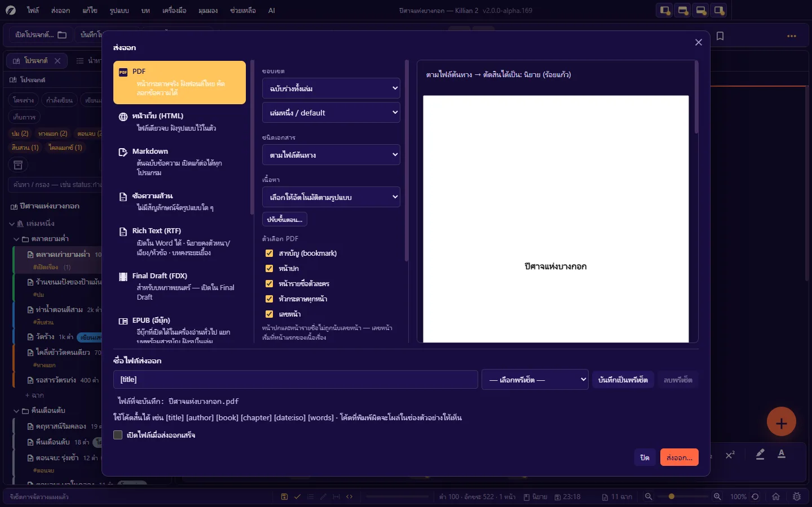
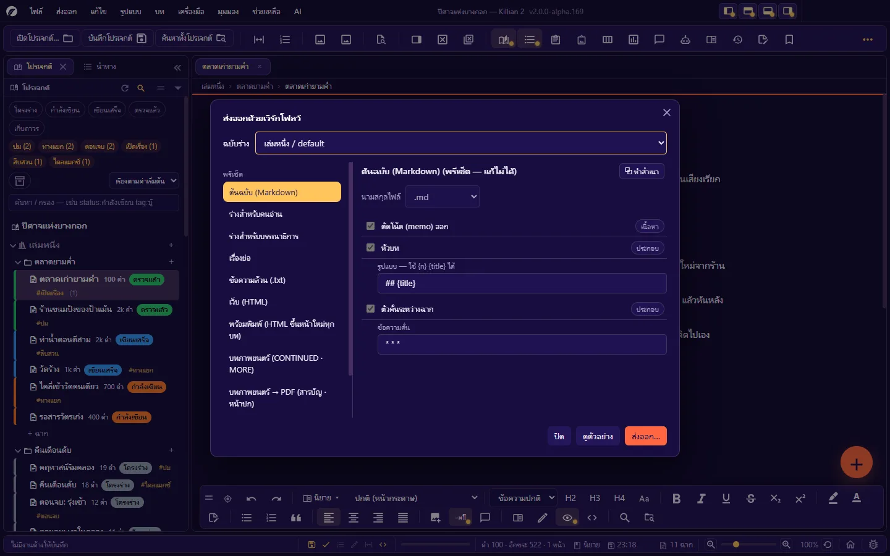

# 9. ส่งออก นำเข้า และพิมพ์

**ภาษา:** ไทย · [English](../en/09-export-import-print.md)

[← 8. ผู้ช่วย AI](08-ai.md) · [สารบัญ](README.md) · ถัดไป: [10. บันทึก ประวัติ สำรอง และกู้คืน →](10-history-backup.md)

---

ทุกทางส่งออกรวมอยู่ในเมนู **ส่งออก** เมนูเดียว:

| รายการ | ใช้ทำอะไร |
|---|---|
| **ศูนย์รวมการส่งออก…** (`Ctrl+Shift+E`) | ส่งออก **ต้นฉบับ** ทุกรูปแบบ พร้อมตัวอย่างก่อนบันทึก |
| **ปรับขั้นตอนเวิร์กโฟลว์ส่งออก…** (`Ctrl+Alt+X`) | กำหนดว่า "อะไรเข้าไปอยู่ในไฟล์" ทีละขั้น |
| เส้นเวลา · แผนที่ · กระดาน · ผัง ฯลฯ | ส่งออกเนื้อหาของแผง ([7.11](07-planning.md#711-ส่งออกจากแผง)) |
| **ทั้งโปรเจกต์เป็น ZIP…** | สำรอง/ส่งต่อทั้งโฟลเดอร์งาน |
| **ส่งออกการจัดวางแผง (JSON)…** | แนบตอนรายงานปัญหาเรื่องแผง |
| **ส่งออกภาษาเป็น CSV…** | สำหรับผู้แปล ([บทที่ 13](13-language-themes-a11y.md)) |

## 9.1 ศูนย์รวมการส่งออก

กล่องแบ่งเป็น 4 ส่วน:

1. **ซ้าย — ปลายทาง**: เลือกรูปแบบไฟล์
2. **กลาง — ตัวเลือก**: ขอบเขต · ชนิดเอกสาร · เนื้อหา · ตัวเลือกเฉพาะรูปแบบ
3. **ขวา — ตัวอย่าง**: เห็นผลก่อนบันทึก (PDF แสดงเป็นหน้ากระดาษจริง)
4. **ล่าง — ชื่อไฟล์ส่งออก** และปุ่ม **ส่งออก…**

โปรแกรมจำค่าที่เลือกไว้สำหรับครั้งถัดไป

### ปลายทาง (รูปแบบไฟล์)

| รูปแบบ | ได้อะไร | หมายเหตุ |
|---|---|---|
| **PDF** | หน้ากระดาษจริง ฝังฟอนต์ไทย คัดลอกข้อความได้ | สร้างในโปรแกรมเอง ไม่ผ่านเครื่องพิมพ์ของระบบ |
| **หน้าเว็บ (HTML)** | ไฟล์เดียวจบ ฝังรูปแบบไว้ในตัว | เลือก "ใช้รูปแบบหน้ากระดาษเดียวกับบนจอ" ได้ |
| **Markdown** | ต้นฉบับข้อความ เปิดแก้ต่อได้ทุกโปรแกรม | |
| **ข้อความล้วน** (`.txt`) | ไม่มีสัญลักษณ์จัดรูปแบบใด ๆ | |
| **Rich Text (RTF)** | เปิดใน Word ได้ — นิยายคงตัวหนา/เอียง/หัวข้อ · บทคงระยะเยื้อง | ตั้งขนาดฟอนต์ได้ |
| **Final Draft (FDX)** | เปิดใน Final Draft | เฉพาะเอกสารที่เป็นบทภาพยนตร์ |
| **EPUB (อีบุ๊ก)** | เปิดในเครื่องอ่านทั่วไป แยกบทพร้อมสารบัญ ฝังรูปในเล่ม | แยกไฟล์ในเล่มที่หัวข้อระดับ 1–2 และจุดขึ้นหน้าใหม่ |
| **DOCX (Word)** | ส่งให้บรรณาธิการแก้ต่อได้ เก็บตัวหนา/เอียง/จัดหน้า/รายการ/รูป | ใช้ขนาดกระดาษ ระยะขอบ และแบบอักษรเดียวกับหน้าจอ · หัวข้อใช้สไตล์หัวข้อของ Word |
| **เว็บบล็อก (ธีม)** | หน้าเว็บพร้อมธีมสำเร็จรูปสำหรับลงบล็อก | เปิดกล่องของตัวเอง ([9.5](#95-ส่งออกแบบอื่น)) |
| **PDF ลายน้ำรายคน** | ไฟล์แยกต่อผู้รับ พร้อมชื่อเป็นลายน้ำ | เฉพาะบทภาพยนตร์ · เปิดกล่องของตัวเอง |
| **ทั้งโปรเจกต์ (.zip)** | สำรองงานทั้งชุด รวมรูปและเมทาดาทา | |
| **ทั้งโปรเจกต์ (.json)** | โครงสร้างโปรเจกต์ล้วน สำหรับเครื่องมืออื่น | |

### ตัวเลือกกลาง

| ช่อง | ตัวเลือก |
|---|---|
| **ขอบเขต** | **ฉบับร่างทั้งเล่ม** (เลือกเล่ม/ร่าง) หรือ **ฉาก/บทที่เปิดอยู่** |
| **ชนิดเอกสาร** | **ตามไฟล์ต้นทาง** (โปรแกรมตัดสินจากฉากส่วนใหญ่ — Memo ไม่นับ · เสมอกันถือเป็นนิยาย) · **นิยาย (ร้อยแก้ว)** · **บทภาพยนตร์** |
| **เนื้อหา** | เวิร์กโฟลว์ที่ใช้ — **เลือกให้อัตโนมัติตามรูปแบบ** หรือเลือกชุดเอง · ปุ่ม **ปรับขั้นตอน…** |

### ตัวเลือก PDF

| ตัวเลือก | ผล |
|---|---|
| สารบัญ (bookmark) | สารบัญในแถบข้างของโปรแกรมอ่าน PDF |
| หน้าปก | แนบหน้าปกที่ตั้งไว้ (บท → หน้าปก · หรือหน้าปกของเล่ม) |
| หน้ารายชื่อตัวละคร | แนบหน้า Cast of Characters ของเล่ม |
| หัวกระดาษทุกหน้า | ใช้หัวกระดาษที่ตั้งไว้ (บท → หัวกระดาษ) |
| เลขหน้า · เลขฉาก | ช่องนี้ชนะค่าในตั้งค่ารูปแบบบท — ติ๊กแล้วได้เลย |
| ลายน้ำ | ข้อความทับทุกหน้า (ว่าง = ไม่ใส่) |
| โหมดสี | **ขาวดำ** = ธรรมเนียมบทที่ส่งกองถ่าย · **สี** = ฉบับอ่านเอง |

- หน้าปกและหน้ารายชื่อ **ไม่ถูกนับเลขหน้า** — เลขหน้าเริ่มที่หน้าแรกของเนื้อเรื่อง
- PDF ฝังฟอนต์ไทยให้เอง ถ้าโปรแกรมหาฟอนต์ไทยที่ฝังได้ไม่เจอ จะเตือนว่าอักษรไทยจะเป็น `?` — ตั้งฟอนต์ไทย (`.ttf`/`.otf`) ที่ **ตั้งค่า → ฟอนต์ตามภาษา**
- ฟอนต์ ขนาด ระยะขอบ การจัดหน้า สี และรูปในไฟล์ตรงกับที่เห็นในมุมมองจัดหน้า

### ชื่อไฟล์ส่งออก

ช่องล่างของกล่องใช้ **โค้ดสั้น** ประกอบชื่อไฟล์ได้ เช่น `[title]` `[author]` `[book]` `[chapter]` `[date:iso]` `[words]` — บรรทัด "ไฟล์ที่จะบันทึก:" แสดงชื่อจริงที่จะได้ (โค้ดที่พิมพ์ผิดจะโผล่ให้เห็นในนั้น)

- **พรีเซ็ต**: ชื่อเรื่อง · ชื่อเรื่อง + เล่ม · ชื่อเรื่อง + บท · ชื่อเรื่อง + วันที่ · ผู้เขียน + ชื่อเรื่อง · ฉบับร่าง + วันที่ + จำนวนคำ
- **บันทึกเป็นพรีเซ็ต** ของคุณเอง (ชื่อซ้ำ = เขียนทับตัวเดิม) — เป็นค่าระดับผู้ใช้ ใช้ได้ทุกผลงาน
- อักขระที่ระบบไฟล์ไม่รับถูกกรองออกให้ (ใช้กฎของ Windows ทุกระบบ เพื่อให้ไฟล์ย้ายเครื่องได้)
- **เปิดไฟล์เมื่อส่งออกเสร็จ** · หลังส่งออกแถบสถานะมีลิงก์ **เปิดโฟลเดอร์**

## 9.2 เวิร์กโฟลว์ส่งออก

เวิร์กโฟลว์ = ลำดับ "ขั้น" ที่แปลงต้นฉบับก่อนเขียนเป็นไฟล์ — เปิด/ปิดทีละขั้น และตั้งค่าของขั้นได้

**ชุดสำเร็จรูป**: ต้นฉบับ Markdown · ร่างสำหรับคนอ่าน · ร่างสำหรับบรรณาธิการ · เรื่องย่อ · ข้อความล้วน (.txt) · เว็บ (HTML) · พร้อมพิมพ์ (HTML ขึ้นหน้าใหม่ทุกบท) · บทภาพยนตร์ (CONTINUED · MORE) · บทภาพยนตร์ → PDF (สารบัญ · หน้าปก)
ชุดสำเร็จรูปแก้ไม่ได้ — **ทำสำเนา** แล้วแก้ หรือ **สร้างเวิร์กโฟลว์ใหม่** ของคุณเอง

**ขั้นที่มี**

| ช่วง | ขั้น | ทำอะไร |
|---|---|---|
| เนื้อหา | ตัดโน้ต (memo) ออก | ไม่เอา Memo เข้าไฟล์ |
| | บทภาพยนตร์: ไม่รวม element ตามประเภท | ตัด note / summary / outline1–3 / image (เลือกได้) · ตัวเลือกวาดกรอบรอบโน้ตที่ยังเหลือ |
| | เอาเฉพาะฉากที่สถานะ… | ระบุสถานะ (คั่นด้วยจุลภาค) |
| | ใช้เรื่องย่อแทนเนื้อ | ได้เอกสารเรื่องย่อ |
| | ใส่เลขลำดับหน้าชื่อฉาก | |
| | ตัดคอมเมนต์ `%%…%%` และ `<!-- … -->` | (คอมเมนต์รูปแบบ เช่น การจัดหน้า/ขึ้นหน้าใหม่ ไม่ถูกตัด) |
| | แปลงลิงก์วิกิ `[[ชื่อ]]` เป็นข้อความธรรมดา | |
| | ตัดสัญลักษณ์ Markdown (ข้อความล้วน) | |
| | แก้ไขตัวแปร `{{ชื่อ}}` จาก Wiki | |
| | แทนโค้ดสั้น `[title]` `[chapter]` `[date]` | |
| ประกอบ | หน้าปก (ชื่อเรื่อง / ผู้เขียน / จำนวนคำ) | ผู้เขียนว่าง = ใช้จากโปรเจกต์ |
| | หน้ารายชื่อตัวละคร (Cast of Characters) | |
| | หัวบท | รูปแบบตั้งเอง เช่น `## {title}` — ใช้ `{n}` `{title}` ได้ |
| | ชื่อฉาก | เช่น `### {title}` |
| | แนบสถานะ/จำนวนคำของฉาก (สำหรับ บ.ก.) | |
| | ตัวคั่นระหว่างฉาก | ค่าเริ่มต้น `* * *` |
| | ขึ้นหน้าใหม่ทุกบท | |
| | ต่อท้ายด้วยสรุปสถิติ | |
| ข้อความสุดท้าย | บทภาพยนตร์: แทรก (CONTINUED)/(MORE) ตามการตัดหน้า | สำหรับปลายทางข้อความ (PDF จัดหน้าเองอยู่แล้ว) |
| | แปลงเป็น HTML | |
| | **สคริปต์ JavaScript เอง** | โค้ดของคุณรับตัวแปร `text` (ข้อความทั้งหมด) และ `model` (โครงเอกสาร) แล้ว `return` ข้อความใหม่ — สำหรับผู้ใช้ขั้นสูง (ดู [คู่มือส่วนขยาย](../../extension/th/04-hooks-lifecycle.md#45-ตะขออื่นนอกปลั๊กอิน)) |

เวิร์กโฟลว์เก็บกับผลงาน · ศูนย์รวมการส่งออกปรับขั้น "แปลงเป็น HTML" ให้ตรงกับปลายทางที่เลือกเองโดยไม่แก้เวิร์กโฟลว์ที่คุณบันทึกไว้

## 9.3 สิ่งที่ "ติดไปกับไฟล์" และ "ไม่ติดไป"

| ติดไป | ไม่ติดไป |
|---|---|
| ตัวหนา/เอียง/ขีดเส้นใต้/ขีดฆ่า/ตัวยก/ตัวห้อย | เส้นขีดคำผิด |
| สีตัวอักษรและสีเน้น (ปิดได้ด้วยโหมดขาวดำ) | ไฮไลต์ชื่อ Wiki |
| การจัดหน้า (ซ้าย/กลาง/ขวา/เต็มบรรทัด) | คอมเมนต์ของฉาก |
| หัวข้อ รายการ คำพูดยกมา เส้นคั่น | โน้ต · Future Note · คุณสมบัติฉาก (เว้นแต่เปิดขั้น "แนบสถานะ/จำนวนคำ") |
| รูป (รวมตัวเลือกเต็มหน้า/ความกว้าง/ขอบมน) | เลขบรรทัด · เส้นบอกระยะขอบ · แถบสีบรรทัดเคอร์เซอร์ |
| การบังคับขึ้นหน้าใหม่ | สีกระดาษบนจอ (PDF เป็นขาวเสมอ) · ธีมของโปรแกรม |
| ฟอนต์ ขนาด ช่วงบรรทัด ย่อหน้า ระยะขอบ | เส้นบอกจุดผิดของตัวตรวจบท · แถบสี "ฉากมีปัญหา" |

ฉากที่กำลังเปิดดู "ฉบับเดิม" ของฉากมีปัญหา → ไฟล์ที่ส่งออกใช้ **ฉบับแก้ไข** เสมอ

## 9.4 ตรวจก่อนส่ง

- **บทภาพยนตร์**: เปิด **บท → ตรวจก่อนพิมพ์/ส่งออก** ไว้ โปรแกรมจะตรวจรูปแบบบทก่อนทุกครั้งและถามถ้าพบจุดผิด
- **ดูตัวอย่าง** ในศูนย์ส่งออกก่อนเสมอ — โดยเฉพาะรอยต่อหน้าและรูปเต็มหน้า
- **เปิดไฟล์ที่ได้** ดูสักครั้งในโปรแกรมปลายทางจริง (Word · เครื่องอ่านอีบุ๊ก · Final Draft) ก่อนส่งให้ผู้อื่น — แต่ละโปรแกรมแสดงผลต่างกันเล็กน้อย

## 9.5 ส่งออกแบบอื่น

### เว็บบล็อก (`Ctrl+Shift+B`)

ไฟล์ HTML หน้าเดียวพร้อมวางลงบล็อก/เว็บไซต์: เลือก **ขอบเขต** · **ธีม** (เรียบ ไม่มีกรอบ · Medium การ์ดครีม · มืด อ่านกลางคืน) · ใส่ชื่อบท (H2) / ชื่อฉาก (H3) · **ฝังรูปในไฟล์ (base64)** — ไฟล์ใหญ่ขึ้นแต่ก๊อปไปวางที่ไหนก็เห็นรูป · มีปุ่ม **ดูตัวอย่าง**

### PDF ลายน้ำรายคน

สำหรับแจกบทให้หลายคนโดยแต่ละคนได้ไฟล์ที่มีชื่อตัวเองเป็นลายน้ำ: ใส่รายชื่อผู้รับ (บรรทัดละคน) · ข้อความลายน้ำ · คำนำหน้าชื่อไฟล์ · โฟลเดอร์ปลายทาง · ขนาดและมุมของลายน้ำ → โปรแกรมสร้างไฟล์ทีละคนพร้อมบอกความคืบหน้า

### ทั้งโปรเจกต์เป็น ZIP

**ส่งออก → ทั้งโปรเจกต์เป็น ZIP…** (หรือปุ่ม **ส่งออก** บนหน้าแรก) — รวมทุกไฟล์ของโปรเจกต์ **ยกเว้น `ai-key.json`** (คีย์ AI ของคุณ)
นำกลับเข้ามา: ปุ่ม **นำเข้า** บนหน้าแรก → เลือกไฟล์ `.zip` → เลือกโฟลเดอร์ปลายทาง

> ZIP ของโปรเจกต์ที่มีปลั๊กอินในโฟลเดอร์ `Plugins/` จะพาปลั๊กอินไปด้วย — ผู้รับต้องกดอนุญาตเองก่อนปลั๊กอินจะทำงาน ([บทที่ 14](14-plugins.md))

## นำเข้า

### บทภาพยนตร์จากโปรแกรมอื่น

**ไฟล์ → นำเข้าบทภาพยนตร์…** (หรือลากไฟล์มาวางบนหน้าต่าง)

| รูปแบบ | นามสกุล |
|---|---|
| Fountain | `.fountain` (ไฟล์ `.txt` ถูกอ่านเป็น Fountain) |
| Final Draft | `.fdx` |
| Celtx | `.celtx` |
| Fade In Pro | `.fadein` |
| Adobe Story | `.astx` |

กล่องนำเข้าแสดง **ตัวอย่างบทที่จะนำเข้า** พร้อมสรุป (จำนวนคำ · บทพูด · คำบรรยาย) แล้วเลือก **สร้างเป็นฉากใหม่** หรือ **แทนที่เนื้อในแท็บที่เปิดอยู่**

- ไฟล์ Fountain มาตรฐานถูกแปลงเป็นไวยากรณ์ของ Killian ให้ (เช่น โน้ต `[[…]]` ของ Fountain ไม่ถูกเข้าใจผิดเป็นลิงก์ Wiki)
- ไฟล์ Celtx รุ่นเก่าที่เก็บเป็น XML ตรง ๆ อาจอ่านไม่ได้

### โปรเจกต์ Scrivener

**ไฟล์ → นำเข้าจาก Scrivener (.scriv)…** (`Ctrl+Alt+Shift+I`) — เลือกโฟลเดอร์ `.scriv` แล้วเลือกโฟลเดอร์ปลายทาง: โปรแกรมอ่านโครง Binder และเนื้อหา แปลงเป็นโปรเจกต์ Killian พร้อมบทและฉาก · กล่องสรุปบอกจำนวนบท/ฉาก/ไฟล์ที่จะสร้าง · คำเตือนระหว่างนำเข้าดูได้ใน Log

### อื่น ๆ

| นำเข้าอะไร | ที่ไหน |
|---|---|
| โปรเจกต์จาก `.zip` | หน้าแรก → **นำเข้า** |
| โปรเจกต์ Killian v1 | เปิดโฟลเดอร์ได้เลย ไม่ต้องนำเข้า |
| รูป | ลากมาวาง · คลังรูป → เพิ่มรูป · Explorer → คลังรูป → นำเข้ารูป |
| ชุดสถานะฉาก | จัดการสถานะฉาก → นำเข้า… |
| คำแปลจาก CSV | เครื่องมือ → นำเข้าภาษาจาก CSV… |
| เรื่องของ Story Starter | แผง Story Starter → นำเข้า `.zip` |
| ไฟล์อ้างอิงของ Agent | ตั้งค่า AI → Agent → นำเข้า `.txt` |

## 9.6 พิมพ์

**ไฟล์ → พิมพ์…** (`Ctrl+P`) — พิมพ์เอกสารในแท็บที่เปิดอยู่ผ่านกล่องพิมพ์ของระบบ

- พิมพ์ได้ครบทุกหน้าของเอกสาร · ของตกแต่งบนจอ (ไฮไลต์ เส้นขีด แถบสี) ไม่ติดไป · ตัวหนังสือเป็นสีสำหรับกระดาษขาวแม้ใช้ธีมมืด
- ถ้าเปิด **ตรวจก่อนพิมพ์/ส่งออก** ไว้ บทภาพยนตร์จะถูกตรวจก่อน

> **ข้อจำกัดที่ควรรู้**: คำสั่งพิมพ์ใช้ตัวตัดหน้าของระบบ ไม่ใช่ตัวจัดหน้าของโปรแกรม — บทภาพยนตร์ที่พิมพ์ทางนี้จึง **ไม่มี CONTINUED และหัวกระดาษ** และจำนวนหน้าอาจไม่ตรงกับ PDF
> ต้องการหน้าตรงเป๊ะ (ส่งกองถ่าย · ส่งสำนักพิมพ์): **ส่งออกเป็น PDF จากศูนย์รวมการส่งออก แล้วพิมพ์ไฟล์ PDF นั้น**

---

ถัดไป: [10. บันทึก ประวัติ สำรอง และกู้คืน →](10-history-backup.md)
