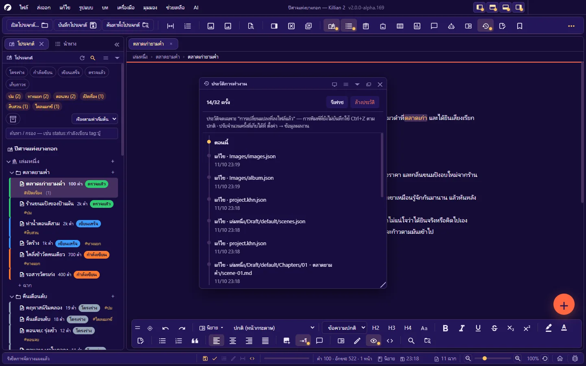

# 10. บันทึก ประวัติ สำรอง และกู้คืน

**ภาษา:** ไทย · [English](../en/10-history-backup.md)

[← 9. ส่งออก นำเข้า และพิมพ์](09-export-import-print.md) · [สารบัญ](README.md) · ถัดไป: [11. ค้นหา แทนที่ และนำทาง →](11-search-navigate.md)

---

Killian 2 มีตาข่ายกันงานหาย **5 ชั้น** — แต่ละชั้นแก้ปัญหาคนละแบบ:

| ชั้น | กันอะไร | เก็บที่ไหน | ย้อนได้ไกลแค่ไหน |
|---|---|---|---|
| **เลิกทำ** (`Ctrl+Z`) | พิมพ์ผิด/ลบผิดเมื่อครู่ | หน่วยความจำ | ถึงตอนเปิดแท็บนี้ |
| **ประวัติเวอร์ชัน** | เนื้อหาของไฟล์ในแต่ละครั้งที่บันทึก | `Snapshots/` | 10 เวอร์ชันอัตโนมัติล่าสุดต่อไฟล์ + เวอร์ชันที่ตั้งชื่อ (ไม่ถูกลบ) |
| **ประวัติการทำงาน** | การกระทำกับไฟล์ (เขียน ย้าย เปลี่ยนชื่อ ลบ) ทั้งโปรเจกต์ | `.k2history/` | 32 ครั้งล่าสุด (ตั้งได้ 4–500) |
| **ถังขยะ** | ของที่ลบ | `Recycle/` | 30 วัน (ตั้งได้ · 0 = ไม่ล้างเอง) |
| **ชุดสำรอง** | ทั้งโปรเจกต์พังหรือหาย | `Backups/<วันที่>/` | 7 วันล่าสุด |

> ทั้งหมดนี้อยู่ **ในโฟลเดอร์โปรเจกต์เดียวกัน** — ถ้าดิสก์เสียหรือโฟลเดอร์ถูกลบ ทุกชั้นหายพร้อมกัน **ควรมีสำเนานอกเครื่อง** (คลาวด์ · ไดรฟ์นอก · Git) ของงานที่เสียไม่ได้เสมอ วิธีง่ายสุด: **ส่งออก → ทั้งโปรเจกต์เป็น ZIP…** เป็นระยะ

## 10.1 บันทึก

| คำสั่ง | คีย์ | ทำอะไร |
|---|---|---|
| **บันทึก** | `Ctrl+S` | บันทึกแท็บที่เปิดอยู่ |
| **บันทึกทั้งหมด** | `Ctrl+Alt+S` | บันทึกทุกอย่างที่ค้าง: แท็บเอกสาร · กระดานวางแผน · ผังแตกสาย · ผังพื้นที่ ฯลฯ |
| **บันทึกเป็น…** | `Ctrl+Shift+S` | บันทึกเนื้อหาของแท็บนี้เป็นไฟล์ `.md` ใหม่ในที่ที่เลือก — ไฟล์เดิมไม่ถูกเปลี่ยน |
| **กลับไปเวอร์ชันล่าสุด (Revert)** | เมนู ไฟล์ | ทิ้งการแก้ที่ยังไม่บันทึก แล้วโหลดเนื้อหาจากไฟล์กลับมา |

**บันทึกอัตโนมัติ**: ทุก 5 นาทีเป็นค่าเริ่มต้น — ตั้งที่ **ตั้งค่า → บันทึกและสำรอง → บันทึกอัตโนมัติทุก ๆ (นาที)** (`0` = ปิด) · สวิตช์ด่วนอยู่บนแถบสถานะ
แถบสถานะบอก **เวลาบันทึกล่าสุด** หรือ "ยังไม่ได้บันทึก"

หลายอย่างบันทึกเองทันทีโดยไม่ต้องกด: คุณสมบัติฉาก · การลากการ์ด Kanban · การจัดเรียงใน Explorer · ค่าตั้งของแผง

การเขียนไฟล์ทุกครั้งเป็นแบบ "เขียนไฟล์ชั่วคราวแล้วสลับชื่อ" — ถ้าไฟดับกลางคัน ได้ไฟล์เดิมหรือไฟล์ใหม่ครบทั้งไฟล์ ไม่ได้ไฟล์ครึ่งเดียว

## 10.2 งานค้าง — ก่อนปิดหรือเปลี่ยนโปรเจกต์

เมื่อจะ **ออกจากโปรแกรม · ปิด/เปลี่ยนโปรเจกต์ · เริ่มโปรแกรมใหม่** (เช่น หลังอัปเดตหรือเปลี่ยนภาษา) และมีงานที่ยังไม่บันทึก โปรแกรมแสดง **รายการงานค้างทุกชิ้น** ให้ติ๊กว่าจะบันทึกอะไร

- ชิ้นที่ติ๊กแล้วแต่บันทึกไม่ผ่าน (ดิสก์เต็ม · ไฟล์ถูกล็อก) **จะไม่ถูกปิดทิ้ง** — โปรแกรมค้างไว้ให้แก้
- ปิด "แผง" ไม่ทำให้งานในแผงหาย — งานยังอยู่ในหน่วยความจำและอยู่ในรายการงานค้าง

## 10.3 ประวัติเวอร์ชันของไฟล์

ทุกครั้งที่บันทึก โปรแกรมเก็บสำเนาเวอร์ชันก่อนหน้าไว้ (เปิดเป็นค่าเริ่มต้น: **ตั้งค่า → บันทึกและสำรอง → สำรองเวอร์ชันอัตโนมัติเมื่อบันทึก** · เก็บสูงสุด 10 เวอร์ชันอัตโนมัติต่อไฟล์)

คลิกขวาที่ฉาก/Memo ใน Explorer (หรือปุ่มในแผงคุณสมบัติ · บนหน้า Wiki):

| คำสั่ง | ทำอะไร |
|---|---|
| **บันทึกเวอร์ชันนี้** | เก็บเวอร์ชันตอนนี้พร้อม **ตั้งชื่อ** เช่น "ก่อนแก้ประวัติ" — เวอร์ชันที่ตั้งชื่อไม่ถูกลบอัตโนมัติ |
| **ประวัติเวอร์ชัน…** | รายการเวอร์ชันทั้งหมด — ดูเนื้อหา แล้ว **กู้คืน** เวอร์ชันที่ต้องการ |
| **เทียบเวอร์ชัน…** | ดูผลต่างระหว่างเวอร์ชันกับปัจจุบัน |

- แถวใน Explorer บอกจำนวนเวอร์ชันที่เก็บไว้
- ย้าย/เปลี่ยนชื่อฉากหรือบท ประวัติเวอร์ชันตามไปด้วย
- ใช้ก่อนแก้ครั้งใหญ่: **บันทึกเวอร์ชันนี้** แล้วตั้งชื่อ — กลับมาได้เสมอ

## 10.4 ประวัติการทำงาน (ย้อนกลับไปจุดไหนก็ได้)

`Ctrl+Alt+H` — ไทม์ไลน์ของ **ทุกการกระทำที่ลงไฟล์แล้ว** ในโปรเจกต์: เขียน · ย้าย/เปลี่ยนชื่อ · คัดลอกเข้ามา · เพิ่มรูป · ลบ

- คลิก **ย้อนมาที่นี่** ที่รายการใด → โปรแกรมบอกว่าจะถอนกี่การกระทำและแตะกี่ไฟล์ แล้วคืนไฟล์ทุกไฟล์กลับไปเป็นสภาพ "หลังการกระทำนั้น"
- ใช้กู้จากการกระทำกว้าง ๆ เช่น **แทนที่ทั้งโปรเจกต์** ผิด · AI แก้หลายไฟล์ · ลบ/ย้ายผิดชุด
- จำนวนครั้งที่เก็บ: **ตั้งค่า → ข้อมูลผลงาน → เก็บประวัติย้อนหลัง (ครั้ง)** (ค่าเริ่มต้น 32 — ยิ่งมากยิ่งย้อนได้ไกลแต่กินที่) · ปิดการจดประวัติได้ที่เดียวกัน
- **ล้างประวัติ** ไม่แตะไฟล์งาน — หายแค่ความสามารถในการย้อนกลับ

ข้อควรรู้:

- ประวัตินี้จดเฉพาะ **การเปลี่ยนแปลงที่ลงไฟล์แล้ว** — การพิมพ์ที่ยังไม่บันทึกใช้ `Ctrl+Z`
- หลังย้อนกลับ ไฟล์ที่ถูกเขียนทับหลังจุดนั้นจะกลับเป็นของเดิม — **ย้อนกลับซ้ำอีกทีไม่ได้** (ทำ ZIP เก็บไว้ก่อนถ้าไม่แน่ใจ)

## 10.5 ถังขยะ

ทุกอย่างที่ **ลบ** ในโปรแกรม — ฉาก · บท · เล่ม · Memo · หน้า Wiki · รูป · อัลบั้ม · ผังพื้นที่ — ถูกย้ายไปโฟลเดอร์ `Recycle/` ของโปรเจกต์

หมวด **ถังขยะ** ท้ายแผงโปรเจกต์:

| ทำอะไร | วิธี |
|---|---|
| **กู้คืน** | คลิกขวาที่รายการ → กู้คืน — กลับไปที่เดิม |
| เปิดดูในโฟลเดอร์ | คลิกขวา → เปิดในโฟลเดอร์ |
| **ล้างถังขยะ** | ลบของในถังทั้งหมด **ถาวร** (ถามยืนยัน — กู้คืนไม่ได้) |
| ล้างของเก่าตามจำนวนวัน | ล้างเฉพาะที่เก่ากว่าที่ตั้งไว้ |
| ตั้งเวลาล้างถังขยะ | พาไป **ตั้งค่า → บันทึกและสำรอง → ล้างถังขยะที่เก่ากว่า (วัน)** |

- กู้คืนฉากที่บทเดิมถูกลบไปแล้ว → โปรแกรม **สร้างบทกลับมาให้**
- กู้คืนแล้วชื่อชนกับของที่มีอยู่ → บันทึกเป็นชื่อใหม่ (ต่อท้าย)
- เมื่อของในถังเก่าเกินกำหนด โปรแกรม **ถามก่อนลบถาวร** (เลือกเก็บไว้ต่อได้)
- AI ในโหมดปลดล็อกเต็มที่ ลบของ = ลงถังนี้เหมือนกัน

## 10.6 ชุดสำรองของโปรเจกต์

**อัตโนมัติวันละครั้ง** — เก็บในโฟลเดอร์ `Backups/<ปี-เดือน-วัน>/` ของโปรเจกต์ รักษาไว้ 7 ชุดล่าสุด (สำรองซ้ำในวันเดียวกัน = ทับชุดของวันนั้น)

| ไม่อยู่ในชุดสำรอง | เหตุผล |
|---|---|
| `Recycle/` · `Snapshots/` · `.k2history/` · `Backups/` | เป็นตาข่ายชั้นอื่นอยู่แล้ว |
| `Research/` | ไฟล์อ้างอิงขนาดใหญ่ |
| `ai-key.json` | คีย์ AI เป็นของเครื่องนี้ ไม่ใช่ของผลงาน |

- **สำรองเดี๋ยวนี้**: **ไฟล์ → สำรองโปรเจกต์เดี๋ยวนี้** — เหมาะก่อนแก้งานครั้งใหญ่
- **สำรองรายชิ้น**: คลิกขวาที่เล่ม/บท/ฉาก → **สำรอง (Backup)** · **กู้คืนจากชุดสำรอง…** → เลือกชุด (ของปัจจุบันถูกย้ายลงถังขยะก่อน จึงยังกู้กลับได้)
- ถ้ามีงานค้างที่บันทึกไม่ผ่าน การสำรองจะ **ถูกยกเลิก** (ไม่สำรองฉบับเก่าโดยที่คุณไม่รู้)

**กู้ทั้งโปรเจกต์จากชุดสำรอง**: ปิดโปรแกรม → คัดลอกโฟลเดอร์ `Backups/<วันที่>/` ไปเป็นโฟลเดอร์ใหม่นอกโปรเจกต์ → เปิดโฟลเดอร์นั้นเป็นโปรเจกต์

## 10.7 เมื่อไฟล์ถูกแก้จากนอกโปรแกรม

Killian 2 ยอมให้แก้ไฟล์ด้วยโปรแกรมอื่น (ตัวแก้ข้อความ · ซิงก์คลาวด์ · Git) และคอยตรวจ:

| สถานการณ์ | โปรแกรมทำอะไร |
|---|---|
| ไฟล์ถูกแก้ข้างนอก และแท็บ **ไม่มีงานค้าง** | โหลดเนื้อหาใหม่ให้เอง พร้อมแจ้งจำนวนแท็บที่โหลดใหม่ |
| ไฟล์ถูกแก้ข้างนอก ขณะแท็บ **มีงานค้าง** | เตือน — ตอนบันทึกจะถามว่า **บันทึกทับด้วยเนื้อในแท็บ** หรือ **ใช้ฉบับบนดิสก์ (ทิ้งที่แก้ในแท็บ)** |
| บันทึกอัตโนมัติเจอไฟล์ที่ถูกแก้ข้างนอก | **ข้ามไฟล์นั้น** ไม่เขียนทับเอง — รอให้คุณกดบันทึกแล้วเลือก |
| ไฟล์ของแท็บหายไปจากดิสก์ | เสนอ **สร้างไฟล์ใหม่** จากเนื้อในแท็บ |
| เปลี่ยนชื่อไฟล์/โฟลเดอร์จากนอกโปรแกรม | จับคู่และปรับทะเบียนให้ตรง ([3.8](03-project-structure.md#38-ชื่อไฟล์บนดิสก์-และการเปลี่ยนชื่อจากนอกโปรแกรม)) |
| แก้คุณสมบัติฉากในหัวไฟล์ `.md` เอง | **เครื่องมือ → ซิงก์คุณสมบัติฉากจากไฟล์ .md** |
| **ไฟล์ทะเบียน JSON อ่านไม่ออก** (ซิงก์ครึ่งไฟล์ · แก้มือพลาด) | เก็บสำเนา `<ชื่อ>.unreadable-<เวลา>.json` ไว้ข้าง ๆ + แจ้งคุณ · **ไม่เขียนทับของเดิม** ถ้าสำรองไม่ได้ |

หลังแก้ไฟล์ข้างนอกเสร็จ กด **รีเฟรช** บนหัวแผงโปรเจกต์ หรือสลับกลับมาที่หน้าต่างโปรแกรม

## 10.8 เปิดโปรแกรมใหม่แล้วได้อะไรคืน

- แท็บที่เปิดค้าง · การจัดวางแผง · ตำแหน่งเลื่อน · มุมมอง/ซูมที่คุณตั้ง
- ถ้าโปรแกรมถูกปิดกะทันหัน (ไฟดับ · ถูกบังคับปิด): งานที่บันทึกแล้วอยู่ครบ · งานที่พิมพ์หลังการบันทึกอัตโนมัติรอบสุดท้ายอาจหาย — ลดช่วงบันทึกอัตโนมัติถ้าเครื่องไม่เสถียร

## 10.9 แนวปฏิบัติที่แนะนำ

1. เปิด **บันทึกอัตโนมัติ** และ **สำรองเวอร์ชันอัตโนมัติ** ไว้ (ค่าเริ่มต้นเปิดทั้งคู่)
2. ก่อนแก้ครั้งใหญ่: **บันทึกเวอร์ชันนี้** (ตั้งชื่อ) หรือ **สำรองโปรเจกต์เดี๋ยวนี้**
3. สัปดาห์ละครั้ง (หรือทุกครั้งที่จบบท): **ส่งออก ZIP** ไปเก็บนอกเครื่อง
4. ใช้โฟลเดอร์ซิงก์คลาวด์ได้ แต่ **เปิดทีละเครื่อง** และรอซิงก์เสร็จก่อนเปิดอีกเครื่อง
5. ใช้ Git ได้ — ไฟล์เป็นข้อความล้วน diff อ่านรู้เรื่อง (ใส่ `Backups/` `Snapshots/` `.k2history/` `Recycle/` และ `ai-key.json` ใน `.gitignore`)
6. โปรแกรมยังเป็น alpha — อย่าให้ตาข่ายของโปรแกรมเป็นสำเนา **เดียว** ของงานคุณ

---

ถัดไป: [11. ค้นหา แทนที่ และนำทาง →](11-search-navigate.md)
