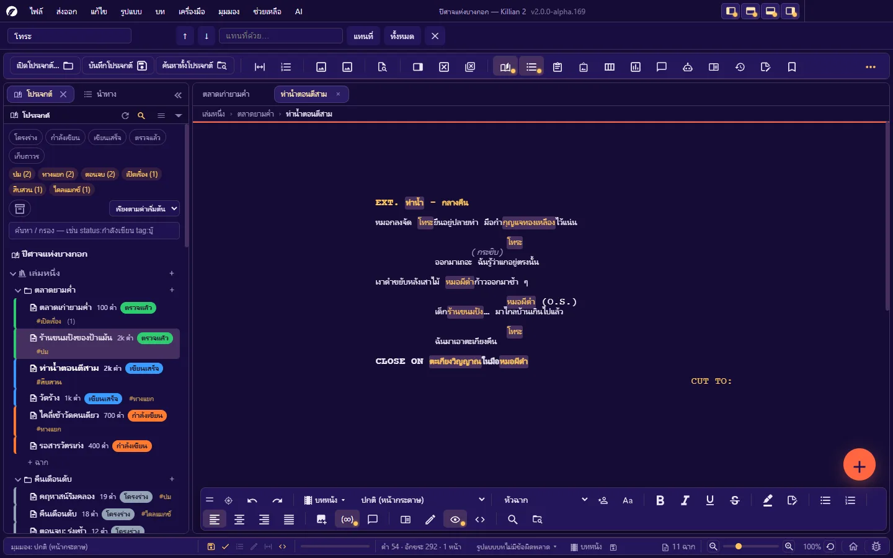
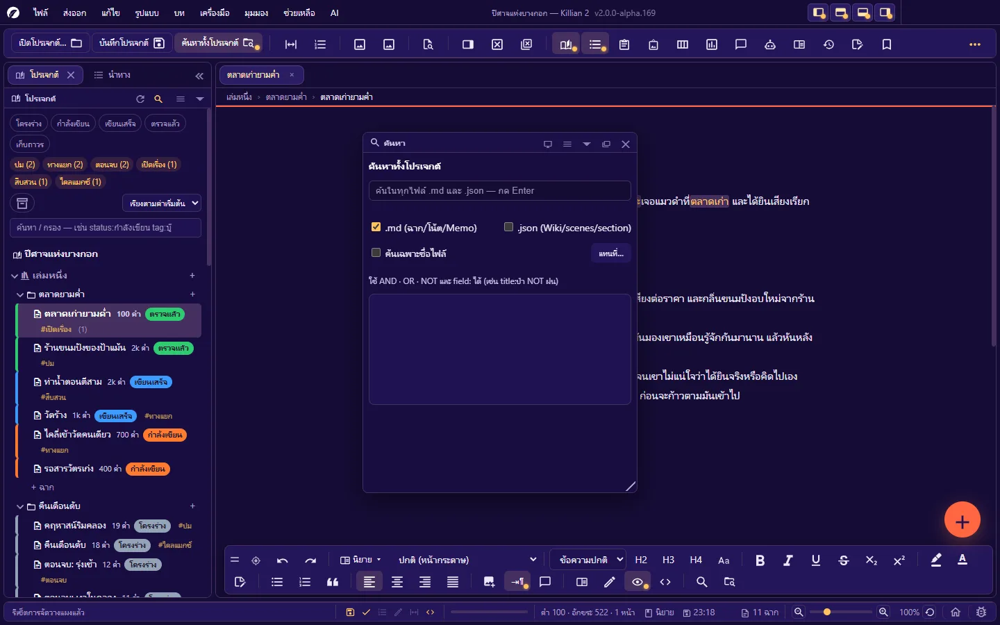
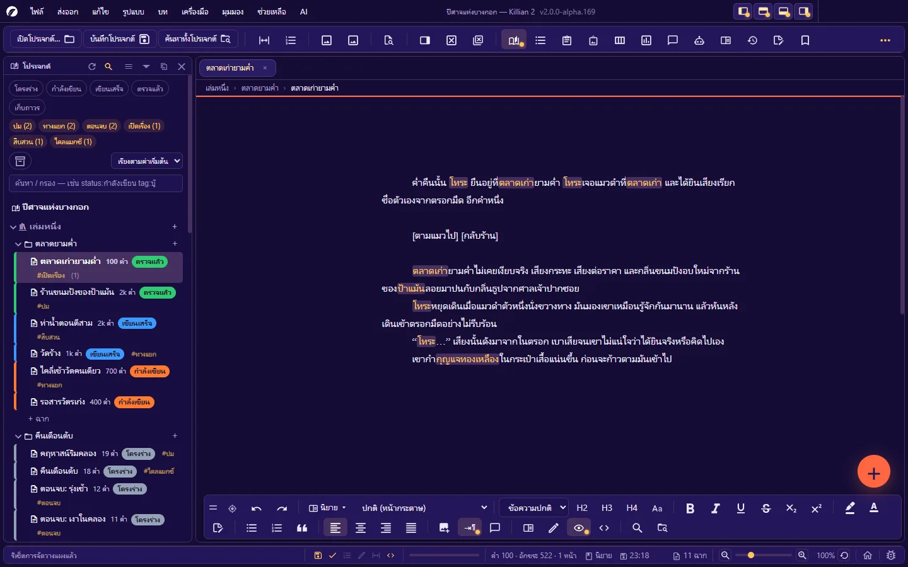
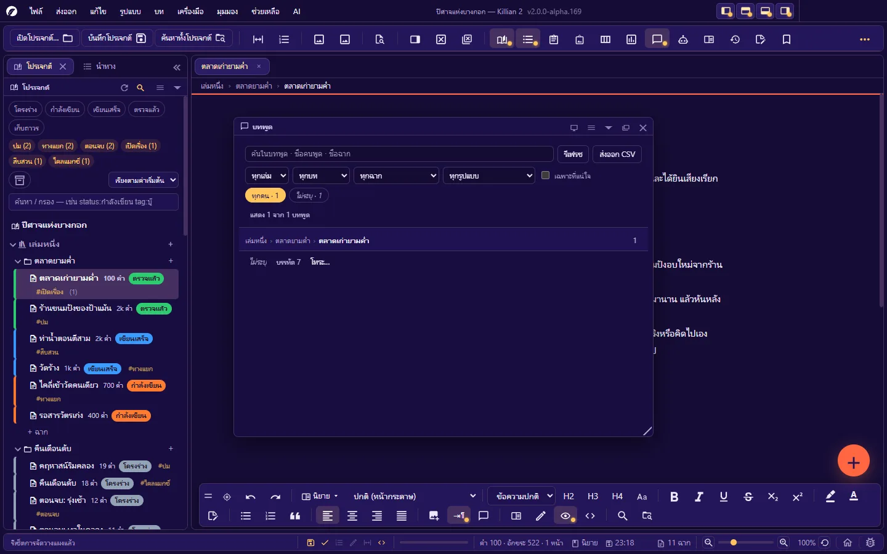

# 11. ค้นหา แทนที่ และนำทาง

**ภาษา:** ไทย · [English](../en/11-search-navigate.md)

[← 10. บันทึก ประวัติ สำรอง และกู้คืน](10-history-backup.md) · [สารบัญ](README.md) · ถัดไป: [12. ตั้งค่า →](12-settings.md)

---

| ต้องการ | ใช้ | คีย์ลัด |
|---|---|---|
| หาคำในเอกสารที่เปิดอยู่ | [ค้นหาในเอกสาร](#111-ค้นหาและแทนที่ในเอกสาร) | `Ctrl+F` / `Ctrl+H` |
| หาคำทั้งโปรเจกต์ | [ค้นหาทั้งโปรเจกต์](#112-ค้นหาทั้งโปรเจกต์) | `Ctrl+Shift+F` |
| เปลี่ยนคำทั้งโปรเจกต์ | [แทนที่ทั้งโปรเจกต์](#113-แทนที่ทั้งโปรเจกต์) | `Ctrl+Alt+Shift+H` |
| หาฉากตามสถานะ/แท็ก/ผู้เล่า | [ตัวกรองของแผงโปรเจกต์](#114-ตัวกรองของแผงโปรเจกต์) | — |
| กระโดดในเอกสารยาว | [แผงนำทาง](#115-แผงนำทาง-navigation) · ไปที่หน้า/ฉาก | `Ctrl+Alt+7` · `Ctrl+G` |
| เปิดไฟล์จากชื่อ | [เปิดไฟล์ด่วน](#116-เปิดไฟล์ด่วน) | `Ctrl+Shift+O` |
| หาบทพูดของตัวละคร | [แผงบทพูดทั้งผลงาน](#117-แผงบทพูดทั้งผลงาน) | `Ctrl+Alt+L` |

## 11.1 ค้นหาและแทนที่ในเอกสาร

`Ctrl+F` เปิดแถบค้นหาเหนือแถบเครื่องมือ · `Ctrl+H` เปิดแถบเดียวกันโดยไปยืนที่ช่องแทนที่

| ปุ่ม | ทำอะไร |
|---|---|
| ↑ / ↓ | คำที่เจอก่อนหน้า / ถัดไป (`Enter` = ถัดไป) |
| **แทนที่** | แทนที่คำที่เลือกอยู่ แล้วไปคำถัดไป |
| **ทั้งหมด** | แทนที่ทุกคำที่เจอในเอกสารนี้ในครั้งเดียว (`Ctrl+Z` ย้อนได้) |
| × | ปิดแถบค้นหา (`Esc`) |

ใช้กับเอกสารในแท็บที่เปิดอยู่เท่านั้น

## 11.2 ค้นหาทั้งโปรเจกต์

`Ctrl+Shift+F` (หรือปุ่ม **ค้นหาทั้งโปรเจกต์** บนแถบเครื่องมือ) — เปิด **แผงค้นหา**

- พิมพ์แล้วผลขึ้นเองหลังหยุดพิมพ์ครู่หนึ่ง · `↑` `↓` เลือกผล · `Enter` เปิด · `Esc` ออก
- ผลเรียงตามความตรง พร้อม **สไนป์เพ็ตที่ไฮไลต์คำค้น** — คลิกแล้วเปิดไฟล์และ **กระโดดไปตรงคำที่เจอ**
- บอกจำนวนไฟล์ที่พบทั้งหมด (และจำนวนที่แสดง)
- ตัวเลือก: ค้นเฉพาะ `.md` (ฉาก/โน้ต/Memo) หรือรวม `.json` (หน้า Wiki) · **ค้นเฉพาะชื่อไฟล์**
- คลิกขวาที่เล่ม/บทใน Explorer → **ค้นหาในนี้** = จำกัดขอบเขตการค้น

**ไวยากรณ์คำค้น**

| เขียน | ความหมาย |
|---|---|
| `ทอร่า เค้ก` | ต้องเจอทุกคำ |
| `ป่า OR ทะเล` | อย่างใดอย่างหนึ่ง |
| `ป่า NOT ฝน` | มี "ป่า" แต่ไม่มี "ฝน" |
| `title:ป่า` | ค้นเฉพาะช่อง (เช่น `title:` `tag:` `status:`) |

ภาษาไทยถูกตัดเป็นคำก่อนค้น จึงหาคำไทยที่อยู่กลางประโยคได้

**ไม่ถูกค้น**: ถังขยะ (`Recycle/`) · ประวัติเวอร์ชัน (`Snapshots/`) · ชุดสำรอง (`Backups/`) · ฉบับเดิมของฉากมีปัญหา (`OnSet/`) — ฉากที่ลบแล้วจึงไม่โผล่ในผลค้นหา

ครั้งแรกโปรแกรมสร้างดัชนี (มีแถบความคืบหน้า ยกเลิกได้) แล้วอัปเดตเองเมื่อไฟล์เปลี่ยน

## 11.3 แทนที่ทั้งโปรเจกต์

**เครื่องมือ → ค้นหาและแทนที่ทั้งโปรเจกต์** (`Ctrl+Alt+Shift+H`)

1. ใส่ **ค้นหา** และ **แทนที่ด้วย** (เว้นว่าง = ลบคำนั้น)
2. ตัวเลือก: **ตรงตัวพิมพ์เล็ก/ใหญ่** · **ทั้งคำ** (เฉพาะอักษรละติน) · **นิพจน์ปกติ (regex)**
3. **ดูตัวอย่าง** — รายการตำแหน่งที่จะเปลี่ยนในแต่ละไฟล์ + สรุป "เจอ N ตำแหน่งใน M ไฟล์"
4. **แทนที่ทั้งหมด** → ยืนยัน

กติกาความปลอดภัย:

- แทนที่เฉพาะ **เนื้อฉากและโน้ต (`.md`)** — ไม่แตะหัวไฟล์ (คุณสมบัติฉาก) · ข้อมูล Wiki · คอมเมนต์
- **ข้ามฉากที่ล็อกอยู่** (บอกจำนวนตำแหน่งที่ข้าม)
- ฉากที่เปิดเป็นแท็บและมีงานค้าง: เปลี่ยน **ในแท็บ** ก่อน ยังไม่ลงไฟล์จนกว่าคุณจะบันทึก
- **ย้อนกลับได้** จากแผงประวัติการทำงาน ([10.4](10-history-backup.md#104-ประวัติการทำงาน-ย้อนกลับไปจุดไหนก็ได้))

> เปลี่ยนชื่อตัวละครทั้งเรื่อง: ถ้าตัวละครมีหน้า Wiki ให้เปลี่ยนชื่อที่หน้า Wiki แล้วเปิด **ซิงก์ชื่อเอนทิตี้อัตโนมัติ** (ตั้งค่า → อัตโนมัติ) — หรือใช้แทนที่ทั้งโปรเจกต์

## 11.4 ตัวกรองของแผงโปรเจกต์

ช่อง **ค้นหา / กรอง** บนแผงโปรเจกต์กรองต้นไม้ตามคุณสมบัติของฉาก

**ค้นอิสระ**: พิมพ์คำ — หาในชื่อ แท็ก สถานะ เรื่องย่อ โน้ต ฯลฯ

**ค้นเจาะช่อง** `ช่อง:ค่า` (ใช้ชื่อช่องไทยหรืออังกฤษก็ได้):

| ช่อง | เขียนได้ว่า | ตัวอย่าง |
|---|---|---|
| สถานะ | `status:` `สถานะ:` | `status:กำลังเขียน` |
| แท็ก | `tag:` `tags:` `แท็ก:` `#:` | `tag:บู๊` |
| ผู้เล่า | `pov:` `มุมมอง:` | `pov:โทระ` |
| อารมณ์ | `emotion:` `อารมณ์:` | `อารมณ์:เศร้า` |
| ความขัดแย้ง | `conflict:` `ขัดแย้ง:` | |
| สี | `color:` `สี:` | `color:#6fae6f` — เทียบกับ **รหัสสี** ที่เก็บไว้ (ชื่อสีอย่าง "เขียว" ใช้ไม่ได้) |
| เรื่องย่อ | `synopsis:` `เรื่องย่อ:` | |
| โน้ต | `note:` `โน้ต:` | |
| ติดดาว | `flag:` `fav:` `ปักหมุด:` | `flag:1` |
| ชื่อไฟล์ | `file:` `ไฟล์:` | `file:scene-01` |
| ชื่อฉาก | `title:` `ชื่อ:` | |

**ผสมเงื่อนไข**

| เขียน | ความหมาย |
|---|---|
| `status:กำลังเขียน tag:บู๊` | ต้องตรงทั้งสองข้อ (AND) |
| `status:โครงร่าง OR status:กำลังเขียน` | อย่างใดอย่างหนึ่ง (ใช้ `OR` · `\|` · `หรือ`) |
| `-tag:ตัดทิ้ง` หรือ `NOT tag:ตัดทิ้ง` | ไม่เอา (ใช้ `-` นำหน้า · `NOT` · `ไม่`) |
| `status:"รอ แก้"` | ค่าที่มีวรรค ครอบด้วยเครื่องหมายคำพูด |

**ชิปสถานะ/ชิปแท็ก** เหนือช่องกรองเขียนคิวรีให้เอง — คลิกหลายชิปในกลุ่มเดียวกัน = OR · คำที่คุณพิมพ์เองในช่องยังอยู่
**เมฆแท็ก**: คลิกแท็กเพื่อกรอง Explorer ให้แสดงเฉพาะฉากที่มีแท็กนั้น
ฉากสถานะ **เก็บถาวร** ถูกซ่อนเสมอ เว้นแต่กดปุ่มเก็บถาวรให้แสดง

## 11.5 แผงนำทาง (Navigation)

`Ctrl+Alt+7` — เค้าโครงของเอกสารที่เปิดอยู่ คลิกแถวเพื่อกระโดดไปตำแหน่งนั้น

**แถวในรายการ** มาจากชนิดของบล็อก: หัวข้อ · ฉาก (หัวฉากของบท) · ทรานซิชัน · โน้ต · ย่อหน้า — เปิด/ปิดการแสดงย่อหน้าย่อยได้

| ทำอะไร | วิธี |
|---|---|
| กระโดดไปตำแหน่ง | คลิกแถว (ถ้าอยู่ในมุมมองหน้ากระดาษแบบครอบทีละหน้า โปรแกรมพาไปหน้าที่ถูกให้) |
| ค้นในโครง | ช่อง **ค้นหาในโครงเรื่อง…** |
| กรองตามชนิด | ปุ่มตัวกรอง (หัวข้อ/ฉาก/ทรานซิชัน/โน้ต/ย่อหน้า) · **เฉพาะที่ติดดาว** · **ล้างตัวกรองทั้งหมด** |
| ติดดาว / ตั้งสีให้แถว | คลิกขวาที่แถว — เครื่องหมายผูกกับข้อความของแถว ไม่ใช่ตำแหน่ง (แทรกย่อหน้าข้างบนแล้วเครื่องหมายไม่เลื่อน) |
| ดูทั้งเล่ม | สลับ "เฉพาะฉากที่เปิดอยู่" ↔ "ทั้งเล่ม" |
| สองคอลัมน์ | ข้อความ · บรรทัด/หน้า |

**สัญลักษณ์ในรายการ**: ตัวหนา = จุดแตกทางเลือก · ไอคอนทางเลือก (ฉากนี้มีทางแยก) · ดาว · แถบสี · มีงานค้าง (`TODO` / `???` ในข้อความ) · ยังไม่มีเนื้อหา · ฉากถูกล็อก · มีคอมเมนต์ที่ยังไม่ปิด · บังคับขึ้นหน้าใหม่

**รายการยาวมาก**: **ตั้งค่า → แผงนำทาง** เลือก **เลื่อนยาว** หรือ **แบ่งหน้า** (5–500 แถวต่อหน้า)

**ไปที่หน้า/ฉาก**: `Ctrl+G` พิมพ์เลขหน้าหรือเลขฉาก · `Ctrl+Shift+.` ไปที่หน้า · `Ctrl+Shift+,` ไปที่ฉาก (บทภาพยนตร์ที่มีหลายหัวฉากในไฟล์เดียว)

## 11.6 เปิดไฟล์ด่วน

`Ctrl+Shift+O` — พิมพ์บางส่วนของชื่อ แล้วเปิดได้ทันทีโดยไม่ต้องไล่หาในต้นไม้

| คีย์ | ทำอะไร |
|---|---|
| `↑` `↓` | เลือก |
| `Enter` | เปิด (ฉาก = เปิดเป็นฉาก · หน้า Wiki = เปิดเป็นหน้า Wiki) |
| `Esc` | ปิด |
| `Ctrl+R` | สแกนรายชื่อไฟล์ใหม่ |

รายการไม่รวมไฟล์ภายในของโปรแกรม (ไฟล์ทะเบียน · คีย์ AI · ถังขยะ · ประวัติ · ชุดสำรอง)

ทางลัดอื่น: **เปิดแท็บที่เพิ่งปิด** `Ctrl+Alt+Shift+Z` · **แสดงไฟล์ที่เปิดอยู่ในต้นไม้** `Ctrl+Shift+1` · รายการ **ปักหมุด** ใน Explorer

## 11.7 แผงบทพูดทั้งผลงาน

`Ctrl+Alt+L` — รวมบทพูดทุกบรรทัดของทั้งผลงานไว้ที่เดียว

- **กรอง** ตามเล่ม / บท / ฉาก / ตัวละคร · **ค้น** ในบทพูด ชื่อคนพูด ชื่อฉาก
- **คลิก** = ไปที่บทพูดนั้นในฉาก · **ดับเบิลคลิก** = แก้ตรงนี้ได้เลย
- อ่านได้ทั้งสองโหมด:
  - บทภาพยนตร์: รู้คนพูดจาก `@ชื่อตัวละคร`
  - นิยาย: บทพูด = ข้อความในเครื่องหมายคำพูด · คนพูดรู้จากชื่อที่อยู่หน้า/หลังเครื่องหมายคำพูด หรือ **เดาจากการสลับกันพูด** — ซ่อนแถวที่เป็นการเดาได้
- เตือนบรรทัดที่เครื่องหมายคำพูดยังไม่ปิด
- ปุ่มอ่านไฟล์ทั้งผลงานใหม่ (ใช้เมื่อแก้ไฟล์จากที่อื่น)

ใช้ตรวจน้ำเสียงของตัวละครทีละคน: กรองตัวละคร แล้วอ่านบทพูดของเขาต่อกันทั้งเรื่อง

---

ถัดไป: [12. ตั้งค่า →](12-settings.md)
