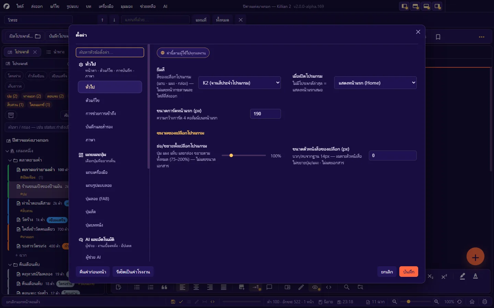
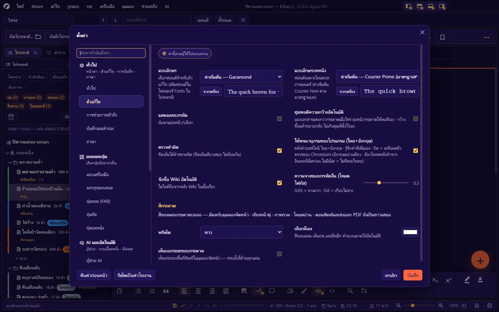
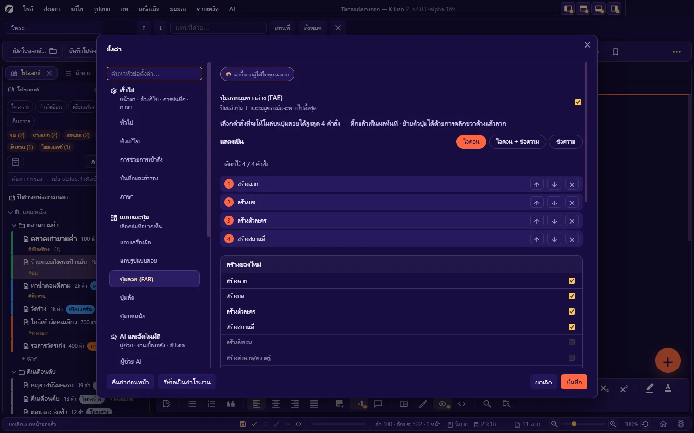
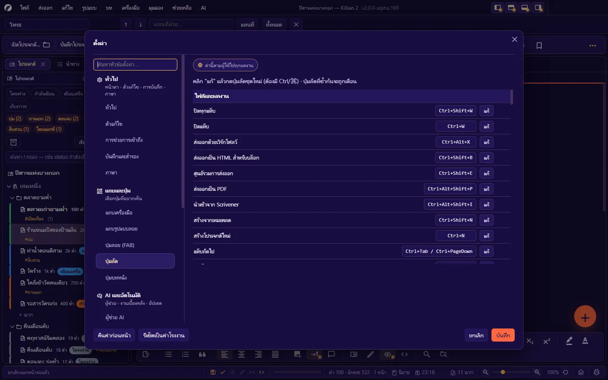
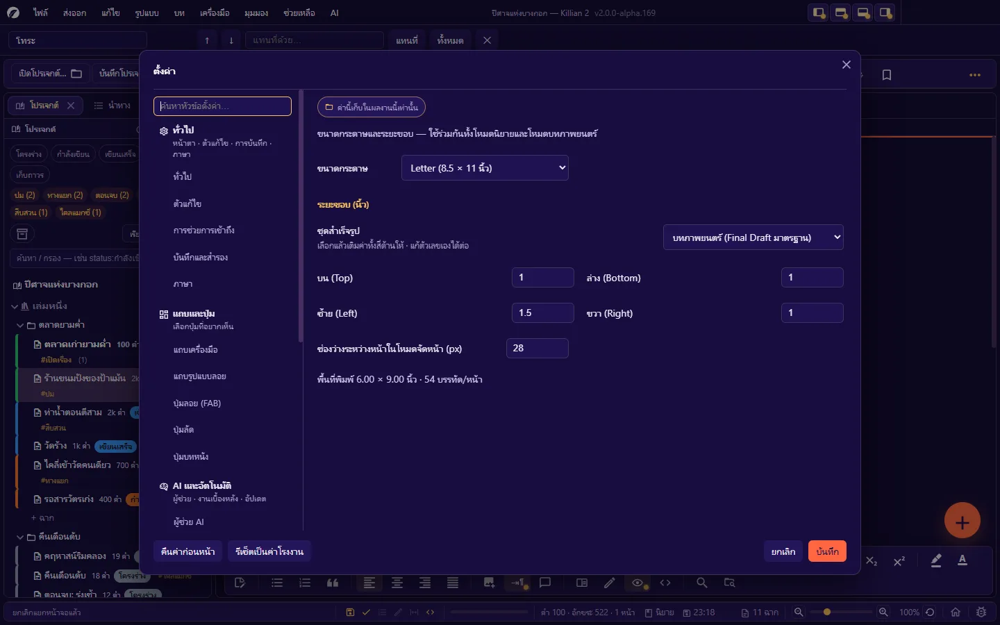
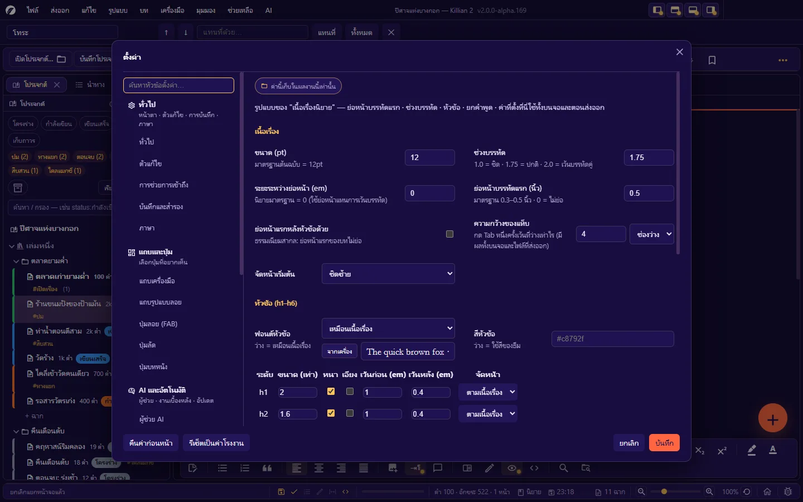
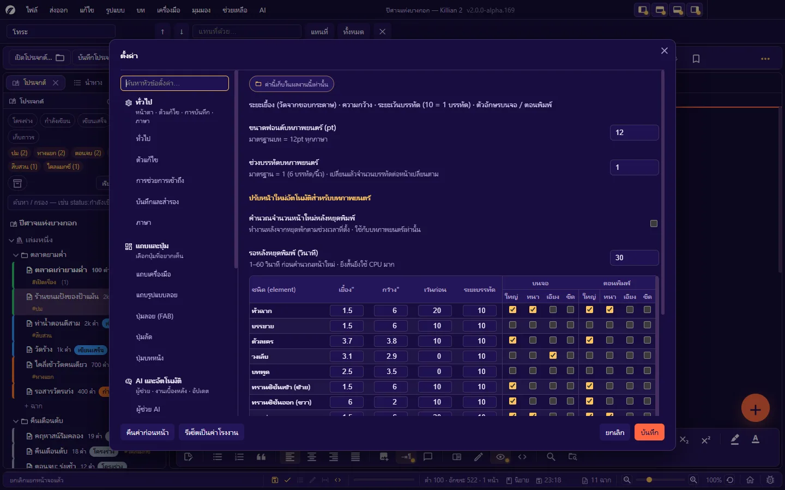

# 12. ตั้งค่า

**ภาษา:** ไทย · [English](../en/12-settings.md)

[← 11. ค้นหา แทนที่ และนำทาง](11-search-navigate.md) · [สารบัญ](README.md) · ถัดไป: [13. ภาษา ธีม ฟอนต์ และการช่วยการเข้าถึง →](13-language-themes-a11y.md)

---

เปิดกล่องตั้งค่า: `Ctrl+,` · **ไฟล์ → ตั้งค่า → ตั้งค่าโปรเจกต์…** · ปุ่มเฟืองบนแถบเครื่องมือหรือหน้าแรก

## 12.1 สิ่งที่ต้องรู้ก่อน: ค่าของ "ผู้ใช้" กับค่าของ "ผลงาน"

ทุกหน้ามีป้ายบอกขอบเขตที่หัวหน้า:

| ป้าย | ความหมาย | เก็บที่ |
|---|---|---|
| **ค่านี้ตามผู้ใช้ไปทุกผลงาน** | ตั้งครั้งเดียว ใช้กับทุกโปรเจกต์บนเครื่องนี้ | โฟลเดอร์ข้อมูลผู้ใช้ (`settings.json`) |
| **ค่านี้เก็บในผลงานนี้เท่านั้น** | เป็นของโปรเจกต์ที่เปิดอยู่ — ส่งโปรเจกต์ให้ใคร ค่านี้ไปด้วย | `project.khn.json` |

| ตามผู้ใช้ | ของผลงาน |
|---|---|
| ทั่วไป · ตัวแก้ไข · การช่วยการเข้าถึง · บันทึกและสำรอง · ภาษา · แถบเครื่องมือ · แถบรูปแบบลอย · ปุ่มลอย · ปุ่มลัด · ผู้ช่วย AI · อัตโนมัติ | ปุ่มบทภาพยนตร์ · หน้ากระดาษ · รูปแบบนิยาย · รูปแบบบทภาพยนตร์ · เลขฉาก/เลขหน้า · ฟอนต์ตามภาษา · ข้อมูลผลงาน · แผงนำทาง · ผังความสัมพันธ์ |

- **ยังไม่ได้เปิดโปรเจกต์** ก็เปิดกล่องตั้งค่าได้ — หน้าของผลงานจะถูกซ่อน
- ช่องส่วนใหญ่ **เห็นผลทันทีเป็นตัวอย่าง** แต่ถูกบันทึกจริงเมื่อกด **บันทึก** · กด **ยกเลิก** = คืนค่าเดิมทุกช่อง
- (ยกเว้น 3 หน้าที่ระบุว่า "ติ๊กแล้วเห็นผลทันที": แถบเครื่องมือ · แถบรูปแบบลอย · ปุ่มลอย)
- มีช่องค้นหาในกล่อง — พิมพ์ชื่อเรื่องที่อยากตั้ง (เช่น "ฟอนต์" "ระยะขอบ") เพื่อหาหน้าที่ถูก

---

## ทั่วไป

| ช่อง | ค่าเริ่มต้น | อธิบาย |
|---|---|---|
| **ธีมสี** | K2 | สีของหน้าตาโปรแกรม (แถบ · แผง · กล่อง) — ไม่แตะหน้ากระดาษและไฟล์ที่ส่งออก · รายชื่อธีมที่ [บทที่ 13](13-language-themes-a11y.md#132-ธีมสี) |
| **เมื่อเปิดโปรแกรม** | แสดงหน้าแรก (Home) | แสดงหน้าแรก · เปิดโปรเจกต์ล่าสุดทันที · เปิดโปรเจกต์ล่าสุดแล้วแสดงหน้าแรกทับ (ไม่มีโปรเจกต์ล่าสุด = แสดงหน้าแรกเสมอ) |
| **ขนาดการ์ดหน้าแรก (px)** | 190 | ความกว้างการ์ดโปรเจกต์บนหน้าแรก |
| **ขนาดของหน้าตาโปรแกรม** | 100% | ย่อ/ขยายปุ่ม แผง แท็บ กล่อง ทั้งหมด (75–200%) — ไม่แตะขนาดเอกสาร |
| **ขนาดตัวหนังสือของโปรแกรม (px)** | 0 | บวก/ลบจากฐาน 14px — เฉพาะตัวหนังสือ ไม่ขยายปุ่ม/แผง |

## ตัวแก้ไข

| ช่อง | ค่าเริ่มต้น | อธิบาย |
|---|---|---|
| **แบบอักษร** | Garamond | ฟอนต์ของตัวแก้ไขนิยาย — เลือกจากรายการ หรือปุ่ม **จากเครื่อง** (ฟอนต์ที่ลงไว้ในเครื่องนี้) · มีช่องพิมพ์ข้อความดูตัวอย่าง · เพิ่มฟอนต์ของโปรเจกต์ได้โดยวางไฟล์ในโฟลเดอร์ `Fonts/` |
| **แบบอักษรบทภาพยนตร์** | Courier Prime | ฟอนต์เฉพาะโหมดบทภาพยนตร์ (มาตรฐานบท) |
| **แสดงเลขบรรทัด** | ปิด | นับตามย่อหน้า/บล็อก |
| **ซูมพอดีความกว้างอัตโนมัติ** | ปิด | แผงเอกสารแคบกว่ากระดาษ = ย่อให้พอดีเอง · กว้างขึ้นแล้วขยายกลับ ไม่เกินซูมที่ตั้งไว้เอง |
| **ตรวจคำผิด** | เปิด | ขีดเส้นใต้คำสะกดผิด |
| **ใช้พจนานุกรมของโปรแกรม (ไทย+อังกฤษ)** | เปิด | คลังคำออฟไลน์ รู้จักคำที่เพิ่มเอง · ปิด = เหลือตัวตรวจของ Chromium (อังกฤษอย่างเดียว ต้องโหลดคลังคำจากอินเทอร์เน็ตก่อน) |
| **จับชื่อ Wiki อัตโนมัติ** | เปิด | ไฮไลต์ชื่อจากคลัง Wiki ในเนื้อเรื่อง |
| **ความจางของบรรทัดอื่น (โหมดโฟกัส)** | 0.3 | 0.05 = จางมาก · 0.8 = เกือบไม่จาง |
| **สีกระดาษ** — พรีเซ็ต | ขาว | ขาว · ครีม · ซีเปีย · เทาอ่อน · เขียวมิ้นต์ · เข้ม · ตั้งเอง — สีของแผ่นกระดาษ **บนจอ** (มุมมองจัดหน้า · เรียงหน้าคู่ · ภาพรวม · โหมดอ่าน) · ตอนพิมพ์/ส่งออก PDF เป็นขาวเสมอ |
| **เลือกสีเอง** | `#ffffff` | สีขอบแผ่น เส้นประ และสีหมึก คำนวณตามให้อัตโนมัติ |
| **เส้นบอกระยะขอบกระดาษ** | ปิด | เส้นประรอบพื้นที่พิมพ์ในมุมมองจัดหน้า |

## การช่วยการเข้าถึง

ดูรายละเอียดและวิธีใช้ที่ [บทที่ 13](13-language-themes-a11y.md#134-การช่วยการเข้าถึง)

| กลุ่ม | ช่อง | ค่าเริ่มต้น |
|---|---|---|
| การมองเห็นและสี | ปุ่มธีมช่วยการมองเห็น 8 ธีม + **กลับไปธีมเดิม** | — |
| แสดงปุ่มที่กด | เปิด/ปิด · แสดงปุ่มไหนบ้าง (ทุกปุ่ม / เฉพาะตัวอักษรที่พิมพ์ / เฉพาะปุ่มพิเศษและคีย์ลัด) · ตำแหน่ง (กลางจอ / บน / ล่าง) · ขนาดตัวอักษร · ค้างบนจอนาน · **แสดงตัวอย่าง** | ปิด · ทุกปุ่ม · กลางจอ · 160 px · 0.9 วินาที |
| แถบสีบรรทัดเคอร์เซอร์ | เปิด/ปิด · สีของแถบ · ความเข้ม | ปิด · `#ffe066` · 40% |
| โหมดเครื่องพิมพ์ดีด | ตรึงบรรทัดที่กำลังพิมพ์ไว้กลางจอ (เปิดค้างข้ามการเปิดโปรแกรม) | ปิด |
| เสียงเครื่องพิมพ์ดีด | เปิด/ปิด · เล่นเมื่อไร (ตลอดเวลาที่พิมพ์ / เฉพาะโหมดเครื่องพิมพ์ดีด) · ระดับเสียง · ปุ่มลองฟัง | ปิด · ตลอดเวลา · 50% |
| แป้นพิมพ์บนจอ | ปุ่ม **เปิดแป้นพิมพ์บนจอ** ของระบบ | — |

## บันทึกและสำรอง

| ช่อง | ค่าเริ่มต้น | อธิบาย |
|---|---|---|
| **บันทึกอัตโนมัติทุก ๆ (นาที)** | 5 | 0 = ปิดบันทึกอัตโนมัติ |
| **สำรองเวอร์ชันอัตโนมัติเมื่อบันทึก** | เปิด | เก็บประวัติเวอร์ชันของไฟล์ |
| **จำนวนเวอร์ชันอัตโนมัติสูงสุด** | 10 | ต่อไฟล์ — เวอร์ชันที่ตั้งชื่อเองไม่ถูกลบ |
| **ล้างถังขยะที่เก่ากว่า (วัน)** | 30 | 0 = ไม่ล้างอัตโนมัติ |

(ประวัติการทำงานตั้งแยกต่อผลงานที่หน้า **ข้อมูลผลงาน**)

## ภาษา

| ส่วน | อธิบาย |
|---|---|
| **ภาษาของอินเทอร์เฟซ** | Deutsch · English · Français · 日本語 · Português · ไทย · 简体中文 (+ ภาษาที่คุณวางไฟล์เพิ่ม) |
| ที่ค้นหาไฟล์ภาษา | รายการโฟลเดอร์ที่โปรแกรมมองหาไฟล์ `k2_<รหัสภาษา>.csv` |
| **ส่งออกไฟล์แปล (CSV)** · **เปิดโฟลเดอร์ภาษา** · **โหลดไฟล์ภาษาใหม่** | สำหรับผู้แปล — ดู [13.1](13-language-themes-a11y.md#131-ภาษา) |

## แถบเครื่องมือ

เลือกว่าปุ่มไหนโผล่บนแถบเครื่องมือ — ติ๊กแล้วเห็นผลทันที · จัดเป็นหมวดเดียวกับบนแถบ ([2.2](02-interface.md#22-แถบเครื่องมือ)) · แต่ละหมวดมีปุ่ม **เปิดหมด / ปิดหมด** · เส้นคั่นของหมวดที่ปิดหมดหายไปเอง · **คืนค่าเริ่มต้น**

## แถบรูปแบบลอย

เลือกปุ่มบนแถบรูปแบบลอย ตั้งแยก 4 ชุด: **นิยาย** · **บทภาพยนตร์** · **ทุกที่ (Wiki · แดชบอร์ด)** · **กระดานวางแผน**
หมวดของปุ่ม: ย้อนกลับ/ทำซ้ำ · ชนิดบล็อกและหัวข้อ · รูปแบบตัวอักษร · สีและโน้ต · รายการ · จัดหน้า · แทรกและสวิตช์ · โหมดการอ่าน/เขียน · ค้นหา · **คืนค่าเริ่มต้น**

## ปุ่มลอย (FAB)

| ช่อง | อธิบาย |
|---|---|
| **ปุ่มลอยมุมขวาล่าง (FAB)** | ปิดแล้วปุ่ม + และเมนูของมันหายทั้งชุด |
| **แสดงเป็น** | ไอคอน · ไอคอน + ข้อความ · ข้อความ |
| รายการที่เลือก (สูงสุด 4) | เลื่อนขึ้น/ลง/เอาออก |
| คำสั่งให้เลือก | **สร้างของใหม่**: ฉาก · บท · ตัวละคร · สถานที่ · สิ่งของ · ตำนาน/ความรู้ · Memo · จากแม่แบบ — **ระหว่างเขียน**: กระดาษทด · โน้ตด่วนของฉาก · ค้นทั้งโปรเจกต์ · เปิดไฟล์ด่วน · แทรกรูป — **มุมมอง/แผง**: แดชบอร์ด · เส้นเวลา · แผนที่ · Kanban · คลังรูป · โหมดโฟกัส — **ไฟล์**: บันทึกทั้งหมด · สำรองข้อมูลเดี๋ยวนี้ · ศูนย์รวมการส่งออก · ตั้งค่า |

## ปุ่มลัด

รายการคำสั่งทั้งหมดที่มีปุ่มลัด จัดหมวดเดียวกับ [ภาคผนวก B](B-shortcuts.md)

- คลิก **แก้** แล้วกดปุ่มชุดใหม่ (ต้องมี `Ctrl`/`⌘`)
- ปุ่มที่ **ซ้ำกับคำสั่งอื่นจะถูกเตือน**
- ปุ่มรีเซ็ตท้ายแถว = คืนค่าเริ่มต้นของคำสั่งนั้น
- เปลี่ยนแล้ว ทูลทิป เมนู และกล่อง "ปุ่มลัดทั้งหมด" แสดงปุ่มใหม่ตาม

> หน้านี้แสดงเฉพาะคำสั่งที่มีปุ่มลัดอยู่แล้ว — คำสั่งที่ยังไม่มีปุ่มลัดตั้งต้นยังเพิ่มปุ่มเองจากหน้านี้ไม่ได้ในรุ่นนี้

## ปุ่มบทภาพยนตร์ *(ของผลงาน)*

| ช่อง | ค่าเริ่มต้น | อธิบาย |
|---|---|---|
| **เปิดระบบปุ่มสลับ element** | เปิด | ปิด = `Enter` ขึ้นบรรทัดใหม่ชนิดเดิม ปุ่มอื่นไม่ทำงาน |
| **บรรทัดถัดจากบทพูด = บทพูดต่อ** | ปิด | ปิด (แนว Final Draft) = บรรทัดถัดไปเป็นบรรยาย · เปิด = เขียนบทพูดยาวหลายบรรทัด แล้วบรรยายต้องขึ้นต้นด้วย `!` |
| **ปุ่มที่ใช้** | `Enter` · `Ctrl+Tab` · `Ctrl+Shift+Tab` | ไป element ถัดไป · วนไปข้างหน้า · วนย้อนกลับ — กด **เปลี่ยน** แล้วกดปุ่มใหม่ |
| **ตารางต่อ element** | ตามมาตรฐาน | ต่อชนิด: `Enter` → ? · `Ctrl+Tab` → ? · `Ctrl+Shift+Tab` → ? |

## ผู้ช่วย AI

แสดงผู้ให้บริการที่ใช้อยู่ และปุ่ม **เปิดการตั้งค่าผู้ช่วย AI** ([บทที่ 8](08-ai.md#82-ตั้งค่าผู้ให้บริการ)) — คีย์เก็บแยกไว้ในไฟล์ของเครื่องนี้ ไม่ลงไฟล์ผลงาน

## อัตโนมัติ

| ช่อง | ค่าเริ่มต้น | อธิบาย |
|---|---|---|
| **ซิงก์ชื่อเอนทิตี้อัตโนมัติ** | ปิด | เปลี่ยนชื่อเอนทิตี้ใน Wiki แล้วอัปเดตชื่อในทุกไฟล์โดยอัตโนมัติ |
| **คลังคำพ้อง/คำตรงข้าม** | ปิด | เปิด = คำที่เลือกจะถูกส่งออกไปค้นคำพ้องทางอินเทอร์เน็ต · ปิด = ใช้คลังไทยในตัวอย่างเดียว |
| **ตรวจหาอัปเดตตอนเปิดโปรแกรม** | เปิด | ปิดแล้วจะไม่ติดต่ออินเทอร์เน็ตตอนเปิดโปรแกรม |
| รุ่นที่ใช้อยู่ · ตรวจล่าสุด · แหล่งอัปเดต | — | ปุ่ม **ตรวจหาอัปเดตตอนนี้** · **เลิกข้ามรุ่น** ([บทที่ 15](15-update-bug-log.md)) |

## หน้ากระดาษ *(ของผลงาน)*

ขนาดกระดาษและระยะขอบ — ใช้ร่วมกันทั้งโหมดนิยายและบทภาพยนตร์

| ช่อง | ค่าเริ่มต้น | ตัวเลือก |
|---|---|---|
| **ขนาดกระดาษ** | Letter | Letter (8.5 × 11 นิ้ว) · A4 (8.27 × 11.69) · Legal (8.5 × 14) · Digest (5.5 × 8.5) · US Trade (6 × 9) · Compact/Novella (5 × 8) · Mass Market (4.25 × 6.87) · Bunkobon/A6 (4.1 × 5.8) · Tankōbon (5 × 7.5) · Pocket Book (14.5 × 21 ซม.) · A5 (14.8 × 21 ซม.) · กำหนดเอง |
| **ชุดระยะขอบสำเร็จรูป** | บทภาพยนตร์ (Final Draft มาตรฐาน) | ปกติ 1 นิ้วรอบด้าน · แคบ 0.5 นิ้ว · ปานกลาง · กว้าง · บทภาพยนตร์ · นิยาย (ต้นฉบับส่งสำนักพิมพ์) · A4 แคบ (2 ซม.) · A4 ปกติ (2.5 / 3.17 ซม.) · ตั้งเอง |
| **บน / ล่าง / ซ้าย / ขวา (นิ้ว)** | 1 / 1 / 1.5 / 1 | แก้ตัวเลขเองได้หลังเลือกชุด |
| **ช่องว่างระหว่างหน้าในโหมดจัดหน้า (px)** | 28 | ระยะระหว่างแผ่นกระดาษบนจอ |

กล่องบอกผล: พื้นที่พิมพ์ (เช่น 6.00 × 9.00 นิ้ว) และจำนวนบรรทัดต่อหน้า (เช่น 54)

## รูปแบบนิยาย *(ของผลงาน)*

ค่าที่ตั้งที่นี่ใช้ทั้งบนจอและตอนส่งออก

**เนื้อเรื่อง**

| ช่อง | ค่าเริ่มต้น | อธิบาย |
|---|---|---|
| ขนาด (pt) | 12 | มาตรฐานต้นฉบับ = 12pt |
| ช่วงบรรทัด | 1.75 | 1.0 = ชิด · 1.75 = ปกติ · 2.0 = เว้นบรรทัดคู่ |
| ระยะระหว่างย่อหน้า (em) | 0 | นิยายมาตรฐาน = 0 (ใช้ย่อหน้าแทนการเว้นบรรทัด) |
| ย่อหน้าบรรทัดแรก (นิ้ว) | 0.5 | มาตรฐาน 0.3–0.5 · 0 = ไม่ย่อ |
| ย่อหน้าแรกหลังหัวข้อด้วย | ปิด | ธรรมเนียมสากล: ย่อหน้าแรกของบทไม่ย่อ |
| ความกว้างของแท็บ | 4 ช่องว่าง | หน่วย: ช่องว่าง · นิ้ว · ซม. — มีผลทั้งบนจอและไฟล์ที่ส่งออก |
| จัดหน้าเริ่มต้น | ชิดซ้าย | ชิดซ้าย · เต็มบรรทัด |

**หัวข้อ (h1–h6)**

| ช่อง | อธิบาย |
|---|---|
| ฟอนต์หัวข้อ | ว่าง = เหมือนเนื้อเรื่อง |
| สีหัวข้อ | ว่าง = ใช้สีของธีม |
| ตารางต่อระดับ | ขนาด (เท่า) · หนา · เอียง · เว้นก่อน (em) · เว้นหลัง (em) · จัดหน้า — ค่าเริ่มต้น h1 = 2 เท่า · h2 = 1.6 · h3 = 1.35 · h4 = 1.2 · h5 = 1.1 · h6 = 1 · หนาทุกระดับ |
| เติมเลขบทอัตโนมัติ | วาดบนจอ/ไฟล์ส่งออก — ไม่เขียนตัวเลขลงไฟล์ต้นฉบับ |
| รูปแบบเลขบท | ใช้ `{n}` เช่น `บทที่ {n}` |
| ใส่เลขให้หัวข้อระดับ | ค่าเริ่มต้น 1 |

**ยกคำพูด (Blockquote)**: ตัวเอียง (เปิด) · มีเส้นขอบซ้าย (เปิด) · ระยะเยื้อง 0.35 นิ้ว · สีตัวอักษร (ว่าง = สีของธีม)

**ปุ่มสำเร็จรูป**: **ตั้งเป็นแบบนิยายมาตรฐาน** · **ต้นฉบับส่งสำนักพิมพ์ (เว้นบรรทัดคู่)** · **คืนค่าเริ่มต้น**
กล่องบอกผลโดยประมาณ: บรรทัด/หน้า และตัวอักษร/บรรทัด · ปุ่ม **ไปที่เลขหน้า** พาไปหน้าเลขฉาก/เลขหน้า

## รูปแบบบทภาพยนตร์ *(ของผลงาน)*

| ช่อง | ค่าเริ่มต้น | อธิบาย |
|---|---|---|
| ขนาดฟอนต์บทภาพยนตร์ (pt) | 12 | มาตรฐานบทภาพยนตร์ = 12pt ทุกภาษา |
| ช่วงบรรทัดบทภาพยนตร์ | 1 | 1 = 6 บรรทัด/นิ้ว · เปลี่ยนแล้วจำนวนบรรทัดต่อหน้าเปลี่ยนตาม |
| คำนวณจำนวนหน้าใหม่หลังหยุดพิมพ์ | ปิด | ปรับหน้าใหม่อัตโนมัติสำหรับบทภาพยนตร์ |
| รอหลังหยุดพิมพ์ (วินาที) | 30 | 1–60 — ยิ่งสั้นยิ่งใช้ CPU มาก |

**ตารางต่อ element** — เยื้อง (นิ้วจากขอบกระดาษ) · กว้าง (นิ้ว) · เว้นก่อน · ระยะบรรทัด (10 = 1 บรรทัด) · และ ใหญ่/หนา/เอียง/ขีด แยก **บนจอ** กับ **ตอนพิมพ์**

| element | เยื้อง | กว้าง | เว้นก่อน | รูปแบบตั้งต้น |
|---|---|---|---|---|
| หัวฉาก | 1.5 | 6 | 20 | ตัวใหญ่ + หนา |
| บรรยาย | 1.5 | 6 | 10 | — |
| ตัวละคร | 3.7 | 3.8 | 10 | ตัวใหญ่ |
| วงเล็บ | 3.1 | 2.9 | 0 | เอียง (บนจอ) |
| บทพูด | 2.5 | 3.5 | 0 | — |
| ทรานซิชันเข้า (ซ้าย) | 1.5 | 6 | 10 | ตัวใหญ่ |
| ทรานซิชันออก (ขวา) | 6 | 2 | 10 | ตัวใหญ่ |
| ฉากย่อย · สลับฉาก · ช็อต | 1.5 | 6 | 20 | ตัวใหญ่ + หนา |
| ตอน | 1.5 | 6 | 20 | ตัวใหญ่ + หนา (+ ขีดเส้นใต้ตอนพิมพ์) |
| โน้ต · ต่อเนื่อง · สรุป | 1.5 | 6 | 10 | เอียง |
| โครง 1 / 2 / 3 | 1.5 / 1.7 / 1.9 | 6 / 5.8 / 5.6 | 10 | หนา |

ปุ่ม **คืนค่าเริ่มต้น**

## เลขฉาก · เลขหน้า *(ของผลงาน)*

| กลุ่ม | ช่อง | ค่าเริ่มต้น |
|---|---|---|
| **เลขฉาก** | แสดงเลขฉากข้างหัวฉาก (ทั้งซ้ายและขวา) | ปิด |
| | ท้ายเลข (เช่น ว่าง หรือ ".") | ว่าง |
| | ระยะจากขอบกระดาษซ้าย / ขวา (นิ้ว) | 0.75 / 1 |
| **เลขหน้า** | แสดงเลขหน้า (สวิตช์เดียวกับนิยาย) | ปิด |
| | ใส่เลขบนหน้าแรกด้วย | เปิด |
| | ระยะจากขอบขวา / ขอบบน (นิ้ว) | 1 / 0.5 |
| | ท้ายเลข | `.` |
| **ต่อเนื่อง (CONTINUED)** | ใส่ CONTINUED อัตโนมัติ | เปิด |
| | ใส่ได้แม้หน้านั้นไม่มีหัวฉาก | ปิด |
| **กฎการตัดหน้า** | บรรยาย: เหลือท้ายหน้าอย่างน้อย / ยกไปหน้าใหม่อย่างน้อย (บรรทัด) | 2 / 3 |
| | บทพูด: เหลือท้ายหน้าอย่างน้อย / ยกไปหน้าใหม่อย่างน้อย | 2 / 3 |
| | ขีดท้ายบรรทัดติดกันไม่เกิน | 2 |
| | หัวฉากท้ายหน้าต้องมีเนื้อตาม | 2 |
| **การตรวจทานบนจอ** | ขีดเส้นบอกจุดที่ผิดในบทภาพยนตร์ | เปิด |
| **ข้อความมาตรฐาน** | ท้ายหน้าเมื่อฉากต่อเนื่อง | `(CONTINUED)` |
| | ต้นหน้าเมื่อฉากต่อเนื่อง | `CONTINUED:` |
| | บทพูดยังไม่จบ | `(MORE)` |
| | ทวนชื่อตัวละคร | `(cont'd)` |
| | หัวข้อ Scene / Time (หน้ารายชื่อ) | `Scene` / `Time` |

ปุ่ม **คืนค่าเริ่มต้น**

## ฟอนต์ตามภาษา *(ของผลงาน)*

ตารางเดียวคุมฟอนต์ทั้งโปรแกรม: **ช่วงอักขระไหน → ฟอนต์อะไร → ใช้กับโหมดไหน → ย่อ/ขยายกี่ %**

| คอลัมน์ | ตัวเลือก |
|---|---|
| เปิด/ปิดแถว | ติ๊ก |
| ช่วงอักขระ | ไทย · ละติน (อังกฤษ) · ลาว · เขมร · พม่า · จีน/ญี่ปุ่น (คันจิ) · เกาหลี · ซีริลลิก · อาหรับ · เทวนาครี · ทุกอักขระ · กำหนดช่วงเอง… |
| ฟอนต์ | ฟอนต์ที่ฝังมากับโปรแกรม · ไฟล์ที่นำเข้าไว้ในโปรเจกต์ · หรือพิมพ์ชื่อฟอนต์ที่ลงในเครื่อง (ใส่หลายชื่อคั่นด้วยจุลภาคเป็นลำดับสำรองได้) · ปุ่ม **จากเครื่อง** |
| ใช้กับ | ทั้งสองโหมด · นิยาย · บทภาพยนตร์ |
| % | ตัวย่อ/ขยายกลิฟให้พอดีกล่องบรรทัด |

- แถวบนสุดมีลำดับก่อน · **เพิ่มแถว** ได้ไม่จำกัด · **นำเข้าไฟล์ฟอนต์เข้าโปรเจกต์…** · **คืนค่าเริ่มต้น** · มีช่องตัวอย่างข้อความ
- แถวตั้งต้น: **ไทยในบทภาพยนตร์ = 85%** — เพราะสแตกของบทเริ่มด้วย Courier ที่ไม่มีอักษรไทย ตัวไทยจึงตกไปฟอนต์สำรองที่ตัวใหญ่กว่า แล้วล้นระยะบรรทัดตายตัวของบท (6 บรรทัด/นิ้ว)
- ฟอนต์ไทยที่ตั้งที่นี่คือฟอนต์ที่ถูก **ฝังลง PDF** ด้วย — ควรเป็นไฟล์ `.ttf`/`.otf`

## ข้อมูลผลงาน *(ของผลงาน)*

| กลุ่ม | ช่อง |
|---|---|
| **Logline** (AI ใช้เป็นเข็มทิศ) | Logline ประโยคเดียว · ตัวละครหลัก · เหตุการณ์กระตุ้น · เป้าหมาย · อุปสรรค/ตัวร้าย · เดิมพัน |
| **ข้อมูลบนหน้าปก** (ใช้ตอนพิมพ์และส่งออก) | ชื่อโปรเจกต์ · ผู้เขียน · อีเมลผู้เขียน · ข้อมูลติดต่อ · โทรศัพท์ |
| **เครดิตของบทภาพยนตร์** | เขียนบทโดย (Screenplay By) · สร้างจาก (Based On) · แก้ไขโดย (Revisions by) |
| **ตัวแทน (Agent)** | ชื่อ · ที่อยู่ · โทรศัพท์ · อีเมล |
| **ลิขสิทธิ์** | ลิขสิทธิ์โดย (Copyright by) |
| **เป้าหมายจำนวนคำ** | เป้าหมายคำต่อวัน (500) · เป้าหมายคำทั้งโปรเจกต์ (50,000) |
| **ประวัติการทำงาน** | เก็บประวัติย้อนหลัง (ครั้ง) — 4–500 · ค่าเริ่มต้น 32 · **ปิดการจดประวัติ** |

เปิดหน้านี้ตรง ๆ: **ไฟล์ → ตั้งค่า → ข้อมูลผลงาน (ผู้เขียน · ตัวแทน · ลิขสิทธิ์)…**

## แผงนำทาง *(ของผลงาน)*

| ช่อง | ค่าเริ่มต้น | อธิบาย |
|---|---|---|
| การแสดงผล | เลื่อนยาว (แถบเลื่อน) | หรือ แบ่งหน้า |
| จำนวนแถวต่อหน้า | 50 | ใช้เฉพาะโหมดแบ่งหน้า — 5–500 |

มีคำอธิบายสัญลักษณ์ของแผงนำทางอยู่ในหน้านี้ ([11.5](11-search-navigate.md#115-แผงนำทาง-navigation))

## ผังความสัมพันธ์ *(ของผลงาน)*

| กลุ่ม | ช่อง |
|---|---|
| **การควบคุมด้วยเมาส์** | ปุ่มหมุนมุมมอง 3D (ปุ่มกลาง · คลิกขวา · คลิกซ้าย) · ปุ่มเลื่อนผัง (ค่าเริ่มต้นคลิกซ้าย) — มีบรรทัดสรุปว่าคำอธิบายใต้ผังจะเป็นอย่างไร |
| **ชุดสีสำเร็จรูป** | ค่าเดิมของโปรแกรม · สายไฟ (Cable) · ดอกไม้ (Flower) · แผ่นเทียบสี (X-Rite) · สีรุ้ง (Rainbow) · ตั้งเอง — **บันทึกเป็นชุดใหม่** · **ลบชุดนี้** |
| **สีโหนด** (ตามหมวด) | ตัวละคร · สถานที่ · สิ่งของ · ตำนาน · ฉาก · บท · เล่ม · ตอน/ส่วน |
| **สีเส้น** (ตามประเภทความสัมพันธ์) | ครอบครัว · คนรัก · พันธมิตร · คู่แข่ง · ศัตรู · ผู้สอน/อาจารย์ · รู้จัก · เป็นกลาง · อื่น ๆ |
| **สีเส้นเชื่อมอื่น ๆ** | ลิงก์ระหว่างฉาก · ปรากฏร่วมในฉาก · เอนทิตี้ ↔ ฉาก |
| **พื้นผัง / ตัวหนังสือ** | พื้นหลังผัง · เส้นกริด · ตัวหนังสือชื่อโหนด · พื้นป้ายชื่อโหนด · ขอบโหนด · ขอบโหนดตอนชี้ · แกนบอกทิศ (ว่าง = ตามธีม) |

คลิกช่องสีเพื่อเลือก หรือพิมพ์รหัสสีเอง · เว้นว่าง = ใช้ค่าเริ่มต้น

---

## 12.2 ตั้งค่าที่อยู่นอกกล่องนี้

| เรื่อง | อยู่ที่ |
|---|---|
| ผู้ให้บริการ AI · system prompt · Agent | **AI → ตั้งค่า AI…** |
| สถานะฉาก | **ไฟล์ → ตั้งค่า → จัดการสถานะฉาก…** |
| แท็กสี | **ไฟล์ → ตั้งค่า → จัดการแท็บสี (Visual Tags)…** |
| หน้าปก · หัวกระดาษ · หน้ารายชื่อตัวละคร | เมนู **บทภาพยนตร์** |
| เวิร์กโฟลว์ส่งออก · ชื่อไฟล์ส่งออก | เมนู **ส่งออก** / ศูนย์รวมการส่งออก |
| การจัดวางแผง · เวิร์กสเปซ | เมนู **มุมมอง** |
| ปลั๊กอิน | แผง **ปลั๊กอิน** |
| สวิตช์ด่วน | แถบสถานะ · เมนู **มุมมอง** / **บท** / **เครื่องมือ** |

---

ถัดไป: [13. ภาษา ธีม ฟอนต์ และการช่วยการเข้าถึง →](13-language-themes-a11y.md)
