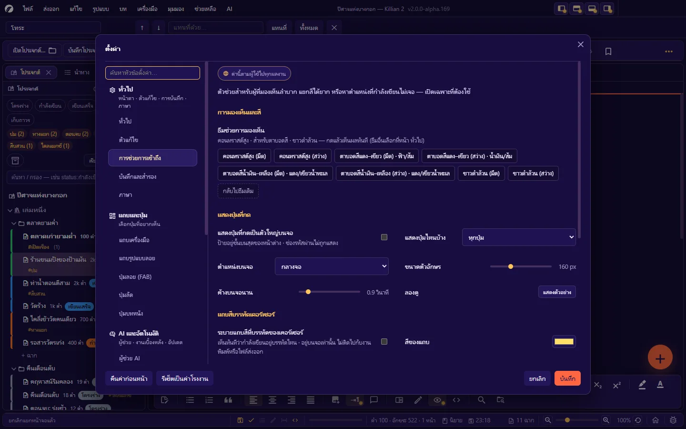

# 13. ภาษา ธีม ฟอนต์ และการช่วยการเข้าถึง

**ภาษา:** ไทย · [English](../en/13-language-themes-a11y.md)

[← 12. ตั้งค่า](12-settings.md) · [สารบัญ](README.md) · ถัดไป: [14. ปลั๊กอิน (สำหรับผู้ใช้) →](14-plugins.md)

---

## 13.1 ภาษา

### เปลี่ยนภาษาของโปรแกรม

**ตั้งค่า → ภาษา → ภาษาของอินเทอร์เฟซ** หรือปุ่มลูกโลกบนหน้าแรก

| ภาษาในตัว | รหัส |
|---|---|
| ไทย | `th` |
| English | `en` |
| Deutsch | `de` |
| Français | `fr` |
| 日本語 | `ja` |
| Português | `pt` |
| 简体中文 | `zh` |

- ภาษาเป็น **ค่าของผู้ใช้** — ไม่ผูกกับโปรเจกต์ เปิดโปรเจกต์ไหนก็ได้ภาษาเดิม
- เปลี่ยนแล้วโปรแกรมถามว่า **จะเริ่มโปรแกรมใหม่เพื่อให้เปลี่ยนครบทุกจุดไหม** (ถ้าตกลง จะถามเรื่องงานที่ยังไม่บันทึกก่อน) — แนะนำให้เริ่มใหม่ เพราะข้อความบางส่วนถูกสร้างไว้ตั้งแต่ตอนเปิดโปรแกรม · เมนูของระบบเปลี่ยนตามภาษาใหม่
- **วันที่ ตัวเลข และการเรียงตัวอักษร** ตามภาษาที่เลือก: ไทย = พ.ศ. · ภาษาอื่น = ค.ศ.

**สิ่งที่ไม่เปลี่ยนตามภาษา** (เพราะเป็นข้อมูลในไฟล์งานของคุณ): ชื่อสถานะฉากที่บันทึกไว้ · แท็ก · ชื่อเล่ม/บท/ฉาก · รหัสของบทภาพยนตร์ในไฟล์ · ชื่อตัวแปรหัวกระดาษที่คุณพิมพ์ไว้ (`${หน้า}` ใช้ได้ทุกภาษา)

### เพิ่มภาษาใหม่ หรือแก้คำแปล

ไฟล์ภาษาเป็น **CSV ธรรมดา** ชื่อ `k2_<รหัสภาษา>.csv` — โปรแกรมอ่านภาษาจาก "ชื่อไฟล์" ในโฟลเดอร์ `languages` วางไฟล์เพิ่มแล้วเปิดโปรแกรมใหม่ก็มีภาษานั้นเลย ไม่ต้องติดตั้งอะไร

**ที่ที่โปรแกรมมองหา** (ตัวบนชนะตัวล่าง ทีละข้อความ — ข้อความที่ไฟล์บนไม่มีหรือเว้นว่าง ใช้ของไฟล์ถัดไป):

1. `<โปรเจกต์>/languages/` — คำแปลเฉพาะผลงานนี้
2. โฟลเดอร์ `languages` ข้างไฟล์โปรแกรม
3. `<ข้อมูลผู้ใช้>/languages/` — ของคุณ ใช้ทุกผลงาน
4. ไฟล์ภาษาที่มากับโปรแกรม

หน้า **ตั้งค่า → ภาษา** แสดงรายการโฟลเดอร์จริงบนเครื่องคุณ และมีปุ่ม **เปิดโฟลเดอร์ภาษา**

**รูปแบบไฟล์**

```csv
meta.code,ja
meta.name,Japanese
meta.nativeName,日本語
meta.version,3
meta.author,ชื่อผู้แปล
ui.common.cancel,キャンセル
ui.app.saveDone,保存しました
# บรรทัดที่ขึ้นต้นด้วย # ในช่องแรกคือคอมเมนต์ของผู้แปล
```

- สองคอลัมน์: **คีย์ , ข้อความ** — ข้อความที่มีจุลภาคหรือขึ้นบรรทัดใหม่ ครอบด้วย `"…"` และเขียน `"` ซ้อนเป็น `""`
- ตัวแทนค่า `{0}` `{1}` ต้องคงไว้ · `{sc:save}` = คีย์ลัดปัจจุบันของคำสั่งนั้น (ห้ามพิมพ์ `Ctrl+S` ลงไปตรง ๆ เพราะผู้ใช้ตั้งคีย์ใหม่ได้)
- พหูพจน์ (ภาษาที่มี): `{0} {0|page|pages}` → "1 page" / "2 pages"
- ห้ามใส่แท็ก HTML · บันทึกเป็น UTF-8 (มี BOM ได้ — เปิดด้วย Excel แล้วภาษาไทยไม่เพี้ยน)

**ขั้นตอนสำหรับผู้แปล**

1. **ส่งออก → ส่งออกภาษาเป็น CSV (key · ไทย · อังกฤษ)…** — ได้ตารางสามคอลัมน์สำหรับเปิดในโปรแกรมตารางคำนวณ
2. แปลในคอลัมน์ของภาษาใหม่
3. **เครื่องมือ → นำเข้าภาษาจาก CSV…** — รวมคำแปลเข้ากับไฟล์ภาษาของโปรเจกต์ เห็นผลทันที (การนำเข้าเป็นการ **รวมทับ** ไม่ลบคีย์ที่ไม่มีในตาราง)
4. หรือบันทึกเป็น `k2_<รหัส>.csv` สองคอลัมน์ แล้ววางใน `<ข้อมูลผู้ใช้>/languages/`
5. **ตั้งค่า → ภาษา → โหลดไฟล์ภาษาใหม่** เพื่ออ่านไฟล์ของภาษาที่ใช้อยู่ใหม่โดยไม่ปิดโปรแกรม

อยากให้ภาษาของคุณเข้าไปอยู่ในโปรแกรม: ส่งไฟล์เป็น pull request ไปที่โฟลเดอร์ `languages/` ของโครงการ

## 13.2 ธีมสี

เปลี่ยนที่ **ตั้งค่า → ทั่วไป → ธีมสี** หรือ **มุมมอง → ธีมสี**

ธีมเปลี่ยน **เปลือกของโปรแกรม** (แถบ · แผง · แท็บ · กล่อง · เมนูและแถบชื่อของระบบ) — **ไม่เปลี่ยนสีกระดาษ** และไม่มีผลกับไฟล์ที่ส่งออก (สีกระดาษตั้งแยกที่ ตั้งค่า → ตัวแก้ไข → สีกระดาษ)

| กลุ่ม | ธีม |
|---|---|
| ประจำโปรแกรม | **K2** (ค่าเริ่มต้น · มืด) · **K2 สว่าง** |
| จานสี | หมอกซากุระ · ไวน์พลัม · ลากูนแดดจ้า · นีออนป๊อป · ทรอปิคอล · สลัดผลไม้ · สวนดอกไม้ · สายรุ้ง |
| ชุดสีเพิ่มเติม | ดินเผา · เทอร์มินัลพีช · จันทร์เงา · โค้ดมืด · เอกสารน้ำเงิน · ตารางเขียว · สไลด์ส้มอิฐ · แพลทินัม · หุ่นรบไตรรงค์ · เกมเมอร์ชมพู |
| ช่วยการมองเห็น | คอนทราสต์สูง (มืด/สว่าง) · ตาบอดสีแดง–เขียว (มืด/สว่าง) · ตาบอดสีน้ำเงิน–เหลือง (มืด/สว่าง) · ขาวดำล้วน (มืด/สว่าง) |

ในกล่องตั้งค่า เลือกธีมแล้วเห็นตัวอย่างทันที — กด **ยกเลิก** เพื่อกลับธีมเดิม

> ธีมไม่มีปุ่มบนแถบเครื่องมือและไม่มีคีย์ลัดโดยเจตนา · การเพิ่มธีมใหม่ต้องทำจากซอร์สของโปรแกรม (ดู [คู่มือส่วนขยาย](../../extension/th/10-other-extension-points.md#106-ธีมสี))

## 13.3 ฟอนต์

มีสามชั้น ตั้งคนละที่:

| ชั้น | ตั้งที่ | ขอบเขต |
|---|---|---|
| **ฟอนต์หลักของตัวแก้ไข** | ตั้งค่า → ตัวแก้ไข → แบบอักษร / แบบอักษรบทภาพยนตร์ | ผู้ใช้ — ค่าเริ่มต้น Garamond (นิยาย) · Courier Prime (บท) |
| **ฟอนต์ตามช่วงอักขระ** | ตั้งค่า → ฟอนต์ตามภาษา (หรือ ไฟล์ → ตั้งค่า → ฟอนต์ตามภาษา…) | ผลงาน — เช่น ไทยใช้ฟอนต์หนึ่ง ละตินใช้อีกฟอนต์ · แยกโหมดนิยาย/บท · ปรับ % |
| **ฟอนต์หัวข้อของนิยาย** | ตั้งค่า → รูปแบบนิยาย → ฟอนต์หัวข้อ | ผลงาน |

**แหล่งของฟอนต์**: ที่ฝังมากับโปรแกรม · ไฟล์ที่นำเข้าเก็บในโปรเจกต์ (โฟลเดอร์ `Fonts/` — ไปกับโปรเจกต์) · ฟอนต์ที่ลงในเครื่อง (ปุ่ม **จากเครื่อง**)

- **ฟอนต์ของไฟล์ที่ส่งออกตรงกับที่จอใช้อยู่จริง**
- ส่งโปรเจกต์ให้คนอื่น: ฟอนต์ที่ "ลงในเครื่อง" ของคุณไม่ไปด้วย — ใช้ **นำเข้าไฟล์ฟอนต์เข้าโปรเจกต์…** ถ้าต้องการให้หน้าตาตรงกันทุกเครื่อง
- **PDF** ฝังฟอนต์ลงไฟล์ — ฟอนต์ไทยควรเป็น `.ttf`/`.otf` (ไฟล์ `.ttc` ใช้ฝังไม่ได้)
- **ขนาดตัวหนังสือของเปลือกโปรแกรม** (ไม่ใช่เอกสาร): ตั้งค่า → ทั่วไป

## 13.4 การช่วยการเข้าถึง

**ตั้งค่า → การช่วยการเข้าถึง** หรือ **เครื่องมือ → การช่วยการเข้าถึง** — เป็นค่าของผู้ใช้ ตามไปทุกผลงาน



### ธีมช่วยการมองเห็น

กดปุ่มธีมแล้วเห็นผลทันที · **กลับไปธีมเดิม** ได้

| ธีม | สำหรับ |
|---|---|
| **คอนทราสต์สูง** (มืด/สว่าง) | ผู้ที่มองเห็นเลือนราง — คอนทราสต์ตัวหนังสือกับพื้นสูงสุด |
| **ตาบอดสีแดง–เขียว** (มืด: ฟ้า/ส้ม · สว่าง: น้ำเงิน/ส้ม) | สีเตือนและสีอันตรายเปลี่ยนเป็นคู่สีที่แยกออกได้ |
| **ตาบอดสีน้ำเงิน–เหลือง** (แดง/เขียวน้ำทะเล) | เช่นเดียวกัน |
| **ขาวดำล้วน** (มืด/สว่าง) | เทาล้วน ไม่พึ่งสีเลย |

สถานะสำคัญในโปรแกรมไม่ได้บอกด้วยสีอย่างเดียว (มีไอคอน/ข้อความกำกับ)

### แสดงปุ่มที่กด

แสดงปุ่มที่เพิ่งกดเป็นตัวอักษรขนาดใหญ่บนจอ — สำหรับผู้ที่มองแป้นพิมพ์ไม่ถนัด หรือใช้ตอนสอน/อัดวิดีโอ

- เลือกแสดง: ทุกปุ่ม · เฉพาะตัวอักษรที่พิมพ์ · เฉพาะปุ่มพิเศษและคีย์ลัด
- ตำแหน่ง: กลางจอ · ด้านบน · ด้านล่าง · ขนาดตัวอักษร · เวลาที่ค้างบนจอ · ปุ่ม **แสดงตัวอย่าง**
- **ช่องรหัสผ่านและช่องคีย์ AI ไม่ถูกแสดง**
- เปิด/ปิดเร็ว: **เครื่องมือ → การช่วยการเข้าถึง → แสดงปุ่มที่กด**

### แถบสีบรรทัดเคอร์เซอร์

ระบายแถบสีที่บรรทัดของเคอร์เซอร์ ให้เห็นทันทีว่ากำลังเขียนอยู่บรรทัดไหน — เลือกสีและความเข้มได้ · อยู่บนจอเท่านั้น ไม่ติดไปกับงานพิมพ์หรือไฟล์ส่งออก

### โหมดเครื่องพิมพ์ดีด และเสียงพิมพ์ดีด

- **โหมดเครื่องพิมพ์ดีด** (`Ctrl+Shift+T`): ตรึงบรรทัดที่กำลังพิมพ์ไว้กลางจอ สายตาอยู่ที่เดิม — เปิดค้างข้ามการเปิดโปรแกรมครั้งถัดไป
- **เสียงเครื่องพิมพ์ดีด**: เคาะแป้น · วรรค · ลบ · กระดิ่งตอนขึ้นบรรทัด — เล่นตลอดเวลาที่พิมพ์ หรือเฉพาะโหมดเครื่องพิมพ์ดีด · ปรับระดับเสียง · ปุ่มลองฟัง

### แป้นพิมพ์บนจอ

ปุ่ม **เปิดแป้นพิมพ์บนจอ** เรียกแป้นของระบบปฏิบัติการเอง (Windows / macOS / Linux) ซึ่งรู้จักภาษาและเลย์เอาต์ที่ตั้งไว้ในเครื่องอยู่แล้ว

### ใช้โปรแกรมด้วยคีย์บอร์ด

| ส่วน | วิธี |
|---|---|
| แถบเมนู | แตะ `Alt` หรือ `F10` → `←` `→` · `Enter`/`↓` · `Esc` |
| เมนูป๊อปอัป | `↑` `↓` · `Enter` · `Esc` · `→` เข้าเมนูย่อย |
| กล่องโต้ตอบ | `Tab` วนในกล่อง · `Enter` ปุ่มหลัก · `Esc` ยกเลิก |
| แถบเครื่องมือ | `Tab` เข้าแถบ แล้ว `←` `→` เดินระหว่างปุ่ม |
| แถบแท็บของแผง · ปุ่มบนหัวแผง | `Tab` ถึง · `Enter`/`Space` กด |
| แผงโปรเจกต์ | `↑` `↓` `Home` `End` `Enter` `F2` `Shift+F10` |
| ทุกคำสั่ง | ตั้งคีย์ลัดเองได้ที่ ตั้งค่า → ปุ่มลัด |

### อื่น ๆ ที่ช่วยได้

- **ขนาด UI 75–200%** และ **ขนาดตัวหนังสือของเปลือก** (ตั้งค่า → ทั่วไป) · **ซูมหน้ากระดาษ** แยกต่างหาก
- **สีกระดาษ** (ครีม · ซีเปีย · เข้ม) ลดความจ้า
- **โหมดโฟกัส** ลดสิ่งรบกวน · **เลขบรรทัด** ช่วยอ้างตำแหน่ง
- โปรแกรมเคารพการตั้งค่า **ลดการเคลื่อนไหว** ของระบบปฏิบัติการ
- ทูลทิปขึ้นหลังชี้ค้างครู่หนึ่ง ไม่เด้งรบกวน

> ยังไม่มีในรุ่นนี้: การอ่านออกเสียง (read aloud) · คีย์ลัดตั้งต้นของสวิตช์ "แสดงปุ่มที่กด" และ "แถบสีบรรทัดเคอร์เซอร์"

---

ถัดไป: [14. ปลั๊กอิน (สำหรับผู้ใช้) →](14-plugins.md)
