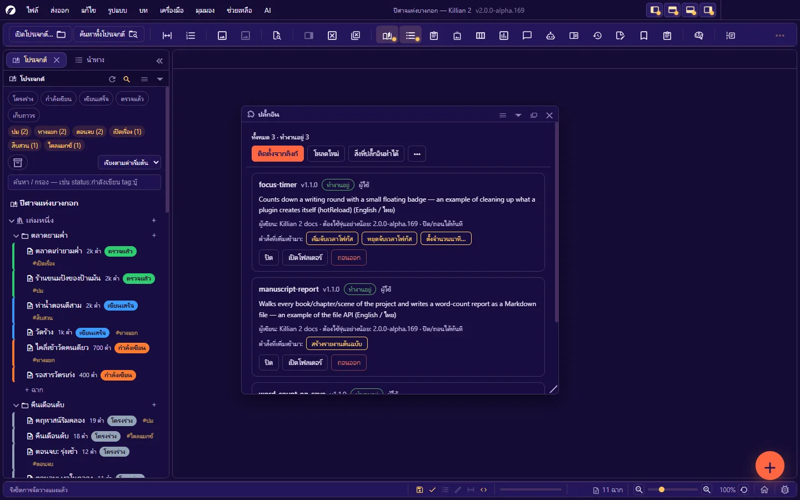

# 14. ปลั๊กอิน (สำหรับผู้ใช้)

**ภาษา:** ไทย · [English](../en/14-plugins.md)

[← 13. ภาษา ธีม ฟอนต์ และการช่วยการเข้าถึง](13-language-themes-a11y.md) · [สารบัญ](README.md) · ถัดไป: [15. อัปเดต รายงานบั๊ก และบันทึกการทำงาน →](15-update-bug-log.md)

---

ปลั๊กอินคือโค้ดเล็ก ๆ ที่คนอื่น (หรือคุณเอง) เขียนเพื่อเพิ่มความสามารถให้โปรแกรม — เพิ่มคำสั่ง แผง คีย์ลัด หรือทำงานอัตโนมัติเมื่อบันทึก/เปิดโปรเจกต์

บทนี้สำหรับ **ผู้ใช้** ปลั๊กอิน · ถ้าจะ **เขียน** ปลั๊กอิน ดู [คู่มือส่วนขยาย](../../extension/th/README.md)

## 14.1 อ่านก่อนติดตั้ง: ปลั๊กอินทำอะไรได้

> **ปลั๊กอินรันโค้ดได้เต็มที่ในโปรแกรม** — อ่าน เขียน และลบไฟล์ในผลงานของคุณได้ และติดต่ออินเทอร์เน็ตได้
> **ติดตั้งเฉพาะจากคนที่คุณเชื่อถือ** เหมือนการติดตั้งโปรแกรมหนึ่งตัว

- ยังไม่มีร้านปลั๊กอินและไม่มีการตรวจรับรองจากผู้พัฒนา Killian — คุณเป็นคนตัดสินว่าเชื่อใคร
- ซอร์สของปลั๊กอินเป็นไฟล์ข้อความธรรมดา เปิดอ่านได้ก่อนติดตั้ง
- ก่อนลองปลั๊กอินใหม่กับงานจริง: **สำรองโปรเจกต์** หรือทดลองกับโปรเจกต์ทดสอบก่อน

## 14.2 แผงปลั๊กอิน

เปิด: **มุมมอง → แผง → ปลั๊กอิน** (`Ctrl+Alt+E`) หรือปุ่มปลั๊กอินบนแถบเครื่องมือ

| ส่วน | ทำอะไร |
|---|---|
| บรรทัดสรุป | จำนวนทั้งหมด · ทำงานอยู่ · มีปัญหา |
| **ติดตั้งจากลิงก์** | วางลิงก์ GitHub ของปลั๊กอิน แล้วโปรแกรมโหลดมาติดตั้งให้ |
| **โหลดใหม่** | อ่านโฟลเดอร์ปลั๊กอินใหม่ — รันเฉพาะตัวที่ไฟล์เปลี่ยน |
| **สิ่งที่ปลั๊กอินทำได้** | รายการความสามารถทั้งหมดที่โปรแกรมเปิดให้ปลั๊กอิน |
| **⋯** | โฟลเดอร์ของผู้ใช้ · โฟลเดอร์ของผลงาน · สร้างตัวอย่าง |

**การ์ดของปลั๊กอิน** แสดง: ชื่อ · รุ่น · ป้ายสถานะ · ที่มา (ผู้ใช้/โปรเจกต์) · คำอธิบาย · ผู้เขียน · รุ่นโปรแกรมขั้นต่ำ · "ปิด/ถอนได้ทันที" หรือ "ปิด/ถอนแล้วต้องเริ่มโปรแกรมใหม่" · **คำสั่งที่เพิ่มเข้ามา** (กดรันได้จากการ์ด) · ปุ่ม **ปิด/เปิดใช้** · **เปิดโฟลเดอร์** · **ถอนออก**

| ป้ายสถานะ | ความหมาย | ทำอะไรต่อ |
|---|---|---|
| **ทำงานอยู่** | โหลดสำเร็จ | — |
| **ปิดอยู่** | คุณปิดไว้เอง | กด **เปิดใช้** |
| **รออนุญาต** | ปลั๊กอินมากับโปรเจกต์และยังไม่ได้รับอนุญาต — **ยังไม่ถูกรันเลย** | ดู [14.4](#144-ปลั๊กอินที่มากับโปรเจกต์--ต้องอนุญาตก่อน) |
| **มีปัญหา** | โหลดแล้วพัง — ถูกปิดอัตโนมัติเพื่อไม่ให้โปรแกรมเปิดไม่ขึ้น | อ่านข้อความผิดพลาดบนการ์ด · แจ้งผู้เขียน · แก้ไฟล์แล้วกด **เปิดใช้** |
| **รุ่นไม่พอ** | ต้องใช้โปรแกรมรุ่นใหม่กว่า | อัปเดต Killian |
| **มีชื่อซ้ำ** | มีปลั๊กอินชื่อเดียวกันสองที่ — ของผลงานถูกใช้ ของผู้ใช้ถูกบัง | ถอนตัวที่ไม่ต้องการ |

## 14.3 ติดตั้ง

### จากลิงก์ (ทางปกติ)

1. กด **ติดตั้งจากลิงก์**
2. วางลิงก์ — รับรูปแบบ:
   - `https://github.com/user/repo`
   - `https://github.com/user/repo/tree/branch` (ระบุ branch)
   - `https://github.com/user/repo/tree/branch/โฟลเดอร์ย่อย`
   - `user/repo` (ทางลัด)
   - `https://…/ไฟล์.zip` (ไฟล์ zip ตรง ๆ — ต้องเป็น http/https)
3. โปรแกรมโหลดมาตรวจ แล้วบอกว่า **จะติดตั้งลงโฟลเดอร์ชื่ออะไร เขียนกี่ไฟล์** พร้อมคำเตือนเรื่องสิทธิ์ → กดยืนยัน
4. ถ้ามีโฟลเดอร์ชื่อเดิมอยู่แล้ว โปรแกรมถามก่อนเขียนทับ
5. ปลั๊กอินเริ่มทำงานทันที — **ไม่ต้องเริ่มโปรแกรมใหม่**

ปลั๊กอินที่ติดตั้งทางนี้ลงที่ **โฟลเดอร์ของผู้ใช้** (ใช้ได้ทุกผลงาน) · ไฟล์ใหญ่สุด 25 MB

ถ้าติดตั้งไม่ได้:

| ข้อความ | สาเหตุ |
|---|---|
| อ่านลิงก์ไม่ออก | ใช้รูปแบบ `https://github.com/user/repo` |
| รองรับเฉพาะลิงก์ GitHub หรือไฟล์ .zip | ลิงก์เว็บอื่นที่ไม่ใช่ zip |
| โหลดไม่สำเร็จ (รหัส …) | เช็คลิงก์และชื่อ branch · รีโปเป็น private · ไม่มีเน็ต |
| ในซิปไม่มีไฟล์ plugin.json | ไม่ใช่ปลั๊กอินของ Killian |
| ไม่เจอโฟลเดอร์ย่อยที่ระบุในลิงก์ | ทางในลิงก์ผิด |
| ไฟล์ใหญ่เกินไป (เกิน 25MB) | — |

### ด้วยมือ

วางโฟลเดอร์ของปลั๊กอิน (ที่มี `plugin.json`) ไว้ในโฟลเดอร์ปลั๊กอิน แล้วกด **โหลดใหม่**

| ที่ | เปิดจาก | ใช้เมื่อ |
|---|---|---|
| **โฟลเดอร์ของผู้ใช้** — `<ข้อมูลผู้ใช้>/Plugins/` (Windows: `%APPDATA%\Killian 2\Plugins\`) | ⋯ → โฟลเดอร์ของผู้ใช้ | ใช้กับทุกผลงานบนเครื่องนี้ |
| **โฟลเดอร์ของผลงาน** — `<โปรเจกต์>/Plugins/` | ⋯ → โฟลเดอร์ของผลงาน | ให้ปลั๊กอินติดไปกับโปรเจกต์ (ก๊อป/ซิปโปรเจกต์แล้วปลั๊กอินไปด้วย) |

## 14.4 ปลั๊กอินที่มากับโปรเจกต์ — ต้องอนุญาตก่อน

เมื่อเปิดโปรเจกต์ที่มีโฟลเดอร์ `Plugins/` (เช่น โปรเจกต์ที่คนอื่นส่งมา) ปลั๊กอินในนั้น **จะไม่ถูกรัน** จนกว่าคุณจะอนุญาต — แถบสถานะแจ้งว่ามีปลั๊กอินกี่ตัวที่ยังไม่ได้อนุญาต และการ์ดขึ้นป้าย **รออนุญาต**

เพื่ออนุญาต: แผงปลั๊กอิน → **อนุญาตปลั๊กอินของโปรเจกต์นี้** → ยืนยัน

- อนุญาต "**ชุดไฟล์ชุดนี้**" ไม่ใช่ "โปรเจกต์นี้ตลอดไป" — ถ้ามีใครเพิ่มหรือแก้ปลั๊กอินในโฟลเดอร์ทีหลัง (ซิงก์ · แตกซิปทับ) โปรแกรมจะ **ขออนุญาตใหม่**
- การอนุญาตเก็บในเครื่องของคุณ ไม่ได้อยู่ในโปรเจกต์ — ผู้ส่งโปรเจกต์ตั้งให้ล่วงหน้าไม่ได้
- **ไม่แน่ใจ = อย่ากดอนุญาต** โปรเจกต์ยังเปิดและใช้งานได้ครบโดยไม่มีปลั๊กอิน

## 14.5 ใช้คำสั่งของปลั๊กอิน

| ทาง | ที่ไหน |
|---|---|
| ปุ่มบนการ์ด | แผงปลั๊กอิน → "คำสั่งที่เพิ่มเข้ามา" |
| ปุ่ม **คำสั่งจากปลั๊กอิน** | บนแถบเครื่องมือ (โผล่เมื่อมีปลั๊กอินเพิ่มคำสั่ง · แถบแคบ = อยู่ในปุ่ม ») |
| คีย์ลัดของปลั๊กอิน | ตามที่ผู้เขียนกำหนด — ถ้าชนกับคีย์ลัดของโปรแกรม คำสั่งของโปรแกรมชนะ |
| แผงของปลั๊กอิน | เปิดจากคำสั่งของปลั๊กอิน แล้วผนึก/ลอย/รวมแท็บได้เหมือนแผงในตัว |

ค่าตั้งของปลั๊กอินและการปิด/เปิดใช้ **จำต่อโปรเจกต์** (เก็บใน `project.khn.json`)

## 14.6 ปิด อัปเดต ถอน

| ทำอะไร | วิธี | หมายเหตุ |
|---|---|---|
| **ปิดชั่วคราว** | ปุ่ม **ปิด** บนการ์ด | จำต่อโปรเจกต์ |
| **อัปเดต** | **ติดตั้งจากลิงก์** เดิมอีกครั้ง → ยืนยันเขียนทับ | ยังไม่มีการอัปเดตอัตโนมัติ |
| **ถอน** | ปุ่ม **ถอนออก** → ยืนยัน | **ลบโฟลเดอร์ทิ้งถาวร** (ไม่ลงถังขยะ) · ค่าตั้งของปลั๊กอินในไฟล์โปรเจกต์ไม่ถูกลบ |

**"ต้องเริ่มโปรแกรมใหม่เพื่อถอดปลั๊กอินออกให้หมด"** — ปลั๊กอินบางตัวถอดตัวเองออกสะอาดไม่ได้ทันที เมื่อคุณปิด/ถอน/อัปเดตตัวแบบนั้น แผงจะขึ้นแถบแจ้งพร้อมปุ่ม **เริ่มโปรแกรมใหม่** (ถามเรื่องงานที่ยังไม่บันทึกก่อนเสมอ) · การ์ดบอกล่วงหน้าว่าตัวไหนเป็นแบบไหน · การติดตั้ง/เปิดใช้ครั้งแรกไม่ต้องเริ่มใหม่

## 14.7 ปลั๊กอินทำให้โปรแกรมมีปัญหา

1. แผงปลั๊กอิน → **ปิด** ตัวที่สงสัย (หรือปิดทั้งหมดทีละตัว) แล้วดูว่าปัญหาหายไหม
2. ปลั๊กอินที่พังตอนโหลดถูกปิดอัตโนมัติอยู่แล้ว — โปรแกรมเปิดขึ้นเสมอ
3. ดูข้อความผิดพลาด: แผง **บันทึก (Log)** — บรรทัดของปลั๊กอินขึ้นต้นด้วย `[plugin ชื่อ]`
4. ถอดออกด้วยมือได้เสมอ: ปิดโปรแกรม แล้วลบ/ย้ายโฟลเดอร์ของปลั๊กอินออกจาก `Plugins/`
5. แจ้งผู้เขียนปลั๊กอิน (ที่อยู่อยู่ในหน้ารีโปของปลั๊กอิน) — ปัญหาจากปลั๊กอินไม่ใช่บั๊กของ Killian

## 14.8 ลองเขียนเองใน 1 นาที

แผงปลั๊กอิน → **⋯ → สร้างตัวอย่าง** → ตั้งชื่อ → ได้ปลั๊กอินที่ทำงานทันที (คำสั่งนับคำ + แผงตัวอย่าง) ในโฟลเดอร์ของผู้ใช้ เปิดไฟล์ `main.js` ไปแก้ แล้วกด **โหลดใหม่**
ต่อจากนั้น: [คู่มือส่วนขยาย](../../extension/th/README.md)

**ส่วนขยายแบบไม่ต้องเขียนโค้ด**: ไฟล์ภาษา · พจนานุกรม · ทักษะของ AI · เทมเพลต Wiki · เวิร์กโฟลว์ส่งออก — ดู [จุดต่อขยายอื่น](../../extension/th/10-other-extension-points.md)

---

ถัดไป: [15. อัปเดต รายงานบั๊ก และบันทึกการทำงาน →](15-update-bug-log.md)
