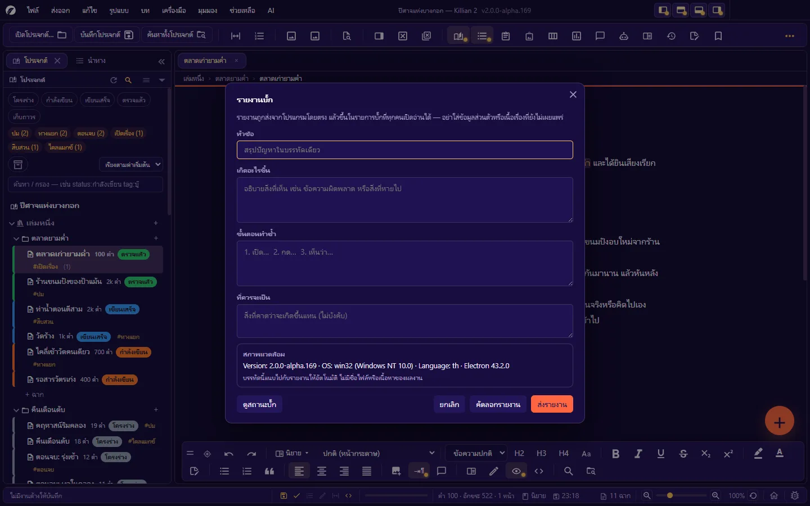
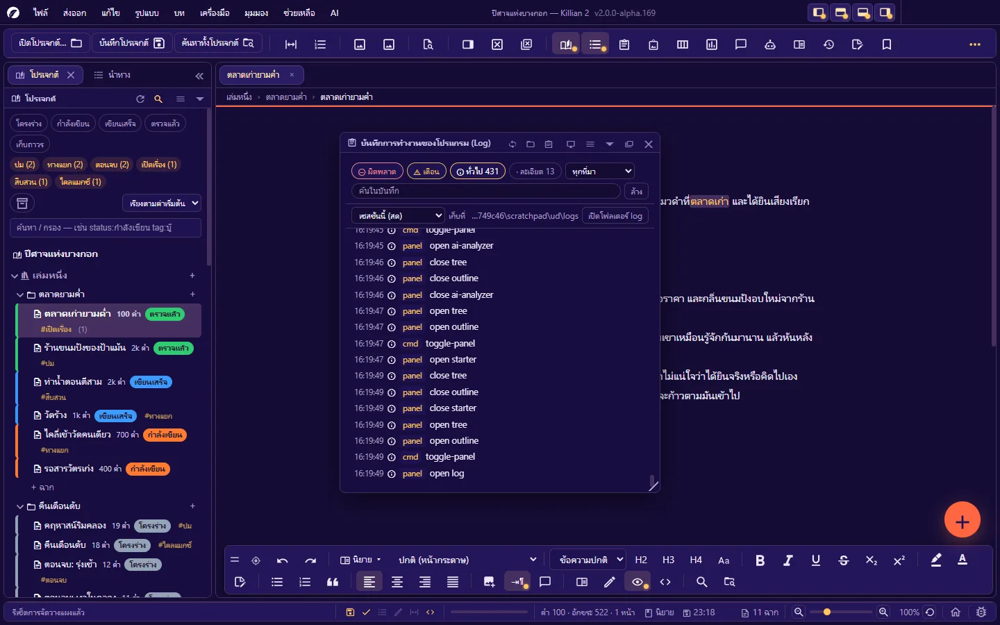

# 15. อัปเดต รายงานบั๊ก และบันทึกการทำงาน

**ภาษา:** ไทย · [English](../en/15-update-bug-log.md)

[← 14. ปลั๊กอิน (สำหรับผู้ใช้)](14-plugins.md) · [สารบัญ](README.md) · ถัดไป: [16. แก้ปัญหาและคำถามที่พบบ่อย →](16-troubleshooting.md)

---

## 15.1 รู้ว่าใช้รุ่นไหนอยู่

- **แถบชื่อของหน้าต่าง**: `ชื่อผลงาน — Killian 2 vX.Y.Z`
- **ช่วยเหลือ → เกี่ยวกับ Killian 2** (`Ctrl+Alt+Shift+/`) — เลขรุ่น · เครดิตและสัญญาอนุญาตของส่วนประกอบ · ปุ่ม **มีอะไรใหม่** · **ตรวจรุ่นใหม่** · **รายงานบั๊ก** · **สถานะบั๊ก** · **โฟลเดอร์โปรเจกต์**
- **ช่วยเหลือ → บันทึกการเปลี่ยนแปลง (Changelog)** — อ่านว่าแต่ละรุ่นเพิ่มหรือแก้อะไร ทีละรุ่น

## 15.2 อัปเดตโปรแกรม

โปรแกรมรับอัปเดตจาก **รีโปทางการที่เดียวเท่านั้น**: <https://github.com/Nbcybg/Killian-Editor-V2>

### ตรวจหาอัปเดต

| ทาง | ที่ไหน |
|---|---|
| อัตโนมัติตอนเปิดโปรแกรม | เปิดเป็นค่าเริ่มต้น — ปิดได้ที่ **ตั้งค่า → อัตโนมัติ → ตรวจหาอัปเดตตอนเปิดโปรแกรม** (ปิดแล้วโปรแกรมจะไม่ติดต่ออินเทอร์เน็ตตอนเปิด) |
| ตรวจเอง | **ช่วยเหลือ → ตรวจหาอัปเดต…** · ปุ่ม **ตรวจหาอัปเดตตอนนี้** ในตั้งค่า · ปุ่มในกล่องเกี่ยวกับ — บอกผลทุกกรณี แม้เป็นรุ่นล่าสุดอยู่แล้ว |

### เมื่อมีรุ่นใหม่

กล่อง **มีรุ่นใหม่ให้อัปเดต** แสดงรุ่นที่ใช้อยู่ · รุ่นล่าสุด · **สิ่งที่เปลี่ยนในรุ่นนี้** และปุ่ม:

| ปุ่ม | ทำอะไร |
|---|---|
| **ดาวน์โหลดรุ่นใหม่** | โหลดไฟล์ของระบบคุณ แล้วตรวจว่าไฟล์ตรงกับค่าตรวจสอบของรุ่นนั้น (ไฟล์เสียระหว่างทาง = ไม่แทนที่) |
| **แทนที่ด้วยรุ่นใหม่** | แทนที่ไฟล์โปรแกรม แล้วเสนอ **เปิดโปรแกรมใหม่ตอนนี้** (ถามเรื่องงานที่ยังไม่บันทึกก่อน) |
| **ไว้ทีหลัง** | ปิดกล่อง — เตือนอีกครั้งตอนเปิดโปรแกรมครั้งหน้า |
| **ข้ามรุ่นนี้** | ไม่เตือนรุ่นนี้อีก (ตรวจเองได้ที่เมนูช่วยเหลือ · **เลิกข้ามรุ่น** ได้ที่ตั้งค่า → อัตโนมัติ) |
| **เปิดหน้ารุ่นใหม่** | เปิดหน้า Releases ในเบราว์เซอร์ |

กรณีพิเศษ:

- **ตัวโปรแกรมที่รันอยู่ไม่ใช่ไฟล์พกพา** (เช่น รันจากซอร์ส) → แทนที่ตัวเองไม่ได้ โปรแกรมโหลดไฟล์ไว้ให้และมีปุ่ม **เปิดโฟลเดอร์ไฟล์ที่โหลด** ให้เปลี่ยนเอง
- **รุ่นใหม่ยังไม่มีไฟล์สำหรับระบบของคุณ** → เปิดหน้ารุ่นแล้วโหลดเอง
- โปรแกรมไม่ดาวน์โหลดจากลิงก์ที่ไม่ได้มาจากรีโปที่กำหนด

**ก่อนอัปเดต**: งานของคุณอยู่ในโฟลเดอร์โปรเจกต์ ไม่ถูกแตะ — แต่ในช่วง alpha ควร **ส่งออก ZIP** ของโปรเจกต์สำคัญไว้ก่อนเปลี่ยนรุ่น
**ย้อนรุ่น**: เก็บไฟล์ `.exe`/`.dmg` รุ่นเดิมไว้ — ไฟล์โปรเจกต์ใช้ข้ามรุ่นได้

## 15.3 รายงานบั๊ก

**ช่วยเหลือ → รายงานบั๊ก…** หรือปุ่มรูปแมลงท้ายแถบสถานะ

| ช่อง | กรอกอะไร |
|---|---|
| **หัวข้อ** (บังคับ) | สรุปปัญหาในบรรทัดเดียว |
| **เกิดอะไรขึ้น** | สิ่งที่เห็น เช่น ข้อความผิดพลาด หรือสิ่งที่หายไป |
| **ขั้นตอนทำซ้ำ** | 1. เปิด… 2. กด… 3. เห็นว่า… |
| **ที่ควรจะเป็น** | สิ่งที่คาดว่าจะเกิดแทน (ไม่บังคับ) |
| **สภาพแวดล้อม** | แนบให้อัตโนมัติ — รุ่นโปรแกรม · ระบบปฏิบัติการ · ภาษา · รุ่นของ Electron |

- กด **ส่งรายงาน** → รายงานถูกส่งจากโปรแกรมโดยตรง และโปรแกรมบอก **รหัสบั๊ก** ที่ได้
- **คัดลอกรายงาน** — สำหรับส่งทางช่องทางอื่นเมื่อส่งจากโปรแกรมไม่ได้
- ส่งไม่สำเร็จ: กล่องบอกเหตุ (ไม่มีเน็ต · ส่งถี่เกินไป · วันเวลาของเครื่องไม่ตรง ฯลฯ) และ **ข้อความที่พิมพ์ไว้ยังอยู่** ลองใหม่ได้

### ความเป็นส่วนตัวของรายงาน

> **รายงานที่ส่งจะขึ้นในรายการบั๊กสาธารณะที่ทุกคนเปิดอ่านได้** (GitHub Issues ของโครงการ)

- สิ่งที่แนบอัตโนมัติมีแค่บรรทัดสภาพแวดล้อมที่คุณเห็นในกล่อง — **ไม่มีชื่อไฟล์ ทางไฟล์ บันทึกการทำงาน ชื่อโปรเจกต์ หรือเนื้อหาของผลงาน**
- **อย่าวางเนื้อเรื่องที่ยังไม่เผยแพร่ คีย์ API หรือข้อมูลส่วนตัว** ลงในช่องรายงาน
- โปรแกรมส่งรายงานเฉพาะตอนคุณกดปุ่มส่ง — ไม่มีการส่งข้อมูลการใช้งานเบื้องหลัง

### เขียนรายงานที่ดี

1. หนึ่งรายงาน = หนึ่งปัญหา
2. ลองทำซ้ำก่อน — ถ้าทำซ้ำได้ เขียนขั้นตอนให้ครบตั้งแต่เปิดโปรแกรม
3. บอกว่าเกิดกับโหมดไหน (นิยาย/บท) · มุมมองไหน · แผงไหน
4. คัดลอกข้อความผิดพลาดจากแถบสถานะหรือแผง Log มาใส่ (ตรวจก่อนว่าไม่มีข้อมูลส่วนตัว)
5. ปัญหาเรื่องการจัดวางแผง: แนบไฟล์จาก **ส่งออก → ส่งออกการจัดวางแผง (JSON)…** ทางช่องทางที่ผู้ดูแลแจ้ง

## 15.4 ดูสถานะบั๊ก

**ช่วยเหลือ → สถานะบั๊ก…** — ตารางบั๊กที่ถูกรายงาน

| คอลัมน์ | |
|---|---|
| รหัสบั๊ก · รายละเอียด | คลิกแถว = เปิดบั๊กนั้นในเบราว์เซอร์ |
| สถานะ | รอตรวจสอบ · ยืนยันแล้ว · กำลังแก้ไข · ขอข้อมูลเพิ่ม · แก้ไขแล้ว · ซ้ำกับรายการอื่น · ไม่แก้ไข |
| พบในรุ่น · แก้ไขในรุ่น | |
| วันที่รายงาน | |

- **ตัวกรอง**: สถานะ (ทุกสถานะ / ยังไม่ปิด / ปิดแล้ว / รายสถานะ) · พบในรุ่น · แก้ไขในรุ่น · ช่องค้นหา (รหัส · รายละเอียด · รุ่น) · **ล้างตัวกรอง**
- คลิกหัวคอลัมน์เพื่อเรียง · **โหลดใหม่** · **เปิดบน GitHub**
- บั๊กที่คุณเพิ่งส่งจากเครื่องนี้ขึ้นในรายการทันที (แม้รายการจากเซิร์ฟเวอร์ยังไม่อัปเดต)
- ถ้าโหลดรอบล่าสุดไม่สำเร็จ โปรแกรมแสดงรายการที่เคยโหลดไว้พร้อมบอกเวลา

ดูสถานะได้ทุกคน · การ **รายงาน** ทำได้จากในโปรแกรม

## 15.5 บันทึกการทำงาน (Log)

**ช่วยเหลือ → สำหรับนักพัฒนา → บันทึกการทำงานของโปรแกรม (Log)…** (`Ctrl+Alt+9`)

จดเหตุการณ์ของโปรแกรม: คำสั่งที่เรียก · การบันทึก · การเปิด/ปิด · ข้อผิดพลาดพร้อมรหัส · บรรทัดของปลั๊กอิน (`[plugin ชื่อ]`)

| ทำอะไร | วิธี |
|---|---|
| กรองตามระดับ | ทั้งหมด / เตือน / ผิดพลาด |
| คัดลอกบรรทัดที่กรองอยู่ | ปุ่มคัดลอกบนหัวแผง |
| อ่านใหม่ | ปุ่มรีเฟรช |
| ดูย้อนหลัง | เลือกไฟล์ของวันที่ต้องการ (อ่านอย่างเดียว) |
| เปิดโฟลเดอร์ไฟล์บันทึก | ปุ่มโฟลเดอร์ — `<ข้อมูลผู้ใช้>/logs/` หนึ่งไฟล์ต่อวัน |

- คีย์ API และโทเคนถูก **ปิดบัง** ในบันทึกเสมอ · ลิงก์เว็บไม่ถูกจดเต็ม
- บันทึกอยู่ในเครื่องของคุณ ไม่ถูกส่งไปไหน — แต่ **อ่านก่อนแชร์** เพราะอาจมีทางไฟล์และชื่อไฟล์ของคุณ

## 15.6 เครื่องมือนักพัฒนา

เมนู **ช่วยเหลือ → สำหรับนักพัฒนา**:

- **คอนโซลนักพัฒนา…** (`Ctrl+Shift+\``) — กล่องรันคำสั่งสำหรับตรวจสภาพภายในของโปรแกรมเวลาไล่ปัญหา (ผู้ดูแลอาจขอให้รันคำสั่งสั้น ๆ แล้วส่งผลกลับ) · `Ctrl+Enter` รัน · `Ctrl+↑` เรียกคำสั่งก่อนหน้า
- **เปิด DevTools ของ Chromium** — มีเฉพาะตัวที่รันจากซอร์สหรือโหมดนักพัฒนา

> อย่ารันคำสั่งในคอนโซลที่คุณไม่เข้าใจหรือได้มาจากคนที่ไม่รู้จัก — คอนโซลเข้าถึงไฟล์ของคุณได้

---

ถัดไป: [16. แก้ปัญหาและคำถามที่พบบ่อย →](16-troubleshooting.md)
