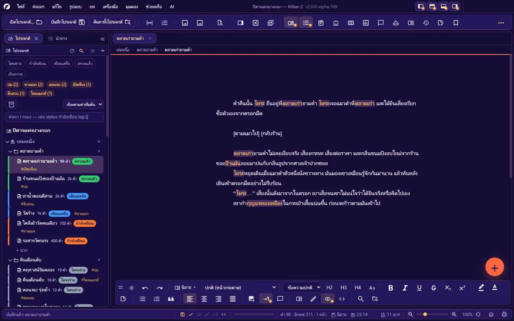

# คู่มือผู้ใช้ Killian 2

**ภาษา:** ไทย · [English](../en/README.md)

> ใช้กับ Killian 2 รุ่น **2.0.0-alpha.170** · หน้าจอในคู่มือถ่ายจากธีม **K2** ภาษาไทย บน Windows
> โปรแกรมยังอยู่ในช่วง alpha — เมนู ชื่อปุ่ม และพฤติกรรมเปลี่ยนได้ทุกรุ่น ถ้าสิ่งที่เห็นบนจอไม่ตรงกับคู่มือ ให้ถือสิ่งที่เห็นบนจอเป็นหลัก แล้วดู **ช่วยเหลือ → บันทึกการเปลี่ยนแปลง (Changelog)**

Killian 2 (คิเลียน · K2) คือโปรแกรมเขียน **เรื่องของเกม นิยาย และบทภาพยนตร์** แบบพกพา ทำงานบนเครื่องของคุณเองโดยไม่ต้องมีบัญชีหรือเซิร์ฟเวอร์ ทุกอย่างเก็บเป็นไฟล์ **Markdown + JSON** ในโฟลเดอร์ธรรมดาที่คุณเป็นเจ้าของ

## วิธีอ่านคู่มือนี้

| ถ้าคุณ… | เริ่มที่ |
|---|---|
| เพิ่งเปิดโปรแกรมครั้งแรก | [1. เริ่มต้นใช้งาน](01-getting-started.md) แล้วต่อด้วย [2. รู้จักหน้าจอ](02-interface.md) |
| อยากเขียนเลย | [4. เขียนนิยาย](04-writing-novel.md) หรือ [5. เขียนบทภาพยนตร์](05-writing-screenplay.md) |
| ย้ายมาจาก Scrivener / Final Draft / Celtx | [9. ส่งออก นำเข้า และพิมพ์](09-export-import-print.md#นำเข้า) |
| กลัวงานหาย | [10. บันทึก ประวัติ สำรอง และกู้คืน](10-history-backup.md) |
| หาปุ่มหรือคีย์ลัดไม่เจอ | [ภาคผนวก A — ผังเมนู](A-menus.md) · [B — คีย์ลัด](B-shortcuts.md) · [C — คำสั่งทั้งหมด](C-commands.md) |
| อยากเขียนปลั๊กอิน | [คู่มือส่วนขยาย](../../extension/th/README.md) |

สัญลักษณ์ที่ใช้: **ตัวหนา** = ชื่อเมนู/ปุ่มบนจอ · `Ctrl+S` = คีย์ลัด (บน macOS: `Ctrl` → `⌘`, `Alt` → `⌥`) · **A → B** = เปิดเมนู A แล้วเลือก B

## สารบัญ

### ส่วนที่ 1 — พื้นฐาน
1. [เริ่มต้นใช้งาน](01-getting-started.md) — ความต้องการของระบบ · ติดตั้ง · หน้าแรก · สร้าง/เปิดโปรเจกต์ · สิบนาทีแรก
2. [รู้จักหน้าจอ](02-interface.md) — แถบเมนู · แถบเครื่องมือ · แท็บ · แถบรูปแบบลอย · ปุ่มลอย · แถบสถานะ · ระบบแผง · เวิร์กสเปซ · แยกหน้าจอ
3. [โปรเจกต์ เล่ม บท ฉาก](03-project-structure.md) — แผงโปรเจกต์ (Explorer) · เมนูคลิกขวา · คุณสมบัติฉาก · สถานะ · ฉบับร่าง · Memo · จัดการเล่ม/บท · ตรวจสุขภาพโปรเจกต์

### ส่วนที่ 2 — เขียน
4. [เขียนนิยาย](04-writing-novel.md) — รูปแบบข้อความ · รูป · หน้ากระดาษและมุมมอง · โหมดโฟกัส/อ่าน/เครื่องพิมพ์ดีด · ตรวจคำผิด · SmartType · คำพ้อง · โน้ต · คอมเมนต์ · โค้ดสั้น
5. [เขียนบทภาพยนตร์](05-writing-screenplay.md) — element และปุ่มสลับ · CONTINUED/MORE · เลขฉาก/เลขหน้า · หน้าปก · หัวกระดาษ · ตัวตรวจบท · รายงาน · เปรียบเทียบบท · ฉากมีปัญหา
6. [Wiki โลกของเรื่อง และคลังรูป](06-wiki-world.md) — หมวดและเอนทิตี้ · ความสัมพันธ์ · ลิงก์อัตโนมัติ · สารานุกรม · Story Network · คลังรูป · กระดานอารมณ์

### ส่วนที่ 3 — วางแผนและตรวจงาน
7. [เครื่องมือวางแผน](07-planning.md) — แดชบอร์ด · Kanban · เส้นเวลา · กระดานวางแผน · ผังแตกสายและทดลองเล่น · แผนที่ · ผังพื้นที่ · เล่าด้วยภาพ · สปรินต์ · บันทึกประจำวัน
8. [ผู้ช่วย AI](08-ai.md) — ตั้งค่าผู้ให้บริการ · AI Hub · แชท · ผู้ช่วยเขียน · Rewrite this · Agent/ทักษะ · วิเคราะห์ · ตรวจบท · สร้างโลก · ห้องซ้อมบท · Story Starter

### ส่วนที่ 4 — ส่งงานและดูแลงาน
9. [ส่งออก นำเข้า และพิมพ์](09-export-import-print.md) — ศูนย์รวมการส่งออก · PDF · ชื่อไฟล์ส่งออก · เวิร์กโฟลว์ · ส่งออกจากแผง · นำเข้า · พิมพ์
10. [บันทึก ประวัติ สำรอง และกู้คืน](10-history-backup.md) — บันทึกอัตโนมัติ · งานค้าง · ประวัติเวอร์ชัน · ประวัติการทำงาน · ถังขยะ · สำรอง · ไฟล์ถูกแก้นอกโปรแกรม
11. [ค้นหา แทนที่ และนำทาง](11-search-navigate.md) — ค้นในเอกสาร · ค้นทั้งโปรเจกต์ · แทนที่ทั้งโปรเจกต์ · ตัวกรอง Explorer · แผงนำทาง · เปิดไฟล์ด่วน

### ส่วนที่ 5 — ปรับแต่งและระบบ
12. [ตั้งค่า](12-settings.md) — ทุกหน้าของกล่องตั้งค่า ทีละช่อง
13. [ภาษา ธีม ฟอนต์ และการช่วยการเข้าถึง](13-language-themes-a11y.md)
14. [ปลั๊กอิน (สำหรับผู้ใช้)](14-plugins.md) — ติดตั้ง · อนุญาต · ปิด · ถอน · ความปลอดภัย
15. [อัปเดต รายงานบั๊ก และบันทึกการทำงาน](15-update-bug-log.md)
16. [แก้ปัญหาและคำถามที่พบบ่อย](16-troubleshooting.md)

### ภาคผนวก
- [A — ผังเมนูทั้งหมด](A-menus.md)
- [B — คีย์ลัดทั้งหมด](B-shortcuts.md)
- [C — คำสั่งทั้งหมด](C-commands.md)
- [D — โครงโฟลเดอร์และรูปแบบไฟล์](D-file-formats.md)
- [E — อภิธานศัพท์](E-glossary.md)

## หลักสำคัญ 5 ข้อที่ควรรู้ก่อนเริ่ม

1. **โปรเจกต์คือโฟลเดอร์** — ไม่มีฐานข้อมูล ไม่มีไฟล์ห่อพิเศษ สำรองด้วยการก๊อปโฟลเดอร์ทั้งใบได้เลย เปิดไฟล์ `.md` ด้วยโปรแกรมอื่นก็อ่านออก
2. **ลบ = ย้ายลงถังขยะของโปรเจกต์** — ฉาก บท เล่ม หน้า Wiki ที่ลบไปกู้คืนได้ จนกว่าจะล้างถัง
3. **งานถูกบันทึกอัตโนมัติและมีประวัติเวอร์ชัน** — แต่โปรแกรมยังเป็น alpha: เก็บสำเนาของงานที่เสียไม่ได้ไว้อีกที่เสมอ
4. **AI เป็นของเสริม ใช้คีย์ของคุณเอง** — ไม่มีบริการ AI ในตัว ไม่ตั้งค่าก็เขียนได้ครบ และข้อความจะออกจากเครื่องก็ต่อเมื่อคุณสั่งเท่านั้น
5. **คีย์ลัดจับปุ่มกายภาพ** — ใช้ได้เหมือนเดิมตอนแป้นพิมพ์อยู่ภาษาไทย และตั้งเองได้ทุกปุ่ม

## เกี่ยวกับเอกสารชุดนี้

- ภาคผนวก A–C สร้างจากทะเบียนของโปรแกรมโดยตรง (เมนูตัวจริง · กล่องปุ่มลัด · `icons/commands.csv` + ไฟล์ภาษา) จึงตรงกับรุ่นที่ระบุ
- เนื้อหาบทที่ 1–16 เขียนจากพฤติกรรมของรุ่น alpha.170 — ฟีเจอร์ที่เป็นของใหม่มากหรือยังทดสอบไม่ครบทุกระบบ คู่มือจะบอกไว้ตรงจุดนั้น
- พบจุดที่คู่มือผิดหรือตกหล่น: รายงานได้จากในโปรแกรม (**ช่วยเหลือ → รายงานบั๊ก…**)
